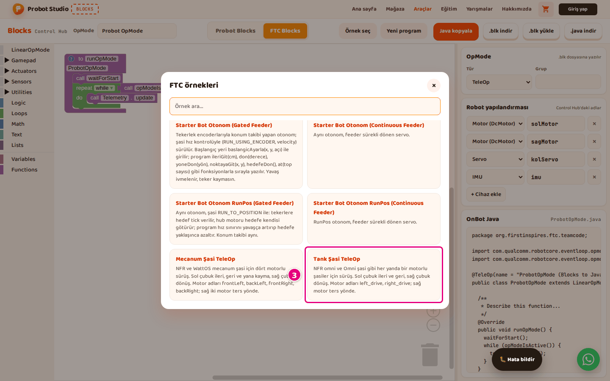

# Start with an FTC example

On this page you open one of the eight ready-made programs in FTC Blocks. Each example comes with
its own device list. The workspace and the **Robot configuration** fill in to match the example.

## Before you start

- Blocks is open. See [First 10 minutes](ilk-10-dakika.md), section "Open Blocks".

## Open an example

!!! warning "Warning"
    An example replaces the program in the FTC workspace without asking. The **Robot configuration**
    also changes to the example's devices (for example `left_drive`, `right_drive` in
    **Tank Chassis TeleOp**). To keep your program, press **Download .blk** first.

1. In the toolbar, press the **FTC Blocks** tab.
2. In the toolbar, press **Pick an example**.
3. In the "FTC examples" window, select an example card, for example **Tank Chassis TeleOp**.
   A "Tank Chassis TeleOp example loaded." notification appears in the corner.
   
   <!-- CAPTURE: url=https://probotstudio.com/blocks/?dil=en | hazirla=FTC Blocks tab, Pick an example open | hedef=role=dialog >> text="Tank Chassis TeleOp" | isaret=3 | bekle=text="FTC examples" -->
   <!-- SAY: We pick a ready-made drive program from the FTC examples. -->

Result: The program appears in the workspace. The **OpMode** box shows the example's name (for
example "Tank Sasi TeleOp"). The **Robot configuration** shows only the devices the example uses.

Type a word in the **Search examples...** box in the window. The list then shows only the examples
that have that word in their name or description. To close the window, press **×** or <kbd>Esc</kbd>.

## Match the device names to your robot

The device names in the example must be the same as the ones in your Control Hub configuration.

1. In the side panel, read the names in **Robot configuration** (for example `left_drive`, `right_drive`).
2. Check that the robot configuration on the Control Hub has the same names.
3. If a name is different, change it in Blocks. See [Set up the robot configuration](ftc-yapilandirmayi-ayarla.md).

Result: The program finds the devices on the Control Hub by their names.

<!-- SAY: We make the motor names in the example match the names on our own robot. -->

## What each example does

| Example | What it does |
|---|---|
| **Starter Bot (Gated Feeder)** | The Starter Bot TeleOp. The feeder opens like a gate with a position servo. POV drive. Hold **LT** for intake and **RT** for the shooter. **Y** pushes the feeder. Hold **B** to clear a jam. **D-Pad** right and left pick a setting, up and down raise or lower its value. |
| **Starter Bot (Continuous Feeder)** | The same program; the feeder is a continuous rotation servo. |
| **Starter Bot Autonomous (Gated Feeder)** | An autonomous that tracks its position with the wheel encoders. It is written with functions such as `ileriGit`, `don`, `noktayaGit` and `at`. |
| **Starter Bot Autonomous (Continuous Feeder)** | The same autonomous; the feeder is a continuous rotation servo. |
| **Starter Bot Autonomous RunPos (Gated Feeder)** | The same autonomous; the chassis is driven with `RUN_TO_POSITION`. |
| **Starter Bot Autonomous RunPos (Continuous Feeder)** | The RunPos autonomous; the feeder is a continuous rotation servo. |
| **Mecanum Chassis TeleOp** | Drive for a four-motor chassis. **Left stick** for forward, back and strafing; **right stick** for turning. Motor names are `frontLeft`, `backLeft`, `frontRight`, `backRight`. |
| **Tank Chassis TeleOp** | Drive for a chassis with one motor on each side. **Left stick** for forward and back, **right stick** for turning. Motor names are `left_drive`, `right_drive`. |

The window shows the full description on each example card.

<!-- SAY: For the Starter Bot we have both TeleOp and autonomous examples. -->

## Having trouble?

- **"Could not load the example because the connection dropped. Pick it again." appears:** Check your internet connection and select the example again.
- **"No matching examples." appears:** No example has the word from the **Search examples...** box in its name or description. Clear the box.
- **Picking an example deleted my program:** An example replaces the open program without asking. Next time, press **Download .blk** before you select an example. See [Save the program, open it and get the Java code](ftc-programi-kaydet.md).

## Next step

[Set up the robot configuration](ftc-yapilandirmayi-ayarla.md)
