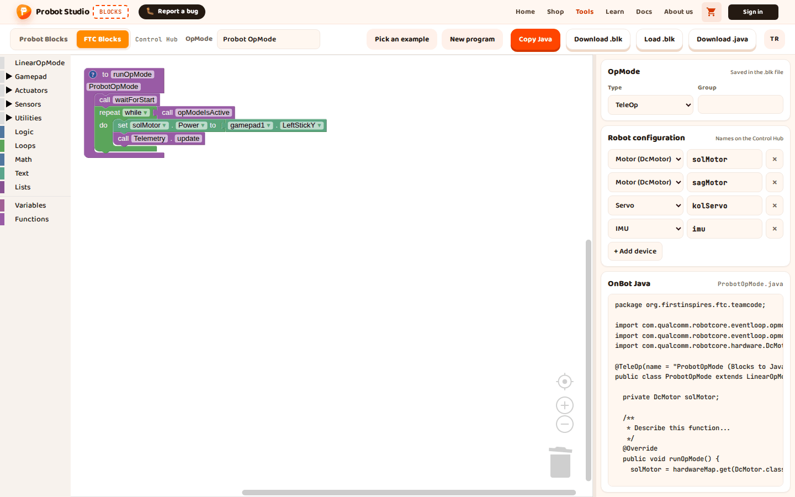
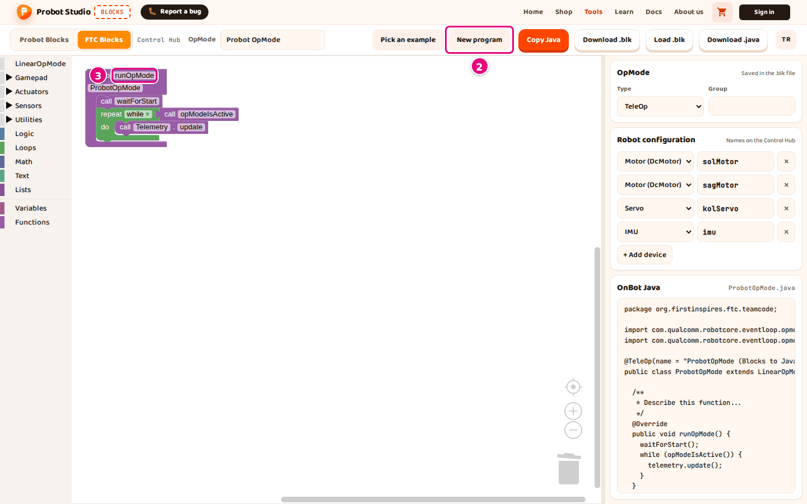
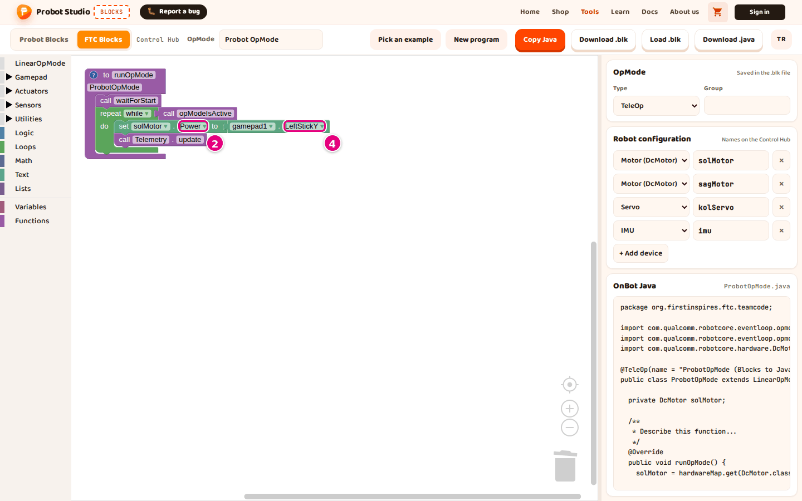

# Write a new FTC program

On this page you start an empty FTC program, set the OpMode name and type, and arrange your first
blocks to drive a motor with the gamepad. The blocks of the FTC editor are in English.

<!-- CAPTURE: url=https://probotstudio.com/blocks/?dil=en | hazirla=FTC Blocks, New program, set solMotor.Power to gamepad1.LeftStickY added | hedef=body | isaret=yok | bekle=text="LeftStickY" -->
<!-- SAY: By the end of this page the left motor turns with the left stick of the gamepad. -->

## Before you start

- Blocks is open and the **FTC Blocks** tab is selected.
- The **Robot configuration** matches the Control Hub configuration. See [Set up the robot configuration](ftc-yapilandirmayi-ayarla.md).
- The configuration has a **Motor (DcMotor)** named `solMotor`. The default configuration has this motor.

To see a ready-made drive program, open **Pick an example** > **Tank Chassis TeleOp**.

If you opened an example, only the example's devices stay in the configuration (`left_drive` and `right_drive` in Tank Chassis TeleOp).
**New program** does not bring the default configuration's devices back. In that case, press **+ Add device** in the **Robot configuration** section
of the side panel and rename the new `motor1` to `solMotor`. Or use your own motor's name instead of solMotor in the steps.

## Start a new program

!!! warning "Warning"
    **New program** deletes the program in the workspace. If you want to keep the program, download it in step 1.

1. In the toolbar, press **Download .blk**. A "<ClassName>.blk downloaded." notification appears.
2. In the toolbar, press **New program**.
3. When it asks "Reset the FTC program to its starting state?", press **OK**.
   
   <!-- CAPTURE: url=https://probotstudio.com/blocks/?dil=en | hazirla=FTC Blocks, New program confirmed | hedef=role=button[name="New program"]; iframe.ftc-cerceve >> text="runOpMode" | isaret=2,3 | bekle=text="waitForStart" -->
   <!-- SAY: With New program we reset the FTC workspace to its starting state. -->

Result: Only the **to runOpMode** block stays in the workspace, in its starting state. In the **OpMode** section of the side panel,
**Type** goes back to **TeleOp** and **Group** is cleared. The **Robot configuration** and the **OpMode** name in the toolbar do not change.

## Get to know how the program is built

The **to runOpMode** block is the program itself and cannot be deleted. It comes with three parts inside:

| Block | When it runs | What goes here |
|---|---|---|
| Before **call waitForStart** | When you press **INIT** on the Driver Station | Setup: motor direction, starting values |
| **call waitForStart** | Waits until **START** is pressed | |
| Inside **repeat while call opModeIsActive** | From **START** to **STOP**, over and over | Reading the gamepad, driving motors, telemetry |

The **call Telemetry.update** block at the end of the loop sends the telemetry text to the Driver Station.

<!-- SAY: In an FTC program the setup part runs before START and the driving part runs inside the loop. -->

## Set the OpMode name and type

1. In the toolbar, type the program's name into the **OpMode** box, for example `First Drive`. The box takes at most 60 characters.
2. In the **OpMode** section of the side panel, select **TeleOp** or **Autonomous** from the **Type** list.
3. If you like, type a group name of at most 40 characters into the **Group** box. You can leave it empty.

Result: The file name in the title of the **OnBot Java** section becomes `FirstDrive.java`. The Java code gets the line
`@TeleOp(name = "FirstDrive (Blocks to Java)")`. If you typed a group, the group name is added inside the parentheses, for example `@TeleOp(name = "FirstDrive (Blocks to Java)", group = "Drive")`.
If you select **Autonomous**, the line starts with `@Autonomous`.

The Java class name comes from the OpMode name. Turkish letters become plain letters. The words are joined together,
and each word starts with a capital letter. If the name starts with a digit, `Op` is added in front. If the name is empty, the class name is `ProbotOpMode`.

<!-- SAY: We give the OpMode a name and choose whether it is TeleOp or autonomous. -->

## Drive a motor with the gamepad

!!! tip "Tip"
    If there is no **solMotor** under **DcMotor**, the configuration has no motor with this name. Add it with **+ Add device**, or
    select your own motor's name in the steps.

1. In the block list, select the **Actuators** > **DcMotor** > **solMotor** category.
2. Drag the **set solMotor.Power to 1** block into the **do** slot of the **repeat while** loop, above **call Telemetry.update**.
3. In the block list, select the **Gamepad** category.
4. Drag the **gamepad1.LeftStickY** block onto the `1` slot of the **set solMotor.Power to** block.
   
   <!-- CAPTURE: url=https://probotstudio.com/blocks/?dil=en | hazirla=FTC Blocks, New program, set solMotor.Power to gamepad1.LeftStickY added | hedef=iframe.ftc-cerceve >> text="Power"; text="LeftStickY" | isaret=2,4 | bekle=text="LeftStickY" -->
   <!-- SAY: We put the motor power block inside the loop and take its value from the gamepad stick. -->

Result: The **OnBot Java** section gets the line `solMotor.setPower(gamepad1.left_stick_y);`. On the robot, after **START**,
solMotor turns when you push the **left stick** and stops when you let go of the stick.

In FTC, `LeftStickY` gives a negative value when you push the stick forward. If the motor turns the wrong way, put the
minus sign block from the **Math** category in between, or change the motor's **Direction** value.

## Write to telemetry

1. In the block list, select the **Utilities** > **Telemetry** category.
2. Drag the **call Telemetry.addData** block with the **key** and **number** slots into the loop, above **call Telemetry.update**.
3. Press the `key` text in the **key** slot and type `power`.
4. In the block list, select the **Actuators** > **DcMotor** > **solMotor** category.
5. Drag the **solMotor.Power** block onto the `123` in the **number** slot.

Result: The **OnBot Java** section gets the line `telemetry.addData("power", solMotor.getPower());`. On the Driver Station
screen, a `power` line appears after **START**. As you push the **left stick**, its value changes between -1 and 1.

<!-- SAY: With the telemetry blocks we show values on the Driver Station screen. -->

## Edit the blocks

The FTC workspace works much like the Probot one. The trash can is the same too: press it to list the deleted blocks,
and drag them back from there. The differences:

- The mouse wheel does not scroll; it zooms in and out. To scroll, drag an empty area.
- The only redo shortcut is <kbd>Ctrl</kbd>+<kbd>Shift</kbd>+<kbd>Z</kbd>. <kbd>Ctrl</kbd>+<kbd>Y</kbd> does not work.
- Right-click a block to get **Duplicate**, **Add Comment**, **Collapse Block**, **Disable Block**, **Delete Block** and **Help**.
  On blocks with several inputs (for example **call Telemetry.addData**), **Inline Inputs** or **External Inputs** also appears after **Add Comment**.
- If blocks are plugged into a block's slots, an item with a count appears instead of **Delete Block**. The count includes the number and text
  boxes in the slots: for `set solMotor.Power to 1` it says **Delete 2 Blocks**. Blocks attached below it are not deleted; the stack closes up without breaking.
- Right-click an empty area to get **Undo**, **Redo**, **Clean up Blocks**, **Collapse Blocks**, **Expand Blocks** and
  a delete item (for example **Delete 5 Blocks**).

All menu items: [Interface tour](arayuz.md). Shortcuts: [Shortcuts](kisayollar.md).

<!-- SAY: In the FTC editor the mouse wheel zooms instead of scrolling. -->

## Create a variable

1. In the block list, select the **Variables** category.
2. Press **Create variable...**.
3. Type the variable's name into the "New variable name:" box, for example `speed`.
4. Press **OK**.

Result: The **set speed to** and **speed** blocks appear in the **Variables** category.

To rename or delete the variable, open the name dropdown on a **speed** block. **Rename variable...** changes the name
in all blocks. **Delete the "speed" variable** deletes the variable together with the blocks that use it. If more than one
block uses it, you first see a question such as "Delete 2 uses of the "speed" variable?".

<!-- SAY: With a variable we store a value under a name. -->

## Create a function

1. In the block list, select the **Functions** category.
2. Drag the **to do something** block to an empty spot in the workspace.
3. Press the **do something** name on the block and type `driveForward`.
4. In the block list, select the **Functions** category again.
5. Drag the **driveForward** block into the loop, above **call Telemetry.update**.

Result: The **OnBot Java** section gets the line `driveForward();` inside the loop.

The call block does not say **call**; it shows only the function's name. This block appears in the block panel after the function block
is placed in the workspace. You can also get the same block by right-clicking the function block and selecting **Create "driveForward"**.

<!-- SAY: We can split long programs into functions. -->

## Having trouble?

- **The solMotor category does not appear:** The configuration has no motor with this name. If there are no motors at all, the **DcMotor**
  category does not appear either. Add the motor as shown in [Before you start](#before-you-start).
- **"There is no ... named ... in the current robot configuration" warning on a block:** The block uses a device name that is not
  in the configuration. See [Troubleshooting](sorunlar.md).
- **"A name must start with a letter and can only use letters, numbers and _." appears:** A device name must start with a letter. It cannot
  have spaces, Turkish letters or hyphens. See [Troubleshooting](sorunlar.md).

## Next step

[Save the program, open it and get the Java code](ftc-programi-kaydet.md)
