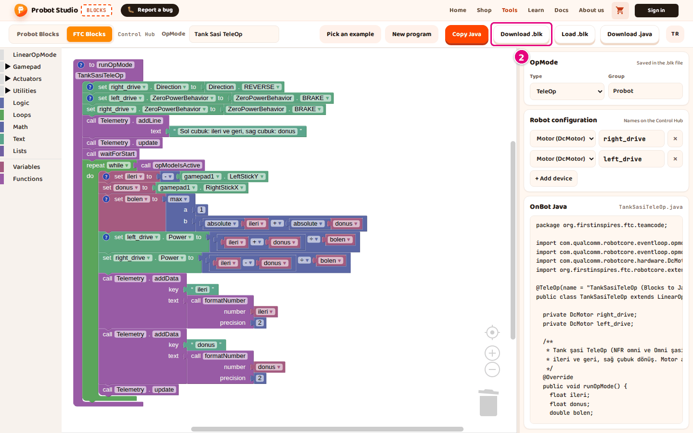

# Save the program, open it and get the Java code

On this page you will save an FTC program as a `.blk` file, open a saved `.blk` file and get the
OnBot Java version of the program.

## Before you start

- Blocks is open and the **FTC Blocks** tab is selected.
- To try it out, press **Pick an example** and select **Tank Chassis TeleOp**.

## Save the program as a .blk file

1. In the toolbar, type the program's name into the **OpMode** box, for example `Tank Sasi TeleOp`. It can have at most 60 characters.
2. In the toolbar, press **Download .blk**. A "TankSasiTeleOp.blk downloaded." notification appears.
   
   <!-- CAPTURE: url=https://probotstudio.com/blocks/?dil=en | hazirla=FTC Blocks, ornek:Tank Chassis TeleOp | hedef=role=button[name="Download .blk"] | isaret=2 | bekle=text="Copy Java" -->
   <!-- SAY: We download the FTC program as a .blk file that the Control Hub also understands. -->
3. Move the `TankSasiTeleOp.blk` file from your Downloads folder to a safe place.

Result: You have the `TankSasiTeleOp.blk` file. The file holds the blocks and the **Type** and **Group**
settings from the side panel.

The file name comes from the name in the **OpMode** box. Turkish letters become plain letters (`ş` becomes `s`),
spaces and symbols are removed, and each word starts with a capital letter. If the box is empty, the name is
`ProbotOpMode`; if the name starts with a digit, `Op` is added in front.

You upload this file to the Control Hub. See [Upload the program to the Control Hub](ftc-control-hub-yukle.md).

## Open a saved .blk file {#blk-ac}

!!! warning "Warning"
    Opening a file replaces the program in the workspace, and Blocks does not ask first. A file that
    fails to open can also delete the program on the screen.

1. In the toolbar, press **Load .blk**.
2. In the window that opens, select the `.blk` file.
3. Press **Open**.

Result: A "<file> loaded." notification appears. The **OpMode** name comes from the file name. Devices
that the program uses but that are not in the **Robot configuration** yet are added to it.

You can also open `.blk` files downloaded from the Blocks editor on the Control Hub. This works only if
they use blocks that Blocks has (motor, servo, continuous rotation servo, IMU, gamepad, telemetry and so on).

Some files do not open: files with color, distance or touch sensor blocks, digital/analog input blocks,
or AprilTag/vision blocks. "This file is not an FTC Blocks (.blk) file." appears, and the program on the
screen is deleted or only partly loaded. So save your work with **Download .blk** before you open a file.

<!-- SAY: We open a .blk file that we saved earlier or got from the Control Hub. -->

## Copy the Java code

!!! tip "Tip"
    If the browser does not allow access to the clipboard, "Copy failed." appears. Then use
    **Download .java**.

1. In the side panel, write down the file name next to the **OnBot Java** heading, for example `TankSasiTeleOp.java`.
2. In the toolbar, press **Copy Java**. An "OnBot Java copied to the clipboard." notification appears.
3. In the OnBot Java file on the Control Hub, paste the code with <kbd>Ctrl</kbd>+<kbd>V</kbd>.

Result: All of the Java code is now in the OnBot Java file. On a Mac, use <kbd>Cmd</kbd>+<kbd>V</kbd>.
To open the file and build it, see [Upload the program to the Control Hub](ftc-control-hub-yukle.md).

<!-- SAY: We copy the Java version of the same program with one button. -->

## Download the Java code as a file

1. In the toolbar, type the program's name into the **OpMode** box, for example `Tank Sasi TeleOp`.
2. In the toolbar, press **Download .java**. A "TankSasiTeleOp.java downloaded." notification appears.
3. Move the `TankSasiTeleOp.java` file from your Downloads folder to a safe place.

Result: The file name and the class name inside the file are the same (`TankSasiTeleOp`). OnBot Java
needs them to match.

<!-- SAY: We can also download the Java code as a file. -->

## Autosave

The FTC program, the **Robot configuration**, the OpMode name and the side panel width are saved in the
browser by themselves. If you switch to the **Probot Blocks** tab and come back, the program is still
there. Another browser or computer does not see this save, so use **Download .blk** to move the program.

<!-- SAY: The browser keeps the FTC program, but we download it to a file to move it to another computer. -->

## Having trouble?

- **"This file is not an FTC Blocks (.blk) file." appears:** The file you picked is not a `.blk` file,
  or it has blocks that Blocks does not have. See [Open a saved .blk file](#blk-ac).
- **"Copy failed." appears:** The browser did not allow writing to the clipboard. Press **Download .java**
  to get the file.
- Other problems: [Troubleshooting](sorunlar.md).

## Next step

[Upload the program to the Control Hub](ftc-control-hub-yukle.md)
