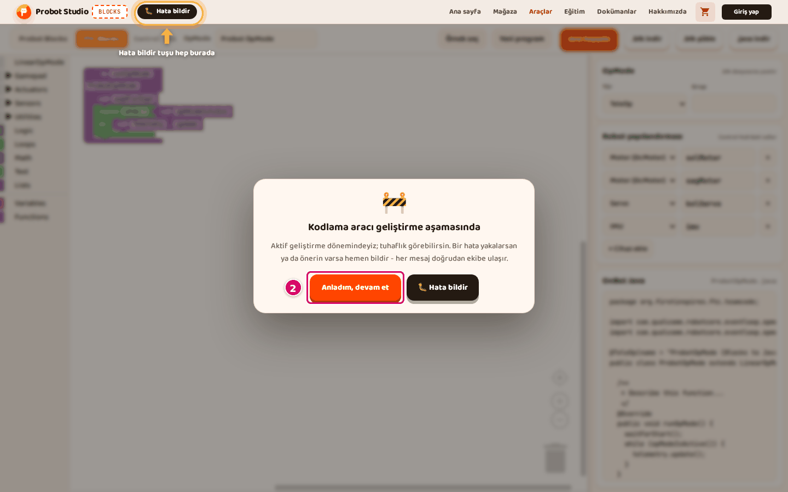
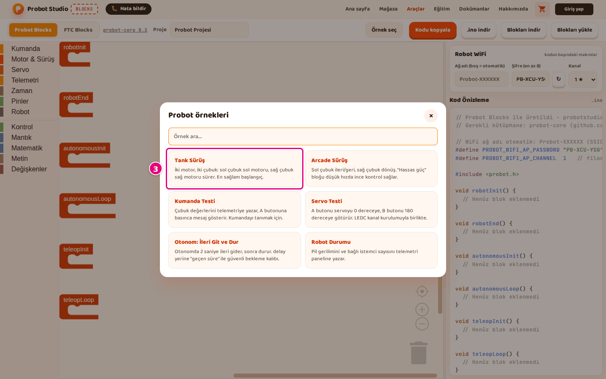
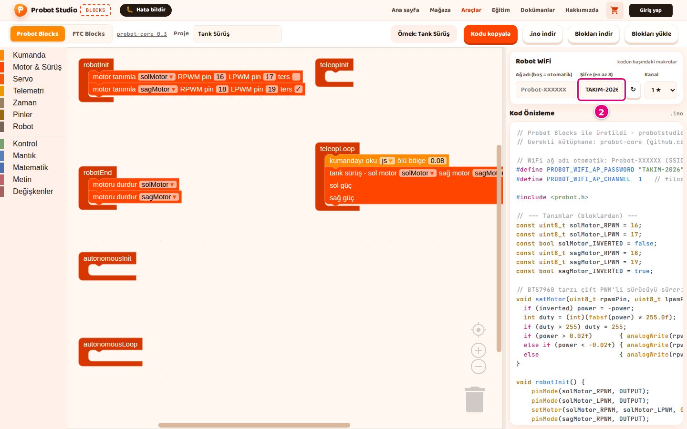
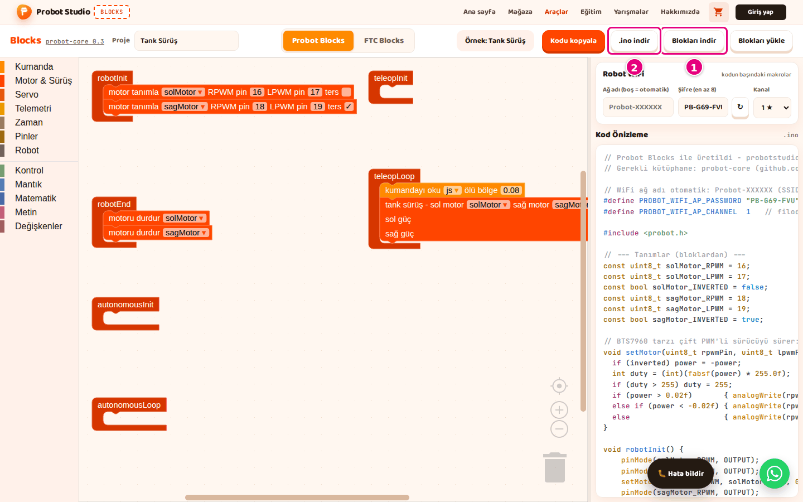

# First 10 minutes

On this page you open a ready-made drive program for your Probot kit. You look at its code and
download it to your computer. You do not need to install anything or create an account.

<!-- CAPTURE: url=https://probotstudio.com/blocks/?dil=en | hazirla=ornek:Tank Drive, Probot Blocks tab | hedef=body | isaret=yok | bekle=text="Example: Tank Drive" -->
<!-- SAY: In ten minutes our screen will look like this, with a ready-made drive program and its code. -->

## Before you start

- Computer and browser: [What you need](../index.md#ne-gerekir).
- You do not need the Probot kit yet. Uploading the code to the board is covered on the
  [Upload the code to the Probot board](probot-karta-yukle.md) page.
- If you are on an FTC team, follow these pages in this order instead: [Start with an FTC example](ftc-ornekle-basla.md),
  [Set up the robot configuration](ftc-yapilandirmayi-ayarla.md), [Write a new FTC program](ftc-program-yaz.md),
  [Save the program, open it and get the Java code](ftc-programi-kaydet.md), [Upload the program to the Control Hub](ftc-control-hub-yukle.md).

## Open Blocks

1. In your browser, go to [probotstudio.com/blocks](https://probotstudio.com/blocks/?dil=en).
2. On the "Coding tool is in development" card, press **Got it, continue**.
   
   <!-- CAPTURE: url=https://probotstudio.com/blocks/?dil=en | hazirla=clean browser | hedef=text="Got it, continue" | isaret=2 | bekle=text="Coding tool is in development" -->
   <!-- SAY: When we open Blocks an info card appears, and we close it with Got it, continue. -->
3. If the cookie banner appears, press **Accept** or **Only necessary**.

Check: There is no card on the screen. You can see the toolbar and the workspace.

## Load the Tank Drive example

A Probot program has six ready-made blocks. **robotInit** runs once when you press **Init** on the
Driver Station. **teleopLoop** runs about 50 times a second during TeleOp. Only the blocks you
put inside these six blocks go into the code ([Glossary](index.md#glossary)).

!!! warning "Warning"
    Loading an example replaces the project in the workspace without asking. If you
    already made a project, save it first with [Download blocks](probot-projeyi-kaydet.md).

1. In the toolbar, select the **Probot Blocks** tab. On your first visit the tool opens with the
   **FTC Blocks** tab. After that it opens with the tab you picked last.
   
   <!-- CAPTURE: url=https://probotstudio.com/blocks/?dil=en | hazirla=intro card closed, FTC Blocks selected | hedef=role=tab[name="Probot Blocks"] | isaret=1 | bekle=role=tab[name="Probot Blocks"] -->
   <!-- SAY: For the Probot kit we select the Probot Blocks tab in the toolbar. -->
2. In the toolbar, press **Pick an example**.
3. In the "Probot examples" window, select the **Tank Drive** card. A "Tank Drive example loaded."
   notification appears in the corner.
   
   <!-- CAPTURE: url=https://probotstudio.com/blocks/?dil=en | hazirla=Probot Blocks tab, Pick an example open | hedef=role=dialog >> text="Tank Drive" | isaret=3 | bekle=text="Probot examples" -->
   <!-- SAY: From the examples we pick Tank Drive, the safest place to start. -->

Check: The **Probot Blocks** tab is orange. The button in the toolbar reads "Example: Tank Drive".
**robotInit** holds two **define motor** blocks, and **teleopLoop** holds the **read gamepad** and
**tank drive** blocks.

## Look through the code

1. In the side panel, move the mouse over **Code Preview**.
2. Turn the mouse wheel down. The lines of code scroll up.
3. When the `void teleopLoop()` line appears, stop turning the wheel.
   
   <!-- CAPTURE: url=https://probotstudio.com/blocks/?dil=en | hazirla=ornek:Tank Drive | hedef=.code-preview >> text="void teleopLoop()" | isaret=3 | bekle=text="void teleopLoop()" -->
   <!-- SAY: In the code preview on the side panel we see the code that matches the blocks. -->

Check: Inside `void teleopLoop()` there are two lines that start with `setMotor(`. The left stick
drives the left motor, and the right stick drives the right motor. When you change a block, the
code changes right away.

## Type the WiFi password

The robot broadcasts its own WiFi network, and Blocks keeps its password in this browser. If you do
not open Blocks in this browser for 30 days, the saved password is deleted. The tool then makes a new
one. If that happens, type the password you wrote down into the box again.

1. In the **Robot WiFi** section, clear the **Password (min. 8)** box.
2. Type `TEAM-2026` into the box. The box turns lowercase letters into capitals (ı becomes I too). It
   removes letters outside A to Z, spaces, and every symbol except `-`.
   
   <!-- CAPTURE: url=https://probotstudio.com/blocks/?dil=en | hazirla=ornek:Tank Drive | hedef=role=textbox[name="Password (min. 8)"] | isaret=2 | bekle=text="Robot WiFi" -->
   <!-- SAY: We type the robot's WiFi password ourselves and write it down. -->
3. Write the password down somewhere. You need it to connect to the robot.

Check: At the top of **Code Preview** there is the line `#define PROBOT_WIFI_AP_PASSWORD "TEAM-2026"`.

## Download the project and the code

1. In the toolbar, press **Download blocks**. `tank-drive.probot.json` downloads.
2. In the toolbar, press **Download .ino**. `tank-drive.ino` downloads.
   
   <!-- CAPTURE: url=https://probotstudio.com/blocks/?dil=en | hazirla=ornek:Tank Drive | hedef=role=button[name="Download blocks"]; role=button[name="Download .ino"] | isaret=1,2 | bekle=text="Copy code" -->
   <!-- SAY: Finally we download the project and the code to our computer. -->
3. On your computer, open the Downloads folder.

Check: The "Block project downloaded." and ".ino file downloaded." notifications appeared. The
Downloads folder has `tank-drive.probot.json` and `tank-drive.ino`.

The `.probot.json` file is for opening the project later. The `.ino` file is the code you upload to
the board.

## Next step

- [Upload the code to the Probot board](probot-karta-yukle.md)
- [Write a drive program from scratch](probot-surus-programi-yaz.md)
