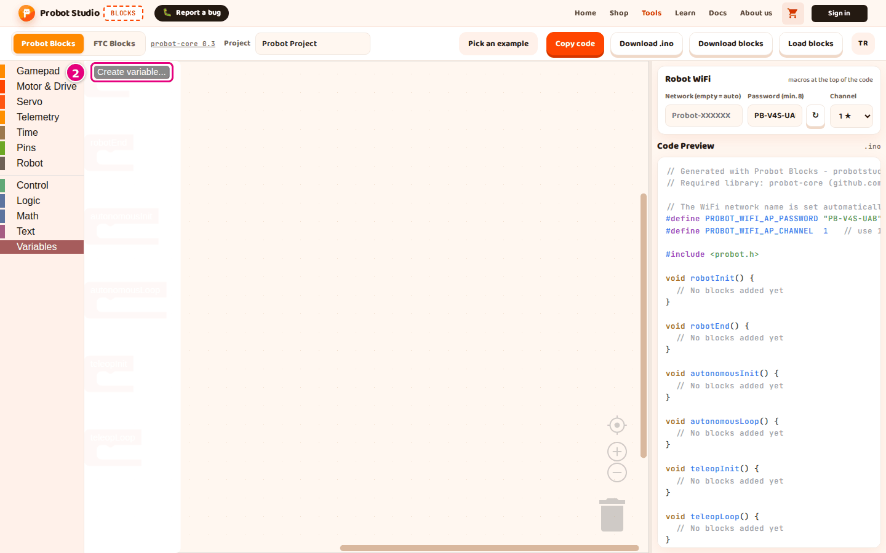
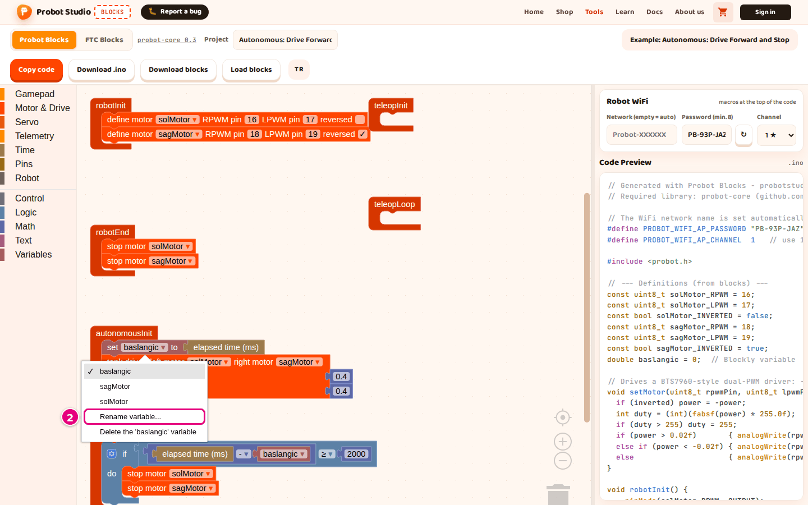

# Create and use a variable

On this page you will create a variable to store a value, give it a value and use that value in
another block. Example: storing the moment autonomous starts.

## Before you start

- Blocks is open and the **Probot Blocks** tab is selected.
- To see a variable in a ready-made project, open **Pick an example** >
  **Autonomous: Drive Forward and Stop**. This example uses a variable named **baslangic**.

## Create a variable

1. In the block list, select the **Variables** category.
2. In the block panel, press **Create variable...**.
   
   <!-- CAPTURE: url=https://probotstudio.com/blocks/?dil=en | hazirla=Probot Blocks, empty project, Variables panel open | hedef=text="Create variable..." | isaret=2 | bekle=text="Create variable..." -->
   <!-- SAY: We create a new variable from the Variables category. -->
3. In the "New variable name:" box, type `baslangic`.
4. Press **OK**.

Result: The block panel shows the **set baslangic to**, **change baslangic by** and **baslangic**
blocks.

Write the name with English letters. Do not use Turkish letters or spaces, and do not start the
name with a digit. You cannot create a second variable with the same name: the warning "A variable
named 'baslangic' already exists." appears.

Names that break these rules are changed in the code: `hız` becomes `h_C4_B1z`, a space becomes
`_`, and a name that starts with a digit gets `my_` in front. You will not recognize the name in
the code. Some reserved names, such as `name` and `status`, also get a `2` at the end.

## Give the variable a value

1. From **Variables**, drag the **set ... to ...** block into **autonomousInit**.
2. In the block's dropdown, select **baslangic**.
3. From **Time**, plug the **elapsed time (ms)** block into the slot of the **set ... to ...** block.

Result: When autonomous starts, the time at that moment is stored in **baslangic**. In **Code
Preview**, under "// --- Definitions (from blocks) ---", the line
`double baslangic = 0;  // Blockly variable` appears. Inside `void autonomousInit()`, the line
`baslangic = millis();` appears.

<!-- SAY: We save the moment autonomous starts in the baslangic variable. -->

## Use the variable's value

Only blocks inside the lifecycle blocks (such as **robotInit** and **autonomousLoop**) go into the
code. So plug the block that reads the variable into a block inside a lifecycle block.

1. From **Telemetry**, drag the **write value to telemetry** block into **autonomousLoop**. The
   block's **label** box shows `speed`. You can change it if you like.
2. From **Math**, plug the **+** block into the **value** slot of the **write value to telemetry**
   block. Both slots of the **+** block show `1`.
3. From **Variables**, plug the **baslangic** block into the first slot of the **+** block. The
   second slot keeps `1`.
4. To increase the value, drag the **change baslangic by** block from **Variables** into
   **autonomousInit**, under the **set ... to ...** block.
5. In the slot of the **change ... by** block, type `5`. To decrease the value, type a negative
   number, for example `-5`.

Result: In **Code Preview**, inside `void autonomousLoop()`, the line
`probot::printf("speed: %.2f\n", (double)(baslangic + 1));` appears. Inside
`void autonomousInit()`, the line `baslangic += 5;` appears.

<!-- SAY: We plug the block that reads the variable into the slots of other blocks. -->

## Rename the variable

1. On a block that uses the variable, press the `baslangic ▾` dropdown.
2. Select **Rename variable...**.
   
   <!-- CAPTURE: url=https://probotstudio.com/blocks/?dil=en | hazirla=ornek:Autonomous: Drive Forward and Stop | hedef=text="baslangic" (dropdown); text="Rename variable..." | isaret=2 | bekle=.blocklyDropDownDiv -->
   <!-- SAY: We can change the name of the variable in every block at once. -->
3. In the "Rename all 'baslangic' variables to:" box, type the new name.
4. Press **OK**.

Result: Every block that uses the variable shows the new name.

## Delete the variable

!!! warning "Warning"
    Deleting a variable also deletes the blocks that use it.

1. On a block that uses the variable, press the variable dropdown.
2. Select **Delete the 'baslangic' variable**.
3. If the variable is used in more than one place, press **OK** in the "Delete ... uses of the
   '...' variable?" message.

Result: The variable and the blocks that use it are deleted. To undo, press
<kbd>Ctrl</kbd>+<kbd>Z</kbd>.

<!-- SAY: We can delete a variable we no longer use from the dropdown. -->

## Motor, servo and gamepad names

Names such as **solMotor**, **sagMotor**, **kolServo** and **js** are variables too. That is why
they appear in the **Variables** block panel. Do not use **set ... to ...** or **change ... by**
with them: the code then gets a number variable that means nothing. Select these names only from
the dropdowns on the motor, servo and gamepad blocks.

<!-- SAY: Motor and gamepad names also show up in the variable list but we do not give them numbers. -->

## Next step

[Set up the robot WiFi](probot-wifi-ayarla.md)
