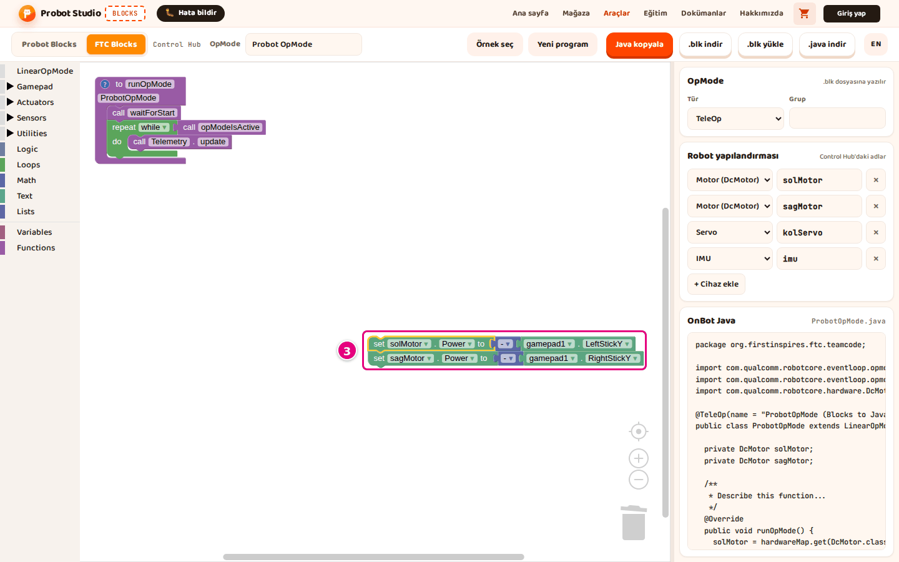

# Move blocks to FTC Blocks

You can copy the blocks you wrote in Probot Blocks into FTC Blocks. When you copy a block, Blocks
also writes its FTC version to the clipboard. On this page you move a drive block to an FTC program.

<!-- CAPTURE: url=https://probotstudio.com/blocks/?dil=en | hazirla=ornek:Tank Drive, tank drive inside teleopLoop copied, FTC Blocks New program | hedef=body | isaret=yok | bekle=text="gamepad1" -->
<!-- SAY: In the end the drive block from Probot will sit in the FTC program as its FTC version. -->

## Before you start

- Blocks is open.
- To try it with ready-made blocks, open **Pick an example** > **Tank Drive**. See [Start with a ready-made example](probot-ornekle-basla.md).

!!! warning "Warning"
    The example replaces the project in the workspace without asking. To keep your own
    project, press **Download blocks** first. See [Save the project, open it and start over](probot-projeyi-kaydet.md).

## Copy the Probot block

!!! note "Note"
    If you copy a block alone and it has no FTC version, nothing is written to the clipboard and
    no notification appears. The [What each block becomes in FTC](#karsiliklar) table shows which blocks have one.

1. In the toolbar, select the **Probot Blocks** tab.
2. In the workspace, select the block you want to move, for example **tank drive** inside **teleopLoop**.
3. Press <kbd>Ctrl</kbd>+<kbd>C</kbd> (on a Mac, <kbd>Cmd</kbd>+<kbd>C</kbd>). A "Block copied. You can
   paste it in FTC Blocks too." notification appears. It appears only once per page.

Result: The selected block is copied to the clipboard together with the blocks plugged into its slots.
The blocks attached below it are not copied.

To move a whole section, select a lifecycle block such as **teleopLoop**. All the blocks inside it
are copied. To move a block and remove it from Probot, press <kbd>Ctrl</kbd>+<kbd>X</kbd>.

<!-- SAY: In Probot mode we select a block and copy it the usual way. -->

## Paste into FTC Blocks

1. In the toolbar, select the **FTC Blocks** tab.
2. In the FTC workspace, move the mouse to where the block should go and click once.
3. Press <kbd>Ctrl</kbd>+<kbd>V</kbd> (on a Mac, <kbd>Cmd</kbd>+<kbd>V</kbd>). The blocks appear where the mouse is.
   
   <!-- CAPTURE: url=https://probotstudio.com/blocks/?dil=en | hazirla=ornek:Tank Drive, tank drive inside teleopLoop copied, FTC Blocks New program | hedef=iframe.ftc-cerceve >> .blocklySvg; text="Robot configuration" | isaret=3 | bekle=text="gamepad1" -->
   <!-- SAY: We switch to the FTC tab and paste the block where the mouse is. -->
4. Drag the pasted blocks to the right place inside the **to runOpMode** block. The table below shows
   where each section goes.

Result: The blocks sit inside **to runOpMode** as their FTC versions. In the Tank Drive example, you get
two **set ... Power to** blocks, for `solMotor` and `sagMotor`. If a motor or servo name used in the
blocks is not in the list, it is added to the **Robot configuration**.

| Probot section | Place in FTC |
|---|---|
| **robotInit** | Before **call waitForStart** |
| **teleopInit**, **autonomousInit** | After **call waitForStart**, before the loop |
| **teleopLoop**, **autonomousLoop** | The **do** opening of the **repeat while call opModeIsActive** block |
| **robotEnd** | After the loop |

<!-- SAY: We switch to the FTC tab and put the block in the right place inside runOpMode. -->

## What each block becomes in FTC {#karsiliklar}

| Probot block | FTC version |
|---|---|
| **drive motor** | The **Power** block of the **DcMotor** with the same name (`solMotor.Power`) |
| **stop motor** | The **Power** block of the same motor, value `0` |
| **tank drive** | Two **Power** blocks: left power to the left motor, right power to the right motor |
| **arcade drive** | Two **Power** blocks: forward/back + turn to the left motor, forward/back - turn to the right motor |
| **define motor** | If **reversed** is checked, the motor's **Direction** value becomes `REVERSE`. If it is not checked, the block is skipped. |
| **servo angle** | The **Position** block of the **Servo** with the same name. The angle is divided by 180: 90 degrees becomes `0.5`. |
| **precise power** | The value cubed (`^ 3`) |
| Gamepad blocks (`js`): stick, trigger, button and D-Pad direction | **gamepad1** |
| **left stick ↕ (forward +)**, **right stick ↕ (forward +)** | `- gamepad1.LeftStickY`, `- gamepad1.RightStickY`: in FTC, forward is negative, so a minus block is added by itself |
| **write to telemetry**, **Serial print line**, **Serial print** | Telemetry text block (`telemetry.addData`) |
| **write value to telemetry** | Telemetry block with the same label (`telemetry.addData`) |
| **wait ... ms** | **sleep** |
| **elapsed time (ms)** | `getRuntime` × 1000 |
| The **in autonomous?**, **in TeleOp?** and **missed a deadline?** options of the **robot** block | `false` |
| **Control**, **Logic**, **Math**, **Text**, **Variables** blocks | The same block |
| Pin blocks (except **Serial print**), **stop servo signal**, **clear telemetry**, **read gamepad**, **D-Pad angle**, **connected?**, **raw axis number**, **raw button number**, **gamepad mapping**, the **robot:** block (for example **battery voltage (V)**) | No FTC version, skipped |

A **call Telemetry.update** block is added by itself after the telemetry blocks. If a value block with
no FTC version is in a slot of a Probot block, a `0` takes its place. In the text slot of
**write to telemetry**, **Serial print line** and **Serial print**, an empty text block takes its place.
If the value block is inside a **Control**, **Logic** or **Math** block, that slot stays empty.

After pasting, check that the motor names match the names on the Control Hub. See
[Set up the robot configuration](ftc-yapilandirmayi-ayarla.md).

<!-- SAY: The motors turn into FTC motors with the same names, and the gamepad turns into gamepad1. -->

## Having trouble?

- **Pasting adds no block, or adds the previous copy:** The block you selected has no FTC version,
  so nothing was written to the clipboard. Look at the [What each block becomes in FTC](#karsiliklar)
  table and use an FTC block that does the same job.
- **No notification on the second copy:** The "Block copied" notification appears only once per page.
  The block is still copied to the clipboard.
- **An empty slot is left:** The Probot block in that slot has no FTC version. Plug an FTC block
  into the slot.

## Next step

[Write a new FTC program](ftc-program-yaz.md)
