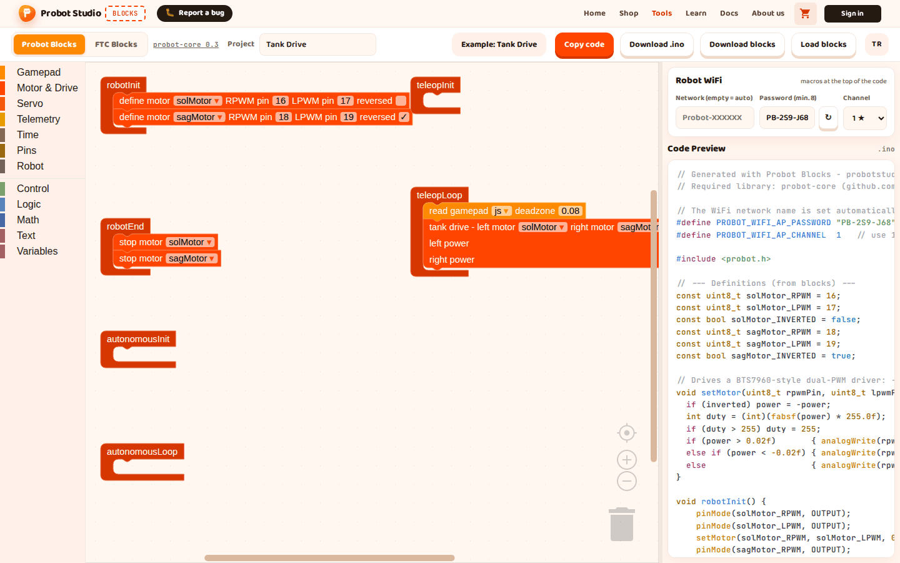
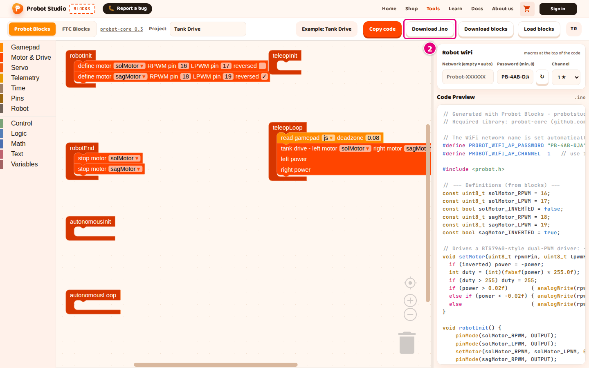

# Copy or download the code

On this page you copy the Arduino code made from your blocks to the clipboard,
or download it as an `.ino` file. You upload the code to the board with Arduino IDE.

<!-- CAPTURE: url=https://probotstudio.com/blocks/?dil=en | hazirla=ornek:Tank Drive, Probot Blocks tab | hedef=body | isaret=yok | bekle=text="Example: Tank Drive" -->
<!-- SAY: We take the code from Code Preview to our computer and move it into Arduino IDE. -->

## Before you start

- Blocks is open and the **Probot Blocks** tab is selected.
- There is a program in the workspace. If not, open **Pick an example** > **Tank Drive**.
- You typed the **Robot WiFi** password yourself, and it has at least 8 characters. With a shorter
  password, the code will not compile. See [Set up the robot WiFi](probot-wifi-ayarla.md).

## Download the code as an .ino file

1. In the toolbar, type a project name into the **Project** box, for example `Tank Drive`. The file name is made from this name.
2. In the toolbar, press **Download .ino**. A ".ino file downloaded." notification appears.
   
   <!-- CAPTURE: url=https://probotstudio.com/blocks/?dil=en | hazirla=ornek:Tank Drive | hedef=role=button[name="Download .ino"] | isaret=2 | bekle=text="Download .ino" -->
   <!-- SAY: We download the code to our computer as an .ino file. -->
3. If the browser asks where to save the file, press **Save**.

Result: Your Downloads folder has a `<project-name>.ino` file, for example `tank-drive.ino`. The name is
changed to lower case, Turkish letters become plain letters, and characters that are not letters or digits
become `-`. A capital `İ` becomes `i-` (`İleri` → `i-leri.ino`). If the **Project** box is empty, the file is
`probot-projesi.ino`.

## Copy the code to the clipboard

!!! tip "Tip"
    If the browser does not allow access to the clipboard, you see "Copy failed." In that case, use **Download .ino**.

1. In the toolbar, press **Copy code**. A "Code copied to the clipboard." notification appears.
2. In Arduino IDE, open a new sketch.
3. Delete the text that is already in the sketch. Make sure no `setup()` or `loop()` is left in it.
4. Paste the code with <kbd>Ctrl</kbd>+<kbd>V</kbd>. On a Mac, use <kbd>Cmd</kbd>+<kbd>V</kbd>.

Result: The sketch starts with the line `// Generated with Probot Blocks - probotstudio.com/blocks` and
ends with the `void teleopLoop()` function.

<!-- SAY: If Arduino IDE is open, we can copy the code and paste it in directly. -->

## What is in the code

The code in **Code Preview** has these parts, from top to bottom:

- A header comment and the name of the library it needs (probot-core).
- WiFi settings: the `#define PROBOT_WIFI_AP_...` lines. If the **Network (empty = auto)** box is empty,
  a comment takes the place of the network name line.
- The `#include <probot.h>` line.
- Definitions: motor and servo pins, variables, helper functions.
- Six lifecycle functions: `robotInit()`, `robotEnd()`, `autonomousInit()`, `autonomousLoop()`,
   `teleopInit()`, `teleopLoop()`.

If a lifecycle block is empty, its function contains the comment `// No blocks added yet`. Blocks does not write `setup()` or `loop()`.
The library provides them.

<!-- SAY: The generated code starts with the WiFi settings and ends with the six lifecycle functions. -->

The **probot-core 0.3** text in the toolbar shows which library version the code is generated for.
Press it to open the Probot Core documentation. That documentation describes a newer version, and it
mentions functions that Blocks does not generate, such as `autonomousStop()`.

## Next step

[Upload the code to the Probot board](probot-karta-yukle.md)
