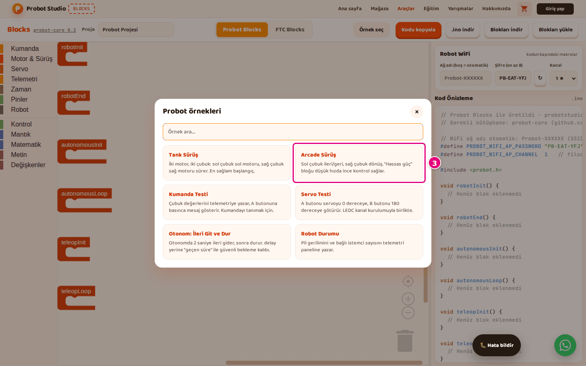

# Start with a ready-made example

On this page you open one of the six ready-made examples in Probot Blocks. An example comes with
the six lifecycle blocks, and the blocks that do the work are already inside them. You do not have
to start from scratch.

<!-- CAPTURE: url=https://probotstudio.com/blocks/?dil=en | hazirla=ornek:Tank Drive, Probot Blocks tab | hedef=body | isaret=yok | bekle=text="Example: Tank Drive" -->
<!-- SAY: When the example loads, its blocks and its code are ready on the screen. -->

## Before you start

- Computer and browser: [What you need](../index.md#ne-gerekir).
- Blocks is open. See [First 10 minutes](ilk-10-dakika.md).

## Open an example

!!! warning "Warning"
    An example replaces the project in the workspace, and it does not ask first. To keep your
    project, press **Download blocks** first. See [Save the project, open it and start over](probot-projeyi-kaydet.md).

1. In the toolbar, select the **Probot Blocks** tab. On the **FTC Blocks** tab, **Pick an example**
   opens the FTC examples instead: [Start with an FTC example](ftc-ornekle-basla.md).
2. In the toolbar, press **Pick an example**.
3. In the "Probot examples" window, select the **Arcade Drive** card. An "Arcade Drive example
   loaded." notification appears in the corner and is gone after 5 seconds.
   
   <!-- CAPTURE: url=https://probotstudio.com/blocks/?dil=en | hazirla=Probot Blocks tab, Pick an example open | hedef=role=dialog >> text="Arcade Drive" | isaret=3 | bekle=text="Probot examples" -->
   <!-- SAY: Six ready-made projects are waiting for us in the Probot examples window. -->

Result: The example's blocks appear in the workspace. In the toolbar, the **Project** box shows
"Arcade Drive" and the button reads "Example: Arcade Drive".

## Search for an example

1. On the **Probot Blocks** tab, in the toolbar, press **Pick an example**. The cursor moves to
   the **Search examples...** box.
2. Type `servo` in the box. Only the **Servo Test** card stays in the list.
3. Select the **Servo Test** card.

Result: A "Servo Test example loaded." notification appears. In the toolbar, the button reads
"Example: Servo Test".

The search looks in the example's name and in the description on its card. Upper and lower case
do not matter. If nothing matches, "No matching examples." appears instead of the list.

<!-- SAY: We can find the example we want by its name or by its description. -->

To close the window without picking an example, press **×**, click outside the window or press
<kbd>Esc</kbd>. When the window closes, the search box is cleared.

## What each example does

| Example | What it does | Filled blocks |
|---|---|---|
| **Tank Drive** | Two motors, two sticks: the **left stick** drives the left motor, and the **right stick** drives the right motor. | **robotInit**, **robotEnd**, **teleopLoop** |
| **Arcade Drive** | The **left stick** drives forward and back, and the **right stick** turns. The **precise power** block gives fine control at low speed. | **robotInit**, **robotEnd**, **teleopLoop** |
| **Gamepad Test** | Writes the Y value of the **left stick** to telemetry on a "left Y" line, and the X value of the **right stick** on a "right X" line. It writes "A pressed!" when you press the **A** button. | **teleopLoop** |
| **Servo Test** | The **A** button moves the servo to 0 degrees, the **B** button moves it to 180 degrees. | **robotInit**, **robotEnd**, **teleopLoop** |
| **Autonomous: Drive Forward and Stop** | When autonomous starts, it drives both motors at 0.4 power and stops them after 2 seconds. It measures the time with the **elapsed time (ms)** block. | **robotInit**, **robotEnd**, **autonomousInit**, **autonomousLoop** |
| **Robot Status** | Writes the battery voltage to telemetry on a "battery (V)" line, and the number of connected clients on a "clients" line. | **teleopLoop** |

In the examples, the **define motor** blocks connect the left motor to pins RPWM 16 and LPWM 17,
and the right motor to pins 18 and 19. The right motor has **reversed** checked. The
**define servo** block connects the servo to pin 4, LEDC channel 7.

If your robot is wired differently, change the pin numbers in these two blocks.

<!-- SAY: Each example shows a different job, from driving to servos to autonomous. -->

## Save the example you changed

!!! warning "Warning"
    The browser does not save the loaded example's blocks until you change a block. If you refresh
    the page before that, the blocks of your previous project come back, but the **Project** box
    keeps the example's name.

1. In the toolbar, delete the example name in the **Project** box.
2. Type your own project name in the box, for example `Team Arcade`.
3. In the toolbar, press **Download blocks**.

Result: A "Block project downloaded." notification appears. The file `team-arcade.probot.json`
arrives in your Downloads folder. The new project name is saved in the browser too.

<!-- SAY: We save the example we changed to our computer under our own name. -->

## Having trouble?

- **"Could not load the example." appears:** Refresh the page and pick the example again.
- **A different project came back after a refresh:** See [Troubleshooting](sorunlar.md#yenileyince-proje-degisti).
- **"No matching examples." appears:** The word in the search box is not in the name or the description of any example. Clear the box and look at the list.
- **Picking an example deleted my program:** See [Troubleshooting](sorunlar.md#ornek-program-silindi).

## Next step

[Copy or download the code](probot-kodu-al.md)
