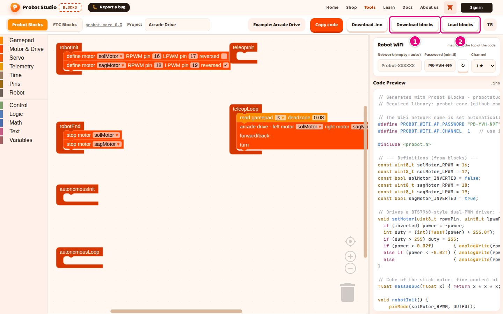
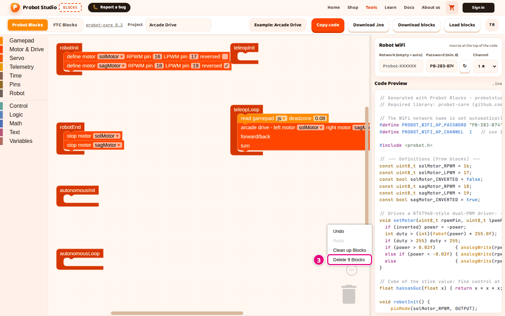

# Save the project, open it and start over

On this page you will save your Probot project as a file on your computer, open the file you saved and
start over with an empty project.

Blocks has no accounts and no cloud save. The reliable way to keep your project is to save it to a file
with **Download blocks**.

## Before you start

- Blocks is open and the **Probot Blocks** tab is selected.
- To try it out, open an example: **Pick an example** > **Arcade Drive**.

## Name the project

1. In the toolbar, press the **Project** box.
2. Delete the name in the box and type a new one, for example `Team Robot`. It can have at most 60 characters.
3. Click anywhere outside the box.

Result: The files you download get this name: `team-robot.probot.json`, `team-robot.ino`. Turkish letters
become plain letters; spaces, `_`, `.` and other characters that are not letters or digits become `-`. A
capital `İ` becomes `i-` (`İleri` → `i-leri`). If the box is empty, the file name is `probot-projesi`.

<!-- SAY: First we give our project a name, and the downloaded files take this name. -->

## Save the project to a file

!!! warning "Warning"
    Blocks autosaves your project only in this browser. Another browser or computer does not see this
    save, and if you clear your browser data, the save is deleted. To keep a lasting copy, download the
    project to a `.probot.json` file with the steps below.

1. In the toolbar, press **Download blocks**. A "Block project downloaded." notification appears.
   
   <!-- CAPTURE: url=https://probotstudio.com/blocks/?dil=en | hazirla=ornek:Arcade Drive | hedef=role=button[name="Download blocks"]; role=button[name="Load blocks"] | isaret=1,2 | bekle=text="Download blocks" -->
   <!-- SAY: So that we do not lose the project, we save it to our computer with Download blocks. -->
2. Open your browser's Downloads folder.
3. Move the `<project-name>.probot.json` file to a safe place.

Result: The file holds the blocks, the project name and the WiFi settings. The WiFi password is stored in
the file as plain text.

## Open a saved project

!!! warning "Warning"
    Opening a file replaces the project in the workspace, and Blocks does not ask first. A broken file
    can also delete your current project. Save your project with **Download blocks** first.

1. In the toolbar, press **Load blocks**.
2. In the window that opens, select the `.probot.json` file.
3. Press **Open**.

Result: A "Block project loaded." notification appears. The blocks, the project name and the WiFi settings
come from the file. The blocks, the project name and the password go into autosave. The network name and
channel from the file do not: see [How autosave works](#otomatik-kayit).

If the file is not JSON, or does not have the structure of a Probot Blocks project, "Could not load the
block project." appears and the current project does not change.

If the file has the right structure but contains a block type that the tool does not have, the same
message appears. This happens with a file from another Blockly app or with a `.probot.json` file edited by
hand. Then the current project is deleted and the workspace is left empty or half full. The project name
and WiFi settings may also have changed to the ones in the file.

<!-- SAY: We open the project we saved with Load blocks. -->

## Start over {#yeniden-basla}

Probot Blocks has no **New** button. You get back to an empty project by deleting the blocks in the
workspace.

!!! warning "Warning"
    This deletes all the blocks in the workspace. If you want to keep your project, do not skip step 1.

1. In the toolbar, press **Download blocks**.
2. Right-click an empty spot in the workspace.
3. Select **Delete <n> Blocks** (for example "Delete 12 Blocks").
   
   <!-- CAPTURE: url=https://probotstudio.com/blocks/?dil=en | hazirla=ornek:Arcade Drive | hedef=.blocklySvg (empty spot, right-click); .blocklyContextMenu >> text=/Delete \d+ Blocks/ | isaret=3 | bekle=.blocklyContextMenu -->
   <!-- SAY: To get back to an empty project, we delete all the blocks in the workspace. -->
4. When "Delete all <n> blocks?" appears, press **OK**.
5. In the **Project** box, type the new project's name.

Result: Only the six lifecycle blocks are left. They are not deleted.

## How autosave works {#otomatik-kayit}

Blocks saves your project in the browser by itself. When you open the page again in the same browser, the
project comes back.

| What | When it is saved | How long it is kept |
|---|---|---|
| Blocks | On every change. A large project is saved too. | It does not expire. |
| Project name | Every time it changes: when you type it, pick an example or open a file. | 30 days from the last day you opened Blocks in this browser. |
| WiFi password | Every time it changes: when Blocks generates it on the first visit, when you type it, when you press **↻**, or when you open a file. | 30 days from the last day you opened Blocks in this browser. |
| Network name and channel | Only when you type the name or select the channel from the list yourself. | 30 days from the last day you changed them by hand. |
| Side panel width, selected tab | When you change them. | The width is kept for 30 days from the last day you changed it; the tab does not expire. |

A project that an older version of Blocks saved in a cookie is moved into the new save once, on the first visit.

!!! warning "Warning"
    In these cases autosave misses part of your work without a warning:

    - If you load an example and do not change any block, the blocks are not saved. When the page is
      refreshed, the previous project comes back.
    - The network name and channel that come in with **Load blocks** are not saved until you change each of
      them by hand once: [Save the settings from a file in the browser](probot-wifi-ayarla.md#dosyadan-gelen-ayarlar).

    Another browser or computer does not see the save, and if you clear your browser data, the save is
    deleted. Save an important project to a file with **Download blocks**.

<!-- SAY: The browser keeps the project, but the truly safe save is downloading it to a file. -->

## Having trouble?

- **"Could not load the block project." appears:** The file is not a `.probot.json` file, it is broken, or it
  contains a block the tool does not have. Select a file you got with **Download blocks**.
- **A different project came back after a refresh:** See [Troubleshooting](sorunlar.md#yenileyince-proje-degisti).
- **The network name or channel changed after a refresh:** The network name and channel from a file do not go
  into autosave. Change both of them by hand once, or load the file again. See [Troubleshooting](sorunlar.md#yenileyince-ad-wifi-degisti).

## Next step

[Copy or download the code](probot-kodu-al.md)
