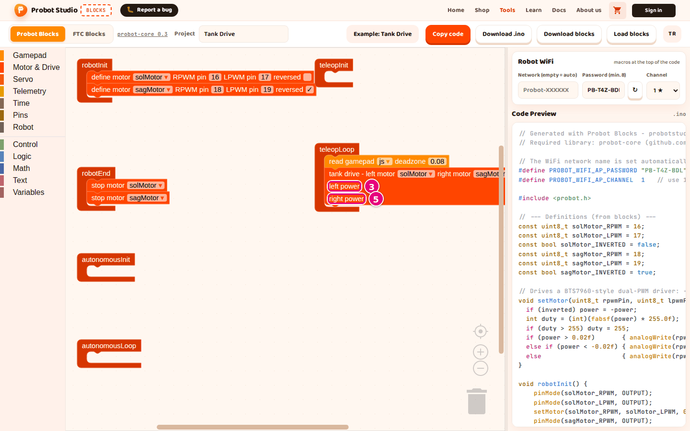
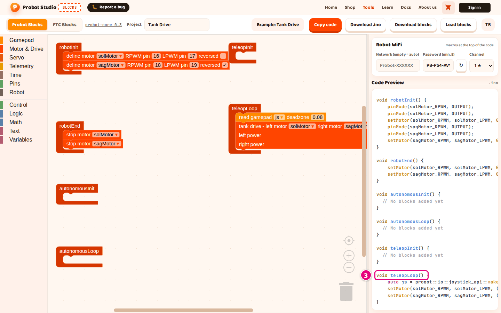

# Write a drive program

On this page you will start from an empty project and write a program for two motors that you
drive with a gamepad. By the end, you will have built the **Tank Drive** example's program
yourself. In the example, the right motor's **reversed** checkbox is also checked.

<!-- CAPTURE: url=https://probotstudio.com/blocks/?dil=en | hazirla=ornek:Tank Drive, Probot Blocks tab | hedef=body | isaret=yok | bekle=text="Example: Tank Drive" -->
<!-- SAY: By the end of this page our screen will show the same program as the Tank Drive example. -->

## Before you start

- Blocks is open and the **Probot Blocks** tab is selected.
- The workspace holds only the six lifecycle blocks. If not, see [Start over](probot-projeyi-kaydet.md#yeniden-basla).
- Know the motor driver pins on your robot. This page uses the pins from the examples: left motor
  16 and 17, right motor 18 and 19.

To see the finished result, open **Pick an example** > **Tank Drive**.

## Get to know the lifecycle blocks

The program is split into six blocks. Each block runs at a certain moment in the robot's life.
TeleOp (driver control) is the part where you drive the robot with the gamepad.

| Block | When it runs | What goes in it |
|---|---|---|
| **robotInit** | Once, when you press **Init** on the Driver Station | Motor and pin definitions |
| **robotEnd** | Once, when you press **Stop** | Stopping the motors |
| **autonomousInit** | Once, when autonomous starts | Getting ready for autonomous |
| **autonomousLoop** | About 50 times per second during autonomous | Autonomous moves |
| **teleopInit** | Once, when TeleOp starts | Getting ready for TeleOp |
| **teleopLoop** | About 50 times per second during TeleOp | Reading the gamepad and driving |

Do not wait longer than 2 seconds inside a loop block. The robot counts that as a deadline miss.

<!-- SAY: The program is split into six blocks, and each block runs at a different moment in the robot's life. -->

## Create the right motor's name

Motor names are stored as variables. In the **define motor**, **drive motor** and **stop motor**
blocks, the default name is **solMotor**.

**sagMotor** comes ready only in the **tank drive** and **arcade drive** blocks. You will define
the motors before the drive block, so create this name yourself first.

Do not use Turkish letters or spaces in a variable name. Blocks changes these characters in the
code: a space becomes `_`, and a Turkish letter turns into characters like `_C4_9F`. For example,
`sağMotor` becomes `sa_C4_9FMotor`, which still compiles but is hard to read.

1. In the block list, select the **Variables** category.
2. In the block panel, press **Create variable...**.
   
   <!-- CAPTURE: url=https://probotstudio.com/blocks/?dil=en | hazirla=Probot Blocks, empty project, Variables panel open | hedef=text="Create variable..." | isaret=2 | bekle=text="Create variable..." -->
3. In the "New variable name:" box, type `sagMotor`.
4. Press **OK**.

Result: The block panel shows blocks named **sagMotor**.

<!-- SAY: First we create a variable named sagMotor for the right motor. -->

## Define the motors

!!! tip "Tip"
    Drop each block inside a lifecycle block so that its notch clicks into place. A block left outside does not go into the code.

1. In the block list, select the **Motor & Drive** category.
2. Drag the **define motor** block into **robotInit**. It comes with the name **solMotor** and
   pins 16 and 17.
3. Drag a second **define motor** block under the first one.
4. On the second block, press the `solMotor ▾` dropdown and select **sagMotor**.
5. On the second block, type `18` in **RPWM pin** and `19` in **LPWM pin**.
6. If the right motor turns the wrong way, check the **reversed** checkbox on the second block.
   
   <!-- CAPTURE: url=https://probotstudio.com/blocks/?dil=en | hazirla=ornek:Tank Drive | hedef=text="define motor" (second block); text="sagMotor"; text="18"; text="reversed" | isaret=4,5,6 | bekle=text="define motor" -->
   <!-- SAY: When the robot first starts, we define the two motors with their pin numbers. -->

Result: In **Code Preview**, the line `const uint8_t sagMotor_RPWM = 18;` appears.

## Stop the motors

1. From **Motor & Drive**, drag the **stop motor** block into **robotEnd**.
2. Drag a second **stop motor** block under it.
3. On the second block, select **sagMotor** from the dropdown.

Result: In **Code Preview**, two `setMotor(` lines appear inside `void robotEnd()`. When you
press **Stop** on the Driver Station, both motors stop.

<!-- SAY: We put the stop blocks inside robotEnd so that both motors stop when Stop is pressed. -->

## Drive with the gamepad

1. From **Gamepad**, drag the **read gamepad** block into **teleopLoop**.
2. From **Motor & Drive**, drag the **tank drive** block under **read gamepad**.
3. From **Gamepad**, plug the **js left stick ↕ (forward +)** block into the **left power** slot
   of **tank drive**.
4. Plug another **js left stick ↕ (forward +)** block into the **right power** slot.
5. On the block in **right power**, press the `left stick ↕ (forward +) ▾` dropdown and select
   **right stick ↕ (forward +)**.
   
   <!-- CAPTURE: url=https://probotstudio.com/blocks/?dil=en | hazirla=ornek:Tank Drive | hedef=text="tank drive - left motor"; text="left power"; text="right power" | isaret=3,5 | bekle=text="read gamepad" -->
   <!-- SAY: In the TeleOp loop we read the gamepad and send the values of the two sticks to the two motors. -->
6. The `0` blocks that were in the slots drop into the workspace. Drag them to the trash can.

Result: The left stick block is in the **left power** slot and the right stick block is in the
**right power** slot. On the robot, the left stick drives the left motor and the right stick drives the right
motor. When you push a stick all the way forward, the value is +1.

## Check the code

1. In the workspace, drag any block left outside the lifecycle blocks to the trash can.
2. In the side panel, move the mouse over **Code Preview**.
3. With the mouse wheel, scroll **Code Preview** down to the `void teleopLoop()` line.
   
   <!-- CAPTURE: url=https://probotstudio.com/blocks/?dil=en | hazirla=ornek:Tank Drive | hedef=.code-preview >> text="void teleopLoop()" | isaret=3 | bekle=text="void teleopLoop()" -->

Result: Inside `void teleopLoop()`, an `auto js = ...` line and two `setMotor(` lines appear. The
code is ready to upload to the board.

To save it, press **Download blocks**. To upload it to the board, press **Download .ino**.

<!-- SAY: Finally we check what our program looks like as code in Code Preview. -->

## Having trouble?

- **The block does not show up in the code:** The block is not sitting inside a lifecycle block.
  Drag the block back into a lifecycle block. See [Troubleshooting](sorunlar.md#code).
- **The two motors do not turn the same way:** Check the **reversed** checkbox in the
  **define motor** block of the motor that turns the wrong way.
- **The robot keeps drifting a little:** Raise the **deadzone** value in the **read gamepad**
  block (at most 0.5).

## Next step

[Upload the code to the Probot board](probot-karta-yukle.md)
