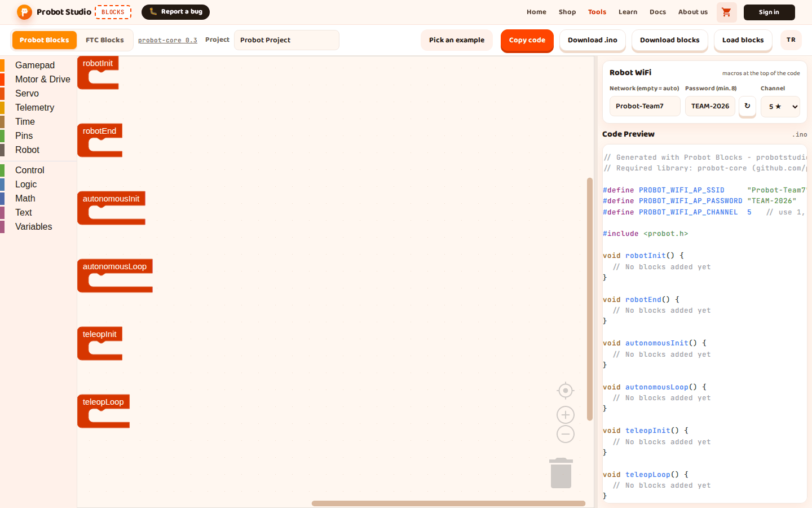
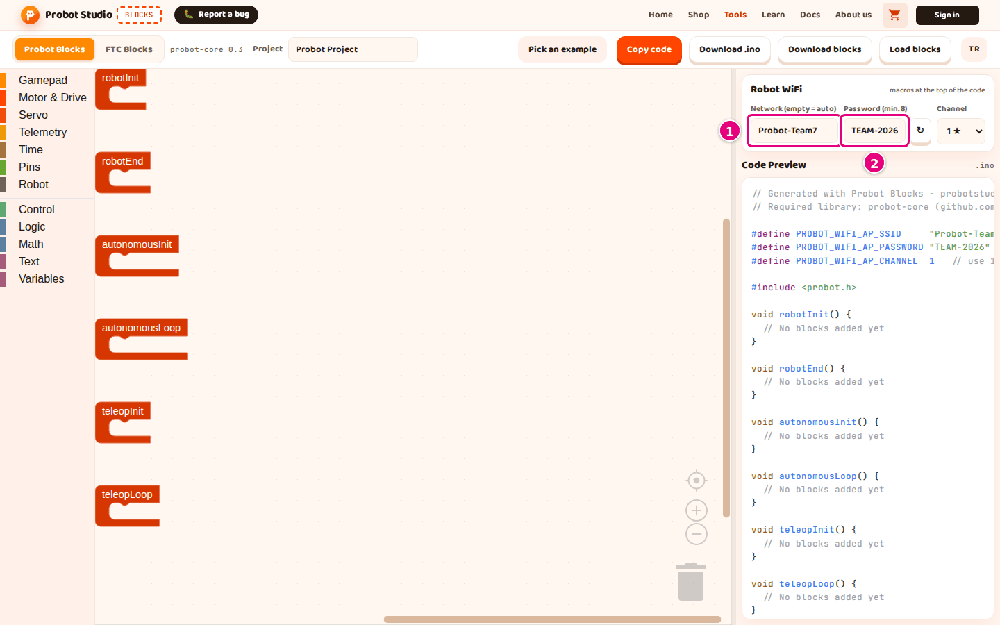

# Set up the robot WiFi

The Probot board broadcasts its own WiFi network. Your computer or phone connects to this network and
drives the robot. On this page you set the network's name, password and channel. The settings are
written at the top of the code and take effect when you upload the code to the board.


<!-- CAPTURE: url=https://probotstudio.com/blocks/?dil=en | hazirla=Probot Blocks; Network=Probot-Team7; Password=TEAM-2026; Channel=5 ★ | hedef=body | isaret=yok | bekle=text="PROBOT_WIFI_AP_SSID" -->
<!-- SAY: By the end of this page we will have the robot's network name, password and channel at the top of the code. -->

## Before you start

- Blocks is open and the **Probot Blocks** tab is selected.
- The **Robot WiFi** section is visible in the side panel.

!!! note "Note"
    Blocks generates a password the first time it opens and keeps it in this browser, and another browser
    or computer generates its own. Type the password yourself once, or press **↻** and write down the new password.

## Type the network name and password

!!! warning "Warning"
    If the password is shorter than 8 characters, the code will not compile. With 1-7 characters, the box gets a dark
    orange border and the text "The password needs at least 8 characters, or the code will not compile." appears.
    This warning does not appear while the box is empty.

1. In the **Robot WiFi** section, type the robot's network name in the **Network (empty = auto)** box, for example
   `Probot-Team7`. The name can be 24 characters at most.
   <!-- SAY: We give a name to the WiFi network the robot will broadcast. -->
2. Clear the text in the **Password (min. 8)** box and type a password of 8-24 characters, for example `TEAM-2026`.
3. Write the password down. You need it to connect to the robot.
   
   <!-- CAPTURE: url=https://probotstudio.com/blocks/?dil=en | hazirla=Probot Blocks; Network=Probot-Team7; Password=TEAM-2026 | hedef=role=textbox[name="Network (empty = auto)"]; role=textbox[name="Password (min. 8)"] | isaret=1,2 | bekle=text="Robot WiFi" -->
   <!-- SAY: We type the password ourselves and write it down somewhere safe. -->

Result: The top of **Code Preview** shows these two lines:

```cpp
#define PROBOT_WIFI_AP_SSID     "Probot-Team7"
#define PROBOT_WIFI_AP_PASSWORD "TEAM-2026"   // at least 8 characters
```

When you upload the code to the board, the `Probot-Team7` network appears in the computer's WiFi list.

If you leave the network name box empty, the robot uses its own name in the `Probot-XXXXXX` format. The code
then has a comment line instead of `#define PROBOT_WIFI_AP_SSID`. If the class has more than one robot, give
each robot a different name.

The network name does not accept the `"` and `\` characters. The password contains only capital letters (A-Z),
digits and `-`. The box takes 24 characters at most; anything longer is cut off.

If you type lowercase letters in the password box, Blocks turns them into capital letters (ı becomes I too). The letters Ç, Ğ, İ, Ö, Ş, Ü,
ç, ğ, ö, ş, ü and other characters are removed.

If you leave the password box empty, the code is generated with the password `Probot1234`: the top of the code
reads `#define PROBOT_WIFI_AP_PASSWORD "Probot1234"`.

## Generate a new password

1. In the **Robot WiFi** section, press **↻** next to the **Password (min. 8)** box. A "New WiFi password
   created." notification appears.
2. Write down the password in the box.
3. In the toolbar, press **Download .ino**.

Result: The box shows a new password in the `PB-XXX-XXX` format, and the browser keeps it. The `.ino` you
downloaded carries this password. The robot uses the new password once you upload this code to the board.

<!-- SAY: If we like, we press the refresh button and get a random password. -->

## Select the channel

1. In the **Robot WiFi** section, press the **Channel** list.
2. Select **1 ★**, **5 ★**, **9 ★** or **13 ★**.
3. Upload the code to the board. See [Upload the code to the Probot board](probot-karta-yukle.md).
4. Connect to the robot's network and open the Driver Station (same page, "Connect to the robot's network" section).
5. On the Driver Station, press **Logs**.

Result: In **Code Preview**, the channel line changes. For example, for **5 ★**:

```cpp
#define PROBOT_WIFI_AP_CHANNEL  5   // use 1, 5, 9 or 13 in a fleet (1-11 if a device cannot see 13)
```

On the **Logs** page, the "Channel" line reads "5 (macro)". The robot broadcasts its network on this channel.

If the parentheses say "nvs", a channel was saved earlier with **Kanal Değiştir** on the robot's **Logs** page (these controls are in Turkish).
That saved channel is used even after you upload the code. To go back to the channel in the code, select
**Varsayılana dön (açılışta)** there and press **Uygula**. Then restart the robot.

If several robots are in the same room, give each robot a different channel from 1, 5, 9 and 13. These four
channels do not interfere with each other.

The list shows all channels from 1 to 13, but some laptops and tablets
cannot see 12 and 13. If a device cannot find the robot, give that robot a channel from 1 to 11. Details:
[Competition day channel plan (in Turkish)](../../core/sinyali-iyilestir.md#kanal-plani).

<!-- SAY: We pick one of the channels with a star so the robots in the same room do not interfere with each other. -->

## Where the settings are stored

The network name, password and channel are kept in the browser. They are also written into the `.probot.json`
file you download with **Download blocks**.

The password that Blocks generates the first time it opens is saved too. When you refresh the page, the same
password stays.

When you open the file with **Load blocks**, the settings come from the file. The password from the file is
saved in the browser.

The network name and channel from the file are not saved until you change them by hand. If you refresh
the page, the old network name and channel from the browser come back.

What is kept, and for how long: [How autosave works](probot-projeyi-kaydet.md#otomatik-kayit).

!!! warning "Warning"
    The `.probot.json` file carries the WiFi password as plain text. This is the password of the robot's own
    network, not an account password. Still, if you share the file, others can connect to your robot's network.

<!-- SAY: The WiFi settings are saved in our project file too. -->

## Save the settings from a file in the browser {#dosyadan-gelen-ayarlar}

To keep the network name and channel of a file you opened with **Load blocks**, change each of them once by
hand. If you do not, load the file again every time you open the page. The password does not need this,
because the password from the file is saved by itself.

1. In the **Robot WiFi** section, delete the last character in the **Network (empty = auto)** box and type it
   again. If the box is empty, type a letter and delete it.
2. In the **Channel** list, select another channel.
3. In the **Channel** list, select the channel from the file again.

Result: When you refresh the page, the network name, password and channel come back with the values from the file.

<!-- SAY: We make the browser save the WiFi settings that came from the file as well. -->

## Next step

[Copy or download the code](probot-kodu-al.md)
