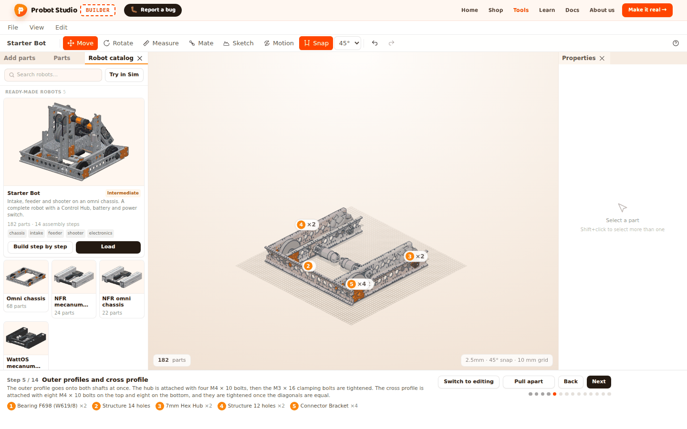
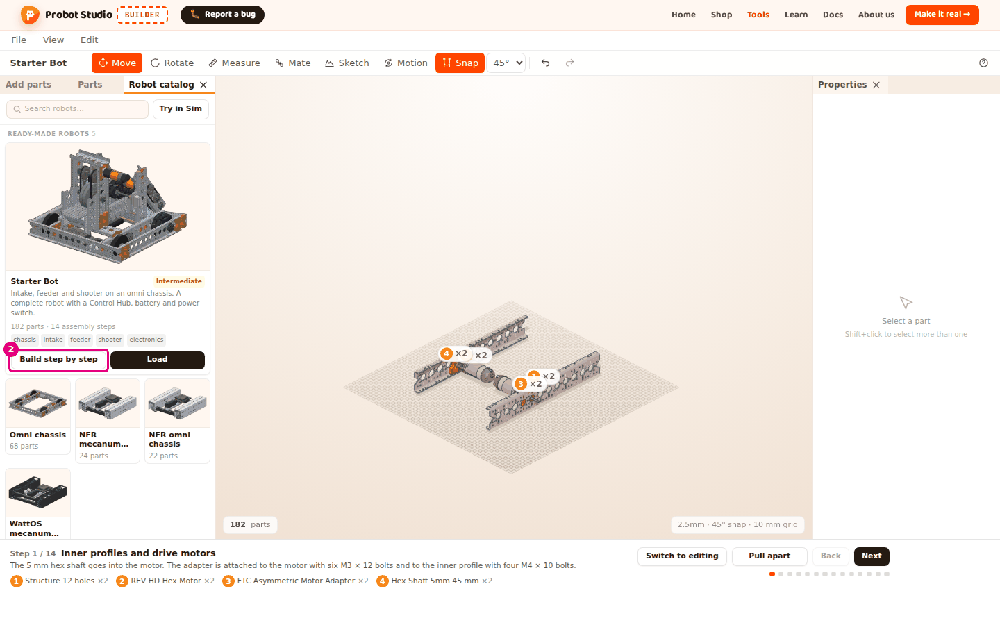
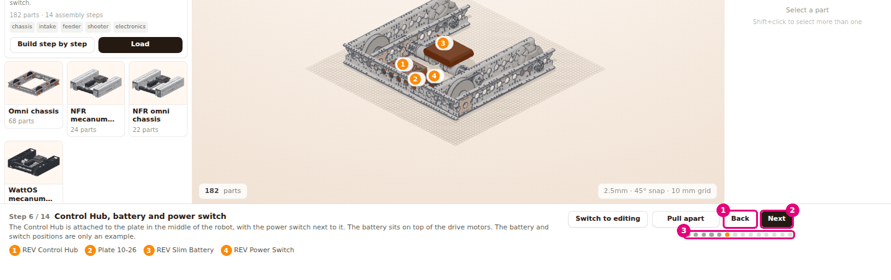
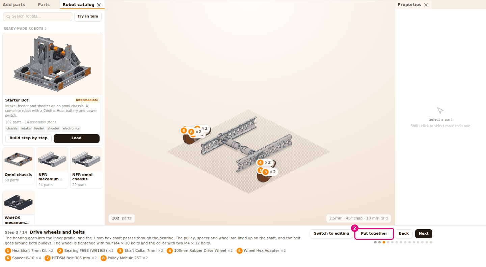
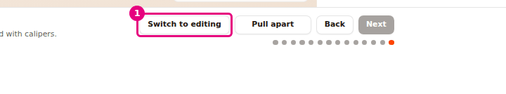

# Build the robot step by step

On this page you will watch the Starter Bot being built part by part in assembly mode. At each step
you see which parts go on. Then you open the robot for editing.

<!-- CAPTURE: url=https://probotstudio.com/builder/?dil=en | hazirla=Starter Bot in assembly mode, Step 5 open | hedef=body | isaret=yok | bekle=[data-montaj-seridi] -->

## Before you start

- The only robot with assembly steps is the **Starter Bot**: 182 parts, 14 steps. The other
  ready-made robots have no **Build step by step**.
- Assembly mode removes everything in the scene and puts the Starter Bot there. If your own work is
  in the scene, first select **File** > **Save (download JSON)**.
- For more about ready-made robots, see [Start with a ready-made robot](hazir-robotla-basla.md).

## Start assembly mode

1. In the **Left panel**, select the **Robot catalog** tab.
2. On the **Starter Bot** card, press **Build step by step**.
3. If the scene has parts in it, a confirmation appears on the card. Press **Replace**.
   
   <!-- CAPTURE: url=https://probotstudio.com/builder/?dil=en | hazirla=empty scene, Robot catalog in front, Build step by step pressed on the Starter Bot card | hedef=[data-adim-adim="starter-bot-rev"];text="Step 1 / 14" | isaret=2 | bekle=text="Step 1 / 14" -->
   <!-- SAY: We open assembly mode from the Starter Bot card with Build step by step. -->

Result: The **Assembly strip** opens below the **Scene**. The strip shows "Step 1 / 14" and the
name of the step, "Inner profiles and drive motors".

Below the step name, the strip shows a short description of the step and the parts that go on in
that step. The parts are numbered. If there is more than one of the same part, "×N" appears next to
it (for example ×4). In the scene you see the following:

- The parts that go on in this step glow orange, with the numbers from the strip above them.
- The parts from earlier steps look light in color.
- The parts from later steps are hidden.

The camera fits the robot in view once, from a diagonal angle. When you change the step, the camera
does not move. You rotate, zoom and pan the camera as usual. See [Move around the scene](sahnede-gezin.md).

## Move between the steps

1. In the **Assembly strip**, press **Next** (<kbd>→</kbd>).
2. To go back to the previous step, press **Back** (<kbd>←</kbd>).
3. To jump to a step, press one of the step dots below **Next**.
   
   <!-- CAPTURE: url=https://probotstudio.com/builder/?dil=en | hazirla=Starter Bot in assembly mode, Step 6 open | hedef=text="Back";text="Next";[aria-label="Steps"] | isaret=1-3 | bekle=text="Step 6 / 14" -->
   <!-- SAY: We move between the steps with Next and Back or with the dots. -->

Result: The strip shows the number and name of the new step. When you go forward, the parts of the
new step come in from outside and settle into place.

When you hold the mouse pointer over a dot, the step number and name appear (for example "Step 6, Control
Hub, battery and power switch"). The dot of the current step is orange, and the dots of the steps
you have passed are dark. On the first step **Back** is faded, and on the last step **Next** is faded.

The 14 steps of the Starter Bot:

| Step | Name |
|---|---|
| 1 | Inner profiles and drive motors |
| 2 | Motor pulleys |
| 3 | Drive wheels and belts |
| 4 | Omni wheels |
| 5 | Outer profiles and cross profile |
| 6 | Control Hub, battery and power switch |
| 7 | Intake side profiles and motor |
| 8 | Intake shafts and wheels |
| 9 | Intake pulleys and belts |
| 10 | Intake ramp and chassis mounting |
| 11 | Feeder servo and shaft |
| 12 | Shooter tower and flywheel |
| 13 | Upper shaft, gears and shooter motor |
| 14 | Hood |

## Pull apart a step's parts

If many parts in a step fit inside each other, you can see them pulled apart.

1. Go to the step whose parts you want to see (for example Step 3).
2. In the **Assembly strip**, press **Pull apart**.
   
   <!-- CAPTURE: url=https://probotstudio.com/builder/?dil=en | hazirla=Starter Bot in assembly mode, Step 3 open, Pull apart pressed | hedef=text="Put together" | isaret=2 | bekle=text="Put together" -->
   <!-- SAY: With Pull apart we see the parts of this step spaced out. -->
3. To put the parts back in place, press **Put together**.

Result: When you press **Pull apart**, the parts of that step move outward from where they are
mounted (an exploded view). The button changes to **Put together**. **Put together** puts the parts
back in place.

The pulled-apart view stays on until you turn it off. When you change the step, the parts of the new
step also appear pulled apart.

## Leave assembly mode and edit the robot

1. In the **Assembly strip**, press **Switch to editing**.
   
   <!-- CAPTURE: url=https://probotstudio.com/builder/?dil=en | hazirla=Starter Bot in assembly mode, Step 14 open | hedef=[data-duzenlemeye-gec] | isaret=1 | bekle=[data-duzenlemeye-gec] -->
   <!-- SAY: With Switch to editing we leave assembly mode and change the robot ourselves. -->
2. In the **Scene**, select a part. The part's settings open in the **Properties** panel.
3. In the **Toolbar**, press **Move** and drag the part's arrow.

Result: The **Assembly strip** closes. All the robot's parts appear in their own colors. You can
select, move and delete parts, and add new ones.

No notification appears when you switch. Whatever step you are on, the whole robot stays in the
scene. The project name becomes "Starter Bot", and the robot sits on one row in the **Parts** tab.

There is one more way to leave assembly mode: load another robot from the **Robot catalog**. Because
the scene has parts in it, a **Cancel** / **Replace** confirmation appears first. If you press
**Build step by step** again while assembly mode is on, the Starter Bot starts over from the
beginning without asking.

## What is off in assembly mode

In assembly mode you can only watch the robot. These things do not work:

- Clicking a part in the scene does not select it. Right-clicking does not open the context menu.
- Keyboard shortcuts do not work. Only <kbd>←</kbd> and <kbd>→</kbd> change the step.
- The list in the **Parts** tab is read-only.
- Everything that changes the scene is blocked: clicking a part in **Add parts**, **File** > **New**,
  **Open...**, **Import (STL, STEP, GLB, OBJ)...** and the like. If you try these, the "Editing is
  off in assembly mode. Switch to editing to make changes" message appears. With **New**, first the
  "The parts in the scene will be deleted. Start a new project?" confirmation opens. Even if you
  confirm, the scene does not change. A part you drag from **Add parts** into the scene is not
  dropped. In that case no notification appears.

The camera and the **View** menu work. The view cube is hidden in assembly mode and comes back when
you press **Switch to editing**. **File** > **Save (download JSON)** also works and downloads the
whole robot.

<!-- SAY: In assembly mode we only watch the robot, and to change it we switch to editing. -->

## Having trouble?

- **"Editing is off in assembly mode. Switch to editing to make changes" appears:** You are in
  assembly mode. In the **Assembly strip**, press **Switch to editing**. See [Troubleshooting](sorunlar.md#montaj-modu).
- **The card has no Build step by step button:** Only the Starter Bot has assembly steps. To load
  the other robots, press their cards.
- **Clicking a part does not select it:** Selection is off in assembly mode. Press **Switch to
  editing**. See [Troubleshooting](sorunlar.md#montaj-modu).
- **<kbd>←</kbd> / <kbd>→</kbd> does not change the step:** On the first step <kbd>←</kbd> does
  nothing, and on the last step <kbd>→</kbd> does nothing. Check the step number in the strip.
- **The robot went off the screen:** Select **View** > **Fit view**.

## Next step

- [Move around the scene](sahnede-gezin.md)
- [Select, hide and delete parts](parcalari-sec-gizle-sil.md)
- [Set up joints and try the motion](eklem-kur-ve-oynat.md)
