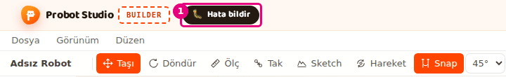

# Interface tour

This page shows every region and every button on the Builder screen. The other pages use the region
names given here. If you wonder what a button does, look for it on this page.

<!-- CAPTURE: url=https://probotstudio.com/builder/?dil=en | hazirla=hazir:WattOS mecanum chassis, one part selected | hedef=bolge:ust-serit,menu,arac-cubugu,sol-panel,sahne,ozellikler | isaret=1-6 | bekle=text="Properties" -->

| # | Region | What is there |
|---|---|---|
| 1 | **Site header** | The site navigation, and the **🐛 Report a bug** and **Make it real →** buttons. |
| 2 | **Menu bar** | The **File**, **View** and **Edit** menus. |
| 3 | **Toolbar** | The project name, the tools, Snap, undo and Help. |
| 4 | **Left panel** | The **Add parts**, **Parts** and **Robot catalog** tabs. |
| 5 | **Scene** | The 3D area, the view cube and the status bar. The **Measure**, **Mate** and **Motion** panels open in the corner of the scene. |
| 6 | **Properties** panel | The settings of the selected part. |
| 7 | **Assembly strip** | Appears below the scene, only in **Build step by step** mode. |

Every time Builder opens, the "The design tool is in development" window appears in the middle of
the screen. Press **Got it, continue** to close it.

While the window is open, an arrow points to
**🐛 Report a bug** in the **Site header** with the text "The Report a bug button is always here".
The button opens a form for sending a message to the team without leaving the page (see
[Report a bug](sorunlar.md#hata-bildir)).

## 1. Site header

| Name | What it does | Shortcut | Related task |
|---|---|---|---|
| **🐛 Report a bug** | Sits next to the "BUILDER" badge. Opens a form for sending a message to the team without leaving the page. | | [Report a bug](sorunlar.md#hata-bildir) |
| **Make it real →** | Opens the window that shows the list of parts in the design, their price and the robot check. | | [Make it real: send the parts list to the shop cart](gercege-dok.md) |

The other links in the header (Home, Shop, Tools, Learn, Docs, About us) go to the rest of the
site.

<!-- CAPTURE: url=https://probotstudio.com/builder/?dil=en | hazirla=clean browser, intro window and cookie banner closed | hedef=probot-header >> .hatabtn | isaret=1 | bekle=text="Report a bug" -->

## 2. Menu bar

Press a menu's name to open it. While a menu is open, moving the mouse pointer to the next menu
opens that one. <kbd>Esc</kbd> or clicking outside the menu closes it.

### File menu

<!-- CAPTURE: url=https://probotstudio.com/builder/?dil=en | hazirla=empty scene | hedef=role=button[name="File"] | isaret=yok | bekle=text="Save (download JSON)" -->

| Name | What it does | Shortcut | Related task |
|---|---|---|---|
| **New** | Empties the scene and starts a new project named "Untitled robot". If there are parts in the scene, it asks first. | | [Save to a file and open it](dosyaya-kaydet-ve-ac.md) |
| **Save (download JSON)** | Downloads the project to your computer as a `<project-name>.json` file. | | [Save to a file and open it](dosyaya-kaydet-ve-ac.md) |
| **Open...** | Opens a `.json` project file from your computer. | | [Save to a file and open it](dosyaya-kaydet-ve-ac.md) |
| **Import (STL, STEP, GLB, OBJ)...** | Adds a 3D model file to the scene as a part. | | [Import a 3D model](model-ice-aktar.md) |
| **Save to my account...** | Saves the robot to your Probot account. You need to sign in. | | [Save to your account and share](hesaba-kaydet-ve-paylas.md) |
| **My robots...** | Lists the robots in your account: open, rename, delete. | | [Save to your account and share](hesaba-kaydet-ve-paylas.md) |
| **Share link...** | Turns a share link on or off for a robot saved to your account. | | [Save to your account and share](hesaba-kaydet-ve-paylas.md) |
| **Robot catalog** | Opens the **Robot catalog** tab in the **Left panel**. | | [Start with a ready-made robot](hazir-robotla-basla.md) |
| **Try in Sim** | Opens the robot in the scene in Sim, in a new tab. It is faded when the scene is empty. | | [Try the robot in Sim](simde-dene.md) |

The account items look faded with the note "Connecting" while Builder connects to the server.
If the server cannot be reached, the note reads "Not available right now".

### View menu

| Group | Name | What it does | Related task |
|---|---|---|---|
| CAMERA | **Perspective** / **Orthographic** | Picks the camera type. The default is **Orthographic**. | [Move around the scene](sahnede-gezin.md) |
| MOUSE CONTROLS | **Onshape** / **SolidWorks** / **Fusion 360** | Picks which mouse buttons rotate and pan the camera. The default is **Onshape**. | [Move around the scene](sahnede-gezin.md) |
| OUTLINE | **Off** / **Rim** / **Line** | The type of line drawn around the parts. The default is **Line**. | [Move around the scene](sahnede-gezin.md) |
| | **Fit view** | Fits the whole robot in view. | [Move around the scene](sahnede-gezin.md) |
| PANELS | **Add parts**, **Parts**, **Properties**, **Robot catalog**, **Build** | A checked panel is shown. Uncheck it to close the panel. **Build** is closed by default. | [Arrange the panels](panelleri-duzenle.md), [Check the robot with Build](robotu-derle.md) |
| | **Reset layout** | Puts the panels back where they were the first time Builder opened. | [Arrange the panels](panelleri-duzenle.md) |
| LANGUAGE | **Türkçe** / **English** | Picks the interface language. The page reloads. The default is **Türkçe**. | |

This browser remembers all of these choices.

### Edit menu

Items are active only when they can be used (for example, **Delete** is faded when nothing is
selected).

| Name | What it does | Shortcut | Related task |
|---|---|---|---|
| **Undo** | Undoes the last change. It goes back 59 steps at most. | <kbd>Ctrl</kbd>+<kbd>Z</kbd> | [Select, hide and delete parts](parcalari-sec-gizle-sil.md) |
| **Redo** | Brings back the change you undid. | <kbd>Ctrl</kbd>+<kbd>Y</kbd> | [Select, hide and delete parts](parcalari-sec-gizle-sil.md) |
| **Duplicate** | Puts a copy of the selection next to it. | <kbd>Ctrl</kbd>+<kbd>D</kbd> | [Duplicate, mirror and pattern parts](cogalt-aynala-dizi.md) |
| **Mirror...** | Makes a left-right or front-back mirror copy of the selection. | <kbd>A</kbd> | [Duplicate, mirror and pattern parts](cogalt-aynala-dizi.md) |
| **Pattern...** | Copies the selection in one direction at equal spacing. | <kbd>D</kbd> | [Duplicate, mirror and pattern parts](cogalt-aynala-dizi.md) |
| **Add belt** | Puts a belt between the two selected pulleys. | <kbd>K</kbd> | [Add a belt to two pulleys](kayis-ekle.md) |
| **Delete** | Deletes the selected parts. | <kbd>Del</kbd> | [Select, hide and delete parts](parcalari-sec-gizle-sil.md) |

## 3. Toolbar

<!-- CAPTURE: url=https://probotstudio.com/builder/?dil=en | hazirla=empty scene | hedef=title="Rename the project";title="Move (T / M)";title^="Snap" | isaret=1-3 | bekle=text="Untitled robot" -->

| Name | What it does | Shortcut | Related task |
|---|---|---|---|
| Project name (for example **Untitled robot**) | Press it to change the name. Type the name, then press <kbd>Enter</kbd>. <kbd>Esc</kbd> cancels. If the robot is saved to your account, "Saved" or "Not saved" appears next to it. | | [Save to a file and open it](dosyaya-kaydet-ve-ac.md) |
| **Move** | Puts the three-axis move arrows on the selected part. It is selected when Builder opens. | <kbd>T</kbd> or <kbd>M</kbd> | [Move and rotate a part](tasi-ve-dondur.md) |
| **Rotate** | Puts the rotate rings on the selected part. | <kbd>R</kbd> | [Move and rotate a part](tasi-ve-dondur.md) |
| **Measure** | Measures the distance between two points. | <kbd>Ö</kbd> or <kbd>I</kbd> | [Measure a distance](mesafe-olc.md) |
| **Mate** | Fits a hole of one part onto a hole of another part. | <kbd>B</kbd> | [Mate parts by their holes](parcalari-tak.md) |
| **Sketch** | Opens a 2D drawing on a face or a plane. | <kbd>S</kbd> | [Draw a sketch and make it solid with Extrude](sketch-ve-extrude.md) |
| **Motion** | Opens the **Motion** panel, which moves the joints. | <kbd>E</kbd> | [Set up joints and try the motion](eklem-kur-ve-oynat.md) |
| **Snap** | When it is on, a part moves in 2.5 mm steps, snaps to holes and turns by the selected rotation step. It is on when it is orange. | Hold <kbd>Shift</kbd> while moving to turn it off for a moment | [Move and rotate a part](tasi-ve-dondur.md) |
| Rotation step (**45°**) | Picks the rotation step: 5°, 15°, 30°, 45°, 90°. It is faded when Snap is off. | | [Move and rotate a part](tasi-ve-dondur.md) |
| Undo icon | Same as **Edit** > **Undo**. | <kbd>Ctrl</kbd>+<kbd>Z</kbd> | [Select, hide and delete parts](parcalari-sec-gizle-sil.md) |
| Redo icon | Same as **Edit** > **Redo**. | <kbd>Ctrl</kbd>+<kbd>Shift</kbd>+<kbd>Z</kbd> | [Select, hide and delete parts](parcalari-sec-gizle-sil.md) |
| Help icon (**?**) | Opens the "Keyboard shortcuts" window. | <kbd>?</kbd> | [Shortcuts](kisayollar.md) |

Selecting **Move** or **Rotate** closes the **Measure** and **Mate** tools if they are open.

## 4. Left panel

There are three tabs. Select a tab to bring it to the front. The cross (×) next to a tab closes
the panel.

To open the panel again, use the **PANELS** group in the **View** menu. If a tab does not fit,
select it from the drop-down arrow at the end of the tab row.

### Add parts tab

<!-- CAPTURE: url=https://probotstudio.com/builder/?dil=en | hazirla=empty scene | hedef=placeholder="Search parts...";[data-gorunum="tur"] | isaret=1-2 | bekle=text="Basic shapes" -->

| Name | What it does | Related task |
|---|---|---|
| **Search parts...** box | Searches parts by name, type, description and product code (SKU). If nothing matches, it shows "No results". | [Add parts](parca-ekle.md) |
| **View**: **Part type** / **Brand** | Lists the sections by part type or by brand. | [Add parts](parca-ekle.md) |
| Section row (for example **Structure**, **Wheels**) | Opens the section. The row shows the number of parts and small pictures. | [Add parts](parca-ekle.md) |
| Family row | Opens the options of one part, such as its length or size (for example "N length options", "N size options"). | [Add parts](parca-ekle.md) |
| Part row | Press it to add the part to the scene. If you drag it into the scene, it lands where you drop it. The row shows the stock ("in stock", "N in stock", "out of stock") and the price. | [Add parts](parca-ekle.md) |
| Back button | Goes back up one level ("Back to sections"). | [Add parts](parca-ekle.md) |
| **Import** row | Lets you choose a 3D model file. It appears in the **Basic shapes** section. In the brand view, it is at the end of the **General** section. | [Import a 3D model](model-ice-aktar.md) |

The **Brand** view also has a **Boardoza** section with 21 boards (see [Add parts](parca-ekle.md#boardoza-karti-ekle)).

Inside a section, <kbd>Esc</kbd> goes back up one level.

### Parts tab

| Name | What it does | Related task |
|---|---|---|
| **Search in parts...** box | Searches the parts in the scene by name, type, SKU and hardware name. | [Select, hide and delete parts](parcalari-sec-gizle-sil.md) |
| **View**: **All parts** / **Part type** / **Brand** | Shows the list flat, grouped by type or grouped by brand. | [Select, hide and delete parts](parcalari-sec-gizle-sil.md) |
| Part row | Press it to select the part. Press it with <kbd>Shift</kbd> to add it to the selection. | [Select, hide and delete parts](parcalari-sec-gizle-sil.md) |
| Ready-made robot row | Puts the parts that came with a ready-made robot in one row. Press it to select them all. "N parts" appears next to it. | [Start with a ready-made robot](hazir-robotla-basla.md) |
| Arrow in the ready-made robot row | Opens ("Show its parts") or closes the parts inside the row. | [Start with a ready-made robot](hazir-robotla-basla.md) |
| **Group (n)** row | Shows a group made with **Group**. | [Group parts and attach them to each other](grupla-ve-bagla.md) |
| **Hide** / **Show** icon in a row | Hides or shows the part in the scene. | [Select, hide and delete parts](parcalari-sec-gizle-sil.md) |
| **Delete** icon in a row | In a part row, it deletes the part. In a group or robot row, it deletes all the parts inside. You can undo it with <kbd>Ctrl</kbd>+<kbd>Z</kbd>. | [Select, hide and delete parts](parcalari-sec-gizle-sil.md) |

When the scene is empty, the tab shows "No parts yet. Start from the Add parts tab." In assembly
mode the list is read-only.

### Robot catalog tab

| Name | What it does | Related task |
|---|---|---|
| **Search robots...** box | Filters the ready-made robots and the community robots by name. | [Start with a ready-made robot](hazir-robotla-basla.md) |
| **Try in Sim** | Opens the robot in the scene in Sim, in a new tab. It is faded when the scene is empty. | [Try the robot in Sim](simde-dene.md) |
| Large robot card (**Starter Bot**) | Shows the difficulty, a description, and the number of parts and assembly steps. | [Start with a ready-made robot](hazir-robotla-basla.md) |
| **Build step by step** | Shows the robot in assembly mode, building it step by step. | [Build the robot step by step](adim-adim-kur.md) |
| **Load** | Puts the whole robot in the scene. | [Start with a ready-made robot](hazir-robotla-basla.md) |
| Small robot card | Press it to load the robot into the scene. | [Start with a ready-made robot](hazir-robotla-basla.md) |
| **Cancel** / **Replace** | The load confirmation when the scene is not empty. **Replace** removes what is in the scene and puts the new robot in. | [Start with a ready-made robot](hazir-robotla-basla.md) |
| Cards in the **COMMUNITY** section | Design examples (for example **4-motor omni chassis (+ layout)**) and approved community robots. Press a card to load it. | [Start with a ready-made robot](hazir-robotla-basla.md#omni4-sasiyi-ac) |
| **Share your robot** | Opens the form that sends your robot to the community catalog for review. You need to sign in. | [Save to your account and share](hesaba-kaydet-ve-paylas.md) |
| **Robot name**, **Share**, **Cancel** | The field and the buttons of the share form. The name is 80 characters at most. | [Save to your account and share](hesaba-kaydet-ve-paylas.md) |
| **Sign in in a new tab** | Appears if you are not signed in. Opens the sign-in page (in Turkish) in a new tab. | [Save to your account and share](hesaba-kaydet-ve-paylas.md) |
| **Try again** | Asks for the community list again if it could not be loaded. | [Troubleshooting](sorunlar.md) |
| **Show more** | Brings the rest of the community list. | [Start with a ready-made robot](hazir-robotla-basla.md) |

## 5. Scene

| Name | What it does | Related task |
|---|---|---|
| 3D area | The parts stand here. Left-click a part to select it. The mouse buttons move the camera. | [Move around the scene](sahnede-gezin.md) |
| View cube | The cube in the corner of the scene. Press a face to point the camera that way: **RIGHT**, **LEFT**, **TOP**, **BOTTOM**, **FRONT**, **BACK**. | [Move around the scene](sahnede-gezin.md) |
| Status bar | The line at the bottom of the scene. It shows the number of parts, the number selected, the size of the selection (width x length x height, in mm) and the number hidden. The snap setting is at the other end ("2.5mm · 45° snap · 10 mm grid"). | [Move and rotate a part](tasi-ve-dondur.md) |

### Empty scene card

When the scene is empty, a card that says "The scene is empty" appears in the middle.

| Name | What it does | Related task |
|---|---|---|
| **Parts list** | Brings the **Add parts** tab to the front. | [Add parts](parca-ekle.md) |
| **Robot catalog** | Brings the **Robot catalog** tab to the front. | [Start with a ready-made robot](hazir-robotla-basla.md) |
| **Starter Bot**, **Omni chassis**, **WattOS mecanum chassis** | Loads the robot into the scene. | [Start with a ready-made robot](hazir-robotla-basla.md) |
| **Empty scene** | Closes the card and brings the **Add parts** tab to the front. | [Add parts](parca-ekle.md) |
| Cross (**Close**) | Closes the card. | |

### Context menu

Right-click in the scene to open it. If you drag with the right button, the camera rotates and the
menu does not open.

On a part, the menu's heading shows the part's name and the number selected.
The menu does not open in assembly mode or while **Measure**, **Mate** or **Sketch** is open.

<!-- CAPTURE: url=https://probotstudio.com/builder/?dil=en | hazirla=hazir:WattOS mecanum chassis, right-click on one part | hedef=koordinat | isaret=yok | bekle=text="Hide" -->

| Name | What it does | Shortcut | Related task |
|---|---|---|---|
| **Edit sketch** | Opens the selected sketch for editing. Appears only when a single sketch is selected. | Double-click the sketch | [Draw a sketch and make it solid with Extrude](sketch-ve-extrude.md) |
| **Extrude** | Makes a solid part from the selected sketch. Appears only when a single sketch is selected. | | [Draw a sketch and make it solid with Extrude](sketch-ve-extrude.md) |
| **Hide** / **Show** | Hides or shows the selection. | <kbd>H</kbd> | [Select, hide and delete parts](parcalari-sec-gizle-sil.md) |
| **Copy** | Copies the selection to the clipboard. | <kbd>Ctrl</kbd>+<kbd>C</kbd> | [Duplicate, mirror and pattern parts](cogalt-aynala-dizi.md) |
| **Duplicate** | Puts a copy of the selection next to it. | <kbd>Ctrl</kbd>+<kbd>D</kbd> | [Duplicate, mirror and pattern parts](cogalt-aynala-dizi.md) |
| **Mirror...** | Opens the Mirror window. | <kbd>A</kbd> | [Duplicate, mirror and pattern parts](cogalt-aynala-dizi.md) |
| **Pattern...** | Opens the Pattern window. | <kbd>D</kbd> | [Duplicate, mirror and pattern parts](cogalt-aynala-dizi.md) |
| **Focus** | Points the camera at the selection. The parts do not move. | | [Move around the scene](sahnede-gezin.md) |
| **Add belt** | When two pulleys are selected, puts a belt between them. | <kbd>K</kbd> | [Add a belt to two pulleys](kayis-ekle.md) |
| **Group** | Makes several parts into one group. | | [Group parts and attach them to each other](grupla-ve-bagla.md) |
| **Ungroup** | Turns the selected group back into separate parts. | | [Group parts and attach them to each other](grupla-ve-bagla.md) |
| **Detach (n)** | Detaches the parts in the selection from the parts they are attached to. When there are several, it shows the number. | | [Group parts and attach them to each other](grupla-ve-bagla.md) |
| **Delete** / **Delete (n)** | Deletes the selection. If several parts are selected, it shows the number. | <kbd>Del</kbd> | [Select, hide and delete parts](parcalari-sec-gizle-sil.md) |
| **Paste here** | On empty space: pastes the parts on the clipboard at the point you clicked. It is faded when the clipboard is empty. | <kbd>Ctrl</kbd>+<kbd>V</kbd> | [Duplicate, mirror and pattern parts](cogalt-aynala-dizi.md) |
| **Select all** | On empty space: selects all the parts in the scene. | <kbd>Ctrl</kbd>+<kbd>A</kbd> | [Select, hide and delete parts](parcalari-sec-gizle-sil.md) |
| **Show all (n)** | On empty space: shows all the hidden parts. | | [Select, hide and delete parts](parcalari-sec-gizle-sil.md) |

### Tool panels in the corner of the scene

| Panel | When it opens | Buttons | Related task |
|---|---|---|---|
| **Measure** | When you select **Measure** | Close ("Close measure (Esc)"), **Delete this measurement** in each measurement row | [Measure a distance](mesafe-olc.md) |
| **Mate** | When you select **Mate** | Close ("Close the mate tool (Esc)"), **45°** (the selected step) and **Flip**, which rotate or flip the last mate | [Mate parts by their holes](parcalari-tak.md) |
| **Motion** | When you select **Motion** | Close, **Set up joints automatically**, the joint slider and angle box, **Select the part**, **Play** / **Stop**, **Speed**, **Reset**, **Save this pose**, **Auto setup** | [Set up joints and try the motion](eklem-kur-ve-oynat.md) |

## 6. Properties panel

With no part selected, it shows "Select a part". If the panel is closed and you select a part, it
opens by itself.

The name of the selected part is at the top of the panel. The fields you see
change with the part type.

<!-- CAPTURE: url=https://probotstudio.com/builder/?dil=en | hazirla=hazir:WattOS mecanum chassis, one Structure part selected | hedef=text="Length";text="Position (mm)";text="Rotation (°)" | isaret=1-3 | bekle=text="Position (mm)" -->

### On every part

| Name | What it does | Related task |
|---|---|---|
| **Position (mm)** X / Y / Z | Sets the part's position as numbers. <kbd>Enter</kbd> applies, <kbd>Esc</kbd> cancels. | [Move and rotate a part](tasi-ve-dondur.md) |
| **Rotation (°)** X / Y / Z | Sets the part's angle as numbers. | [Move and rotate a part](tasi-ve-dondur.md) |
| -90° / +90° icons for the Y axis | Turn the part 90° around the vertical axis. They are next to the **Rotation (°)** heading. | [Move and rotate a part](tasi-ve-dondur.md) |
| **Duplicate** | Puts a copy of the part next to it. | [Duplicate, mirror and pattern parts](cogalt-aynala-dizi.md) |
| **Delete** | Deletes the part. | [Select, hide and delete parts](parcalari-sec-gizle-sil.md) |
| **Mirror** | Opens the Mirror window. | [Duplicate, mirror and pattern parts](cogalt-aynala-dizi.md) |
| **Pattern** | Opens the Pattern window. | [Duplicate, mirror and pattern parts](cogalt-aynala-dizi.md) |

### By part type

| Name | When you see it | What it does | Related task |
|---|---|---|---|
| Option selector (for example **Length**, **Size**, **Speed**) and **−** / **+** | When the part comes from a family | Changes the part's length or size. **−** picks the previous option, **+** the next one. | [Add parts](parca-ekle.md) |
| **Length** / **Width** step selector | Only on old built-in parts that come from old project files (U/C channel, Plate, Flat bar, Standoff). It does not appear on parts from the **Add parts** list. | Sets a length from 1 to 40, in 10 mm steps. | [Add parts](parca-ekle.md) |
| **Length** field, shorten / lengthen | Parts whose length is set by cutting (for example a shaft) | Sets the length in mm or picks it from a list. The limits are written below the field. | [Add parts](parca-ekle.md) |
| Size fields (**Width**, **Length**, **Height**, **Diameter**, **Outer diameter**, **Inner diameter**) | Basic shapes | Sets the shape's size in mm. | [Make a part from basic shapes](temel-sekillerle-parca-yap.md) |
| **Type**: **Solid** / **Hole** | Basic shape, combined shape, Extrude part. On a combined shape, **Hole** is faded. | **Merge** cuts a Hole shape out of the solid shape. | [Make a part from basic shapes](temel-sekillerle-parca-yap.md) |
| **Color** | Basic shapes | Blue, Green, Yellow, Red, Purple, Black, White. | [Make a part from basic shapes](temel-sekillerle-parca-yap.md) |
| **Split** | Combined shape | Splits the shape into its parts. | [Make a part from basic shapes](temel-sekillerle-parca-yap.md) |
| **File units**: mm / cm / m / in | Imported model | Fixes the model's scale. | [Import a 3D model](model-ice-aktar.md) |
| **Up axis**: **Z up** / **Y up** | Imported model | Stands the model upright. | [Import a 3D model](model-ice-aktar.md) |
| **Choose the file again** | When the saved project has no data for the model | Lets you choose the model file again. | [Import a 3D model](model-ice-aktar.md) |
| **Edit**, **Extrude (N regions)** | Sketch | Edits the sketch, makes it solid. | [Draw a sketch and make it solid with Extrude](sketch-ve-extrude.md) |
| **Thickness (mm)**, **Direction** | Part made with Extrude | Changes the thickness and the direction later. | [Draw a sketch and make it solid with Extrude](sketch-ve-extrude.md) |

### Connection section

It appears under the **Connection** heading on every part except sketches and basic shapes of
type Hole.

| Name | What it does | Related task |
|---|---|---|
| **Attach to a part** | Attaches this part to the part you select. When that part moves, this part moves with it. | [Group parts and attach them to each other](grupla-ve-bagla.md) |
| **Detach** | Removes the part's attachment. | [Group parts and attach them to each other](grupla-ve-bagla.md) |
| Axis selector and **Add joint** | Puts a turning joint between this part and the part it is attached to. | [Set up joints and try the motion](eklem-kur-ve-oynat.md) |
| **Continuous rotation** / **Limited rotation** | The joint type. For limited rotation, you enter **Min °** and **Max °**. | [Set up joints and try the motion](eklem-kur-ve-oynat.md) |
| **Remove joint** | Deletes the joint. The attachment stays. | [Set up joints and try the motion](eklem-kur-ve-oynat.md) |
| **Try it in the Motion panel** | Opens the **Motion** panel. | [Set up joints and try the motion](eklem-kur-ve-oynat.md) |
| **Select the driving gear** / **Select the driving pulley**, **Remove** | Pairs the gear or pulley with the part that turns it, or removes the pair. | [Set up joints and try the motion](eklem-kur-ve-oynat.md) |

### Hardware section

It appears only when a motor or a servo is selected.

| Name | What it does | Related task |
|---|---|---|
| **Name** | The name used in the code (for example `leftFrontMotor`). | [Give motors and servos a name and a port](motor-ve-servo-ayarla.md) |
| **Hub**: **Control Hub** / **Expansion Hub** | The board the motor is connected to. | [Give motors and servos a name and a port](motor-ve-servo-ayarla.md) |
| **Port** | The port number on the board. The first option is **Not set**. If two parts use the same port, the warning "Port N is used by another motor" appears. | [Give motors and servos a name and a port](motor-ve-servo-ayarla.md) |
| **Reverse direction** | Reverses the motor's direction in the code. | [Give motors and servos a name and a port](motor-ve-servo-ayarla.md) |

### When a belt is selected

The heading shows "HTD5M belt". The **Required length**, **Tooth count**, **Center distance**,
**Pulleys** and **Ratio** rows are shown.

| Name | What it does | Related task |
|---|---|---|
| **Select pulleys** | Selects the two pulleys the belt goes around. | [Add a belt to two pulleys](kayis-ekle.md) |
| **Delete** | Deletes the belt. | [Add a belt to two pulleys](kayis-ekle.md) |

### When several parts are selected

The heading shows "Multiple selection" and the number of selected parts. If all the parts are the
same type, the option and length fields appear too.

| Name | What it does | Related task |
|---|---|---|
| **Duplicate**, **Delete**, **Mirror**, **Pattern** | The same as for one part, applied to the whole selection. | [Duplicate, mirror and pattern parts](cogalt-aynala-dizi.md) |
| **Add belt** | Appears when exactly two pulleys are selected. It shows the required length beforehand. | [Add a belt to two pulleys](kayis-ekle.md) |
| **Merge** | Appears when the whole selection is basic shapes, combined shapes or Extrude parts. Makes the shapes into one part and cuts out the holes. | [Make a part from basic shapes](temel-sekillerle-parca-yap.md) |

## 7. Assembly strip

It opens below the scene when you press **Build step by step** in the **Robot catalog**. The heading
shows "Step N / M" and the step's name. Below it are the parts mated in that step.

| Name | What it does | Shortcut | Related task |
|---|---|---|---|
| **Switch to editing** | Leaves assembly mode and makes the robot editable. | | [Build the robot step by step](adim-adim-kur.md) |
| **Pull apart** / **Put together** | Shows that step's parts pulled apart (exploded), or puts them back in place. | | [Build the robot step by step](adim-adim-kur.md) |
| **Back** | Goes to the previous step. | <kbd>←</kbd> | [Build the robot step by step](adim-adim-kur.md) |
| **Next** | Goes to the next step. | <kbd>→</kbd> | [Build the robot step by step](adim-adim-kur.md) |
| Step dots | Press one to jump to that step. | | [Build the robot step by step](adim-adim-kur.md) |

## Windows and panels that open

| Window | How it opens | Buttons | Related task |
|---|---|---|---|
| **Keyboard shortcuts** | The Help icon or <kbd>?</kbd> | <kbd>Esc</kbd> or <kbd>?</kbd> to close it | [Shortcuts](kisayollar.md) |
| **Mirror** | <kbd>A</kbd> or **Edit** > **Mirror...** | **Left-right mirror** / **Front-back mirror**, **Robot center** / **Selection center** / **Next to the selection**, **Cancel**, **Mirror** | [Duplicate, mirror and pattern parts](cogalt-aynala-dizi.md) |
| **Pattern** | <kbd>D</kbd> or **Edit** > **Pattern...** | Direction (X, Y, Z), **Total count**, **Spacing (mm)**, **Cancel**, **Pattern** | [Duplicate, mirror and pattern parts](cogalt-aynala-dizi.md) |
| **Make it real** | **Make it real →** in the **Site header** | **show**, **Add the missing parts**, **Add to cart and go to the shop**, close | [Make it real: send the parts list to the shop cart](gercege-dok.md) |
| **Build** panel | **View** > **Build** | **Build**, **Build again**, **Get a price quote** | [Check the robot with Build](robotu-derle.md) |
| **Sketch** panel | The **Sketch** tool. It opens as a temporary tab in the **Left panel**. | Plane, drawing tools, constraints, **Undo**, **Delete**, **Cancel**, **Finish** | [Draw a sketch and make it solid with Extrude](sketch-ve-extrude.md) |
| **Extrude** panel | **Extrude**. It opens as a temporary tab in the **Left panel**. | **Thickness (mm)**, **Type**, **Direction**, **Cancel**, **OK** | [Draw a sketch and make it solid with Extrude](sketch-ve-extrude.md) |
| Account windows | **File** > **Save to my account...**, **My robots...**, **Share link...** | **Save**, **Save as a new robot**, **Create link**, **Copy**, **Turn off link**, **Open**, **Delete**, **Copy link** | [Save to your account and share](hesaba-kaydet-ve-paylas.md) |

Short notifications appear in the corner of the screen. Each one stays for 3.5 seconds. Press a
notification to close it.
