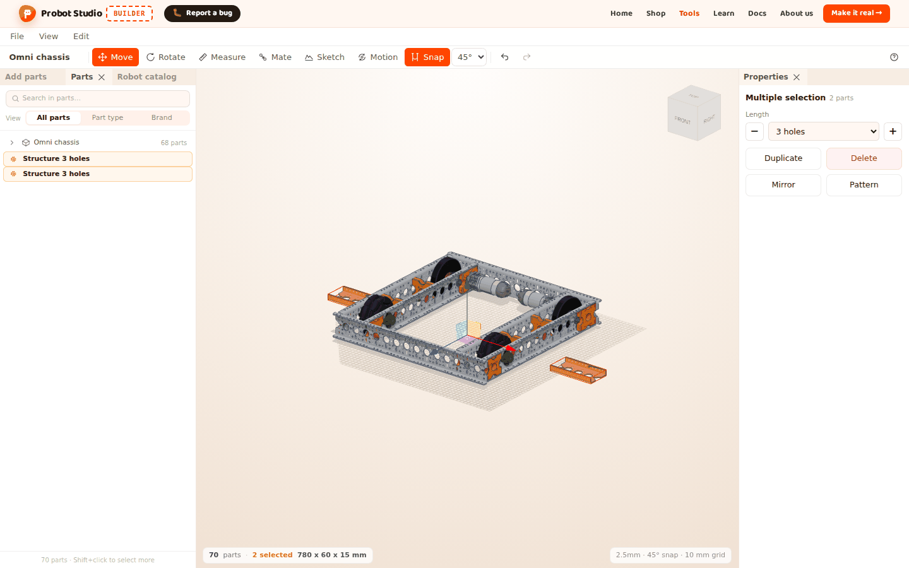
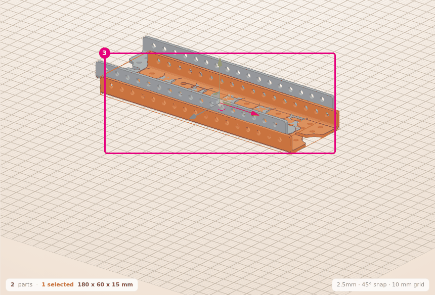
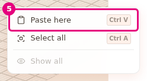
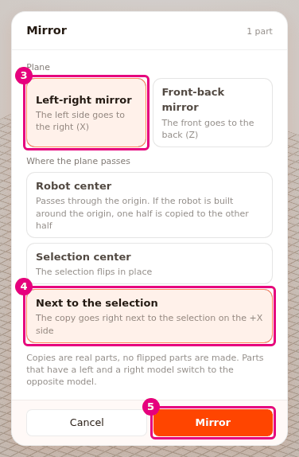
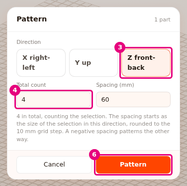

# Duplicate, mirror and pattern parts

On this page you will copy the selected parts. You will place a copy next to the original, paste it
at the spot you want, make a mirror copy and pattern parts in a row at equal spacing.

<!-- CAPTURE: url=https://probotstudio.com/builder/?dil=en | hazirla=hazir:Omni chassis + Structure and its mirror copy | hedef=body | isaret=yok | bekle=canvas -->

## Before you start

- The scene is empty. **Add parts** > **Structure** > **Structure** > **5 holes** is added and selected
  (see [Add parts](parca-ekle.md)).
- For the mirror section, you will also add **Add parts** > **Wheels** > **Mecanum Wheel** > **Left**.
- **Measure**, **Mate** and **Sketch** are off. While one of them is on, <kbd>A</kbd> and <kbd>D</kbd>
  do not open a window.

## Duplicate the selection

1. In the **Scene**, select the Structure part.
2. In the **Menu bar**, open the **Edit** menu.
3. Select **Duplicate** (<kbd>Ctrl</kbd>+<kbd>D</kbd>). The copy sits 20 mm away from the original in the X and Z
   directions.
   
   <!-- CAPTURE: url=https://probotstudio.com/builder/?dil=en | hazirla=empty scene, Structure 5 holes added, duplicated with Ctrl+D | hedef=koordinat:kopya-parca | isaret=3 | bekle=text="2 parts" -->
   <!-- SAY: We duplicate the selected part and the copy lands next to the original. -->

Result: The status bar says "2 parts · 1 selected". The selected part is the copy.

- **Duplicate** is also in the context menu and in the **Properties** panel.
- If more than one part is selected, they are all duplicated together. Groups stay groups in the copy.
- **Duplicate** also copies the selection to the clipboard. Your earlier copy is removed from the clipboard.

## Copy and paste

1. In the **Scene**, select the Structure part.
2. Right-click the part. The context menu opens.
3. In the menu, select **Copy** (<kbd>Ctrl</kbd>+<kbd>C</kbd>). "1 part copied" appears in the corner.
4. In the **Scene**, right-click an empty spot.
5. In the menu, select **Paste here**.
   
   <!-- CAPTURE: url=https://probotstudio.com/builder/?dil=en | hazirla=empty scene, Structure 5 holes copied, right-click on an empty spot | hedef=text="Paste here" | isaret=5 | bekle=text="Paste here" -->
   <!-- SAY: We paste the copied part at the spot where we right-clicked. -->

Result: The copy is placed at the spot on the floor where you right-clicked, and it is selected. Its
height is the same as the original's.

- <kbd>Ctrl</kbd>+<kbd>V</kbd> places the copy 20 mm away from the original in the X and Z directions.
  Every <kbd>Ctrl</kbd>+<kbd>V</kbd> places it at the same spot. To keep the copies apart, move them
  or use **Paste here**.
- If the clipboard is empty, **Paste here** is faded.
- The clipboard is emptied when the page is reloaded.

## Make a mirror copy

The **Mirror** window makes a left-right or front-back mirror copy of the selection. Parts that have a
right and a left model switch to the opposite model: the mirror of **Mecanum Wheel Left** is
**Mecanum Wheel Right**.

1. Select **Add parts** > **Wheels** > **Mecanum Wheel** > **Left**. The wheel is added and is selected.
2. Select **Edit** > **Mirror...** (<kbd>A</kbd>). The top of the window says "Mirror" and "1 part".
3. Under **Plane**, select **Left-right mirror**.
4. Under **Where the plane passes**, select **Next to the selection**.
5. Press **Mirror**.
   
   <!-- CAPTURE: url=https://probotstudio.com/builder/?dil=en | hazirla=empty scene, Wheels > Mecanum Wheel > Left added and selected, Mirror window open with A, Left-right mirror and Next to the selection selected | hedef=[data-testid="ayna-eksen-x"];[data-testid="ayna-merkez-yan"];[data-testid="ayna-uygula"] | isaret=3,4,5 | bekle=[data-testid="ayna-penceresi"] -->
   <!-- SAY: We mirror the left wheel next to the selection and the copy comes in as a right wheel. -->

Result: A **Mecanum Wheel Right** appears to the right of the wheel and is selected. The notification
"1 part mirrored, 1 part switched between its right and left model" appears in the corner. The mirror is a single undo
step.

### Options in the Mirror window

| Group | Option | What it does |
|---|---|---|
| **Plane** | **Left-right mirror** | The left side goes to the right (X axis). Default. |
| **Plane** | **Front-back mirror** | The front side goes to the back (Z axis). |
| **Where the plane passes** | **Robot center** | The plane passes through the origin. If the robot is built around the origin, one half is copied to the other half. Default. |
| **Where the plane passes** | **Selection center** | The copy stays where the selection is, flipped over. |
| **Where the plane passes** | **Next to the selection** | The copy lands right next to the selection. |

The note in the window says this: copies are real parts, no flipped parts are made. So a copy of a
part that has no right and left model is placed in the closest pose. **Cancel** closes the window
without making a copy.

<!-- SAY: We can pass the mirror plane through the middle of the robot or next to the selection. -->

## Pattern parts at equal spacing

The **Pattern** window patterns the selection in a row in one direction, at equal spacing.

1. In the **Scene**, select the Structure part.
2. Select **Edit** > **Pattern...** (<kbd>D</kbd>).
3. Under **Direction**, select **Z front-back**.
4. In the **Total count** box, type `4`. The count includes the selection itself.
5. In the **Spacing (mm)** box, type `60`.
6. Press **Pattern**.
   
   <!-- CAPTURE: url=https://probotstudio.com/builder/?dil=en | hazirla=empty scene, Structure 5 holes selected, Pattern window open with D, Z front-back selected, count 4, spacing 60 | hedef=[data-testid="dizi-eksen-z"];[data-testid="dizi-adet"];[data-testid="dizi-uygula"] | isaret=3,4,6 | bekle=[data-testid="dizi-penceresi"] -->
   <!-- SAY: We want four of the same part, so we pattern it with sixty millimeters of spacing. -->

Result: There are 4 Structures in the front-back direction, 60 mm apart. The parts do not overlap. The
whole pattern stays selected.

- The **Direction** options are **X right-left**, **Y up** and **Z front-back**.
- **Total count** is from 2 to 50. The default is 3.
- **Spacing (mm)** starts as the size of the selection in that direction, rounded up to the 10 mm
  grid step. When you change the direction and have not typed a spacing yourself, the spacing follows
  the size in the new direction. A spacing you typed yourself is kept when you change the direction.
  A negative spacing patterns the other way. The spacing can be at most 2000 mm.
- One pattern adds at most 1000 parts.
- If the values are not valid, red text appears below the boxes and **Pattern** stays faded.

## While the window is open

While the **Mirror** or **Pattern** window is open, the other shortcuts do not work. <kbd>Esc</kbd> or
a click outside the window closes it.

The last plane, position, direction and count you applied
(when you pressed **Mirror** or **Pattern**) are remembered for this session. If you close the window
with **Cancel**, <kbd>Esc</kbd> or a click outside, your changes are not kept.

When you reload the page, these settings go back to the defaults. The spacing is worked out again from the
selection each time the window opens.

Ways to open the window: the **Edit** menu, a right-click on a part (**Mirror...**, **Pattern...**),
**Mirror** and **Pattern** in the **Properties** panel, and the <kbd>A</kbd> and
<kbd>D</kbd> keys.

<!-- SAY: When we mirror the next part, the settings we picked last time are already there. -->

## Having trouble?

- **<kbd>A</kbd> or <kbd>D</kbd> does not open the window:** Select a part first. If **Measure**,
  **Mate** or **Sketch** is on, turn it off.
- **"Count must be between 2 and 50" appears:** In the **Total count** box, type a whole number from 2
  to 50. See [Troubleshooting](sorunlar.md#dizi-deger-siniri).
- **"Spacing cannot be 0" appears:** In the **Spacing (mm)** box, type a number other than zero.
  See [Troubleshooting](sorunlar.md#dizi-deger-siniri).
- **"The selection is on the mirror plane and is its own mirror, no copy needed" appears:** The
  selection is already symmetric and sits on the plane. Under **Where the plane passes**, select
  **Next to the selection**. See [Troubleshooting](sorunlar.md#ayna-duzleminde).
- **"No exact mirror part for .... Placed in the closest pose, check it" appears:** The part has no
  opposite model. Check the pose of the copy and rotate it if needed.
  See [Troubleshooting](sorunlar.md#tam-ayna-parcasi-yok).
- **"The part model did not load, nothing was mirrored" appears:** Check your internet
  connection and try again. See [Troubleshooting](sorunlar.md#aynalanmadi).
- **The copies I pasted sit on top of each other:** Every <kbd>Ctrl</kbd>+<kbd>V</kbd> places the
  copy at the same spot. Choose a spot with **Paste here**.

## Next step

- [Group parts and attach them to each other](grupla-ve-bagla.md)
- [Mate parts by their holes](parcalari-tak.md)
