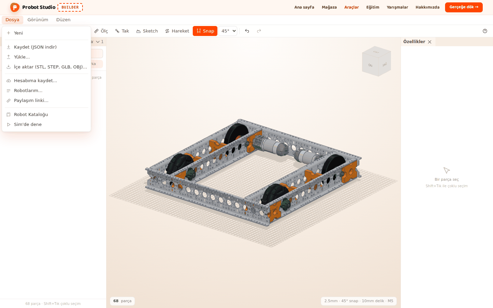
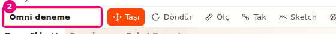
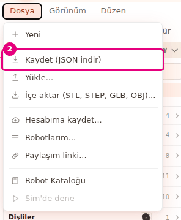
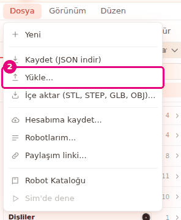
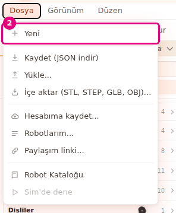

# Save to a file and open it

On this page you will name your project, download it to your computer as a `.json` file and open it
again later. You will also learn how Builder autosaves your work in the browser.

<!-- CAPTURE: url=https://probotstudio.com/builder/?dil=en | hazirla=hazir:Omni chassis, project name first robot, File menu open | hedef=body | isaret=yok | bekle=text="Save (download JSON)" -->

## Before you start

- Builder is open and there is a robot in the scene. For example, on the "The scene is empty" card,
  select **Omni chassis** (see [Start with a ready-made robot](hazir-robotla-basla.md)).
- You do not need an account. To save to your account, see [Save to your account and share](hesaba-kaydet-ve-paylas.md).

## Name the project

1. In the **Toolbar**, press the project name. A new project is named "Untitled robot".
2. Type the new name, for example `Omni test`.
3. Press <kbd>Enter</kbd>. To cancel, press <kbd>Esc</kbd>.
   
   <!-- CAPTURE: url=https://probotstudio.com/builder/?dil=en | hazirla=hazir:Omni chassis, project name pressed, Omni test typed in the box | hedef=title="Rename the project" | isaret=2 | bekle=text="Omni chassis" -->
   <!-- SAY: First we give our project a name, and the file gets this name too. -->

Result: The new name appears in the **Toolbar**. If you leave the box empty, the name becomes "Untitled robot".

## Understand autosave

Builder saves your work in this browser by itself. You do not need to do anything else.

- Builder saves 1 second after every change, and again when the page closes.
- When you open Builder again, your last session comes back and "Last session restored" appears.
- The undo history is not saved. After you refresh the page, there is nothing to **Undo**.
- If the browser storage is full, "Autosave failed because the browser storage is full" appears. With
  any other problem, "Autosave failed" appears. In both cases, save the project to a file.
- Large imported models may not fit in the autosave. See [Import a 3D model](model-ice-aktar.md).

!!! warning "Warning"
    The autosave is only in this browser. It is lost if you clear your browser data, work in a private
    window or move to another computer. To keep a lasting copy, save the project to a file.

<!-- SAY: Builder saves our work in the browser by itself, but this copy stays only in that browser. -->

## Save the project to a file

1. In the **Menu bar**, press **File**.
2. Select **Save (download JSON)**.
   
   <!-- CAPTURE: url=https://probotstudio.com/builder/?dil=en | hazirla=hazir:Omni chassis, project name Omni test, File menu open | hedef=text="Save (download JSON)" | isaret=2 | bekle=text="Save (download JSON)" -->
   <!-- SAY: From the File menu we download the project to our computer as a JSON file. -->
3. If the browser asks, select the folder to save the file in.

Result: The browser downloads the `Omni test.json` file.

- The file name is the project name. Letters of the Turkish and English alphabets, digits and spaces
  are kept. Other characters (hyphens, periods, letters with a circumflex such as â) become `_`. For
  example, the name `first-robot` downloads as `first_robot.json`.
- Imported models are stored inside the file. When you open the file on another computer, the models
  come with it.
- The file has no undo history.

## Open a project from a file

!!! warning "Warning"
    **Open...** replaces the project in the scene without asking, and you cannot undo it. If you want to
    keep the work in the scene, download it first with **Save (download JSON)**.

1. In the **Menu bar**, press **File**.
2. Select **Open...**.
   
   <!-- CAPTURE: url=https://probotstudio.com/builder/?dil=en | hazirla=empty scene, File menu open | hedef=text="Open..." | isaret=2 | bekle=text="Open..." -->
   <!-- SAY: Now we open the file we saved earlier with Open. -->
3. In the window that opens, select the `.json` project file.
4. In the window, press **Open**.

Result: The project appears in the scene. The project name from the file appears in the **Toolbar**.
A notification shows the project name and "loaded".

If some parts in the file cannot be read, they are skipped and "N damaged parts were skipped" appears.
The other parts open.

A file saved with an empty scene opens too. The scene opens empty, and the project gets the name saved
in the file.

## Start a new project

!!! warning "Warning"
    **New** deletes all the parts in the scene, and you cannot undo it. Save the project to a file first.

1. In the **Menu bar**, press **File**.
2. Select **New**.
   
   <!-- CAPTURE: url=https://probotstudio.com/builder/?dil=en | hazirla=hazir:Omni chassis, File menu open | hedef=text="New" | isaret=2 | bekle=text="Save (download JSON)" -->
   <!-- SAY: With New we empty the scene, and Builder asks us to confirm first. -->
3. If there are parts in the scene, the browser asks "The parts in the scene will be deleted. Start a new
   project?". Press **OK**.

Result: The scene empties, the project name becomes "Untitled robot" and "New project created" appears.

After **New**, **Open...** or loading a ready-made robot, the scene is also no longer tied to the robot
in your account. The "Saved" or "Not saved" text next to the project name goes away.

## Having trouble?

- **"Could not read the project file" appears:** The file is not a Builder project file, it is damaged, or
  all the parts in it are damaged. Try another copy.
  See [Troubleshooting](sorunlar.md#proje-dosyasi-okunamadi).
- **"N damaged parts were skipped" appears:** These parts are missing or wrong in the file. The others
  opened. Add the missing ones again.
  See [Troubleshooting](sorunlar.md#parca-bozuktu).
- **"The models of N imported parts are not in the file. Choose the file again" appears:** See
  [Choose a missing model again](model-ice-aktar.md#choose-a-missing-model-again),
  [Troubleshooting](sorunlar.md#model-dosyada-yok).
- **"Autosave failed because the browser storage is full" appears:** First download the project with
  **Save (download JSON)**. Then free up space for this site in your browser (for example, clear the
  site data for probotstudio.com). This also deletes the autosave and the other local settings of this
  site. Imported models are already left out of the autosave, so having fewer of them does not fix
  this error.
  See [Troubleshooting](sorunlar.md#otomatik-kayit-yapilamadi).
- **My earlier work is gone when Builder opens:** The browser data was cleared, or you are using another
  browser or a private window. Open the `.json` file you saved with **Open...**.
- **The file downloaded with a different name:** Hyphens, periods and letters with a circumflex such as â
  in the project name become `_`.
- **"Editing is off in assembly mode" appears:** In the **Assembly strip**, press **Switch to editing**,
  then try again.
  See [Troubleshooting](sorunlar.md#montaj-modu).

## Next step

- [Save to your account and share](hesaba-kaydet-ve-paylas.md)
- [Try the robot in Sim](simde-dene.md)
