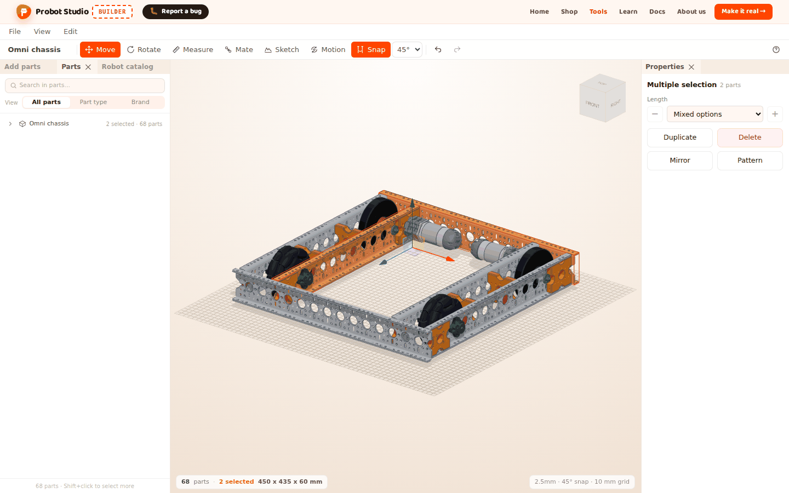
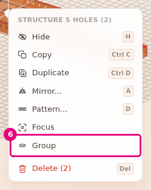
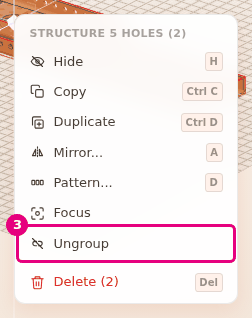
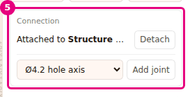
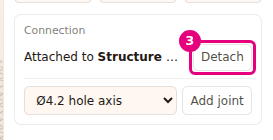

# Group parts and attach them to each other

On this page you make parts into one group with **Group** and attach a part to another part.
A group makes selecting easier. An attachment tells a part which other part to move with.

<!-- CAPTURE: url=https://probotstudio.com/builder/?dil=en | hazirla=hazir:Omni chassis, two parts grouped with Group and selected | hedef=body | isaret=yok | bekle=canvas -->

## Before you start

- The Omni chassis is open in the scene (see [Start with a ready-made robot](hazir-robotla-basla.md)).
- You know how to select more than one part with <kbd>Shift</kbd> (see
  [Select, hide and delete parts](parcalari-sec-gizle-sil.md)).

## Learn the difference between a group and an attachment

Both keep parts together, but they do different jobs.

| | Group | Attachment |
|---|---|---|
| How you make it | **Group** in the context menu | By itself when you use the **Mate** tool, or **Properties** > **Connection** > **Attach to a part** |
| Selecting | Clicking one member selects the whole group. | Each part is selected on its own. |
| Moving | The group is selected, so it all moves together. | One way: when the part it is attached to moves, the attached part comes along. Moving the attached part does not move the other one. |
| Deleting | **Delete** on the **Group (n)** row in the **Parts** tab deletes the whole group. | If the part it is attached to is deleted, the attached part stays where it is and loses its attachment. |
| Motion | Does not set up a joint. | A joint is set up on an attachment. The robot structure that goes to Sim also comes from the attachments. |
| Where you see it | The **Group (n)** row in the **Parts** tab | "Attached to X" or "N parts attached to this" in **Properties** > **Connection** |

In ready-made robots, the attachments of the turning parts (shafts, gears, wheels) are set up while
the robot loads.
<!-- SAY: A group lets us select parts together, and an attachment decides which other part a part moves with. -->

## Group the parts

**Group** makes more than one part into one group. At least 2 parts must be selected for it to
appear in the menu.

1. In the **Left panel**, select the **Parts** tab.
2. In the **Search in parts...** box, type `Structure`.
3. In the list, select the first Structure row.
4. Hold <kbd>Shift</kbd> and select the second Structure row.
5. In the **Scene**, right-click one of the selected parts.
6. In the context menu, select **Group**.
   
   <!-- CAPTURE: url=https://probotstudio.com/builder/?dil=en | hazirla=hazir:Omni chassis; search "Structure" in the Parts tab; first two Structure rows selected with Shift; right-click on a selected part | hedef=text="Group" | isaret=6 | bekle=text="Group" -->
   <!-- SAY: We select two parts and group them from the right-click menu, and now they act like one group. -->

Result: A "Parts grouped" notification appears. In the **Parts** tab, a "Group (2)" row appears above
the two parts.

If the selection holds only part of a group, the whole group joins the new group. The existing group
stays inside the new group as a subgroup. If the selection is already a whole group, **Group** does
not appear.

## Select one part in a group

When you click a grouped part in the **Scene**, the whole outermost group is selected. Click the same
part again to go down one level. The inner group is selected first, and the part itself last.

In the **Parts** tab, pressing the **Group (n)** row selects the group. Pressing a part row under the
group selects only that part. The **Hide** and **Delete** icons on the row apply to the whole group.
<!-- SAY: We click a part in the group again and again to go down into the group and select a single part. -->

## Ungroup

1. In the **Parts** tab, select the **Group (2)** row. All the parts of the group are selected.
2. In the **Scene**, right-click one of the selected parts.
3. In the context menu, select **Ungroup**.
   
   <!-- CAPTURE: url=https://probotstudio.com/builder/?dil=en | hazirla=hazir:Omni chassis; two Structure parts grouped with Group; Group (2) row selected in the Parts tab; right-click on a selected part | hedef=text="Ungroup" | isaret=3 | bekle=text="Ungroup" -->
   <!-- SAY: We select the group and ungroup it from the right-click menu, and the parts are selected one by one again. -->

Result: An "Ungrouped" notification appears. The **Group (2)** row goes away, and the parts stay
where they are.

**Ungroup** appears only when the selection is a whole group, and it ungroups only the outermost
level. Inner groups stay.

## Attach a part to another part

When you mate a part with the **Mate** tool, it is attached to the target part by itself. You can
also make the attachment by hand.

1. In the **Left panel**, select the **Add parts** tab.
2. Select the **Structure** section, then select the **Structure** row.
3. From the list of lengths, drag one length into the **Scene** and drop it on the top face of the
   chassis. The part is selected.
4. In the **Properties** panel, open the **Attach to a part** list in the **Connection** section.
5. In the list, select a part of the chassis (for example **Structure 13 holes**).
   
   <!-- CAPTURE: url=https://probotstudio.com/builder/?dil=en | hazirla=hazir:Omni chassis; Add parts > Structure > Structure, one length dropped on the top face of the chassis and selected; first part selected in the Attach to a part list | hedef=[data-testid="baglanti-alani"] | isaret=5 | bekle=[data-testid="bagi-coz"] -->
   <!-- SAY: We attach the new part to the chassis, so wherever the chassis goes this part goes with it. -->

Result: A "When X moves, this part moves with it" notification appears. The **Connection** section
says "Attached to X".

If you select the part you attached it to, its **Connection** section says "N parts attached to
this". N is the number of all parts attached directly to that part, and your attachment adds one.
When the Omni chassis loads, its wheel shafts attach by themselves to some Structure 13 holes
profiles, so you may see 2 or 3 there.

The list shows only the parts that touch this part (within 3 mm). If no part touches it, the nearest
parts are shown. The list has at most 8 parts, with the nearest at the top.

## Detach a part

!!! warning "Warning"
    Detaching a part also removes its joint. If you detached by mistake, select **Edit** > **Undo**
    (<kbd>Ctrl</kbd>+<kbd>Z</kbd>).

1. In the **Scene**, select the attached part.
2. In the **Properties** panel, scroll down to the **Connection** section. It shows the "Attached to
   X" text.
3. In the **Connection** section, press **Detach**.
   
   <!-- CAPTURE: url=https://probotstudio.com/builder/?dil=en | hazirla=hazir:Omni chassis; the Structure attached to the chassis is selected (previous section) | hedef=[data-testid="bagi-coz"] | isaret=3 | bekle=[data-testid="bagi-coz"] -->
   <!-- SAY: We detach the part, and it stays in place but no longer moves with the chassis. -->

Result: The **Attach to a part** list takes the place of the "Attached to X" text. The part stays
where it is.

To detach more than one part at once, select the parts, right-click one of them and select
**Detach** in the context menu. The menu item appears only if the selection has an attached part.
If more than one part is attached, the count is shown next to its name: **Detach (3)**. The
notification is "3 parts detached" or "Detached".

## Having trouble?

- **No Group in the right-click menu:** Only one part is selected, or the selection is already a
  whole group. Select at least two parts.
- **I cannot move a single part of a group:** Click the same part again to go down a level, or
  select the row under the group in the **Parts** tab.
- **The Connection section says "No other part to attach to":** There is no part in the scene to
  attach to, or all the other parts are already attached to this part.
- **The part I want to attach to is not in the list:** The list shows the parts that touch, or the
  8 nearest parts. Move the part so it touches the other one, or mate it with the **Mate** tool. The list
  also leaves out the parts attached to this part directly or indirectly. If part A is attached to
  B, A does not appear in B's list. Detach A first.
- **"The target part is attached to the part being moved. Detach it in Properties first" appears while using Mate:**
  The target part is attached to the part you are moving. Select the target and press **Detach** in
  the **Connection** section. See [Troubleshooting](sorunlar.md#hedef-parca-bagli).

## Next step

- Turn an attached part: [Set up joints and try the motion](eklem-kur-ve-oynat.md)
- Mate parts hole to hole: [Mate parts by their holes](parcalari-tak.md)
