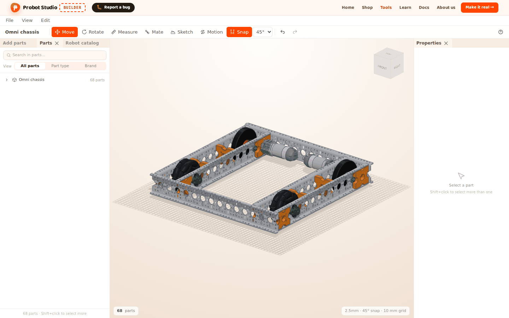
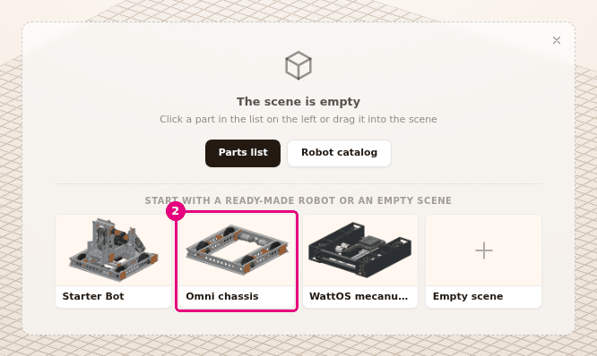
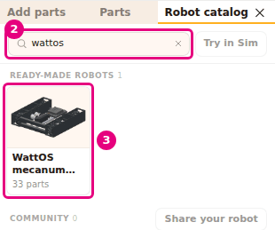
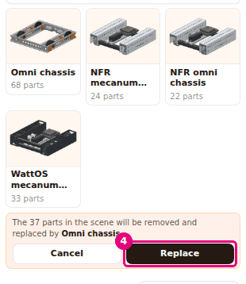
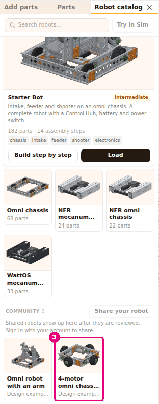
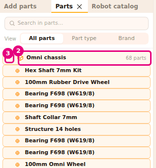

# Start with a ready-made robot

On this page you will load a fully assembled robot into the scene. Instead of building from
scratch, you open a ready-made robot, look it over and make changes to it.

<!-- CAPTURE: url=https://probotstudio.com/builder/?dil=en | hazirla=hazir:Omni chassis, no selection | hedef=body | isaret=yok | bekle=text="68 parts" -->

## Before you start

- Builder is open: `https://probotstudio.com/builder/?dil=en`.
- Loading a robot removes everything in the scene. If your own work is in the scene, first select
  **File** > **Save (download JSON)**. See [Save to a file and open it](dosyaya-kaydet-ve-ac.md).

## Ready-made robots

Builder has five ready-made robots and two design examples. The names are as they appear on screen.

| Robot | Difficulty | Parts | Where |
|---|---|---|---|
| **Starter Bot** | Intermediate | 182 parts, 14 assembly steps | **Robot catalog** (large card), the "The scene is empty" card |
| **Omni chassis** | Beginner | 68 parts | **Robot catalog**, the "The scene is empty" card |
| **NFR mecanum chassis** | Intermediate | 24 parts | **Robot catalog** |
| **NFR omni chassis** | Beginner | 22 parts | **Robot catalog** |
| **WattOS mecanum chassis** | Intermediate | 33 parts | **Robot catalog**, the "The scene is empty" card |
| **Omni robot with an arm** | Intermediate | 148 parts | **Robot catalog** > **COMMUNITY**, "Design example" |
| **4-motor omni chassis (+ layout)** | Intermediate | 72 parts | **Robot catalog** > **COMMUNITY**, "Design example" |

The Starter Bot carries an intake, a feeder and a shooter on an omni chassis. The Control Hub,
battery and power switch are also inside the robot. The Starter Bot is the only robot with assembly
steps. See [Build the robot step by step](adim-adim-kur.md).

<!-- SAY: Builder has five ready-made robots and two design examples. -->

## Load a robot from the empty scene

When the scene is empty, the "The scene is empty" card sits in the middle. There are three robot
cards at the bottom of it.

1. In your browser, open `https://probotstudio.com/builder/?dil=en`. If the scene is empty, the
   "The scene is empty" card is in the middle. Below it is the line "START WITH A READY-MADE ROBOT OR AN EMPTY SCENE".
2. Press the **Omni chassis** card.
   
   <!-- CAPTURE: url=https://probotstudio.com/builder/?dil=en | hazirla=clean browser, intro window closed, empty scene | hedef=[data-bos-sahne-robot="omni-sasi"] | isaret=2 | bekle=text="The scene is empty" -->
   <!-- SAY: We open the Omni chassis with one click from the card in the empty scene. -->
3. The robot appears in the scene in a few seconds. To see all of it, select **View** > **Fit view**.

Result: The Omni chassis is in the scene and the camera fits the robot in view. The notification in
the corner of the screen shows the robot's name and "loaded, press Ctrl+Z to undo". The project name
in the **Toolbar** becomes "Omni chassis".

The **Empty scene** card does not load a robot. It closes the card and brings the **Add parts** tab
to the front.

## Load a robot from the Robot catalog

1. In the **Left panel**, select the **Robot catalog** tab.
2. Type `wattos` in the **Search robots...** box. The list is filtered by robot name and description.
3. In the **READY-MADE ROBOTS** section, press the **WattOS mecanum chassis** card. The robot appears
   in the scene. If there are parts in the scene, the robot does not load and a confirmation appears
   below the cards. Press **Replace**. See the section "Replace the robot in the scene with another robot" below.
   
   <!-- CAPTURE: url=https://probotstudio.com/builder/?dil=en | hazirla=empty scene, Robot catalog tab in front, wattos typed in the search box | hedef=placeholder="Search robots...";[data-robot-yukle="wattos-mekanum-sasi"] | isaret=2-3 | bekle=[data-catalog-panel] -->
   <!-- SAY: We search for the robot by name in the catalog and press its card to load it. -->

Result: The WattOS mecanum chassis is in the scene. The status bar shows "37 parts": the robot's 33
parts and the 4 belts that drive the wheels.

The catalog has two kinds of cards:

- **Large card (Starter Bot):** It shows the difficulty, a description, "182 parts · 14 assembly steps"
  and the subsystem tags (chassis, intake, feeder, shooter, electronics). **Load** puts the whole
  robot in the scene. **Build step by step** opens the robot in assembly mode.
- **Small cards:** They show a picture, the name and the part count. Press anywhere on the card to
  load the robot.

If the **Robot catalog** tab is closed, select **File** > **Robot catalog**. On the "The scene is empty"
card, **Robot catalog** also brings the tab to the front.

## Replace the robot in the scene with another robot

!!! warning "Warning"
    **Replace** removes all the parts in the scene. The parts you added yourself are removed too. First
    download your work with **File** > **Save (download JSON)**.

1. In the **Left panel**, select the **Robot catalog** tab.
2. If text is left in the **Search robots...** box (for example `wattos`), press the cross next to
   the box (**Clear search**). The list shows all the robots again.
3. Press the **Omni chassis** card. A confirmation appears below the cards: "The N parts in the
   scene will be removed and replaced by Omni chassis."
4. If you want the new robot, press **Replace**. If you change your mind, press **Cancel**.
   
   <!-- CAPTURE: url=https://probotstudio.com/builder/?dil=en | hazirla=hazir:WattOS mecanum chassis loaded, Robot catalog in front, Omni chassis card pressed | hedef=[data-robot-onay];[data-robot-onayla] | isaret=4 | bekle=[data-robot-onay] -->
   <!-- SAY: When the scene is full, Builder asks first, and we confirm with Replace. -->

Result: The old parts are gone and the Omni chassis is in the scene.

For the Starter Bot, the confirmation appears inside the large card, in place of **Load** and
**Build step by step**. If you loaded the wrong ready-made robot, select **Edit** > **Undo**
(<kbd>Ctrl</kbd>+<kbd>Z</kbd>). The previous scene comes back.

## Open community robots

The **COMMUNITY** section is below **READY-MADE ROBOTS**. The number of robots is shown next to the
heading. The design examples come first, then the community robots that passed review.

- **Design example card:** Below the **Omni robot with an arm** card, it says "Design example · 148 parts".
  This robot carries an arm turned by a servo on the Starter Bot chassis and intake. It also has a small gripper with one servo.
  The second design example is **4-motor omni chassis (+ layout)** (see [Open the 4-motor omni chassis](#omni4-sasiyi-ac)).
- **Community robot card:** Below the card are the author's name and the part count ("{author} · N parts").
- These cards work like the small cards: press a card to load the robot. If the scene is full, the
  **Cancel** / **Replace** confirmation appears first. When a community robot loads, the notification
  shows the robot's name and "loaded into the scene".
- If the list is long, **Show more** appears at the bottom. Press it to get the next robots.
- **Search robots...** also filters the community robots by name and author.

To send your own robot to the community, see [Save to your account and share](hesaba-kaydet-ve-paylas.md).

<!-- SAY: The community section has two design examples, the Omni robot with an arm and the four-motor omni chassis, and community robots that pass review are added to this list too. -->

### Open the 4-motor omni chassis {#omni4-sasiyi-ac}

In the **COMMUNITY** section, the second design example is **4-motor omni chassis (+ layout)**. Its
four wheels are set out in a "+" layout, and each wheel has a Starter Bot drive module. The profile
channels face outward, and the corners are joined with connector brackets.

1. In the **Left panel**, select the **Robot catalog** tab.
2. Scroll the list to the **COMMUNITY** section.
3. Select the **4-motor omni chassis (+ layout)** card. The card is narrow, so its name and the "Design
   example · 72 parts" line below it are shortened.
   
   <!-- CAPTURE: url=https://probotstudio.com/builder/?dil=en | hazirla=clean browser, Robot catalog tab, scrolled to the COMMUNITY section | hedef=text="4-motor omni chassis (+ layout)" | isaret=3 | bekle=text="Design example · 72 parts" -->
   <!-- SAY: We open the four-motor omni chassis example from the community section. -->
4. If the scene is full, press **Replace** in the confirmation that appears.

Result: The four-wheel chassis is in the scene. The status bar shows "72 parts".

## Find the parts of a ready-made robot

The parts of a ready-made robot are gathered in one row in the **Parts** tab.

1. In the **Left panel**, select the **Parts** tab.
2. Select the row with the robot's name (for example **Omni chassis**). The row shows "68 parts" next to it.
3. Press the arrow at the start of the row ("Show its parts").
   
   <!-- CAPTURE: url=https://probotstudio.com/builder/?dil=en | hazirla=hazir:Omni chassis loaded, Parts tab in front, row open | hedef=[data-kit-row];[data-kit-ac] | isaret=2-3 | bekle=[data-kit-row] -->
   <!-- SAY: All of the robot's parts sit in one row in the Parts tab, and we open it with the arrow. -->

Result: All of the robot's parts are selected in the scene. The parts are listed one by one below the row.

Press the arrow again to close the list ("Close"). When the mouse pointer is over the row, the
**Hide** and **Delete** icons appear. They apply to all of the robot's parts. Parts you add to the
robot later are outside this row, in their own rows.

## Having trouble?

- **The "The scene is empty" card does not appear:** There are parts in the scene, or you closed the
  card with the cross. Use the **Robot catalog** tab.
- **"No ready-made robots match this search" appears:** Clear the **Search robots...** box.
- **There is a red error box in the community list:** Press **Try again** in the box. The design
  examples are not affected by this error. See [Troubleshooting](sorunlar.md#topluluk-robotlari-alinamadi).
- **"Loading community robots" does not go away:** Check your connection and reload the page.
- **I loaded the wrong robot:** If it is a ready-made robot or a design example, select **Edit** >
  **Undo** (<kbd>Ctrl</kbd>+<kbd>Z</kbd>). Loading a community robot cannot be undone. To keep your
  work in the scene, download it with **File** > **Save (download JSON)** before you load a community robot.
- **There is no Robot catalog tab:** In the **View** menu, in the **PANELS** group, check
  **Robot catalog**. See [Arrange the panels](panelleri-duzenle.md) and
  [Troubleshooting](sorunlar.md#panel-kayboldu).

## Next step

- [Build the robot step by step](adim-adim-kur.md)
- [Move around the scene](sahnede-gezin.md)
- [Try the robot in Sim](simde-dene.md)
