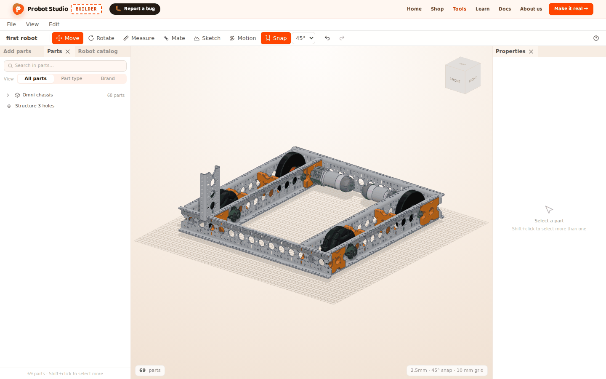
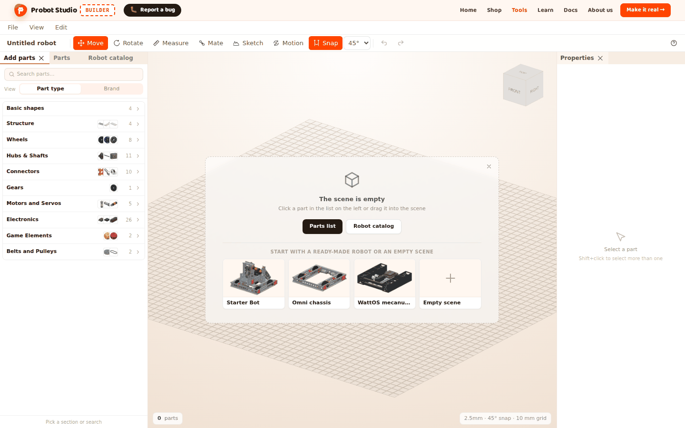
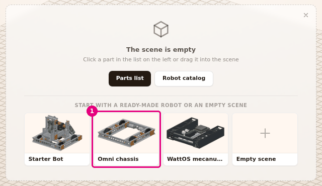
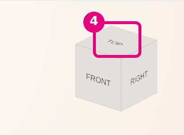
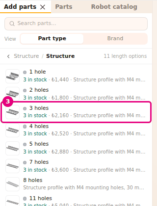
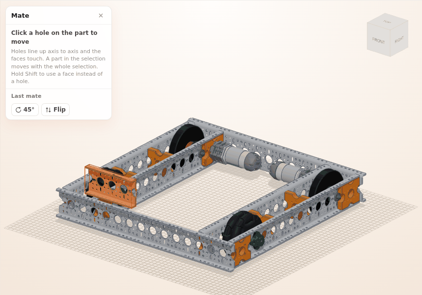
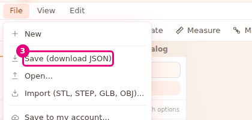

# First 10 minutes

On this page you open a ready-made robot, move around it, mate a part to it and save your project.
At the end of each section you check that you are in the right place.

<!-- CAPTURE: url=https://probotstudio.com/builder/?dil=en | hazirla=hazir:Omni chassis + Structure 3 holes mated on top of the chassis, project name first robot, no selection | hedef=body | isaret=yok | bekle=text="first robot" -->

## Before you start

- Computer, browser and mouse: [What you need](../index.md#ne-gerekir).
- You do not need an account.

## Open Builder

1. In your browser, open the address `https://probotstudio.com/builder/?dil=en`.
2. In the window that says "The design tool is in development", press **Got it, continue**.
3. If the cookie banner appears at the bottom of the screen, press **Accept** or **Only necessary**.
   
   <!-- CAPTURE: url=https://probotstudio.com/builder/?dil=en | hazirla=clean browser, notices closed | hedef=text="The scene is empty" | isaret=yok | bekle=text="The scene is empty" -->
   <!-- SAY: We open Builder in the browser, and there is nothing to install. -->

Check: In the middle of the scene, a card says "The scene is empty". Ready-made robot cards are
below it. If there is no card, your earlier work in this browser has opened. Save it first with
**File** > **Save (download JSON)**, then select **File** > **New**.

## Load a ready-made robot into the scene

1. On the empty scene card, press the **Omni chassis** card.
   
   <!-- CAPTURE: url=https://probotstudio.com/builder/?dil=en | hazirla=clean browser | hedef=[data-bos-sahne-robot="omni-sasi"] | isaret=1 | bekle=text="The scene is empty" -->
   <!-- SAY: Instead of starting from zero, we open a ready-made chassis. -->
2. The robot comes into the scene in a few seconds. In the **Menu bar**, press **View**.
3. To see the whole robot, select **Fit view**.

Check: A four-wheel chassis stands in the scene. The status bar at the bottom of the **Scene** shows
"68 parts".

!!! tip "Tip"
    More ready-made robots are in the **Robot catalog** tab of the **Left panel**. See
    [Start with a ready-made robot](hazir-robotla-basla.md).

## Move around the robot

You move the camera with the mouse. The left button only selects.

1. In the **Scene**, hold down the right mouse button and drag. The camera rotates around the robot.
2. Turn the mouse wheel. The camera zooms in or out.
3. Hold down the middle button (the wheel) and drag. The view pans.
4. On the view cube in the corner of the **Scene**, press the **TOP** face.
   
   <!-- CAPTURE: url=https://probotstudio.com/builder/?dil=en | hazirla=hazir:Omni chassis | hedef=koordinat:gorunum-kupu-ust | isaret=4 | bekle=canvas -->
   <!-- SAY: We rotate with the right button, zoom with the wheel and look from the top with the cube. -->

Check: You see the robot from the top. If the robot is out of view, select **View** > **Fit view** again.

If these mouse buttons do not suit you, select **SolidWorks** or **Fusion 360** in the
**MOUSE CONTROLS** group of the **View** menu. See [Move around the scene](sahnede-gezin.md).

## Add a part to the robot

1. In the **Left panel**, select the **Add parts** tab.
2. Select the **Structure** section, then select the **Structure** row.
3. In the list of lengths that opens, select a length. The part is added to the scene and selected.
   
   <!-- CAPTURE: url=https://probotstudio.com/builder/?dil=en | hazirla=hazir:Omni chassis | hedef=[data-section="shop-yapi"] > text="Structure" | isaret=3 | bekle=text="11 length options" -->
   <!-- SAY: We add a Structure part from the Structure section of the catalog. -->
4. In the **Properties** panel, press **+** next to the **Length** selector. The part changes to the next
   longer length.

Check: The top of the **Properties** panel says "Structure". The status bar says "69 parts · 1 selected".

You can also drag the part into the scene and drop it on top of the robot. See [Add parts](parca-ekle.md).

## Mate the part to the robot

The **Mate** tool fits a hole of one part onto a hole of another part, on the same axis.

1. In the **Toolbar**, press **Mate** (<kbd>B</kbd>).
2. Click a hole on the Structure part you added. The hole is highlighted.
3. Click a hole on the top face of the chassis. The part moves into place on that hole.
   
   <!-- CAPTURE: url=https://probotstudio.com/builder/?dil=en | hazirla=hazir:Omni chassis + Structure added | hedef=koordinat:kaynak-delik,hedef-delik | bekle=[data-testid="tak-paneli"] -->
   <!-- SAY: First we click a hole on the part, then a hole on the chassis, and the part goes into place. -->
4. If the part does not sit the way you want, press <kbd>R</kbd> to rotate it around the hole axis.
   Press <kbd>F</kbd> to flip it.
5. To close the tool, press <kbd>Esc</kbd> twice. The first press stops adjusting the last
   mate. The second press closes the tool. The **×** in the **Mate** panel closes the tool in one press.

Check: The Structure touches the face of the chassis, and their holes line up. If you mated it in the
wrong place, select **Edit** > **Undo** (<kbd>Ctrl</kbd>+<kbd>Z</kbd>).

## Save your project

Builder saves your work in this browser by itself. To open it somewhere else, save it to a file.

1. In the **Toolbar**, press the project name. It says "Omni chassis" because you loaded that
   ready-made robot.
2. Type `first robot` and press <kbd>Enter</kbd>.
3. Select **File** > **Save (download JSON)**.
   
   <!-- CAPTURE: url=https://probotstudio.com/builder/?dil=en | hazirla=hazir:Omni chassis, project name first robot | hedef=text="Save (download JSON)" | isaret=3 | bekle=text="Save (download JSON)" -->
   <!-- SAY: We give the project a name and download it to our computer as a file. -->

Check: The browser downloaded `first robot.json`. In the file name, every character of the project
name other than letters, digits and spaces becomes `_`. Later you open this file with **File** >
**Open...**.

## Next step

- Watch the robot being built part by part: [Build the robot step by step](adim-adim-kur.md)
- Turn the wheels: [Set up joints and try the motion](eklem-kur-ve-oynat.md)
- Order the parts: [Make it real: send the parts list to the shop cart](gercege-dok.md)
