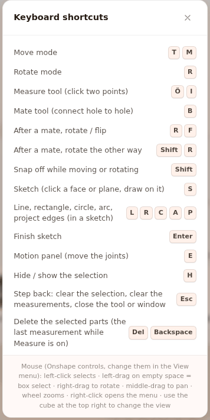

# Shortcuts

This page lists every keyboard key and mouse action in Builder. It also has keys that the
"Keyboard shortcuts" window in the app does not list.

## Before you start

- Builder is open (see [First 10 minutes](ilk-10-dakika.md)).
- Shortcuts are an extra way to do a job. Every job also has a button or a menu
  item (see [Interface tour](arayuz.md)).

## Open the Keyboard shortcuts window

Builder's own list of shortcuts is in the "Keyboard shortcuts" window.

1. In the **Toolbar**, press the Help icon (**?**) (<kbd>?</kbd>).
2. With the mouse wheel, scroll the key list in the "Keyboard shortcuts" window. The mouse row at
   the bottom of the window stays in place.
   
   <!-- CAPTURE: url=https://probotstudio.com/builder/?dil=en | hazirla=empty scene, Keyboard shortcuts window open | hedef=text="Keyboard shortcuts" | isaret=yok | bekle=text="After a mate, rotate the other way" -->
   <!-- SAY: When we press the Help icon, the list of shortcuts opens. -->
3. Press the window's × to close it. <kbd>Esc</kbd> or <kbd>?</kbd> also closes it (not while you are drawing a sketch).

Result: The window closes. Your selection and your open tools do not change.

Pressing the darkened area outside the window also closes it. The mouse row at the bottom changes
with the mouse controls you selected.

!!! note "Note"
    In the window, the <kbd>Esc</kbd> row says "Step back: clear the selection, clear the
    measurements, close the tool or window". The [What Esc does, in order](#what-esc-does-in-order)
    table shows what happens on each press.

## When shortcuts do not work

- While you type in a text box (such as the project name, **Position (mm)** or **Search parts...**),
  the keys go into the box. Shortcuts do not work.
- In assembly mode (you start it with **Build step by step**), shortcuts are off. Only <kbd>←</kbd> and
  <kbd>→</kbd> work.
- While the **Mirror** or **Pattern** window is open, only <kbd>Esc</kbd> works, and it closes the window.
- On a Mac, <kbd>Cmd</kbd> takes the place of <kbd>Ctrl</kbd> in all the <kbd>Ctrl</kbd> shortcuts below.

## Tools

| Key | What it does | Where it works |
|---|---|---|
| <kbd>T</kbd> or <kbd>M</kbd> | Selects the **Move** tool. | Everywhere |
| <kbd>R</kbd> | Selects the **Rotate** tool. | Everywhere. After you mate a part with the **Mate** tool, it does something else (see Mate and Measure tools). |
| <kbd>Ö</kbd> or <kbd>I</kbd> | Opens or closes the **Measure** tool. When it opens, **Mate** and **Sketch** close. | Everywhere. On a Turkish keyboard, <kbd>ı</kbd> and <kbd>İ</kbd> also work. |
| <kbd>B</kbd> | Opens or closes the **Mate** tool. When it opens, **Sketch** closes. | Everywhere |
| <kbd>S</kbd> | Opens or closes the **Sketch** tool. | Except while drawing a sketch |
| <kbd>E</kbd> | Opens or closes the **Motion** panel. | Everywhere |
| <kbd>?</kbd> | Opens or closes the "Keyboard shortcuts" window. | Except while drawing a sketch |

## Selection and editing

| Key | What it does | Where it works |
|---|---|---|
| Left-click | Selects a part. Clicking empty space clears the selection. | **Scene** |
| <kbd>Shift</kbd>+click | Adds the part to the selection or removes it from the selection. | **Scene**, **Parts** tab |
| <kbd>Ctrl</kbd>+click | Same as <kbd>Shift</kbd>+click. | **Scene**, **Parts** tab |
| Left-drag on empty space | Box select. Every part the box touches is selected. With <kbd>Shift</kbd> or <kbd>Ctrl</kbd>, it adds to the selection. | **Scene**, while **Measure**, **Mate** and **Sketch** are closed |
| Right-click | Opens the context menu. If you drag with the right button, the menu does not open. In the default Onshape mouse controls, this drag rotates the camera. | **Scene**. It does not open in assembly mode or while **Measure**, **Mate** or **Sketch** is open. |
| <kbd>Ctrl</kbd>+<kbd>A</kbd> | Selects all parts. | Everywhere |
| <kbd>H</kbd> | Hides or shows the selected parts. | While something is selected |
| <kbd>Del</kbd> | Deletes the selected parts. | While something is selected. While **Measure** is open, it deletes the last measurement. |
| <kbd>Backspace</kbd> | Same as <kbd>Del</kbd>. | Same as <kbd>Del</kbd> |
| <kbd>Ctrl</kbd>+<kbd>Z</kbd> | Undoes the last change. Up to 59 steps. | Everywhere |
| <kbd>Ctrl</kbd>+<kbd>Shift</kbd>+<kbd>Z</kbd> | Redoes what you undid. | Everywhere |
| <kbd>Ctrl</kbd>+<kbd>Y</kbd> | Same as <kbd>Ctrl</kbd>+<kbd>Shift</kbd>+<kbd>Z</kbd>. The **Edit** menu shows this key. | Everywhere |
| <kbd>Ctrl</kbd>+<kbd>C</kbd> | Copies the selection. The notification "N parts copied" appears. | While something is selected |
| <kbd>Ctrl</kbd>+<kbd>V</kbd> | Pastes what you copied. The copy is placed 20 mm away from the original. | Everywhere |
| <kbd>Ctrl</kbd>+<kbd>D</kbd> | Duplicates the selection. | While something is selected |
| <kbd>A</kbd> | Opens the **Mirror** window. | While something is selected and **Measure**, **Mate** and **Sketch** are closed |
| <kbd>D</kbd> | Opens the **Pattern** window. | While something is selected and **Measure**, **Mate** and **Sketch** are closed |
| <kbd>K</kbd> | Puts a belt between the two selected pulleys. | While two pulleys are selected and **Measure**, **Mate** and **Sketch** are closed |
| Hold <kbd>Shift</kbd> | Turns Snap off while you hold it. The part does not snap to 2.5 mm steps or to holes. | While dragging with **Move** or **Rotate** |

## Mate and Measure tools

| Key | What it does | Where it works |
|---|---|---|
| <kbd>R</kbd> | Rotates the last mate around the hole axis by the selected step. | **Mate** open, after a mate |
| <kbd>Shift</kbd>+<kbd>R</kbd> | Rotates the last mate the other way. | **Mate** open, after a mate |
| <kbd>F</kbd> | Flips the last mated part. | **Mate** open, after a mate |
| <kbd>Shift</kbd>+click | Selects a face instead of a hole. | **Mate** open |
| <kbd>Shift</kbd>+click | Places the point freely, without snapping it to the hole center. | **Measure** open |
| <kbd>Del</kbd> | Deletes the last measurement. | **Measure** open |

!!! warning "Warning"
    While **Measure** is open, <kbd>Esc</kbd> deletes **all** measurements, not only one. To delete
    one measurement, press **Delete this measurement** in the **Measure** panel. See
    [What Esc does, in order](#what-esc-does-in-order).

## Sketch and Extrude

| Key | What it does | Where it works |
|---|---|---|
| <kbd>L</kbd> | **Line** tool. | While drawing a sketch |
| <kbd>R</kbd> | **Rectangle** tool. | While drawing a sketch |
| <kbd>C</kbd> | **Circle** tool. | While drawing a sketch |
| <kbd>A</kbd> | **Arc** tool. | While drawing a sketch |
| <kbd>P</kbd> | **Project** tool. | While drawing a sketch |
| <kbd>S</kbd> | **Select** tool. | While drawing a sketch |
| <kbd>Enter</kbd> | Finishes the sketch. | While drawing a sketch |
| <kbd>Esc</kbd> | First drops an unfinished shape, then clears the selection. It does not close the sketch. | While drawing a sketch |
| <kbd>Del</kbd> or <kbd>Backspace</kbd> | Deletes the selected item. | While drawing a sketch |
| <kbd>Ctrl</kbd>+<kbd>Z</kbd> | Undoes the last step in the sketch. | While drawing a sketch |
| <kbd>Ctrl</kbd>+<kbd>Y</kbd> or <kbd>Ctrl</kbd>+<kbd>Shift</kbd>+<kbd>Z</kbd> | Redoes a step you undid in the sketch. | While drawing a sketch |
| Hold <kbd>Shift</kbd> | Places the point freely, without snapping it to endpoints, alignments or the 1 mm grid. | While drawing a sketch |
| Right-click | Drops an unfinished shape. | While drawing a sketch |
| Double-click (on a sketch) | Opens the sketch for editing. | **Scene** |
| <kbd>Enter</kbd> | Same as **OK**: makes the solid part. | While the **Extrude** panel is open |
| <kbd>Esc</kbd> | Closes the **Extrude** panel. | While the **Extrude** panel is open |

While you are drawing a sketch, the other shortcuts do not work. See [Draw a sketch and make it solid with Extrude](sketch-ve-extrude.md).

## Assembly mode, panels and input boxes

| Key | What it does | Where it works |
|---|---|---|
| <kbd>←</kbd> | Previous assembly step. | While the **Assembly strip** is open |
| <kbd>→</kbd> | Next assembly step. | While the **Assembly strip** is open |
| <kbd>Esc</kbd> | Goes back one level. | Inside a section of the **Add parts** tab |
| <kbd>Enter</kbd> | Applies the value you typed. | In number and name boxes (**Position (mm)**, the project name...) |
| <kbd>Esc</kbd> | Drops what you typed and goes back to the old value. | In number and name boxes |
| <kbd>Esc</kbd> | Closes the open menu. | While a **Menu bar** menu is open |
| Double-click (panel divider) | Resets the panel to its default width. | The vertical line between panels |

## Camera with the mouse

With any of the mouse controls, the left button only selects. Select the option in the
**MOUSE CONTROLS** group of the **View** menu (see [Move around the scene](sahnede-gezin.md)).

| Mouse controls | Rotate | Pan | Zoom |
|---|---|---|---|
| **Onshape** (default) | Drag with the right button | Drag with the middle button | Mouse wheel |
| **SolidWorks** | Drag with the middle button | <kbd>Ctrl</kbd>+drag with the middle button | Mouse wheel |
| **Fusion 360** | <kbd>Shift</kbd>+drag with the middle button | Drag with the middle button | Mouse wheel |

When you press a face of the view cube in the corner of the **Scene**, the camera looks in that direction.

## What Esc does, in order

Each time you press <kbd>Esc</kbd>, it does the first job in the list below that fits. Press it
again until you get the result you want.

| Order | Situation | What <kbd>Esc</kbd> does |
|---|---|---|
| 1 | The context menu is open | Closes the menu. |
| 2 | The "Keyboard shortcuts" window is open | Closes the window. |
| 3 | The **Make it real** window is open | Closes the window. |
| 4 | **Measure** is open | First clears an unfinished measurement, then deletes **all** measurements, then closes the tool. |
| 5 | **Mate** is open | First drops the first hole you selected, then stops adjusting the last mate, then closes the tool. |
| 6 | **Sketch** is open | First drops an unfinished shape, then clears the selection. If no plane is selected yet, it closes the tool. Once the sketch is open, it does not close it: press **Finish** or **Cancel**. |
| 7 | **Motion** is playing | Stops playing. The next press closes the panel. |
| 8 | None of these | Clears the selection. |

While **Mirror**, **Pattern** or **Extrude** is open, <kbd>Esc</kbd> closes it first.

While a sketch is open, <kbd>Esc</kbd> and <kbd>?</kbd> go only to the sketch. While you draw,
<kbd>Esc</kbd> only does the job in row 6. It does not close the tool or any open window. If you
open a window during this time, close it with its × or by pressing the darkened area outside it.

## Next step

- [Move around the scene](sahnede-gezin.md)
- [Troubleshooting](sorunlar.md)
