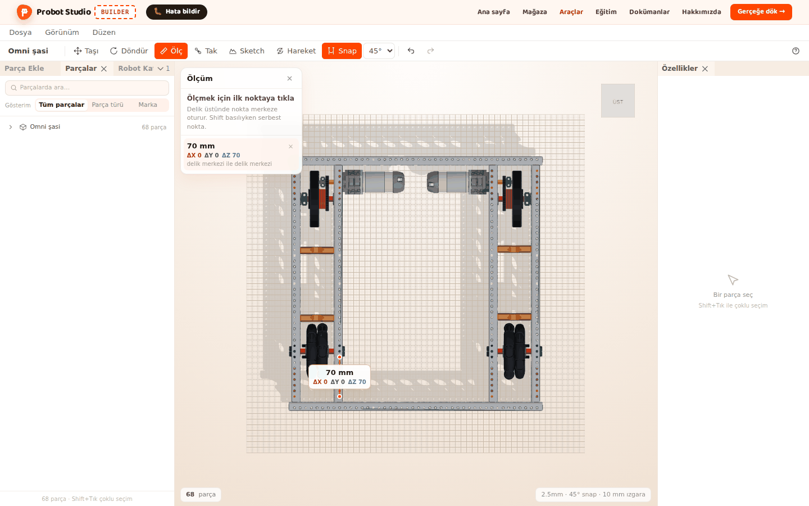
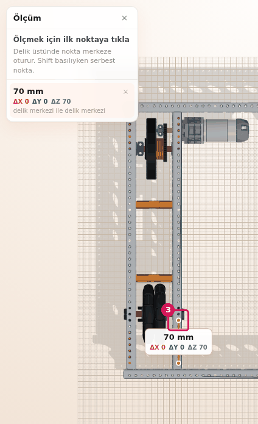
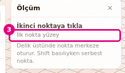
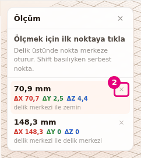
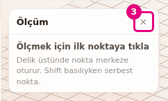

# Measure a distance

On this page you use the **Measure** tool to measure the distance between two points in
millimeters. You can read the distance between holes, between surfaces or to the ground.

<!-- CAPTURE: url=https://probotstudio.com/builder/?dil=en | hazirla=hazir:Omni chassis, Measure on, one measurement between two holes | hedef=body | isaret=yok | bekle=text="mm" -->

## Before you start

- The Omni chassis is open in the scene (see [Start with a ready-made robot](hazir-robotla-basla.md)).
- Measurements are not saved in the project and are not part of the undo history. When the tool
  closes, they are all deleted.

## Measure between two points

1. In the **Toolbar**, press **Measure** (<kbd>Ö</kbd> or <kbd>I</kbd>). The **Measure** panel opens
   in the corner of the **Scene** and says "Click the first point to measure".
2. In the **Scene**, click a hole of the chassis. The point snaps to the center of the hole. The
   panel says "Click the second point" and "First point on the hole center".
3. Click another hole.
   
   <!-- CAPTURE: url=https://probotstudio.com/builder/?dil=en | hazirla=hazir:Omni chassis; TOP on the view cube; Measure on; one measurement between two holes of the chassis | hedef=koordinat:ikinci-delik;text="Measure" | isaret=3 | bekle=text="ΔX" -->
   <!-- SAY: We click two holes and read the distance between them in millimeters. -->

Result: The panel shows the distance in "mm". Below it, you see the colored ΔX, ΔY and ΔZ values
and the line "hole center to hole center". In the **Scene**, a line and a label appear between
the two points.

Builder picks the point under the mouse pointer in this order: hole center, surface, ground. You cannot
put a point on a hidden part. While **Measure** is on, you cannot select or move parts, and the
right-click menu does not open.

## Measure without snapping to a hole center

To measure the edge of a hole or a surface point near a hole, use <kbd>Shift</kbd>.

1. With the **Measure** panel open, move the mouse pointer to the edge of a hole in the **Scene**.
2. Hold down <kbd>Shift</kbd>.
3. Click.
   
   <!-- CAPTURE: url=https://probotstudio.com/builder/?dil=en | hazirla=hazir:Omni chassis; Measure on; one click on the edge of a hole while holding Shift | hedef=text="First point on the surface" | isaret=3 | bekle=text="Click the second point" -->
   <!-- SAY: When we hold Shift, the point does not jump to the center of the hole and stays where we click. -->

Result: The point stays where you clicked. The panel says "First point on the surface" (if you
clicked empty space, it says "First point on the ground").

## Take several measurements and delete one

When a measurement is done, the next two clicks make a new one. In the panel, the newest
measurement is at the top and highlighted. At most 5 measurements stay at a time, so a sixth one
deletes the oldest.

1. In the **Scene**, click two more points. A second measurement appears in the list.
2. In the **Measure** panel, in the row of the measurement you want to delete, press the ×
   (**Delete this measurement**).
3. To delete the last measurement, press <kbd>Del</kbd> or <kbd>Backspace</kbd>.
   
   <!-- CAPTURE: url=https://probotstudio.com/builder/?dil=en | hazirla=hazir:Omni chassis; Measure on; two measurements taken | hedef=title="Delete this measurement" | isaret=2 | bekle=text="Measure" -->
   <!-- SAY: We keep a few measurements side by side and delete the ones we do not need one by one. -->

Result: The measurement you picked leaves the list and the **Scene**. The others stay.

While **Measure** is on, <kbd>Del</kbd> does not delete parts. It deletes only the last
measurement.

## Clear the measurements and close the tool

!!! warning "Warning"
    <kbd>Esc</kbd> deletes **all** measurements, not only one. Closing the tool also deletes all
    measurements. To delete only one, use **Delete this measurement**.

Each time you press <kbd>Esc</kbd>, it does the next thing on this list:

1. After you click the first point, while Builder waits for the second, press <kbd>Esc</kbd>. The
   first point is deleted.
2. Press <kbd>Esc</kbd> again. All measurements are deleted and the panel stays open.
3. Press <kbd>Esc</kbd> one more time. The **Measure** panel closes.
   
   <!-- CAPTURE: url=https://probotstudio.com/builder/?dil=en | hazirla=hazir:Omni chassis; Measure on; no measurements | hedef=title="Close measure (Esc)" | isaret=3 | bekle=text="Click the first point to measure" -->
   <!-- SAY: The Esc key first deletes the waiting point, then all the measurements, and in the end it closes the tool. -->

Result: The panel closes, and **Measure** in the **Toolbar** is no longer selected.

You can also close the tool in these ways: press the × in the panel (**Close measure (Esc)**),
press **Measure** again (<kbd>Ö</kbd>), or select **Move**, **Rotate**, **Mate** or **Motion**.

## Having trouble?

- **The point jumps to the center of a hole I did not want:** Hold <kbd>Shift</kbd> while you click.
- **I cannot select a part or open the right-click menu while Measure is on:** While the tool is
  on, you cannot select parts and the context menu does not open. Close the tool first.
- **<kbd>Del</kbd> did not delete the part:** While **Measure** is on, <kbd>Del</kbd> deletes the
  last measurement. Close the tool and try again. See [Troubleshooting](sorunlar.md#del-parca-silmiyor).
- **My measurements are gone:** You pressed <kbd>Esc</kbd> or closed the tool. Measurements are not
  saved, so measure again. See [Troubleshooting](sorunlar.md#olcumler-silindi).
- **The oldest measurement was deleted by itself:** At most 5 measurements stay at a time.
- **I cannot put a point on a hidden part:** Hidden parts are not measured. Show the part (see
  [Select, hide and delete parts](parcalari-sec-gizle-sil.md)).

## Next step

- Mate a part where you measured: [Mate parts by their holes](parcalari-tak.md)
- See the length a belt needs: [Add a belt to two pulleys](kayis-ekle.md)
