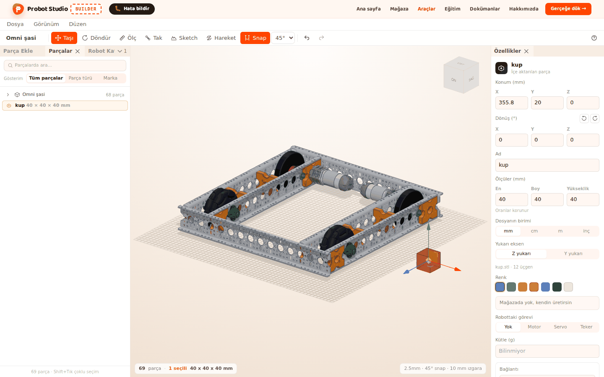
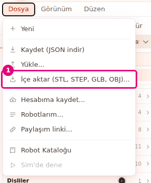
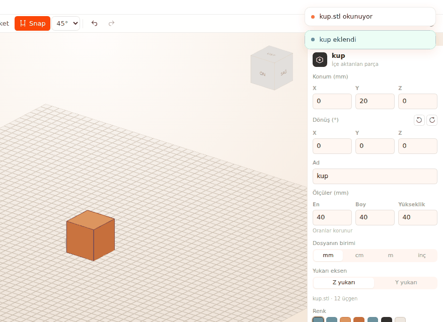
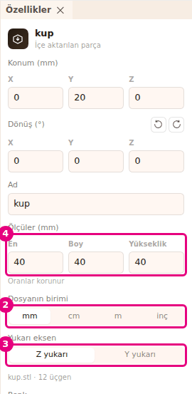
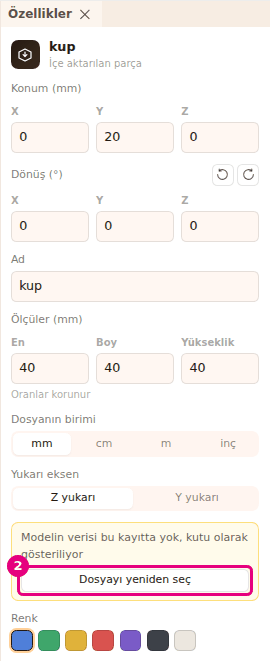

# Import a 3D model

On this page you add a 3D model file from your computer to Builder as a part. Then you fix the
model's units, orientation and size.

<!-- CAPTURE: url=https://probotstudio.com/builder/?dil=en | hazirla=hazir:Omni chassis, sample kup.stl imported and selected | hedef=body | isaret=yok | bekle=canvas -->

## Before you start

- You have a model file on your computer. These file types work: `.stl`, `.step`, `.stp`, `.glb`, `.gltf`, `.obj`.
- The file is 25 MB at most.
- To place the model next to a robot, load the **Omni chassis** (see [Start with a ready-made robot](hazir-robotla-basla.md)).

Builder reads the file in your browser. A model with more than 50,000 triangles is simplified down
to that number. Builder spends at most 120 seconds reading a STEP file. Round holes in the model are
found automatically, and **Measure** and **Mate** snap to these holes.

## Import by selecting a file

1. In the **Menu bar**, select **File** > **Import (STL, STEP, GLB, OBJ)...**.
   
   <!-- CAPTURE: url=https://probotstudio.com/builder/?dil=en | hazirla=hazir:Omni chassis, File menu open | hedef=text="Import (STL, STEP, GLB, OBJ)..." | isaret=1 | bekle=text="Save (download JSON)" -->
   <!-- SAY: We choose Import in the File menu and open the model file from our computer. -->
2. In the file window that opens, select the model file. You can also select more than one file.
3. In the window, press **Open**.
4. Wait for the "Reading <file-name>" notification. For a STEP file, it says "STEP can take a while".

Result: The model stands on the ground in the free spot nearest the middle of the view, and it is
selected. The notification says "<name> added". If the model was simplified, "Simplified from N
triangles" is added. If holes were found, "N holes found" is added.

The **Add parts** tab in the **Left panel** opens the same file window: select the **Import** row
at the end of the **Basic shapes** section. In the **Brand** view, it is at the end of the
**General** section.

## Drop the file on the scene

1. Open your computer's file browser and go to the folder of the model file.
2. Drag the file onto the Builder **Scene**.
3. Drop it on the ground where you want the model to stand.
   
   <!-- CAPTURE: url=https://probotstudio.com/builder/?dil=en | hazirla=hazir:Omni chassis, sample kup.stl (40 mm cube, Z up) dropped next to the chassis | hedef=koordinat:sahne-ortasi | isaret=yok | bekle=text="kup added" -->
   <!-- SAY: We drag the model file and drop it where we want it in the scene. -->

Result: The model sits on the ground where you dropped it. If you drop it where there is no ground,
it goes to the free spot nearest the middle of the view. If you drop several files, the first one
goes to that spot and the others go to free spots near the middle of the view.

## Fix the units, orientation and size

The model can look very small, very big or lying on its side. You change the file units and the
up axis in **Properties**.

1. In the **Scene**, select the imported model. The top of the **Properties** panel says "Imported part".
2. In the **File units** row, select the unit the file was drawn in: **mm**, **cm**, **m** or **in**.
3. If the model is lying on its side, select **Z up** or **Y up** in the **Up axis** row. CAD files
   are usually Z up. GLB files and game models are usually Y up.
4. If you want an exact size, type a value in **Width**, **Length** or **Height** under **Size (mm)** and press <kbd>Enter</kbd>.
   
   <!-- CAPTURE: url=https://probotstudio.com/builder/?dil=en | hazirla=empty scene, sample kup.stl imported and selected | hedef=[data-testid="ozel-birim-mm"];[data-testid="ozel-yukari-z"];[data-testid="ozel-olcu-en"] | isaret=2-4 | bekle=[data-testid="ozel-dosya"] -->
   <!-- SAY: We choose the unit and the up axis of the model, and we type its size if we need to. -->
5. If you need to, type a name for the part in the **Name** box (80 characters at most) and press <kbd>Enter</kbd>.

Result: The model has the right size and stands upright. The bottom of the panel shows the file
name, the number of triangles and the number of holes.

When you change one size, the other two change by the same ratio ("Proportions are kept").
Changing the unit resets the size you typed. When it opens a file, Builder guesses a unit: mm for
STL, OBJ and STEP, and usually m for GLB.

## Choose a missing model again

Sometimes a part keeps its place and size, but its model data is lost. The part shows as a box.

1. In the **Scene**, select the imported part that looks like a box. The **Properties** panel shows
   the warning "The model data is not in this save, so it is shown as a box".
2. Under the warning, press **Choose the file again**.
   
   <!-- CAPTURE: url=https://probotstudio.com/builder/?dil=en | hazirla=a project with its model removed opened with File > Open... (the assets field taken out of a JSON that has an imported part), that part selected | hedef=[data-testid="ozel-model-sec"] | isaret=2 | bekle=[data-testid="ozel-model-eksik"] -->
   <!-- SAY: We bring back the lost model by choosing the same file again. -->
3. In the file window, select the same model file and press **Open**.

Result: The notification says "<name> model updated". All parts that use this model show their real shape.

## Limits of an imported part

- **Autosave:** The autosave in your browser holds about 3,000,000 characters at most (parts and
  models together). If they do not fit, the biggest models are left out of the autosave. If the
  browser's storage is full, no models go in. In both cases, "The autosave could not fit the
  imported models. Download the project with Save in the File menu" appears. **File** > **Save
  (download JSON)** puts the models inside the file. See [Save to a file and open it](dosyaya-kaydet-ve-ac.md).
- **Saving to your account:** A robot can be 5 MB at most, models included.
- **Community:** A robot with an imported part cannot be sent to the community with **Share your robot**.
  Delete these parts first. A share link does carry the models. See [Save to your account and share](hesaba-kaydet-ve-paylas.md).
- **Merge:** An imported model cannot be merged with basic shapes, and it cannot be made a **Hole**.
- **Parts list:** In the **Make it real** window, the model shows with its file name in the "CUSTOM PARTS" section.

<!-- SAY: For big models, saving the project to a file is the safest way. -->

## Having trouble?

Error notifications appear in the corner of the screen.

| Notification | What to do |
|---|---|
| "This file type is not supported. Choose STL, STEP, GLB or OBJ" | Export the file in one of these formats. See [Troubleshooting](sorunlar.md#dosya-turu-desteklenmiyor). |
| "The file is too big. At most 25 MB" | Make the model simpler, or split it into smaller models and import them separately. See [Troubleshooting](sorunlar.md#dosya-cok-buyuk). |
| "The file is empty" | The file is 0 bytes. Export the model again. See [Troubleshooting](sorunlar.md#dosya-cok-buyuk). |
| "The file could not be read. It may be damaged or incomplete" | Export the file again. Save a GLB as a single file. See [Troubleshooting](sorunlar.md#dosya-okunamadi). |
| "The file has no solid model" | The file has no surfaces, only lines or points. Export the solid model. See [Troubleshooting](sorunlar.md#kati-model-yok). |
| "The model looks flat, it has no thickness" | The model is a single surface. Import a solid that has a thickness. See [Troubleshooting](sorunlar.md#kati-model-yok). |
| "The file has invalid numbers" | The file is damaged. Export it again from the CAD program. See [Troubleshooting](sorunlar.md#kati-model-yok). |
| "GLB files with Draco compression cannot be opened. Export without compression" | Export the GLB with Draco compression turned off. See [Troubleshooting](sorunlar.md#draco-glb). |
| "This GLTF depends on separate files. Export it as a single GLB" | Builder cannot read the `.bin` file next to the `.gltf`. Choose a single `.glb` file. See [Troubleshooting](sorunlar.md#gltf-ayri-dosyalar). |
| "The model could not be simplified" | Make the model simpler in the CAD program and import it again. See [Troubleshooting](sorunlar.md#model-sadelestirilemedi). |
| "The STEP reader did not load. Check your connection" | Check your internet connection and try again. See [Troubleshooting](sorunlar.md#step-okuyucu). |
| "The STEP reader could not start" | Reload the page and try again. See [Troubleshooting](sorunlar.md#step-okuyucu). |
| "The STEP file took too long. Try a simpler model" | The 120 seconds ran out. Try a STEP with fewer parts, or an STL. See [Troubleshooting](sorunlar.md#step-cok-uzun-surdu). |
| "The STEP file could not be read. It may be damaged or incomplete" | Export the STEP again, or use STL. See [Troubleshooting](sorunlar.md#step-okunamadi). |
| "Editing is off in assembly mode. Switch to editing to make changes" | In the **Assembly strip**, press **Switch to editing**. See [Troubleshooting](sorunlar.md#montaj-modu). |
| "The models of N imported parts are not in the file. Choose the file again" | The project file has no model. Follow [Choose a missing model again](#choose-a-missing-model-again). See [Troubleshooting](sorunlar.md#model-dosyada-yok). |
| "The models of N imported parts are not in the autosave. Choose the file again" | The model did not fit in the autosave. Choose it again the same way. See [Troubleshooting](sorunlar.md#model-otomatik-kayitta-yok). |
| "Imported parts cannot be shared in the catalog. Remove them first" | Delete the imported parts before you send the robot to the community. See [Troubleshooting](sorunlar.md#katalogda-paylasilamaz). |

- **The model looks very small or huge:** Change **File units**.
- **The model is lying on its side:** Change **Up axis**.

## Next step

- [Mate parts by their holes](parcalari-tak.md)
- [Make a part from basic shapes](temel-sekillerle-parca-yap.md)
- [Save to a file and open it](dosyaya-kaydet-ve-ac.md)
