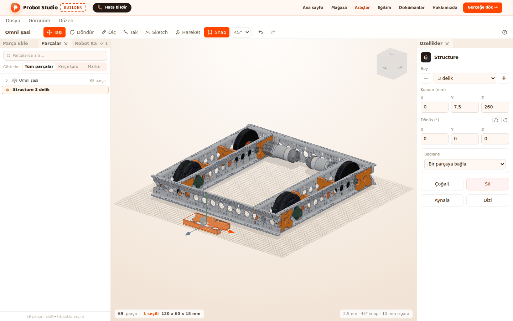
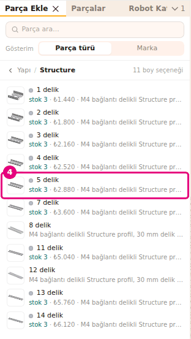
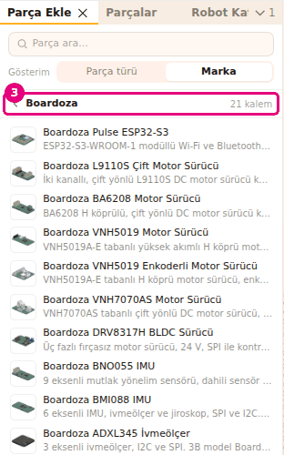
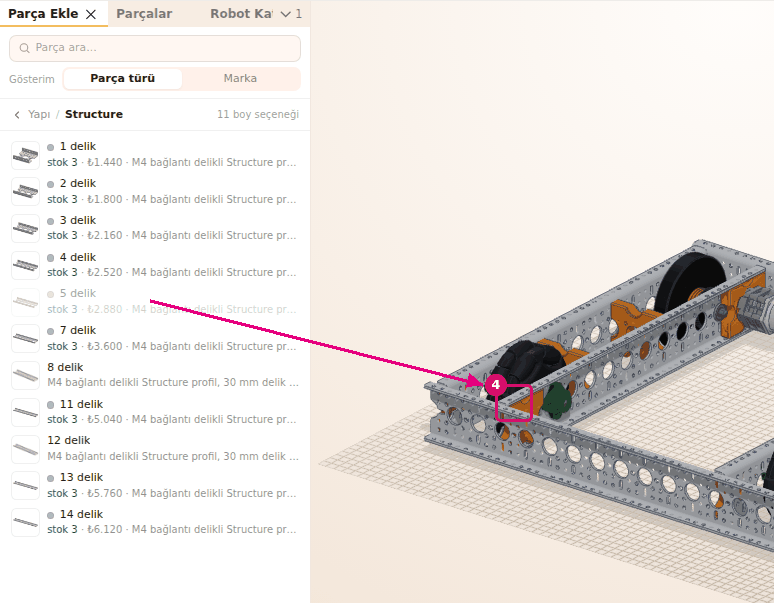
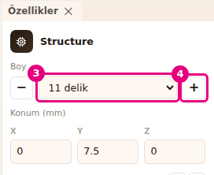
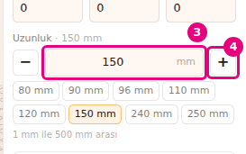

# Add parts

On this page you will add parts from the catalog to the scene. You can select a part from a section,
search for it or drag it into the scene. Then you change its length and size in the **Properties** panel.

<!-- CAPTURE: url=https://probotstudio.com/builder/?dil=en | hazirla=hazir:Omni chassis + Structure 3 holes added and selected | hedef=body | isaret=yok | bekle=text="69 parts" -->

## Before you start

- Builder is open and the "The design tool is in development" window is closed (see [First 10 minutes](ilk-10-dakika.md)).
- The scene is empty or a ready-made robot is open. The examples were written with an empty scene. The
  same steps work with a ready-made robot too (see [Start with a ready-made robot](hazir-robotla-basla.md)).
- The **Add parts** tab is showing in the **Left panel**. If you closed it, check **Add parts** in the
  **PANELS** group of the **View** menu.

## Add a part from a section

The **Add parts** tab sorts the parts into sections. Each section row shows small pictures and the
number of parts. The length or size options of the same part are collected in one family row.

1. In the **Left panel**, select the **Add parts** tab.
2. Select the **Structure** section. The parts of the section open.
3. Select the **Structure** row that says "11 length options". The length options open.
4. From the options, select **5 holes**. The part is added to the scene and is selected.
   
   <!-- CAPTURE: url=https://probotstudio.com/builder/?dil=en | hazirla=clean browser, press Empty scene on the The scene is empty card, Add parts > Structure > Structure | hedef=[data-family-folder="structure"] | isaret=4 | bekle=text="11 length options" -->
   <!-- SAY: We pick a Structure from the Structure section and press the length we want. -->
5. To go back up one level, press the back row at the top of the list ("Back to Structure"). While a
   section is open in the panel, <kbd>Esc</kbd> also goes back up one level.

Result: The part is placed in the scene, in an empty spot near the middle of the visible area. At the
top of the **Properties** panel, it says "Structure".

The sections in Add parts are: **Basic shapes**, **Structure**, **Wheels**, **Hubs & Shafts**,
**Connectors**, **Gears**, **Motors and Servos**, **Electronics**, **Game Elements**, **Belts and
Pulleys**. **Electronics** and **Motors and Servos** have subheadings (for example **Control Hub**,
**Battery**, **Power switch**, **Motor**, **Servo**).

### List the sections by brand

The **View** selector below the search box has two options. **Part type** shows the sections above.
If you select **Brand**, the parts are grouped by brand. Inside a brand section, the parts are again
split into subheadings by type. Your choice is remembered in this browser.

<!-- SAY: If we want, we can also see the same list by brand. -->

## Add a Boardoza board {#boardoza-karti-ekle}

The catalog has 21 electronics boards from the Boardoza brand: a controller board, motor drivers, an
IMU, sensors, I2C boards and voltage regulators. The boards are not sold in the shop, so their rows
show no stock and no price.

1. In the **Left panel**, select the **Add parts** tab.
2. In the **View** selector, select **Brand**.
3. Select the **Boardoza** section. Its row says "21 item(s)".
   
   <!-- CAPTURE: url=https://probotstudio.com/builder/?dil=en | hazirla=empty scene, Add parts > View Brand > Boardoza open | hedef=text="Boardoza" | isaret=3 | bekle=text="21 item(s)" -->
   <!-- SAY: In the brand view we open the Boardoza section and pick the board that fits our robot. -->
4. From the list, select a board, for example **Boardoza BNO055 IMU**. The board is added to the scene
   and is selected.

Result: The board is in the scene. At the top of the **Properties** panel, it shows the board's name.

The boards have a half hole every 20 mm along their edges. When **Snap** is on, these holes make the
board sit on the holes of the 10 mm grid. In the **Make it real** window, the board's row says "Not
sold by Probot, get it from another supplier". You can also find the boards in the **Electronics**
section of the **Part type** view.

## Search for a part by name

If you know the part's name, you do not need to go through the sections. Type part of the name in
the **Search parts...** box at the top of the **Add parts** tab (for example `gear`). The search looks
in the part's name, its description and its product code (SKU), for example PRB-WHL-RBR-100. Section
names (for example Electronics) are not part of the search. To see the parts in a section, open that
section.

The results are listed one by one under section headings, together with their options. Select a result
to add it to the scene. If nothing is found, it says "No results". The × in the box
("Clear search") clears the search. The list goes back to where you were before the search.

<!-- SAY: We type the name of the part we are looking for and add it straight from the results. -->

## Drag a part into the scene

If you drag and drop a part, it lands where you want it. If you drop it on top of another part, it is
placed on that part's surface.

1. In the **Add parts** tab, open the **Structure** > **Structure** options.
2. Hold the **5 holes** row with the left mouse button.
3. Drag the row into the **Scene**.
4. Release the mouse button where you want to place the part.
   
   <!-- CAPTURE: url=https://probotstudio.com/builder/?dil=en | hazirla=hazir:Omni chassis, Add parts > Structure > Structure open, 5 holes row being dragged onto the top face of the chassis (not released) | hedef=koordinat:sasi-ust-yuzu | isaret=4 | bekle=canvas -->
   <!-- SAY: We hold the part in the list and drag it onto the robot, and it sits on the surface where we drop it. -->

Result: The part sits on the ground or on a part's surface at the spot where you dropped it, and it is
selected. If **Snap** is on, a part dropped on a surface lines up with the holes nearby.

## Change a part's option

If a part belongs to a family, you can change its length or size later. The part's position and
angle stay the same.

1. In the **Scene**, select a Structure part.
2. In the **Properties** panel, open the **Length** list. Depending on the part's family, the
   selector can have another name: **Size**, **Speed**, **Side**, **Color**, **Bore**, **Type**,
   **Diameter**, **Thread size**.
3. In the list, select **11 holes**.
4. To go to the next length, press **+** next to the selector. **−** goes back to the previous option.
   
   <!-- CAPTURE: url=https://probotstudio.com/builder/?dil=en | hazirla=empty scene, Structure > Structure > 5 holes added and selected | hedef=[data-testid="varyant"] | isaret=3,4 | bekle=[data-testid="varyant-secim"] -->
   <!-- SAY: We change the length of the part in the Properties panel, and it stays in the same place. -->

Result: The part in the scene changes to the length you selected. Each change is one undo step
(<kbd>Ctrl</kbd>+<kbd>Z</kbd>).

If several parts from the same family are selected, the selector changes all of them together. If the
parts have different lengths, the list says "Mixed options".

## Set the length of a shaft or spacer

Parts that are cut to size, such as shafts, spacers and rods, have a **Length** field in the
**Properties** panel. The example part is **Hex Shaft 7mm Kit** in the **Hubs & Shafts** section.

1. In the **Add parts** tab, select the **Hubs & Shafts** section, then select **Hex Shaft 7mm Kit**.
2. In the **Properties** panel, delete the number in the **Length** field. Next to its heading, it
   shows the current length (for example "120 mm").
3. Type `150` in the field and press <kbd>Enter</kbd>. While you type, the shaft grows longer in the
   scene.
4. To make it 0.5 mm shorter or longer, press **−** or **+** next to the field.
   
   <!-- CAPTURE: url=https://probotstudio.com/builder/?dil=en | hazirla=empty scene, Hubs & Shafts > Hex Shaft 7mm Kit added and selected | hedef=[data-testid="uzunluk"] | isaret=3,4 | bekle=[data-testid="uzunluk-mm"] -->
   <!-- SAY: We type the length of the shaft in millimeters and watch it change in the scene as we type. -->

Result: The shaft is 150 mm long. Below the field, it shows the allowed range (for example "1 mm to 500 mm").

- The length buttons below the field (for example **80 mm**, **120 mm**, **250 mm**) give common
  lengths with one press.
- <kbd>Esc</kbd> cancels what you typed. Leaving the field also applies what you typed.
- A value outside the range is set to the nearest limit.
- If several parts of the same type are selected, the field applies to all of them. If their lengths
  are different, the heading says "mixed lengths".

## What a part row shows

Each part row has the part's picture, its name and a short description. For parts sold in the shop,
the stock and the price come before the description.

| What you see | What it means |
|---|---|
| "in stock" | The part is in the shop. If Builder could not connect to the shop, this text appears even when the stock is not known. |
| "N in stock" | The shop has N left. |
| "out of stock" (red) | The part is not in the shop right now. You can still add it to your design. |
| Price | The unit price in the shop. It shows only when Builder is connected to the shop. |
| Colored dot before the name ("Print color") | The color the shop prints the part in. |
| Arrow at the end of the row | The row is a section or a family. Select it to open it. |

When you hold the pointer over a row, the tip "...: click or drag into the scene" appears. At the bottom
of the panel, it says "Pick a section or search" or "Click or drag into the scene".

Builder connects to the shop when it opens. When it connects, a "Shop connected - N/M parts listed with
live stock" notification appears in the corner of the screen. If it cannot connect, it says "Could not
reach the shop stock - using the static catalog". You can still add parts, but the stock is not live
and no prices show.

<!-- SAY: In each row we see whether the part is in stock and what it costs. -->

## Having trouble?

- **The part is not added, and "Editing is off in assembly mode" appears in the corner:** Builder is
  in assembly mode, which **Build step by step** starts. In the **Assembly strip**, press
  **Switch to editing**. See [Troubleshooting](sorunlar.md#montaj-modu).
- **The search for my part says "No results":** Type a shorter part of the name (for example `shaft`).
  You can also type the product code. See [Troubleshooting](sorunlar.md#sonuc-bulunamadi).
- **"Could not reach the shop stock - using the static catalog" appears:** Keep adding parts. For live
  stock, reload the page later.
  See [Troubleshooting](sorunlar.md#magaza-stoguna-ulasilamadi).
- **<kbd>Esc</kbd> clears the selection instead of leaving the section:** First click inside the panel,
  then press <kbd>Esc</kbd>. Or use the back row at the top of the list.
- **The part went inside another part:** Select the part and move it (see [Move and rotate a part](tasi-ve-dondur.md)).

## Next step

- [Move and rotate a part](tasi-ve-dondur.md)
- [Mate parts by their holes](parcalari-tak.md)
