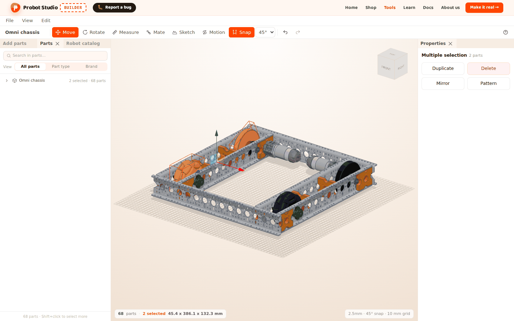
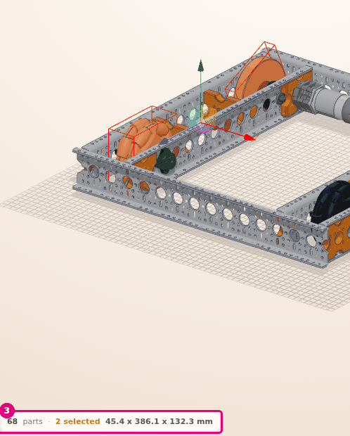
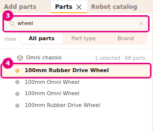
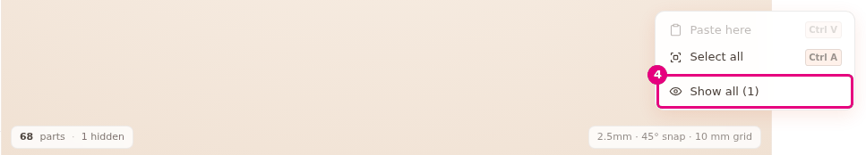
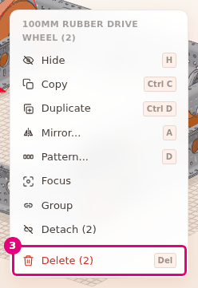

# Select, hide and delete parts

On this page you select parts in the scene one at a time or several at once. You hide the part in
front to see the part behind it, delete a part you do not want and undo a mistake.

<!-- CAPTURE: url=https://probotstudio.com/builder/?dil=en | hazirla=hazir:Omni chassis, two wheels selected with Shift | hedef=body | isaret=yok | bekle=text="2 selected" -->

## Before you start

- The **Omni chassis** is open in the scene (see [Start with a ready-made robot](hazir-robotla-basla.md)).
  The status bar says "68 parts".
- In the **Toolbar**, **Move** is selected. While **Measure**, **Mate** or **Sketch** is on, you
  cannot select parts in the scene.

## Select parts in the scene

With any mouse controls option, the left button only selects. A frame is drawn around the
selected part.

1. To see the whole robot, select **View** > **Fit view**.
2. In the **Scene**, left-click one wheel of the chassis. The wheel is selected.
3. Hold <kbd>Shift</kbd> and click another wheel. The second wheel is added to the selection.
   
   <!-- CAPTURE: url=https://probotstudio.com/builder/?dil=en | hazirla=hazir:Omni chassis, two wheels selected with Shift | hedef=koordinat:durum-seridi-sol | isaret=3 | bekle=text="2 selected" -->
   <!-- SAY: With the Shift key we add the second wheel to the selection, and the bar at the bottom says two selected. -->

Result: The status bar shows "68 parts · 2 selected" and the size of the selection. The size is
in mm, in the order width x length x height.

- Clicking with <kbd>Ctrl</kbd>, or <kbd>Cmd</kbd> on a Mac, works like <kbd>Shift</kbd>. If you
  click a selected part this way, it leaves the selection.
- Clicking empty space clears the selection. <kbd>Esc</kbd> also clears the selection.
- To select all the parts, right-click empty space and select **Select all**
  (<kbd>Ctrl</kbd>+<kbd>A</kbd>).
- If there are hidden parts, the status bar also shows how many (for example "3 hidden").

### Select by drawing a box

In the scene, drag with the left button from an empty spot. A box is drawn.

When you let go, every visible part the box touches is selected. A part does not have to be inside
the box. Touching the edge of the box is enough.

If you hold <kbd>Shift</kbd> or <kbd>Ctrl</kbd> when you start dragging, the parts in the box are
added to the selection you already have. If you start dragging on top of a part, no box is drawn.

<!-- SAY: We drag from empty space to draw a box and select every part it touches. -->

### Select a grouped part

The first click on a part grouped with **Group** selects the whole group. If you click the same
part again, the selection goes one level further in. The last click selects only that part.

To make a group, see [Group parts and attach them to each other](grupla-ve-bagla.md).

<!-- SAY: On a grouped part, each click takes us one level further in. -->

## Select from the Parts tab

If a part is hard to see in the scene, you can select it from a list. The parts of a ready-made
robot are gathered in one row.

1. In the **Left panel**, select the **Parts** tab. The list starts with the "Omni chassis" row, with
   "68 parts" next to it.
2. On the "Omni chassis" row, press the arrow ("Show its parts"). The row opens and lists the robot's parts.
3. In the **Search in parts...** box, type `wheel`. The list narrows to the parts that have "wheel"
   in their name, type, product code (SKU) or hardware name.
4. In the list, select a wheel row. The part is selected in the scene.
   
   <!-- CAPTURE: url=https://probotstudio.com/builder/?dil=en | hazirla=hazir:Omni chassis, Parts tab open, wheel typed in the search, one wheel row selected | hedef=placeholder="Search in parts...";[data-part-id] | isaret=3,4 | bekle=[data-kit-row] -->
   <!-- SAY: We search the list for wheel, and when we press the row we found, the part is selected in the scene. -->

Result: The row is highlighted and the wheel in the scene is selected. The bottom of the panel says
"N / 68 parts · Shift+click to select more".

- Clicking a row with <kbd>Shift</kbd>, <kbd>Ctrl</kbd> or <kbd>Cmd</kbd> adds it to the selection
  or removes it.
- If you select the "Omni chassis" row itself, all the robot's parts are selected. If some of them are
  selected, the row says "N selected · 68 parts".
- The **View** selector arranges the list. **All parts** shows the parts in the order they were
  added, with their groups. **Part type** and **Brand** show them under headings. Press a heading
  to close or open it.
- Builder remembers your **View** choice in this browser.

## Hide and show a part

A hidden part leaves the scene but is not deleted. Hide the part in front to reach the part behind it.

1. In the **Scene**, right-click a Structure part of the chassis. The context menu opens.
2. In the menu, select **Hide** (<kbd>H</kbd>). The part leaves the scene.
3. In the **Scene**, right-click empty space to bring the hidden parts back.
4. In the menu, select **Show all (1)**.
   
   <!-- CAPTURE: url=https://probotstudio.com/builder/?dil=en | hazirla=hazir:Omni chassis, one Structure hidden, right-click on empty space | hedef=text="Show all (1)" | isaret=4 | bekle=text="Paste here" -->
   <!-- SAY: We hide the part in front, and when we are done we bring every part back with a right-click on empty space. -->

Result: The notification "1 part(s) shown" appears in the corner and the part comes back to its place.

- <kbd>H</kbd> hides the selected parts. A hidden part leaves the selection.
- In the **Parts** tab, an eye icon appears when you point at a row ("Hide" / "Show"). The row of a
  hidden part looks faded and has a crossed-out eye.
- You cannot click a hidden part in the scene. To bring it back, use the **Show** icon on its row
  or **Show all (n)**.
- Hiding and showing are steps you can undo, too.

## Delete a part

!!! warning "Warning"
    In the **Parts** tab, the **Delete** icon on a ready-made robot's row deletes all the robot's
    parts. If you deleted it by mistake, select **Edit** > **Undo** before you do anything else.

1. In the **Scene**, select the part you want to delete. You can select several parts with <kbd>Shift</kbd>.
2. Right-click one of the selected parts. The top of the menu shows the part's name and how many
   parts are selected.
3. In the menu, select **Delete (2)**. If one part is selected, the item is called **Delete**.
   
   <!-- CAPTURE: url=https://probotstudio.com/builder/?dil=en | hazirla=hazir:Omni chassis, two wheels selected with Shift, right-click on one of them | hedef=text="Delete (2)" | isaret=3 | bekle=text="Delete (2)" -->
   <!-- SAY: We select two wheels and delete them together from the right-click menu. -->

Result: The parts leave the scene and the **Parts** list. The status bar says "66 parts".

Other ways to do the same thing:

- The <kbd>Del</kbd> or <kbd>Backspace</kbd> key. While **Measure** is on, these keys delete the
  last measurement instead of a part.
- **Edit** > **Delete**.
- **Delete** in the **Properties** panel.
- In the **Parts** tab, the **Delete** icon (×) that appears when you point at a row.

Parts attached to the deleted part are detached and stay where they are. If you delete a
pulley, the belt on it is deleted too.

## Undo a mistake

Select **Edit** > **Undo** (<kbd>Ctrl</kbd>+<kbd>Z</kbd>). The last change is undone. Builder
goes back at most 59 steps. To redo a step you undid, select **Edit** > **Redo**
(<kbd>Ctrl</kbd>+<kbd>Y</kbd> or <kbd>Ctrl</kbd>+<kbd>Shift</kbd>+<kbd>Z</kbd>).

The undo and redo icons in the **Toolbar** do the same thing. If there is no step to undo, the icon
is faded. Undo and redo clear the selection.

While you type in a text or number box, shortcuts do not work. Leave the box first.

<!-- SAY: When we make a mistake, we can go back up to fifty-nine steps with Ctrl Z. -->

## Having trouble?

- **Clicking a part does not select it:** **Measure**, **Mate** or **Sketch** may be on. To close
  **Measure** or **Mate**, press **Move** in the **Toolbar**, or press <kbd>Esc</kbd> a few times
  until the tool closes. Each press goes back one step. In **Measure**, the waiting point is cleared
  first, then all the measurements. To leave **Sketch**, press **Sketch** in the
  **Toolbar** or press **Finish** (<kbd>Enter</kbd>). <kbd>Esc</kbd> closes **Sketch** only while you are
  choosing a plane.
- **The whole group is selected instead of the part I clicked:** The part is grouped. Click the
  same part again.
- **No box is drawn and the camera rotates:** Start dragging with the left button, from an empty spot.
- **Right-clicking does not open the menu:** If the mouse moves while the right button is held
  down, the menu does not open (with Onshape controls the camera also rotates). Right-click without
  moving the mouse. The menu does not open in assembly mode or while **Measure**, **Mate** or
  **Sketch** is on.
- **"Editing is off in assembly mode" appears in the corner:** In the **Assembly strip**, press
  **Switch to editing**. See [Troubleshooting](sorunlar.md#montaj-modu).
- **I cannot find the hidden part:** Right-click empty space and select **Show all (n)**.

## Next step

- [Move and rotate a part](tasi-ve-dondur.md)
- [Duplicate, mirror and pattern parts](cogalt-aynala-dizi.md)
