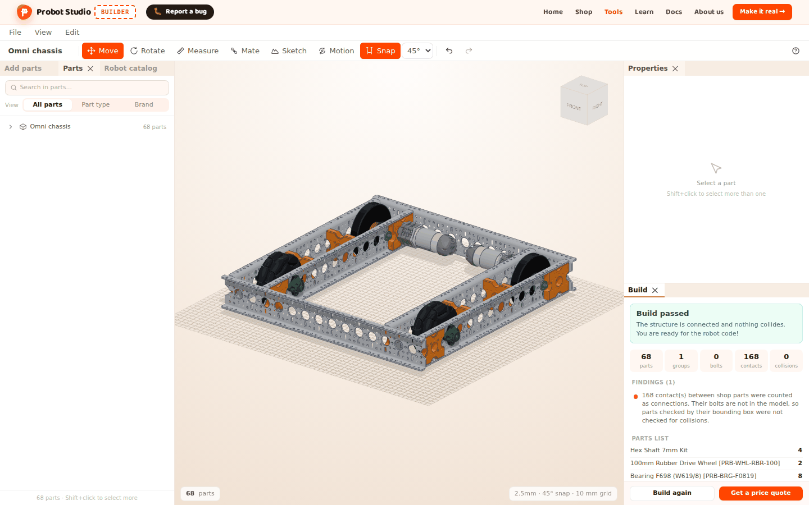
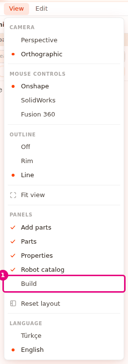
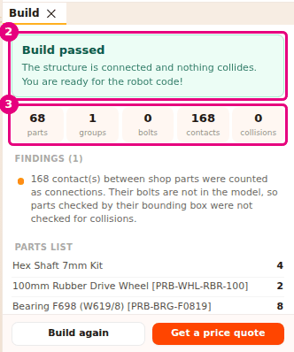
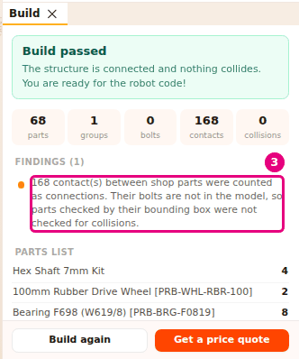
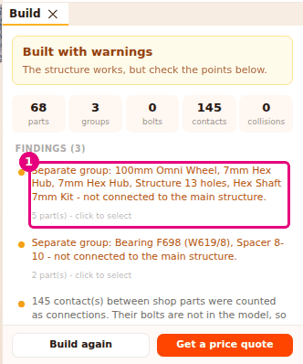
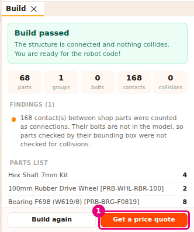

# Check the robot with Build

On this page you will open the **Build** panel and build your robot. Build shows whether the parts
are attached to each other, lists any collisions and shows the parts list.

<!-- CAPTURE: url=https://probotstudio.com/builder/?dil=en | hazirla=hazir:Omni chassis, Build panel open, Build pressed (phase tag cropped out) | hedef=body | isaret=yok | bekle=text="Build again" -->

## Before you start

- A robot is in the scene. To start with a ready-made example, press **Omni chassis** on the "The scene
  is empty" card (see [Start with a ready-made robot](hazir-robotla-basla.md)).
- The **Build** panel is closed by default. You open it first.

## Open the Build panel

In the **Menu bar**, select **View** > **Build**. The menu closes by itself.

<!-- CAPTURE: url=https://probotstudio.com/builder/?dil=en | hazirla=hazir:Omni chassis, View menu open | hedef=role=menuitemcheckbox[name="Build"] | isaret=1 | bekle=text="PANELS" -->
<!-- SAY: The Build panel is closed the first time, so we open it from the View menu. -->

Result: The **Build** panel opens below the **Properties** panel. The panel shows the text "No build
yet" and **Build**. If **Properties** is closed, the panel opens next to the **Scene**.

To close the panel, uncheck **View** > **Build**. This browser remembers your choice.

## Run Build and read the result

1. In the **Build** panel, press **Build**.
2. Read the result heading at the top of the panel.
   
   <!-- CAPTURE: url=https://probotstudio.com/builder/?dil=en | hazirla=hazir:Omni chassis, Build panel open, Build pressed | hedef=text="parts";text="collisions" | isaret=2,3 | bekle=text="Build again" -->
   <!-- SAY: We press the Build button and read the state of the robot from the heading at the top. -->
3. Check the five counters below the heading.

Result: One of three headings appears at the top of the panel, with the counters below it.

| Heading | Description | When |
|---|---|---|
| "Build passed" | "The structure is connected and nothing collides. You are ready for the robot code!" | There are no errors and no warnings. There may be info rows. |
| "Built with warnings" | "The structure works, but check the points below." | There are no errors and at least one warning. |
| "Build failed" | "Fix the errors first, then build again." | There is at least one error. |

| Counter | What it counts |
|---|---|
| **parts** | The material parts in the scene. Shapes of the Hole type and sketches are not counted. |
| **groups** | Sets of parts attached to each other. If the whole robot is attached, it is 1. |
| **bolts** | Each pair of lined-up holes between parts (two lined-up holes count as 2), plus each bolt or nut that touches or goes into another part. |
| **contacts** | Pairs of parts whose surfaces touch but whose holes do not line up. Shop parts that touch or go into each other are also counted here. |
| **collisions** | Pairs of parts that go more than 2 mm into each other. Most shop parts are not counted here (see [Run Build on a ready-made robot](#hazir-robotu-derle)). |

The build result does not update by itself. After you change the robot, press **Build again**.

!!! note "Note"
    The wheel and motor checks do not work on the parts of a ready-made robot. To check a ready-made
    robot, also look at the "Robot check" in the **Make it real** window (see [Read the robot check](gercege-dok.md#read-the-robot-check)).

## Run Build on a ready-made robot {#hazir-robotu-derle}

Build checks shop parts by the box around their model. This box does not see the hole the shaft goes
through. So shop parts that touch or go into each other count as connected, not as a collision.

1. On the "The scene is empty" card, press **Omni chassis**.
2. In the **Build** panel, press **Build**.
3. In the "Findings" list, read the row "N contact(s) between shop parts were counted as connections."
   
   <!-- CAPTURE: url=https://probotstudio.com/builder/?dil=en | hazirla=hazir:Omni chassis, Build panel open, Build pressed | hedef=text=/contact\(s\) between shop parts were counted as connections/ | isaret=3 | bekle=text="Build again" -->
   <!-- SAY: When we build the ready-made robot the contacts of the shop parts count as connections and the robot passes. -->

Result: The heading says "Build passed". For the Omni chassis the counters are 68 parts, 1 group,
0 bolts, 168 contacts and 0 collisions.

For shop parts, the counters and findings work like this:

- **contacts** also counts the contacts of shop parts. For shop parts **bolts** stays 0, because their
  bolts are not in the model.
- Parts with a C-shaped cross section, such as profiles, and bent sheet parts are checked by their
  real shape. These can collide.
- Rotated parts (for example wheels set at 45°) are checked in their real direction. Rotated parts that sit
  close but do not go into each other are not counted as a collision.
- If shop parts touch each other, the "No bolted connections" warning does not appear.
- If there is a motor but no Control Hub in the scene, the info row "There are N motor(s) but no Control
  Hub. Motors connect to a Control Hub." appears.

## Look through the findings

Below the counters, the "Findings (N)" list appears. A red dot is an error, a yellow dot is a warning,
and the rest are info. The list starts with the errors.

1. In the **Build** panel, select a row in the "Findings" list. Below the row it says "N part(s) - click
   to select".
   
   <!-- CAPTURE: url=https://probotstudio.com/builder/?dil=en | hazirla=hazir:Omni chassis, one part moved away from the robot (Separate group), Build panel open, Build pressed | hedef=text="click to select" | isaret=1 | bekle=text^="Findings" -->
   <!-- SAY: When we press a finding the parts it is about are selected in the scene. -->
2. In the **Scene**, right-click the selected part and select **Focus**. The camera points at the part.
3. In the **Toolbar**, press **Mate** and mate the part to the correct hole (see [Mate parts by their holes](parcalari-tak.md)).
4. In the **Build** panel, press **Build again**.

Result: The finding you fixed leaves the list. The counters update.

Rows without "click to select" below them ("The scene is empty - there are no parts to build.", "No
bolted connections" and "N contact(s) between shop parts were counted as connections.") cannot be
selected.

| Finding | Type | What it means | What to do |
|---|---|---|---|
| "The scene is empty - there are no parts to build." | Error | There are no parts in the scene. | Add a part or load a ready-made robot. |
| "A and B overlap (~N.Nmm)." | Error | Two parts go into each other. | Move one of the parts, or mate it by its hole with **Mate**. |
| "A and B touch, but their bolt holes do not line up." | Info | The parts touch, but their holes are not on top of each other. | Line up the holes with **Mate**. |
| "Separate group: A, B - not connected to the main structure." | Warning | These parts do not touch the rest of the robot. | Move the parts to the robot or mate them to it. |
| "No bolted connections - the parts are only resting on each other." | Warning | No part has a hole that lines up with a hole of another part. | Mate the parts by their holes with **Mate**. |
| "No motor shaft on the axis of N wheel(s)." | Warning | No motor turns the wheel. | Mate the wheel to a motor shaft. |
| "There are wheels but no motor - the robot cannot move." | Warning | The robot has wheels but no motor. | Add a motor and mate the wheel to its shaft. |
| "There are N motor(s) but no Control Hub. Motors connect to a Control Hub." | Info | There is a motor in the scene but no Control Hub. | Add a Control Hub (see [Make it real: send the parts list to the shop cart](gercege-dok.md)). |
| "N contact(s) between shop parts were counted as connections. ..." | Info | Shop parts that touch or go into each other were counted as attached. | Do nothing. See [Run Build on a ready-made robot](#hazir-robotu-derle). |

## Read the parts list

Below the findings is the "Parts list" table. Each row shows the name of a part and how many are in
the scene. Different lengths of the same part are separate rows. A belt whose length is not in the
shop shows as an "HTD5M belt N mm, not in the shop" row.

This list does not show prices or stock. For prices, stock and the cart, use **Get a price quote**.
<!-- SAY: In the parts list we see how many of each part the robot has. -->

## Get a price quote

If the panel says "No build yet", press **Build** first. **Get a price quote** appears below the build
result.

1. At the bottom of the **Build** panel, press **Get a price quote**.
   
   <!-- CAPTURE: url=https://probotstudio.com/builder/?dil=en | hazirla=hazir:Omni chassis, Build panel open, Build pressed | hedef=role=button[name="Get a price quote"] | isaret=1 | bekle=text="Build again" -->
   <!-- SAY: From the Build panel we go straight to the price and cart window. -->
2. In the **Make it real** window that opens, read the parts list and the robot check.
3. Press the window's × to go back to the **Build** panel.

Result: The **Build** panel shows again. **Get a price quote** opens the same window as
**Make it real →** in the **Site header**. To send the parts to the cart, see [Make it real: send the parts list to the shop cart](gercege-dok.md).

If the last build ran on an empty scene, **Get a price quote** is faded. After you add parts, press
**Build again**.

## Having trouble?

- **There is no Build button in the panel, and Build is not checked in the menu:** The panel is closed.
  Select **View** > **Build**. See [Troubleshooting](sorunlar.md#panel-kayboldu).
- **I fixed the robot, but the finding is still there:** The result does not update by itself. Press
  **Build again**. See [Troubleshooting](sorunlar.md#sonuc-degismedi).
- **"The scene is empty - there are no parts to build." appears:** There are no parts in the scene, or
  all of them are shapes of the Hole type or sketches. Add a material part. See [Troubleshooting](sorunlar.md#derlenecek-parca-yok).
- **Pressing a finding row selects nothing:** That finding is not about any part. The row does not say
  "click to select".
- For other warnings, see [Troubleshooting](sorunlar.md).

## Next step

- [Make it real: send the parts list to the shop cart](gercege-dok.md)
- [Mate parts by their holes](parcalari-tak.md)
