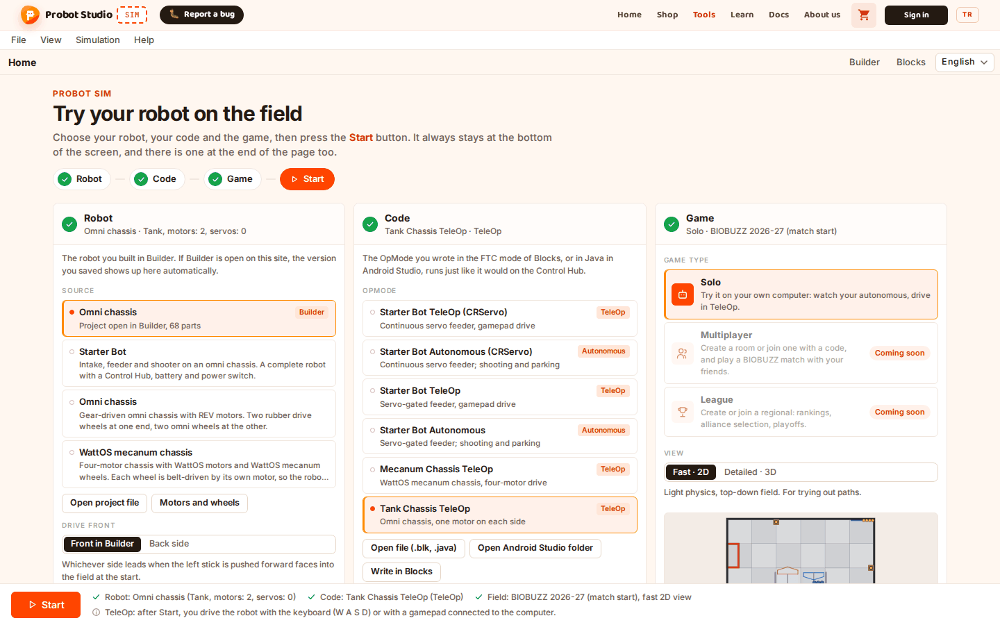
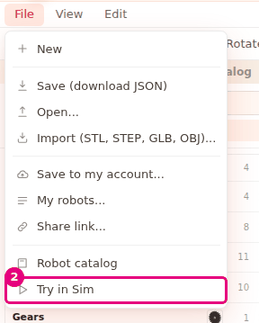
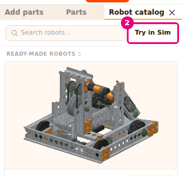

# Try the robot in Sim

On this page you will send the robot that is open in Builder to Sim. Sim opens in a new tab, and
your robot is already selected there. The [Sim docs](../sim/index.md) explain how to use Sim itself.

<!-- CAPTURE: url=https://probotstudio.com/builder/?dil=en | hazirla=hazir:Omni chassis, the Sim tab opened with File > Try in Sim | hedef=body | isaret=yok | bekle=canvas -->

## Before you start

- There is a robot in the scene. To start with a ready-made robot, load the **Omni chassis**. See
  [Start with a ready-made robot](hazir-robotla-basla.md).
- If you gave your motors a name and a port, these go to Sim too. See
  [Give motors and servos a name and a port](motor-ve-servo-ayarla.md).
- Your browser lets this site open new tabs.

## Try in Sim from the File menu

1. In the **Menu bar**, press **File**.
2. Select **Try in Sim**.
   
   <!-- CAPTURE: url=https://probotstudio.com/builder/?dil=en | hazirla=hazir:Omni chassis, File menu open | hedef=role=menuitem[name="Try in Sim"] | isaret=2 | bekle=role=menuitem[name="Try in Sim"] -->
   <!-- SAY: We select Try in Sim from the File menu, and our robot opens in a new tab. -->
3. Switch to the new tab that opens.

Result: Sim opens in a new tab. The project open in Builder is selected as a robot, with the
project's name. The Builder tab stays open, and your work stays there.

## Try in Sim from the Robot catalog

1. In the **Left panel**, select the **Robot catalog** tab.
2. Next to the **Search robots...** box, press **Try in Sim**.
   
   <!-- CAPTURE: url=https://probotstudio.com/builder/?dil=en | hazirla=hazir:Omni chassis, Robot catalog tab in front | hedef=[data-simde-dene] | isaret=2 | bekle=[data-simde-dene] -->
   <!-- SAY: We can do the same thing with Try in Sim in the Robot catalog. -->
3. Switch to the new tab that opens.

Result: Sim opens in a new tab, and your robot is selected. The two buttons do the same thing.

## What goes to Sim

Whatever is in the scene at the moment you press **Try in Sim** goes to Sim. Builder first saves
the project in this browser, then opens Sim on the same site. Sim reads the robot from this save.

What goes to Sim:

- All the parts in the scene, with their positions and angles.
- The attachments and joints between the parts. Wheels and gears that have no joint get their
  missing joints set up automatically. The joints you set up are left as they are.
- The **Name**, **Hub**, **Port** and **Reverse direction** of each motor and servo. If you did
  not give a motor a name or a port, Sim fills in what is missing.
- The project name. The robot shows up in Sim with this name.

After that:

- After you change the robot in Builder, press **Try in Sim** again. Each press opens a new tab.
- Changes you make in Sim do not come back to Builder.
- You do not need an account.

<!-- SAY: The robot goes exactly as it is at the moment we press the button, with its parts, joints and motor ports. -->

## When Try in Sim is faded

- **When the scene is empty**, **Try in Sim** is faded in both places. In the catalog, its
  tooltip says "Load a robot into the scene first". When there is a robot, the tooltip becomes
  "Open the robot from the scene in Sim in a new tab".
- **If Sim does not respond on this site**, **Try in Sim** does not appear in either place.
  Builder checks for Sim once, while the page loads.

<!-- SAY: When the scene is empty Try in Sim stays faded, so we load a robot first. -->

## Having trouble?

- **Try in Sim is faded:** The scene is empty. Load a robot or add parts.
  See [Troubleshooting](sorunlar.md#simde-dene-soluk).
- **Try in Sim is missing from the menu and the catalog:** Builder could not reach Sim. Refresh the
  page. See [Troubleshooting](sorunlar.md#simde-dene-yok).
- **No new tab opened:** The browser may have blocked the pop-up window. Use the warning in the
  address bar to allow this site, then press **Try in Sim** again.
  See [Troubleshooting](sorunlar.md#yeni-sekme-acilmadi).
- **The "The autosave could not fit the imported models. Download the project with Save in the
  File menu" notification appears:** The large models you imported did not fit in the autosave in
  this browser. Sim may not get the shape of these models. Download the project with **File** >
  **Save (download JSON)**. See [Troubleshooting](sorunlar.md#otomatik-kayit-sigdiramadi).
- **Sim shows the old robot:** In Builder, press **Try in Sim** again and switch to the new tab
  that opens.
- **The "Autosave failed because the browser storage is full" notification appears:** The project
  could not be saved in this browser. Instead of your latest version from Builder, Sim selects an
  old save or another robot (for example Starter Bot). Pressing **Try in Sim** again does not fix
  this by itself, and the notification does not appear again until you refresh the page. First,
  download the project with **File** > **Save (download JSON)**. Then free up space in this site's
  storage in your browser. This can also delete what the site's other tools saved in the browser.
  After that, refresh the page, open the project and press **Try in Sim** again.
  See [Troubleshooting](sorunlar.md#otomatik-kayit-yapilamadi).

## Next step

- [Give motors and servos a name and a port](motor-ve-servo-ayarla.md)
- [Set up joints and try the motion](eklem-kur-ve-oynat.md)
- [Check the robot with Build](robotu-derle.md)
