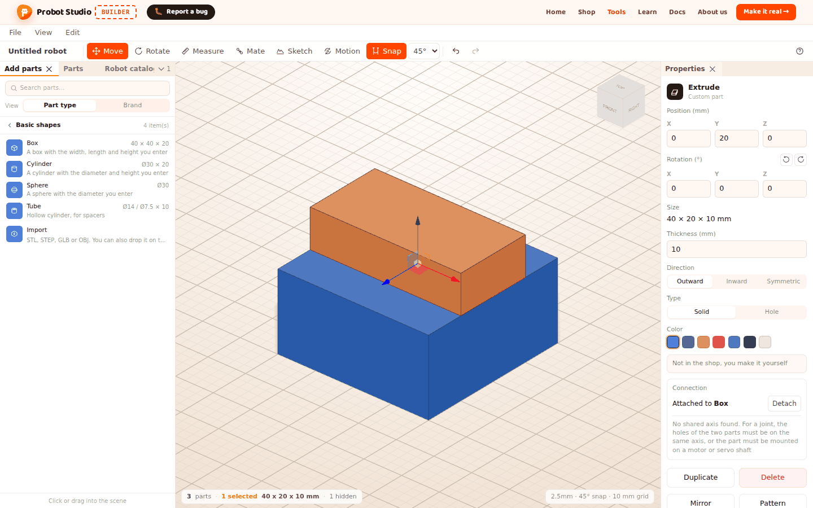
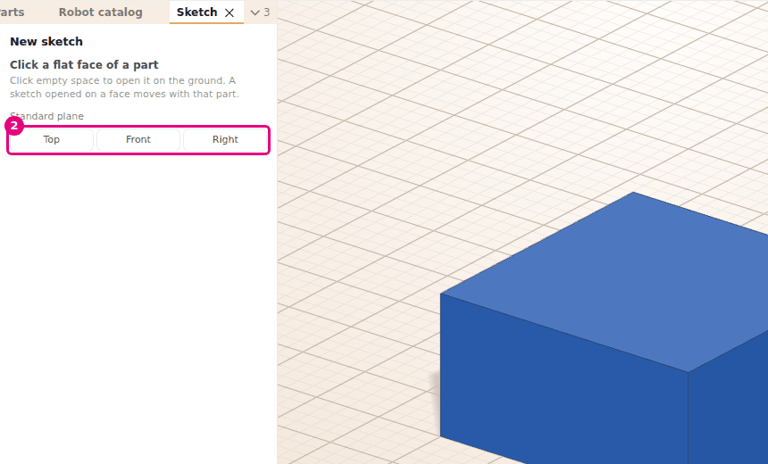
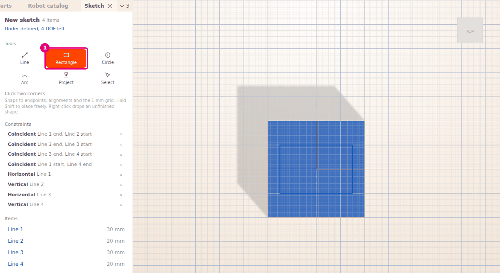
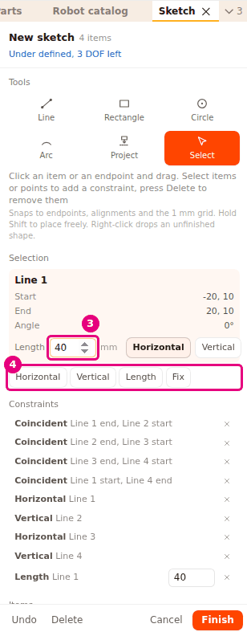
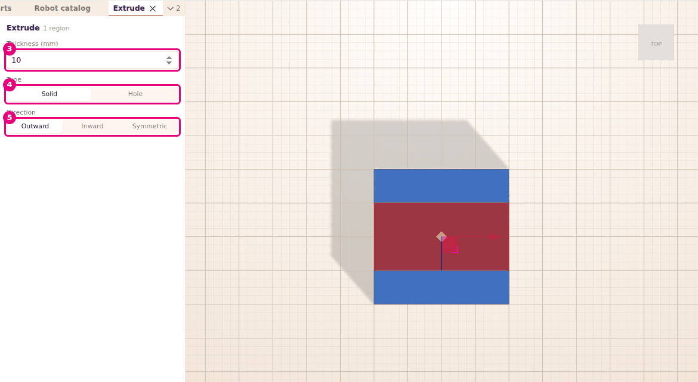

# Draw a sketch and make it solid with Extrude

On this page you draw a 2D sketch on a face or a plane and give it dimensions. Then you give it
a thickness to make a solid part. You can also cut a hole in a part the same way.

<!-- CAPTURE: url=https://probotstudio.com/builder/?dil=en | hazirla=empty scene, a rectangle sketch made solid with Extrude, selected | hedef=body | isaret=yok | bekle=canvas -->

!!! note "Note"
    Sketch and Extrude are still being developed. The screens and buttons may change over time.

## Before you start

- Builder is open. You can start with an empty scene: **File** > **New**. If the scene has parts,
  Builder asks "The parts in the scene will be deleted. Start a new project?". To keep your work,
  save it first, then confirm (see [Save to a file and open it](dosyaya-kaydet-ve-ac.md)).
- To draw on the face of a part, the scene needs a part with a flat face. For example:
  **Add parts** > **Basic shapes** > **Box** (see [Make a part from basic shapes](temel-sekillerle-parca-yap.md)).
- Dimensions are in millimeters. A sketch is not a part, and it does not go into the parts list.

## Open a sketch and select a plane

1. In the **Toolbar**, press **Sketch** (<kbd>S</kbd>). The **Sketch** tab opens in the **Left panel**, with "New sketch" in its heading.
2. In the **Scene**, choose where you want to draw:
    - Click a flat face of a part. The sketch opens on that face and moves with the part.
    - Or, in the **Sketch** tab, press **Top**, **Front** or **Right** in the **Standard plane** row.
    - If you click empty space, the sketch opens on the ground.
   
   <!-- CAPTURE: url=https://probotstudio.com/builder/?dil=en | hazirla=empty scene, Basic shapes > Box added, Sketch tool open (choosing a plane) | hedef=[data-testid="sketch-paneli"];[data-testid="sketch-duzlem-ust"] | isaret=2 | bekle=text="Click a flat face of a part" -->
   <!-- SAY: We open the Sketch tool and click the top face of the box, and the drawing starts on that face. -->
3. If you change your mind, press **Cancel** (<kbd>Esc</kbd>).

Result: The camera looks straight at the plane you chose. The **Tools** group appears in the
**Sketch** tab, and **Line** is selected.

If you click a curved face, "A sketch opens only on a flat face" appears. Choose another flat face.

## Draw the shape and finish the sketch

The **Tools** group in the **Sketch** tab has six tools. You can also choose a tool with its key.

| Tool | Key | How to draw |
|---|---|---|
| **Line** | <kbd>L</kbd> | Click one point, then the next. It ends when you get back to the start, when you double-click, or when you press <kbd>Esc</kbd>. |
| **Rectangle** | <kbd>R</kbd> | Click two corners. The sides stay horizontal and vertical. |
| **Circle** | <kbd>C</kbd> | Click the center, then a point on the edge. |
| **Arc** | <kbd>A</kbd> | Click the start, the end, then a point the arc passes through. |
| **Project** | <kbd>P</kbd> | Click a face of a part that is parallel to the plane. The edges of the face are added to the sketch. |
| **Select** | <kbd>S</kbd> | Click an item or an endpoint, and drag. <kbd>Del</kbd> deletes the selected item. |

1. In the **Tools** group, select **Rectangle** (<kbd>R</kbd>).
2. In the **Scene**, click one corner of the rectangle.
3. Click the opposite corner. The rectangle is drawn.
   
   <!-- CAPTURE: url=https://probotstudio.com/builder/?dil=en | hazirla=empty scene, Box added, Sketch open on the top face of the box, 30×20 mm rectangle drawn | hedef=[data-testid="sketch-arac-dikdortgen"];[data-testid="sketch-durum"] | isaret=1 | bekle=[data-testid="sketch-ogeler"] -->
   <!-- SAY: We click two corners with the Rectangle tool and draw a closed shape. -->
4. If you want, draw a circle inside the rectangle with **Circle**. When you extrude, this circle becomes a hole.
5. At the bottom of the **Sketch** tab, press **Finish** (<kbd>Enter</kbd>).

Result: The sketch is saved. It shows as lines in the scene and is selected. It is listed as "Sketch" in the **Parts** tab.

While you draw, points snap to endpoints, alignments and the 1 mm grid. Hold <kbd>Shift</kbd> to
place a point freely. Right-click drops an unfinished shape. While a sketch is open,
<kbd>Ctrl</kbd>+<kbd>Z</kbd> and **Undo** undo only the last change in the sketch. **Delete**
deletes the selected items. **Cancel** closes without saving the changes. If you press **Finish**
without drawing anything, no sketch is added.

## Add dimensions and constraints

A constraint fixes an item's length, its direction or how it relates to another item. Endpoints
that snap together while you draw become **Coincident** on their own. The sides of a rectangle
are **Horizontal** and **Vertical** from the start.

1. In the **Tools** group, select **Select** (<kbd>S</kbd>).
2. In the **Scene**, click one side of the rectangle. The item's name and the **Length** box appear in the **Selection** group.
3. Type `40` in the **Length** box and press <kbd>Enter</kbd>. The side becomes 40 mm long.
4. To add another constraint, in the **Selection** group, press one of the constraint buttons.
   
   <!-- CAPTURE: url=https://probotstudio.com/builder/?dil=en | hazirla=the rectangle from the previous section, open with Edit sketch, one side selected with the Select tool | hedef=[data-testid="sketch-olcu-deger"];[data-testid="sketch-kisit-ekle"] | isaret=3-4 | bekle=[data-testid="sketch-secili"] -->
   <!-- SAY: We select a side and type its length, then we add the constraints we need. -->
5. Add dimensions and constraints until the status at the top of the tab says "Fully defined".

Result: "Fully defined" appears at the top of the tab. The shape no longer changes when you drag it.

To select more than one item or point, hold <kbd>Shift</kbd> and click. To select a point, click
an endpoint, a center or the origin. These constraints appear, depending on what you select:

| Selection | Constraints |
|---|---|
| Two points | **Coincident**, **Distance**, **Horizontal distance**, **Vertical distance** |
| A point and a line | **On line**, **Distance** |
| One or more lines | **Horizontal**, **Vertical**; **Length** for a single line |
| A circle or an arc | **Radius** |
| Two lines | **Equal**, **Parallel**, **Perpendicular** |
| Two circles or arcs | **Equal** |
| Any item | **Fix** |

When a single line is selected, **Horizontal** and **Vertical** are also next to the **Length**
box. For a circle or an arc, the box is called **Radius**. The constraints you add are listed in
**Constraints**. In the list, you can change the value of a constraint that has a dimension. To remove
a constraint, press the × on its row (**Delete constraint**).

The status at the top of the tab tells you one of three things:

- "Fully defined": everything is fixed.
- "Under defined, N DOF left": the shape can still move in N ways (N degrees of freedom, DOF). You can still extrude the shape.
- "Extra or conflicting constraints, delete the red ones": remove the red rows with **Delete constraint**.

## Make a solid with Extrude

Extrude gives every closed region of the sketch a thickness and makes a solid part. A circle inside a closed shape becomes a hole in the solid.

!!! tip "Tip"
    If you drew with lines, bring the last endpoint back to the first one to close the shape.
    Otherwise **Extrude** stays faded. See [Troubleshooting](sorunlar.md#kapali-bolge-yok).

1. In the **Scene**, select the sketch.
2. In the **Properties** panel, press **Extrude**. If there is more than one closed region, the button shows a count, like "Extrude (2 regions)".
3. In the **Extrude** tab that opens in the **Left panel**, type the thickness in the **Thickness (mm)** box. The first time, it is 5 mm. In later Extrudes, it keeps the last thickness you typed (after the page reloads, it is 5 mm again).
4. In the **Type** row, select **Solid** (a new solid part) or **Hole** (cuts the part the sketch is on).
5. In the **Direction** row, select **Outward**, **Inward** or **Symmetric**. A see-through preview appears in the scene: orange for Solid, gray-brown for Hole.
   
   <!-- CAPTURE: url=https://probotstudio.com/builder/?dil=en | hazirla=empty scene, 40×20 rectangle sketch on the top face of a Box, Properties > Extrude open, Thickness 10 | hedef=[data-testid="ekstrud-panel-kalinlik"];[data-testid="ekstrud-panel-delik"];[data-testid="ekstrud-panel-yon-normal"] | isaret=3-5 | bekle=[data-testid="ekstrud-paneli"] -->
   <!-- SAY: We choose the thickness and the direction, check the preview and add the solid. -->
6. Press **OK** (<kbd>Enter</kbd>). To change your mind, press **Cancel** (<kbd>Esc</kbd>).

Result: Each closed region becomes a separate solid part and is selected. The sketch is hidden.

You can also open Extrude with a right-click: in the **Scene**, right-click the sketch and select **Extrude**.

- The thickness can be from 0.1 to 1000 mm. If you type a value above 1000, it becomes 1000.
- When you select **Hole**, **Direction** changes to **Inward** on its own.
- A hole cuts the shape you opened the sketch on (a basic shape, an Extrude part or a combined
  shape), and the part becomes a combined shape. A catalog part, an imported model or a part of type Hole is not cut: "This part cannot be cut, so the hole was added as a separate Hole part" appears.
- If the sketch is on the ground, the hole is added as a separate part: "Hole part added, use Merge to cut it".
  See [Merge shapes and cut a hole](temel-sekillerle-parca-yap.md#merge-shapes-and-cut-a-hole).
- If there is no closed region, **Extrude** is faded ("Draw a closed shape to extrude").

## Change the sketch and the Extrude part later

- **Edit the sketch:** Double-click the sketch. Or right-click it and select **Edit sketch**. Or,
  with the sketch selected, press **Edit** in the **Properties** panel. "Edit sketch" appears at the top of the tab.
  Save the change with **Finish**. If you delete all the items and press **Finish**, the sketch is deleted.
- **Find a hidden sketch:** After Extrude, the sketch is hidden. In the **Parts** tab, press the
  **Show** icon on its row to bring it back.
- **Change an Extrude part:** Select the part. In the **Properties** panel, change the thickness with
  **Thickness (mm)** and **Direction** (**Outward**, **Inward**, **Symmetric**). **Type** and **Color** work as they do for basic shapes.
- An Extrude part is separate from its sketch. Changing the sketch does not change the old Extrude part.
  For a new shape, use **Extrude** again.

<!-- SAY: We double-click the sketch to fix it, and we change the extrude thickness in Properties. -->

## Having trouble?

- **"A sketch opens only on a flat face" appears:** You clicked a curved face. Choose a flat face or use a standard plane.
  See [Troubleshooting](sorunlar.md#sketch-duz-yuz).
- **"The sketch has no closed region" appears or Extrude is faded:** The shape does not close. Bring the last endpoint of the line to the first one.
  See [Troubleshooting](sorunlar.md#kapali-bolge-yok).
- **"Extra or conflicting constraints, delete the red ones" appears:** Delete the red rows in the **Constraints** list.
  See [Troubleshooting](sorunlar.md#celisen-kisit).
- **The Sketch tab is gone and so is the drawing:** Closing the tab with its × closes the sketch without saving. Open **Sketch** again.
- **<kbd>Esc</kbd> does not close the sketch:** While you draw, <kbd>Esc</kbd> first drops the unfinished shape, then the selection.
  To close, press **Finish** or **Cancel**.
- **No Merge when the selection has a sketch:** Sketches cannot be merged. Extrude first, then merge the Extrude part.
  See [Troubleshooting](sorunlar.md#birlestirilemez).
- **Thickness does not go above 1000 mm:** The largest thickness is 1000 mm.

## Next step

- [Make a part from basic shapes](temel-sekillerle-parca-yap.md)
- [Mate parts by their holes](parcalari-tak.md)
- [Make it real: send the parts list to the shop cart](gercege-dok.md)
