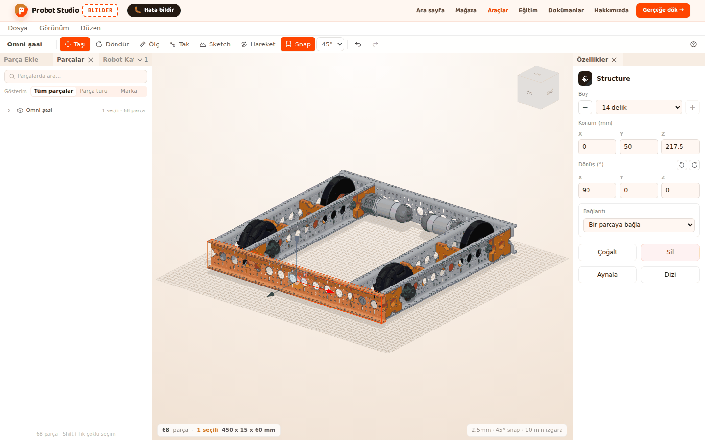
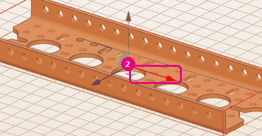
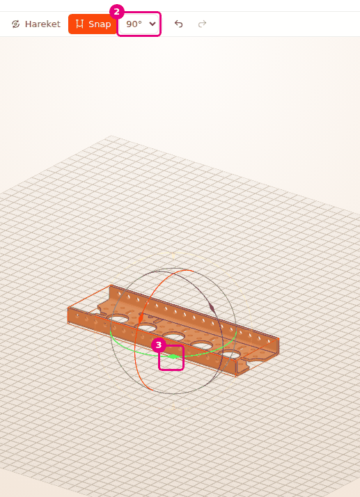
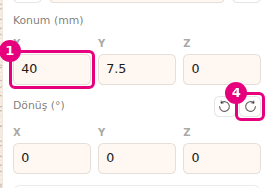
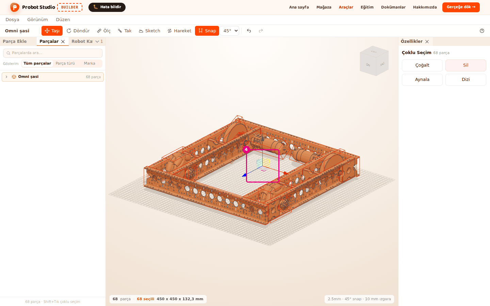

# Move and rotate a part

On this page you move and rotate a part with the mouse. You type numbers for an exact position and
angle. You also see how Snap puts the part on the grid and into the holes.

<!-- CAPTURE: url=https://probotstudio.com/builder/?dil=en | hazirla=hazir:Omni chassis, one Structure selected, Move on | hedef=body | isaret=yok | bekle=canvas -->

## Before you start

- The scene is empty. **Add parts** > **Structure** > **Structure** > **5 holes** is added and selected
  (see [Add parts](parca-ekle.md)).
- For the section on moving parts together, the **Omni chassis** is open in the scene (see [Start with a ready-made robot](hazir-robotla-basla.md)).
- **Measure**, **Mate**, **Sketch** and **Motion** are off. While they are on, the handles do not appear.

## Snap and the grid

**Snap** in the **Toolbar** decides how a part moves. It is on when it is orange. Press it to turn
it on or off. Builder remembers your choice in this browser.

| Snap on | Snap off |
|---|---|
| The part moves in 2.5 mm steps. | The part moves freely. |
| When a hole of the moving part comes near another hole, the part centers on it (hole magnet). | The hole magnet does not work. |
| Rotating locks to the rotation step (45° by default). | Rotating is free. |

If you hold <kbd>Shift</kbd> while you move or rotate, Snap turns off for that moment.

The thin lines of the grid on the floor are 2.5 mm apart. The thick lines are 10 mm apart.
The right end of the status bar below the **Scene** shows these settings: "2.5mm · 45° snap · 10 mm grid".
When Snap is off, it says "snap off · 10 mm grid".

<!-- SAY: With Snap on, the part moves in steps of two and a half millimeters and settles into the holes by itself. -->

## Move a part with the handles

1. In the **Toolbar**, press **Move** (<kbd>T</kbd> or <kbd>M</kbd>). Three colored arrows appear
   on the selected part.
2. Hold the red arrow with the left mouse button and drag it. The part moves along that axis in 2.5 mm steps.
3. Let go of the mouse button.
4. To slide the part freely, hold <kbd>Shift</kbd> and drag the green arrow.
   
   <!-- CAPTURE: url=https://probotstudio.com/builder/?dil=en | hazirla=empty scene, Structure > Structure > 5 holes added and selected, Move selected | hedef=koordinat:tasima-oku-kirmizi | isaret=2 | bekle=canvas -->
   <!-- SAY: We hold the arrow and drag it, and the part moves step by step along that axis. -->

Result: The part stays in its new place. In the **Properties** panel, the **Position (mm)** values change.

- The arrows show the part's own axes. On a rotated part, the arrows turn too.
- The squares between the arrows slide the part along two axes at once.
- Each time you let go of the mouse button, that counts as one undo step (<kbd>Ctrl</kbd>+<kbd>Z</kbd>).

## Rotate a part

1. In the **Toolbar**, press **Rotate** (<kbd>R</kbd>). Three colored rings appear around the selected part.
2. In the **Toolbar**, in the rotation step list next to **Snap**, select **90°**. The options are
   5°, 15°, 30°, 45° and 90°.
3. Hold the green ring with the left mouse button and drag it. The part turns in 90° steps.
4. Let go of the mouse button.
   
   <!-- CAPTURE: url=https://probotstudio.com/builder/?dil=en | hazirla=empty scene, Structure 5 holes selected, Rotate selected, step 90° | hedef=[data-testid="donus-adimi"];koordinat:dondurme-halkasi-yesil | isaret=2,3 | bekle=canvas -->
   <!-- SAY: We hold the ring and turn it, and the part rotates by the angle step we picked. -->

Result: The part turns around the vertical axis. In the status bar, the rotation step "90°" is highlighted.

The rotation step looks faded while Snap is off, but you can still select it. It takes effect when
Snap is turned on. Builder remembers the step you pick in this browser.

## Enter the position and angle as numbers

When one part is selected, the **Properties** panel has the **Position (mm)** and **Rotation (°)**
fields. Each one has an X, a Y and a Z box. Y is the height.

1. In the **Properties** panel, under **Position (mm)**, press the **X** box.
2. Type `40`. The part moves in the scene as you type.
3. Press <kbd>Enter</kbd>. The value is applied.
4. Next to the **Rotation (°)** heading, press the **+90° around Y** icon. The part turns 90°
   around the vertical axis.
   
   <!-- CAPTURE: url=https://probotstudio.com/builder/?dil=en | hazirla=empty scene, Structure 5 holes selected, Position X=40 | hedef=text="Position (mm)";title="+90° around Y" | isaret=1,4 | bekle=text="Rotation (°)" -->
   <!-- SAY: For an exact place we type the position in millimeters, and for a quarter turn we press the icon. -->

Result: The part's X position becomes 40 mm and the part makes a quarter turn.

- <kbd>Esc</kbd> undoes what you typed and leaves the box. Pressing anywhere outside the box applies what you typed.
- In the **Rotation (°)** boxes, you type degrees.
- **-90° around Y** and **+90° around Y** always turn the part 90°. They do not depend on Snap or
  the rotation step.
- While several parts are selected, these fields do not appear. Move the selection with the handles.

## Move several parts together

While several parts are selected, one set of handles appears in the middle of the parts. The
selection moves and turns as if it were one solid object.

1. In the **Left panel**, select the **Parts** tab.
2. Select the "Omni chassis" row. All 68 parts of the robot are selected.
3. In the **Toolbar**, press **Move** (<kbd>T</kbd>).
4. Drag the blue arrow of the handles in the middle of the parts.
   
   <!-- CAPTURE: url=https://probotstudio.com/builder/?dil=en | hazirla=hazir:Omni chassis, Omni chassis row pressed in the Parts tab, Move selected | hedef=koordinat:coklu-tutamac-mavi-ok | isaret=4 | bekle=text="68 selected" -->
   <!-- SAY: We select all the parts of the robot and slide them together with one set of handles. -->

Result: All the parts of the chassis slide together and keep the same distance between them.

If the selection has a hidden part, the handles do not appear. First show the hidden parts or take
them out of the selection (see [Select, hide and delete parts](parcalari-sec-gizle-sil.md)).

## Having trouble?

- **No arrows or rings on the selected part:** **Measure**, **Mate**, **Sketch** or **Motion** may
  be on. If **Measure** or **Mate** is on, press **Move**. If **Sketch** is on, press **Sketch** to
  finish the sketch. If **Motion** is on, press **Motion** to turn it off. If the part is hidden,
  show it first.
- **The part will not make small moves and keeps jumping to the same spots:** Snap is on. Hold
  <kbd>Shift</kbd> while you drag, or turn off **Snap**. See [Troubleshooting](sorunlar.md#snap-acik).
- **The part slides into a hole I do not want:** The hole magnet is working. Hold <kbd>Shift</kbd>.
  See [Troubleshooting](sorunlar.md#snap-acik).
- **The rotation step list is faded:** Snap is off. Turn on **Snap**.
- **The number I typed in a Position box changed back:** You may have pressed <kbd>Esc</kbd> or
  typed something that is not a number. Type the number again and press <kbd>Enter</kbd>.
- **"Editing is off in assembly mode" appears in the corner:** In the **Assembly strip**, press
  **Switch to editing**. See [Troubleshooting](sorunlar.md#montaj-modu).

## Next step

- [Mate parts by their holes](parcalari-tak.md)
- [Duplicate, mirror and pattern parts](cogalt-aynala-dizi.md)
