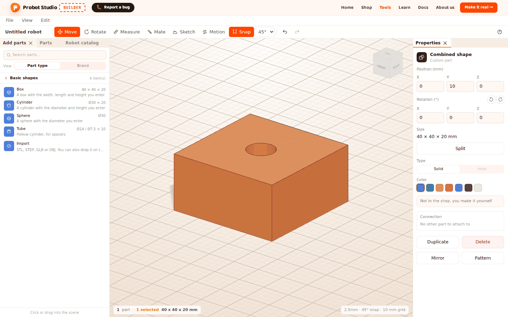
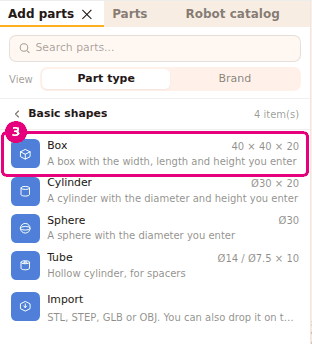
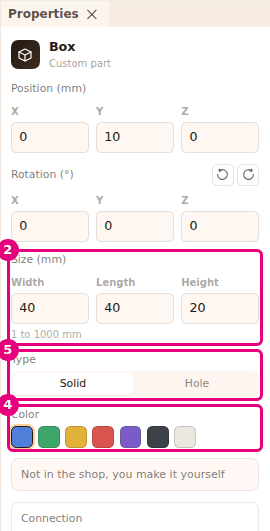
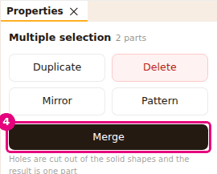
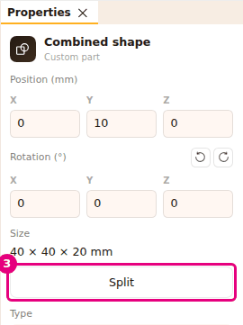

# Make a part from basic shapes

On this page you make your own part from a box, a cylinder, a sphere and a tube. You give the
shapes a size and a color, cut into them with a hole shape and merge them all into one part.

<!-- CAPTURE: url=https://probotstudio.com/builder/?dil=en | hazirla=empty scene, Box + Hole cylinder merged, selected | hedef=body | isaret=yok | bekle=text="Combined shape" -->

## Before you start

- Builder is open. Start with an empty scene: select **File** > **New** (see [Save to a file and open it](dosyaya-kaydet-ve-ac.md)).
- If you want, put the shape next to a robot: load **Omni chassis** (see [Start with a ready-made robot](hazir-robotla-basla.md)).
- Sizes are in millimeters.

## Add a basic shape

There are four basic shapes: **Box**, **Cylinder**, **Sphere** and **Tube** (a hollow cylinder, for a spacer).

1. In the **Left panel**, select the **Add parts** tab.
2. Select the **Basic shapes** section.
   
   <!-- CAPTURE: url=https://probotstudio.com/builder/?dil=en | hazirla=empty scene from File > New, Add parts > Basic shapes open | hedef=[data-section-open="temel"];[data-part-type="ozel-kutu"] | isaret=3 | bekle=[data-part-type="ozel-tup"] -->
   <!-- SAY: In the Add parts tab we open the basic shapes section. -->
3. Select the **Box** row. The box is added to the scene and is selected.
4. To put the shape in a certain place, drag the row to the **Scene** and drop it.

Result: A blue 40 × 40 × 20 mm box is in the scene. "Box" appears at the top of the **Properties** panel.

New shapes start at these sizes: **Box** 40 × 40 × 20 mm, **Cylinder** Ø30 × 20 mm, **Sphere** Ø30 mm,
**Tube** Ø14 / Ø7.5 × 10 mm.

## Set the size, type and color

When you select a shape, the **Properties** panel shows its size fields, **Type** and **Color**.

| Shape | Size fields |
|---|---|
| **Box** | **Width**, **Length**, **Height** |
| **Cylinder** | **Diameter**, **Height** |
| **Sphere** | **Diameter** |
| **Tube** | **Outer diameter**, **Inner diameter**, **Height** |

1. In the **Scene**, select the shape.
2. In the **Properties** panel, type the new size in a field under **Size (mm)**, for example `60` in the **Width** field.
3. Press <kbd>Enter</kbd>. The shape changes while you type, and its bottom stays in place. <kbd>Esc</kbd> goes back to the old size.
   
   <!-- CAPTURE: url=https://probotstudio.com/builder/?dil=en | hazirla=empty scene, Basic shapes > Box added and selected | hedef=[data-testid="ozel-olcu-w"];[data-testid="ozel-renkler"];[data-testid="ozel-delik"] | isaret=2,4,5 | bekle=[data-testid="ozel-sekil"] -->
   <!-- SAY: We type the size of the box, and then we choose its type and its color. -->
4. In the **Color** row, select a color: Blue, Green, Yellow, Red, Purple, Black or White.
5. In the **Type** row, select **Hole** if the shape will cut a hole in another shape. If it stays solid, leave **Solid** selected.

Result: The box has the size you typed and the color you chose. At the bottom of the panel, the note
"Not in the shop, you make it yourself" appears.

Sizes go from 1 to 1000 mm, and the limit is shown below the fields. On a tube, the outer diameter is
at least 2 mm and the inner diameter at least 0.5 mm. The inner diameter stays at least 1 mm smaller than the outer one.

When you select **Hole**, the shape turns see-through gray and the **Color** row disappears. The note changes to
"Merge cuts a hole shape out of a solid shape, it is not made on its own".

## Merge shapes and cut a hole

**Merge** makes the selected shapes into one part. Shapes of type **Hole** are cut out of the solid shapes.

1. Add a **Box** and a **Cylinder**. Set the cylinder's **Type** to **Hole**.
2. Move the cylinder to where it passes through the box (see [Move and rotate a part](tasi-ve-dondur.md)).
3. Select the box, then hold <kbd>Shift</kbd> and select the cylinder.
4. In the **Properties** panel, press **Merge**.
   
   <!-- CAPTURE: url=https://probotstudio.com/builder/?dil=en | hazirla=empty scene, Box (40×40×20) and Cylinder (Ø10×40, Type Hole) passing through the middle of the box, both selected with Shift | hedef=[data-testid="ozel-birlestir"] | isaret=4 | bekle=text="Multiple selection" -->
   <!-- SAY: We select the box and the hole cylinder together and merge them, and a hole opens in the box. -->

Result: A cylinder-shaped hole is cut in the box. "Combined shape" appears at the top of the
**Properties** panel, and the **Size** row shows the overall size of the part.

- **Merge** appears only when everything in the selection is a basic shape, a combined shape or an Extrude part.
  If the selection has a catalog part, an imported model or a sketch, the button does not appear.
- If all the selected shapes are **Hole**, **Merge** stays faded. You need at least one solid shape.
- A combined shape cannot be made a **Hole**.
- You can merge a combined shape with other shapes again.

## Split a combined shape

1. In the **Left panel**, select the **Parts** tab.
2. In the list, select the row of the combined shape. "Combined shape" appears at the top of the **Properties** panel.
3. In the **Properties** panel, press **Split**.
   
   <!-- CAPTURE: url=https://probotstudio.com/builder/?dil=en | hazirla=the combined shape from the previous section (Box + Hole cylinder) selected | hedef=[data-testid="ozel-ayir"] | isaret=3 | bekle=text="Combined shape" -->
   <!-- SAY: With the Split button we turn the combined shape back into the parts it was made from. -->

Result: The shapes are separate parts again, in the places they had before you merged them. They are all selected.

To undo a merge, you can also select **Edit** > **Undo** (<kbd>Ctrl</kbd>+<kbd>Z</kbd>).

## See it in the parts list

Basic shapes are not sold in the shop. You make them yourself (for example, with a 3D printer). When
you press **Make it real →** in the **Site header**, these shapes appear in a separate **CUSTOM PARTS**
section, not in the parts table.

The section's note says "Not in the shop, you make these yourself. Not included in the total".
Each row shows the name, size and count of the shape. Hole shapes are not on the list.

<!-- SAY: The shapes we made ourselves appear in the custom parts section of the parts list. -->

Details: [Make it real: send the parts list to the shop cart](gercege-dok.md).

## Having trouble?

- **Merge does not appear:** The selection must have at least two parts. All of them must be basic shapes, combined shapes or Extrude
  parts. Imported models and sketches cannot be merged.
  See [Troubleshooting](sorunlar.md#birlestirilemez).
- **Merge is faded:** All the selected shapes are **Hole**. Make one of them **Solid**, or add a solid shape to the selection.
  See [Troubleshooting](sorunlar.md#birlestirilemez).
- **I merged the shapes, but no hole was cut:** The hole shape was not touching the solid shape. Press **Split**, move the hole shape
  inside the solid, and merge again.
- **The Hole option is faded:** A combined shape cannot be made a hole. Press **Split** first.
- **"This part cannot be cut, so the hole was added as a separate Hole part" appears:** This warning appears when you cut a hole with Extrude.
  If you opened the sketch on a catalog part, an imported model or a Hole shape, that part is not cut.
  The hole is added as a separate part. Basic shapes, combined shapes and Extrude parts are cut. See [Draw a sketch and make it solid with Extrude](sketch-ve-extrude.md),
  [Troubleshooting](sorunlar.md#parca-kesilemez).
- **"Editing is off in assembly mode" appears:** The robot is in assembly mode (from **Build step by step**). In the **Assembly strip**,
  press **Switch to editing**. See [Troubleshooting](sorunlar.md#montaj-modu).

## Next step

- [Draw a sketch and make it solid with Extrude](sketch-ve-extrude.md)
- [Import a 3D model](model-ice-aktar.md)
- [Make it real: send the parts list to the shop cart](gercege-dok.md)
