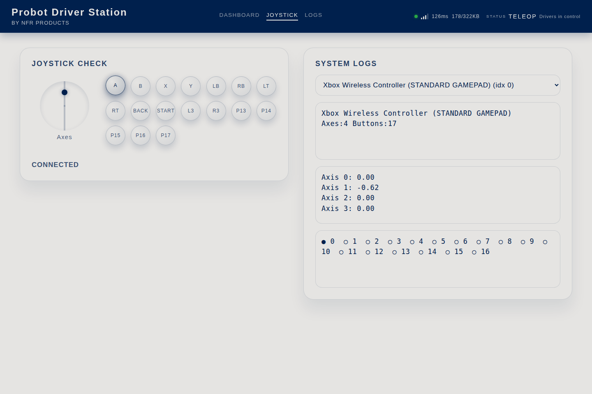
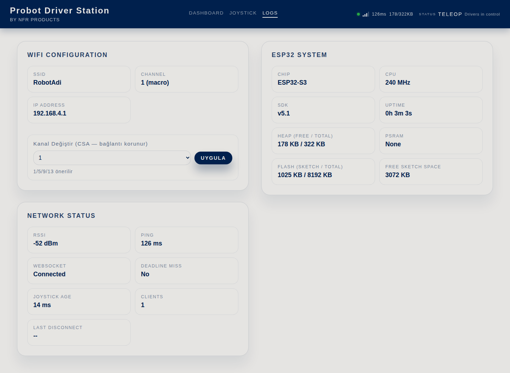
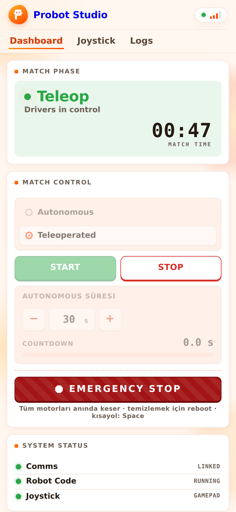

# Driver Station interface

Driver Station is the match control screen. It opens in the browser over the robot's own WiFi network. This page describes every tab, button and indicator.

The address is `http://192.168.4.1`. The page comes from inside the robot, so it does not need the internet. The text on the screen is in English, and this page writes it the same way. Only the channel controls in the **Logs** tab are in Turkish; this page quotes them in Turkish, with their meaning in parentheses. Steps to connect to the robot: [First 10 minutes](ilk-10-dakika.md#robotun-agina-baglan).

Only one device controls Driver Station at a time. The device that opens the page first becomes the owner of the robot. Another device that tries to open it sees "Another client is already connected." If the owner device stays silent for 5 seconds, the spot is freed.

## Top bar {#ust-serit}

| Name | What it does | Related task |
|---|---|---|
| "Probot Driver Station" title | The name of the page. It is hidden on screens narrower than 900 pixels. | |
| **Dashboard**, **Joystick**, **Logs** | Opens the tab. The page opens on **Dashboard**. | |
| Connection indicator | A colored dot, 4 signal bars, the latency (ms), and the robot's free and total memory (KB). The dot is green at 3 or 4 bars, yellow at 2, and red at fewer. | [Measure the signal](sinyali-iyilestir.md#sinyali-olc) |
| **Status** | The match stage and a short description (table below). It is hidden on screens narrower than 900 pixels. | [Follow the match flow](hooklari-yaz.md#mac-akisi) |

| **Status** | Description | When |
|---|---|---|
| Standby | "Awaiting command" | When the page first opens |
| Init | "Systems primed" | After **Init** |
| Autonomous | "Auto running - 12.3 s" (time left) | While autonomous runs |
| Teleop | "Drivers in control" | While TeleOp runs |
| Stopped | "Motors safe" | After **Stop** |

## Dashboard {#dashboard}

### Match Control {#match-control}

The **Match Control** section has one main button. Its label changes in turn to **Init**, **Start** and **Stop**.

| Name | What it does | LED on the board | Related task |
|---|---|---|---|
| **Init** | `robotInit()` runs once. The robot is ready and does not move. The button's label changes to **Start**. | Solid yellow | [Write the functions for the match flow](hooklari-yaz.md#mac-akisi) |
| **Start** | If **Autonomous** is on, `autonomousInit()` and `autonomousLoop()` run. When the time is up, `teleopInit()` and `teleopLoop()` start. If **Autonomous** is off, TeleOp starts right away. The button's label changes to **Stop**. | Blinks orange in autonomous, green in TeleOp | [Write the autonomous](otonom-yaz.md) |
| **Stop** | When the current loop pass ends, `robotEnd()` runs once and the robot stops. The button's label changes back to **Init**. | Blue | [Stop the motors at Stop](hooklari-yaz.md#robotend) |
| **Autonomous Duration** | The length of autonomous, in seconds. The default is 30. The value is sent to the robot when you press **Start**. | | [Write the autonomous](otonom-yaz.md) |
| **Autonomous** | When it is on, **Start** runs autonomous first. It is on by default. If you turn it off during autonomous, the robot switches to TeleOp. You cannot change it during TeleOp. | | |
| **EMERGENCY STOP** | Emergency stop. It cuts the robot code without waiting for the loop pass to end, then runs `robotEnd()`. The robot stays locked until it restarts. **Init** and **Start** do not work until then. | Solid red | ["EMERGENCY STOPPED"](sorunlar.md#pb-e302-emergency-stop-kilidi) |
| **Autonomous Countdown** | The time left in autonomous, with a bar that shrinks. | | |

For all the colors of the LED on the board, see [Use the status LED](led-durumu.md).

!!! warning "Warning"
    **Stop** does not cut the robot code in the middle. It waits for the loop pass to end. If the loop gets stuck, **Stop** is late. If you must stop the robot at once, press **EMERGENCY STOP**.

### Joystick {#joystick-karti}

| Name | What it does | Related task |
|---|---|---|
| Circle | Shows the left stick of the gamepad as a dot. | |
| "Connected" / "Not Connected" | Whether the page sees a gamepad. | [Connect the gamepad](ilk-10-dakika.md#kumandayi-bagla) |
| **Open Joystick page** | Opens the **Joystick** tab. | |

### Telemetry {#telemetry}

| Name | What it does | Related task |
|---|---|---|
| Telemetry panel | Shows the text from `probot::print`, `probot::println` and `probot::printf` in your code. The robot keeps the last 256 bytes. Older lines drop off. The panel updates as the text changes. | [Write to the Telemetry panel](kumandayi-oku.md#telemetri) |
| **Clear** | Erases the text from the panel. When the code writes new text, the panel fills again. | |
| **Auto-scroll: ON** / **Auto-scroll: OFF** | When it is on, the panel always shows the bottom line. When it is off, you can scroll up to read older lines. | |

## Joystick tab {#joystick-sekmesi}

This tab shows what the gamepad sends to the browser. The values are raw values. They are not the same as the values the library reads in your code.

| Name | What it does | Related task |
|---|---|---|
| **Joystick Check** circle | The position of the left stick. | |
| Button circles | A pressed button looks dark. The labels are A, B, X, Y, LB, RB, LT, RT, Back, Start, L3 and R3. The next ones are P13, P14, and so on. | [Read the buttons](kumandayi-oku.md#dugmeler) |
| "Connected" / "Not Connected" | Whether the gamepad is seen. If no gamepad is seen at all, "Press any controller button to activate." appears below it. | [Gamepad "Not Connected"](sorunlar.md#kumanda-baglanmiyor) |
| Gamepad list | "No Gamepad", or the name and order of the gamepad ("... (idx 0)"). The first gamepad found is selected automatically. If there are several, select the one that goes to the robot here. | |
| Gamepad info | The name of the gamepad, its number of axes and its number of buttons ("Axes:4 Buttons:17", for example). | [Change the gamepad mapping](kumandayi-oku.md#esleme) |
| Axis list | The raw value of each axis ("Axis 1: -0.62"). When you push the stick forward, the browser gives a negative value. In code, `js.getLeftY()` reads forward as positive. | [Read the sticks](kumandayi-oku.md#cubuklar) |
| Button list | The number of each button. ● means pressed. ○ means not pressed. | |

## Logs tab {#logs}

### WiFi Configuration {#wifi-configuration}

| Name | What it does | Related task |
|---|---|---|
| **SSID** | The name of the robot's network. | [Set up the robot's WiFi](wifi-ayarla.md) |
| **Channel** | The channel, and where it comes from: "(macro)" from the code, "(nvs)" from a choice saved on the board, "(auto)" from automatic selection. | [Change the channel without uploading code](wifi-ayarla.md#kanal-degistir) |
| **IP Address** | The address of the robot, `192.168.4.1`. | |
| **Kanal Değiştir** (Change channel) list and **Uygula** (Apply) | Switches the robot to the selected channel without uploading code, and saves the channel on the board. **Varsayılana dön (açılışta)** (Back to default, at startup) deletes the saved channel. When the robot turns on again, it uses the channel in the code. The line below the controls shows the result. | [Change the channel without uploading code](wifi-ayarla.md#kanal-degistir) |

### Network Status {#network-status}

| Name | What it does | Related task |
|---|---|---|
| **RSSI** | The signal strength the robot receives from the connected device, in dBm. | [Measure the signal](sinyali-iyilestir.md#sinyali-olc) |
| **Ping** | The time the page takes to ask the robot and get an answer, in ms. | |
| **WebSocket** | The live channel between the page and the robot: "Connected" or "Disconnected". | |
| **Deadline Miss** | "YES": a loop pass took longer than 2 seconds, and the robot is waiting in a safe state. "No": there is no problem. | [The LED blinks red](sorunlar.md#pb-e301-deadline-miss-loop-takildi) |
| **Joystick Age** | The age of the last gamepad data the robot received, in ms. | |
| **Clients** | The number of devices connected to the robot's network. | |
| **Last Disconnect** | The WiFi reason code of the last device that disconnected, such as "reason 8". | [Measure the signal](sinyali-iyilestir.md#sinyali-olc) |

### ESP32 System {#esp32-system}

| Name | What it does |
|---|---|
| **Chip**, **CPU**, **SDK** | The chip model of the board, the processor speed and the ESP-IDF version. |
| **Uptime** | How long the board has been on. |
| **Heap (Free / Total)** | The free and total memory. |
| **PSRAM** | Extra memory. It shows "None" if the board has none. |
| **Flash (Sketch / Total)** | The space the code uses, and the total flash memory of the board. |
| **Free Sketch Space** | The free code space that the board reports. |

## On a phone {#telefonda}

When you hold the phone upright, the sections stack one below the other. The buttons and tabs are the same. On a narrow screen, the "Probot Driver Station" title and the **Status** area are hidden. Follow the match from the label on the main button and from the LED on the board.

## If the connection drops {#baglanti-koparsa}

| What happens | When | What to do |
|---|---|---|
| The gamepad values reset to zero. The motors do not keep going on the last command. | When no gamepad data reaches the robot for 500 ms | Check the connection. |
| The page is covered by a screen that says "DISCONNECTED" and "Trying to reconnect...". The page tries to reconnect. | When the page gets no data from the robot for 6 seconds | Check that the device is still on the robot's network. |
| The robot switches to **Stop** (default setting). | When the Driver Station is completely silent for 10 seconds | Reconnect, then press **Init** and **Start**: [Connection lost, robot stopped](sorunlar.md#pb-e303-baglanti-kopmasi-robot-durduruldu). |
| The page is covered by a screen that says "EMERGENCY STOPPED", and the **Reboot Robot** button appears. | After **EMERGENCY STOP** | Press **Reboot Robot**, or turn the robot off and on: ["EMERGENCY STOPPED"](sorunlar.md#pb-e302-emergency-stop-kilidi). |

## Having trouble?

- **The page does not open, or it says "Another client is already connected.":** [The interface does not open](sorunlar.md#arayuz-acilmiyor).
- **The gamepad says "Not Connected":** [Gamepad "Not Connected"](sorunlar.md#kumanda-baglanmiyor).

## Next step

[Set up the robot's WiFi](wifi-ayarla.md): network name, password and channel.
