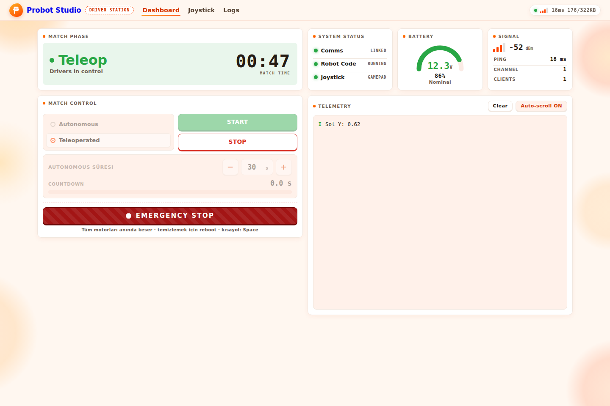
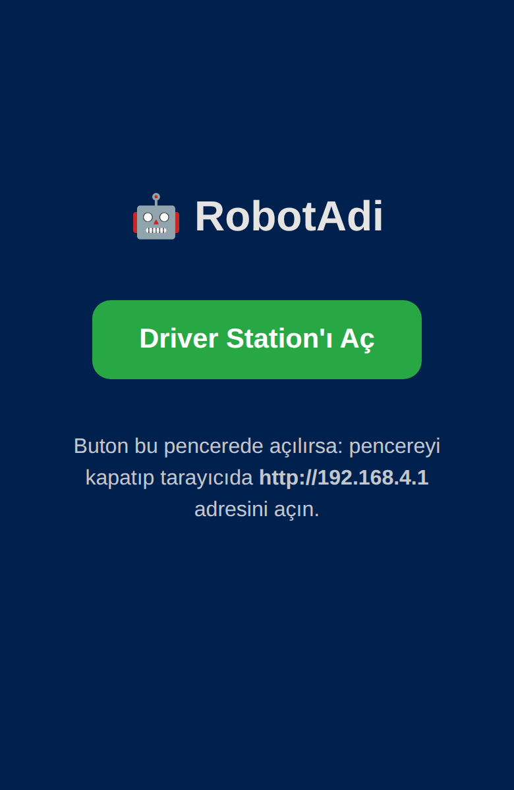

# First 10 minutes

By the end of this page, your first Probot code runs on the board, your phone connects to the robot's network and the gamepad's left stick changes a value on the Driver Station.



## Before you start

- Arduino IDE is installed and set up for Probot: [Set up Arduino IDE for Probot](arduino-ide-kur.md).
- An ESP32 board and a USB data cable.
- A phone, tablet or computer with WiFi. The Driver Station opens in its browser.
- A USB or Bluetooth gamepad. It must be able to connect to this device. If you have no gamepad, you can also drive with the computer's keyboard or the phone's screen: [Drive without a gamepad](kumandayi-oku.md#kumandasiz-sur).

If you generated your code in Blocks, follow the Blocks pages from start to finish: [Upload the code to the Probot board](../blocks/probot-karta-yukle.md). Blocks generates code for probot-core 0.3. That code does not compile with 0.4.0, and the Driver Station steps on this page are for 0.4.0. To use Blocks code with this page, first move it to 0.4.0: [Move 0.3.0 code](hooklari-yaz.md#gecis).

## Write the code {#kodu-yaz}

In Probot code, you do not write `setup()` and `loop()`. Instead, you write functions that run at given moments of the match ([Glossary](index.md#glossary)). Autonomous and TeleOp each have their own init, loop and stop function. The two loop functions and the two stop functions must be in the program, but they can stay empty.

1. In Arduino IDE, select **File** > **New Sketch**.
2. Delete every line in the new sketch.
3. Paste the code below.
4. Replace `Probot` with your robot's name, and `Probot1234` with a password of at least 8 characters.
5. Select **File** > **Save** and give the sketch a name.

```cpp
#define PROBOT_WIFI_AP_SSID     "Probot"      // WiFi network name
#define PROBOT_WIFI_AP_PASSWORD "Probot1234"  // at least 8 characters
#define PROBOT_WIFI_AP_CHANNEL  1             // 1, 6 or 11 recommended
#include <probot.h>

void autonomousInit() {}   // Autonomous: once when you press Init
void autonomousLoop() {}   // Autonomous: again and again after Start
void autonomousStop() {}   // Once every time autonomous ends

void teleopInit() {}       // TeleOp: once when you press Init

void teleopLoop() {        // TeleOp: again and again after Start
  auto js = probot::io::joystick_api::makeDefault();
  probot::clearTelemetry();                        // delete the previous text
  probot::printf("Sol Y: %.2f\n", js.getLeftY());  // -1..+1, forward is positive
}

void teleopStop() {}       // Once every time TeleOp ends
```

The three `#define` lines must come before the `#include <probot.h>` line. The library reads these values when the code is compiled. If they come after it, the code does not compile.

Do not carry `robotInit()` or `robotEnd()` over from old code. These two functions were removed in 0.4.0; if you write them, the code does not compile. Where to move the code inside them: ["redefinition of 'void robotInit()'"](sorunlar.md#pb-e106).

Check: The sketch is saved. The code has no `setup()`, `loop()`, `robotInit()` or `robotEnd()`.

## Upload the code to the board {#kodu-yukle}

1. Connect the board to the computer with the USB data cable.
2. In the **Tools** > **Port** menu, select the board's port.
3. In **Tools** > **Partition Scheme**, check that **Huge APP (3MB No OTA/1MB SPIFFS)** is selected.
4. In the toolbar, press **Upload** (the right arrow icon).
5. When the upload is done, open **Tools** > **Serial Monitor** and select **115200 baud** in the speed list.

Check: The IDE shows "Done uploading." When the board starts, it writes these lines to the **Serial Monitor**:

```text
[DS   ] ========================================
[DS   ] WiFi SSID: Probot
[DS   ] Password:  ********
[DS   ] Channel:   1 (macro)
[DS   ] IP Address: 192.168.4.1
[DS   ] ========================================
```

If the lines went by before you opened the screen, that is fine; in the next section you see the network in the WiFi list. If you get a compile error: [Compile errors](sorunlar.md#derleme-hatalari).

## Connect to the robot's network {#robotun-agina-baglan}

!!! note "Note"
    Only one device at a time controls the Driver Station. A second device cannot open the page: [The interface does not open, or "Another client is already connected."](sorunlar.md#arayuz-acilmiyor).

1. In the phone's WiFi settings, select the `Probot` network (or the name you gave it) and type the password.
2. If the welcome page opens, press **Driver Station'ı Aç** (Open Driver Station). The welcome page is in Turkish.
   
3. If the Driver Station opens in the same small window, or the welcome page does not open at all, close the window.
4. In the browser, open the address `http://192.168.4.1`. The address starts with `http`, not `https`. The page can take a few seconds to open.

Check: The page shows the **Dashboard**, **Joystick** and **Logs** tabs. In the **System Status** section, **Comms** shows "Linked". The LED on the board blinks blue.

## Connect the gamepad {#kumandayi-bagla}

The browser does not show the gamepad to the page until you press a button on it. The gamepad connects to the device where you opened the Driver Station, not to the robot.

1. Connect the gamepad to the device where you opened the Driver Station, with USB or Bluetooth.
2. On the gamepad, press any button.
3. On the Driver Station, press the **Joystick** tab.
4. Move the left stick.

Some Driver Station labels are in Turkish. This page quotes them in Turkish, with their meaning in parentheses.

Check: On the **Gamepad** card in the **Input Source** section, "Etkin" (On) is shown. In the **Axes** section, the dot in the **SOL** (LEFT) circle moves with the left stick.

If you have no gamepad, on the same tab press **Etkinleştir** (Turn on) on the **Klavye** (Keyboard) card on a computer, or on the **Dokunmatik** (Touch) card on a phone or tablet: [Drive without a gamepad](kumandayi-oku.md#kumandasiz-sur).

## Start the robot and read the value {#kumandayi-oku}

The robot runs when you select the mode on the Driver Station and press **Init**, then **Start**. The gamepad values reach the code only after **Start**; during **Init**, they all read as 0.

1. Press the **Dashboard** tab.
2. In the **Match Control** section, select **Teleoperated**. This mode is selected when the robot turns on.
3. Press **Init**. The same button's text changes to **Start**.
4. Press **Start**.
5. Push the left stick forward, then pull it back.
6. Press **Stop**.

Check: After **Init**, the LED lights yellow. After **Start**, the **Match Phase** section shows "Teleop" and the LED blinks green. In the **Telemetry** panel, `Sol Y: 0.00` is shown while the stick is in the middle. As you push forward, the value goes up to `1.00`; as you pull back, it goes down to `-1.00`. After **Stop**, **Match Phase** changes to "Standby" and the LED blinks blue again.

## Next step

- [Driver Station interface](arayuz.md): every button and indicator on the screen.
- [Set up the robot's WiFi](wifi-ayarla.md): network name and channel when there are several robots in the classroom.
- [Write the functions for the match flow](hooklari-yaz.md): when each function runs.
- [Drive the motor](motoru-sur.md): give the stick value to a motor.
