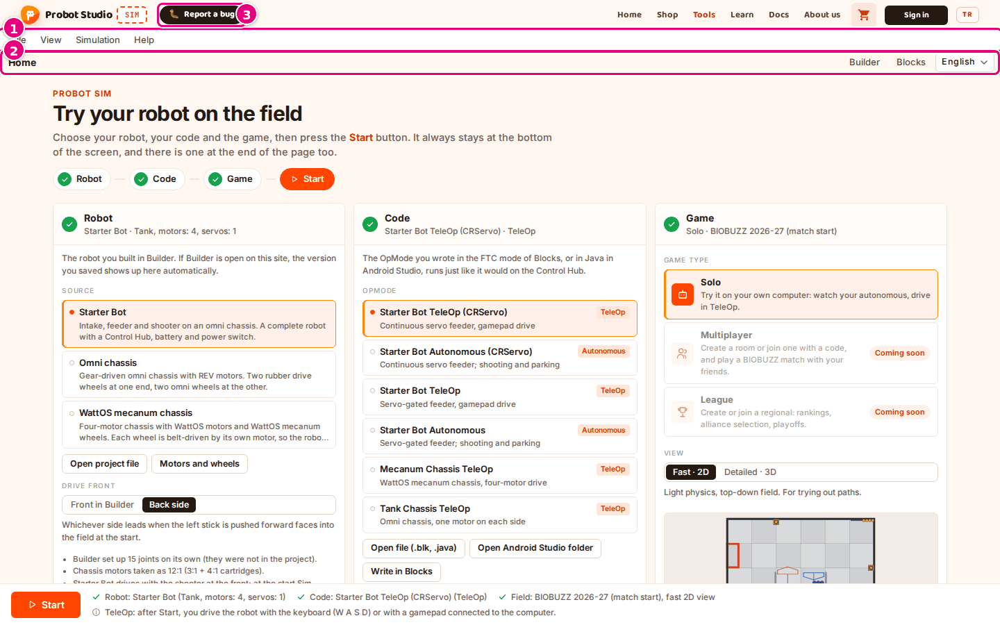
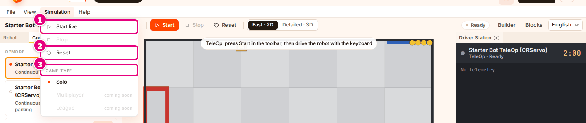
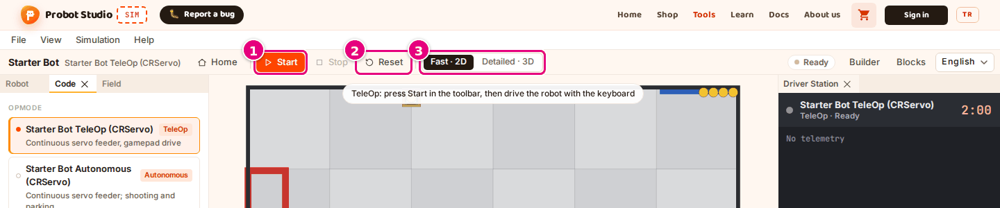
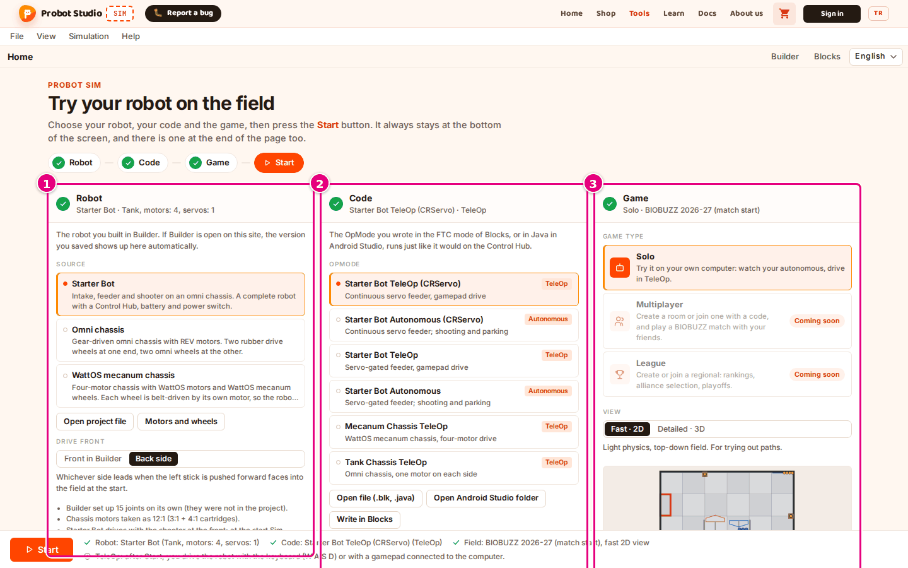
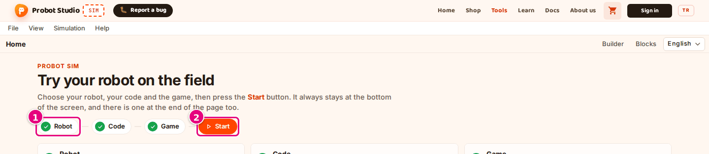
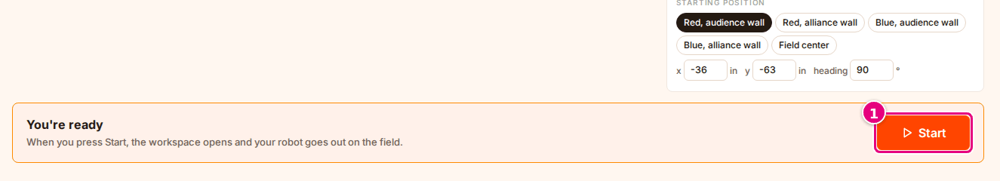
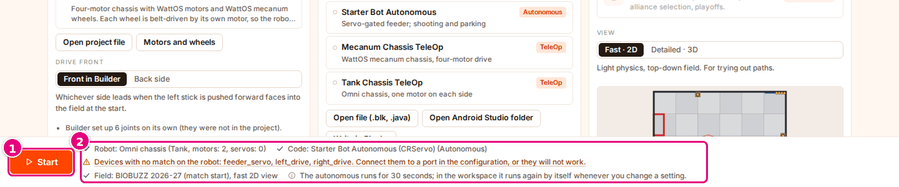
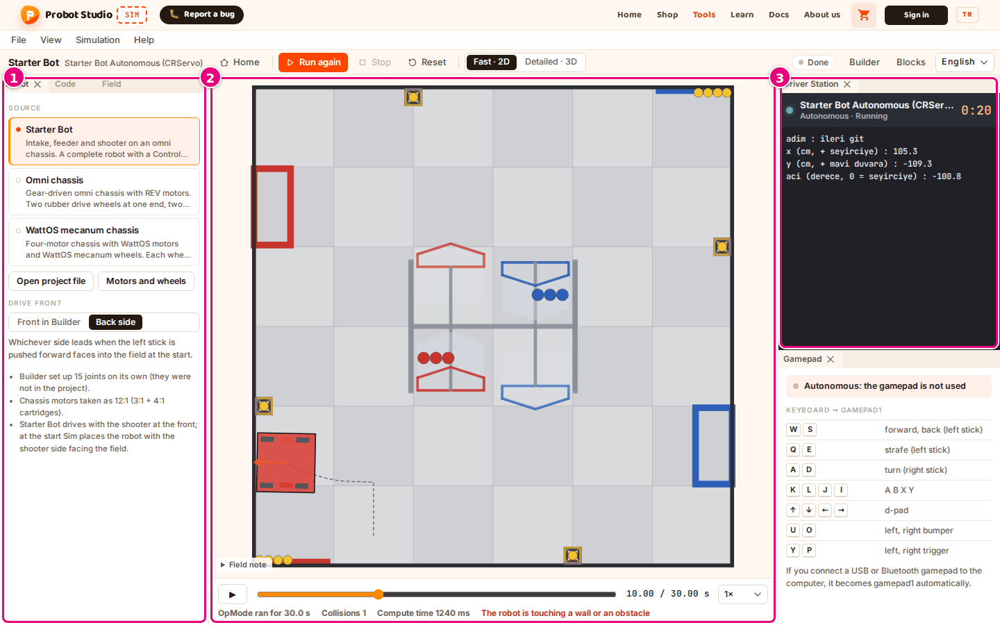
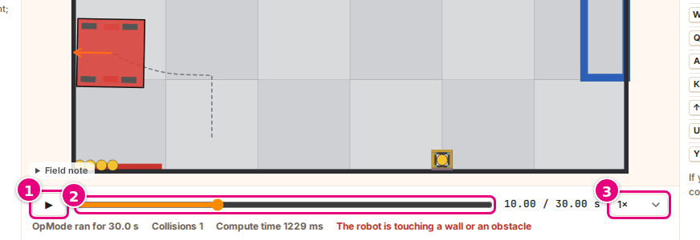
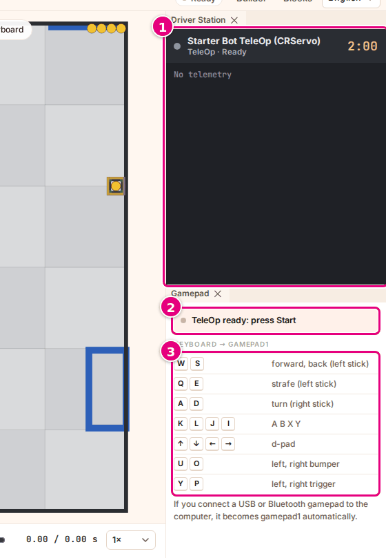

# Interface tour

This page shows every region and every button on the Sim screen. The region names used in the task
pages are defined here.

Sim has two screens. On the **Home** page you select the robot, the program and the field. When you
press **Start**, the **workspace** opens and the robot goes out on the field there. The same menu bar
and toolbar sit at the top of both screens.

## On every screen

<!-- CAPTURE: url=https://probotstudio.com/sim/?dil=en | hazirla=intro card and cookie banner closed, default choices | hedef=role=menubar; role=toolbar[name="Tools"]; probot-header >> .hatabtn | isaret=1,2,3 | bekle=text="Try your robot on the field" -->
<!-- SAY: On the Sim screen we see the menu bar at the top and the toolbar below it. -->

| # | Name | What it does | Shortcut | Related task |
|---|---|---|---|---|
| | Site header | The Probot Studio logo, the "SIM" badge, **Report a bug** and the site menu (**Home**, **Shop**, **Tools**, **Learn**, **Docs**, **About us**). The cart icon, **Sign in** and **TR** belong to the whole site. **TR** opens the Turkish version of the page. Sim does not need you to sign in. | | |
| 1 | Menu bar | The **File**, **View**, **Simulation** and **Help** menus (see below). | <kbd>Esc</kbd> closes an open menu | |
| 2 | Toolbar | On the left, the name of the screen. In the workspace it shows the robot's name, with the program's name below it. The buttons are described below. | | |
| 3 | **Report a bug** | Opens a form for sending a bug or an idea to the team. It always stays in the site header, next to the "SIM" badge. If the window is at most 560 pixels wide, or between 761 and 900 pixels wide, the "SIM" badge is hidden. At most 560 pixels wide, the button shows only the 🐛 icon. | | [Report a bug](sorunlar.md#hata-bildir) |
| | Intro card | The "The simulation tool is in development" card that appears every time the page opens. **Got it, continue** closes the card. **Report a bug** opens the form. While the card is open, **Report a bug** in the site header is shown with a ring and an arrow ("The Report a bug button is always here"). If the window is at most 900 pixels wide, or you are on a touch screen narrower than 1100 pixels (for example a tablet), the card says "The simulation tool is made for a computer". The button becomes **Continue anyway**, and you can press it after a 3-second countdown. | | [First 10 minutes](ilk-10-dakika.md) |
| | Cookie banner | Appears on your first visit. **Accept** allows detailed analytics. **Only necessary** limits it to counting visits without cookies. | | |
| | Notification box | Shows the result when you open a file from the menu ("<file> opened" or the error text). It disappears after 6 seconds. | | [Select the robot](robotu-sec.md) |

### Menu bar

Press a menu, then select an item. While a menu is open, moving the mouse pointer over the next menu
opens that one. To close the menu, press <kbd>Esc</kbd> or click outside the menu.

The menu items have no keyboard shortcuts.

<!-- CAPTURE: url=https://probotstudio.com/sim/?dil=en#calis | hazirla=Starter Bot + Starter Bot TeleOp (CRServo), workspace, no run | hedef=role=menuitem[name="Simulation"]; text="Start live"; text="Reset"; text="Game type" | isaret=1,2,3 | bekle=role=menu -->
<!-- SAY: The Simulation menu holds the commands for starting, stopping and resetting. -->

| Menu | Item | What it does | When it is disabled | Related task |
|---|---|---|---|---|
| **File** | **Home** | Goes back to the home page. | | |
| | **Open robot project file…** | Lets you pick the `.json` project file you downloaded from Builder. | | [Open a Builder project file](robotu-sec.md#builder-proje-dosyasini-ac) |
| | **Open code file (.blk, .java)…** | Lets you pick an FTC Blocks `.blk` file, or one or more Java `.java` files. | | [Open a .blk file](programi-sec.md#blk-dosyasini-ac) |
| | **Open Android Studio folder…** | Lets you pick the `TeamCode` folder of an Android Studio project. | | [Open an Android Studio project](programi-sec.md#android-studio-projesini-ac) |
| | **Reload Java project** | Reads the open Java project again. Appears only while a Java project is open. | If the folder was not opened with **Open Android Studio folder** in Chrome or Edge, or if the page was reloaded since then ("open the folder again" note) | [Bring the change into Sim](programi-sec.md#java-yeniden-oku) |
| | **Open Builder** | Opens Builder in a new tab. | | [Select the robot](robotu-sec.md) |
| | **Open Blocks** | Opens Blocks in a new tab. | | [Select the program](programi-sec.md) |
| **View** | Scene > **Fast · 2D** | A top-down 2D scene and light physics. | | [Change the view and the camera](gorunumu-degistir.md) |
| | Scene > **Detailed · 3D** | A 3D scene and full physics. | | [Change the view and the camera](gorunumu-degistir.md) |
| | Panels > **Robot**, **Code**, **Field**, **Driver Station**, **Gamepad** | Opens or closes the panel. A check mark appears next to an open panel. | On the home page ("in the workspace" note) | [Arrange the panels](panelleri-duzenle.md) |
| | **Reset window layout** | Puts the panels back in their first places and deletes the saved layout. | On the home page | [Reset the layout](panelleri-duzenle.md#duzeni-sifirla) |
| **Simulation** | **Start live** (when TeleOp is selected) or **Run again** (when Autonomous is selected) | Starts the run. | On the home page, while the code is being converted, if the code could not be converted, or while the autonomous is being computed | [Run the autonomous phase and review the recording](otonomu-calistir.md), [Drive in TeleOp with the keyboard or a gamepad](teleopu-sur.md) |
| | **Stop** | Stops the run or the playback. | On the home page, and when there is no run or playback | [Stop, reset, start again](otonomu-calistir.md#durdur-sifirla-yeniden-baslat) |
| | **Reset** | Deletes the recording and puts the robot back at its starting position. | On the home page | [Stop, reset, start again](otonomu-calistir.md#durdur-sifirla-yeniden-baslat) |
| | Game type > **Solo** | Switches to the workspace. If Autonomous is selected, the run starts by itself and you do not need to press **Start**. | | [Start the autonomous phase](otonomu-calistir.md#start-the-autonomous-phase) |
| | Game type > **Multiplayer**, **League** | Not available yet ("coming soon" note). | Always | |
| **Help** | **Gamepad controls** | Opens the **Gamepad** panel or brings it to the front. On a narrow screen it does nothing; select the **Gamepad** tab below the scene. | On the home page | [Drive in TeleOp with the keyboard or a gamepad](teleopu-sur.md) |
| | **Setup tips (home page)** | Goes back to the home page. | | |

### Toolbar

<!-- CAPTURE: url=https://probotstudio.com/sim/?dil=en#calis | hazirla=Starter Bot + Starter Bot TeleOp (CRServo), no run | hedef=role=toolbar[name="Tools"] >> role=button[name="Start"]; role=button[name="Reset"]; role=radiogroup[name="View"] | isaret=1,2,3 | bekle=text="Ready" -->
<!-- SAY: In the toolbar the start button, the reset button and the view picker sit side by side. -->

| # | Name | What it does | When it appears | Related task |
|---|---|---|---|---|
| | **Home** | Goes back to the home page. If a run is going, it stops. | In the workspace | |
| 1 | **Run** / **Run again** / **Start** / "Computing…" | When Autonomous is selected, **Run** (**Run again** if there is a recording) runs the autonomous from the beginning. When TeleOp is selected, **Start** turns on live driving. While the computation is going, it shows "Computing…" and is disabled. | In the workspace | [Run the autonomous phase and review the recording](otonomu-calistir.md), [Drive in TeleOp with the keyboard or a gamepad](teleopu-sur.md) |
| | **Stop** | Stops the autonomous computation or the playback of the recording. In live TeleOp it turns orange and ends the driving. It is disabled when there is nothing to stop. | In the workspace | [Stop, reset, start again](otonomu-calistir.md#durdur-sifirla-yeniden-baslat) |
| 2 | **Reset** | Cancels the run, deletes the recording and sets the clock to 0. The robot goes back to its starting position. | In the workspace | [Stop, reset, start again](otonomu-calistir.md#durdur-sifirla-yeniden-baslat) |
| 3 | **View**: **Fast · 2D** / **Detailed · 3D** | Selects the scene and the kind of physics. | In the workspace | [Change the view and the camera](gorunumu-degistir.md) |
| | Status badge | The state of the run: "Ready", "Computing", "Done", "Live · keyboard", "Live · gamepad", "Error". | In the workspace | [Troubleshooting](sorunlar.md) |
| | **Builder** | Opens Builder in a new tab. | Always | [Select the robot](robotu-sec.md) |
| | **Blocks** | Opens Blocks in a new tab. | Always | [Select the program](programi-sec.md) |
| | **Language**: **Türkçe** / **English** | Picks the interface language. Each language is shown in its own name. The page reloads. | Always (not in Sim embedded in a lesson) | |

## Home page

The header of the home page shows the "Probot Sim" label and "Try your robot on the field". Below it
are the step strip, three sections, a **Start** block at the end of the page and the bottom strip at
the bottom of the screen. The numbered circle at the start of a section shows that section's state
by color: yellow means a warning, red an error, gray that it is waiting for the code to be
converted. When the circle turns into a green check mark, nothing is missing in that section.

<!-- CAPTURE: url=https://probotstudio.com/sim/?dil=en | hazirla=intro card and cookie banner closed, default choices | hedef=#ana-robot; #ana-kod; #ana-oyun | isaret=1,2,3 | bekle=text="Try your robot on the field" -->
<!-- SAY: On the home page the robot, code and game choices sit side by side in three sections. -->

| # | Region | What is there | Related task |
|---|---|---|---|
| 1 | **Robot** section | Below the heading, a summary of the selected robot ("Starter Bot · Tank, motors: 4, servos: 1"). The **Source** list, **Open project file**, **Motors and wheels**, **Drive front** and the robot notes. | [Select the robot](robotu-sec.md) |
| 2 | **Code** section | A summary of the selected program. The **OpMode** list, **Open file (.blk, .java)**, **Open Android Studio folder**, **Write in Blocks** and the **Configuration** table. While a Java project is open, the "Android Studio: …" line, **Read again** and **Remove Java project**. | [Select the program](programi-sec.md), [Connect the devices to ports](cihazlari-porta-bagla.md) |
| 3 | **Game** section | The **Game type** cards, the **View** picker and its description, the starting position preview (2D field), the **Field** list and **Starting position**. | [Select the field and the starting position](sahayi-ayarla.md) |

### Step strip and the Start button at the end of the page {#adim-seridi}

The step strip sits below the header, and a second **Start** block sits at the end of the page. So
**Start** is in three places: in the step strip, in the bottom strip and at the end of the page. All
three do the same thing.

<!-- CAPTURE: url=https://probotstudio.com/sim/?dil=en | hazirla=intro card and cookie banner closed, Starter Bot + Starter Bot Autonomous (CRServo) | hedef=role=list[name="Steps"] >> text="Robot"; role=list[name="Steps"] >> role=button[name=/Start/] | isaret=1,2 | bekle=text="Try your robot on the field" -->

<!-- CAPTURE: url=https://probotstudio.com/sim/?dil=en | hazirla=intro card and cookie banner closed, Starter Bot + Starter Bot Autonomous (CRServo), scrolled to the end of the page | hedef=section.ana-son >> role=button[name=/Start/] | isaret=1 | bekle=text="You're ready" -->

| Name | What it does | Related task |
|---|---|---|
| Step strip: **Robot**, **Code**, **Game** | The numbered circle of each step shows that section's state by color; when nothing is missing it becomes a green check mark. Pressing a step scrolls the page to that section. | [Check the status indicators first](sorunlar.md#durum-gostergeleri) |
| **Start** in the step strip | The same as **Start** in the bottom strip. It is disabled if the code could not be converted or is being converted. | [Start the autonomous phase](otonomu-calistir.md#start-the-autonomous-phase) |
| End-of-page block | Shows "You're ready" when everything is ready, otherwise "One step left". Below that it names the item that blocks the start, a warning ("You can start. Note: …") or what **Start** will do. A large **Start** sits next to it. | [First 10 minutes](ilk-10-dakika.md) |

<!-- SAY: We also find the Start button at the top and at the end of the page. -->

### Game type cards

| Name | What it does |
|---|---|
| **Solo** | You try it on your own computer: you watch the autonomous phase and drive in TeleOp. It is the default and the only option you can select for now. |
| **Multiplayer** | Has a "Coming soon" badge and cannot be selected. |
| **League** | Has a "Coming soon" badge and cannot be selected. |

### Bottom strip

<!-- CAPTURE: url=https://probotstudio.com/sim/?dil=en | hazirla=Omni chassis + Starter Bot Autonomous (CRServo): the unmatched device warning must show | hedef=.ana__baslat; role=list[name="Checklist"] | isaret=1,2 | bekle=text="Devices with no match on the robot" -->
<!-- SAY: In the bottom strip we see the Start button and the checklist of our choices. -->

The bottom strip stays at the bottom of the screen even when you scroll the page.

| # | Name | What it does | Related task |
|---|---|---|---|
| 1 | **Start** | Opens the workspace and starts the run. If TeleOp is selected, live driving starts too. It is disabled if the code could not be converted or is being converted. | [First 10 minutes](ilk-10-dakika.md) |
| 2 | Checklist | A summary of your choices and the warnings. Green check mark = done, yellow = warning, red = error, gray circular arrow = the code is being converted, gray "i" = information. Pressing a warning, an error or the "Converting the code…" item scrolls the page to the related section; information items are only tips and cannot be pressed. | [Troubleshooting](sorunlar.md) |

## Workspace

The workspace opens when you press **Start** on the home page. The address becomes
`probotstudio.com/sim/#calis`. The browser's back button goes back to the home page.

If Autonomous is selected, the run starts by itself when the workspace opens. This also happens when
you open the workspace with **Simulation** > Game type > **Solo**, with the browser's forward button or
with a `#calis` link. When you open it these ways and TeleOp is selected, driving does not start until
you press **Start** in the toolbar.

<!-- CAPTURE: url=https://probotstudio.com/sim/?dil=en#calis | hazirla=Starter Bot + Starter Bot Autonomous (CRServo), BIOBUZZ 2026-27 (match start), Fast · 2D, autonomous finished, clock at 10 s | hedef=.dv-groupview (Robot); .sahne; .dv-groupview (Driver Station) | isaret=1,2,3 | bekle=text="Done" -->
<!-- SAY: In the workspace the scene is in the middle with the panels on both sides. -->

| # | Region | What is there | Related task |
|---|---|---|---|
| 1 | Left panels | The **Robot**, **Code** and **Field** panels, stacked as tabs. They hold the same choices as the home page; a choice you change here also changes on the home page. The **Field** panel also has the **View** picker at the top. | [Select the robot](robotu-sec.md), [Select the program](programi-sec.md), [Select the field and the starting position](sahayi-ayarla.md) |
| 2 | Scene | The 2D or 3D field, the robot and the game elements. The timeline is below it. | [Run the autonomous phase and review the recording](otonomu-calistir.md) |
| 3 | Right panels | The **Driver Station** panel at the top, the **Gamepad** panel at the bottom. | [Drive in TeleOp with the keyboard or a gamepad](teleopu-sur.md) |

### Scene

| Name | What it does | Related task |
|---|---|---|
| 2D scene | A top-down field. The path the robot took is drawn as a dashed line, and its front as an orange arrow. Each wheel is colored by its power: green when turning forward, red when turning backward, gray when stopped; the color gets darker as the power goes up. The robot turns red when it touches a wall or an obstacle. While the mouse is over the field, the pointer's position is shown in inches in a corner ("x … · y … in"). | [Change the view and the camera](gorunumu-degistir.md) |
| 3D scene | The field, the robot and the game elements are drawn in 3D. You rotate and zoom with the mouse. | [Use the 3D camera](gorunumu-degistir.md#3b-kamerayi-kullan) |
| Loading texts | Shows "Loading workspace…" while the workspace opens and "Loading 3D scene…" while the 3D scene opens. | [Change the view and the camera](gorunumu-degistir.md) |
| **Field**, **Driver's-eye view**, **Follow robot** | 3D camera angles. They appear only in the **Detailed · 3D** view. | [Use the 3D camera](gorunumu-degistir.md#3b-kamerayi-kullan) |
| **Field note** | A box you can expand. It says where the field's dimensions come from and what is approximate. It appears only on BIOBUZZ fields. | [Select the field and the starting position](sahayi-ayarla.md) |
| Scene hint | When TeleOp is selected and driving has not started, it shows "TeleOp: press Start in the toolbar, then drive the robot with the keyboard". | [Drive in TeleOp with the keyboard or a gamepad](teleopu-sur.md) |

### Timeline

<!-- CAPTURE: url=https://probotstudio.com/sim/?dil=en#calis | hazirla=Starter Bot Autonomous (CRServo) finished, clock at 10 s, paused | hedef=role=button[name="Play"]; role=slider[name="Time"]; role=combobox[name="Playback speed"] | isaret=1,2,3 | bekle=text="OpMode ran for 30.0 s" -->
<!-- SAY: With the timeline we play the recording and go to any moment we want. -->

| # | Name | What it does | Related task |
|---|---|---|---|
| 1 | Play / Pause (▶ / ❚❚) | Plays or pauses the recording. If you press it at the end of the recording, it plays from the beginning; if you paused, it goes on from where it stopped. It is not the **Stop** in the toolbar. It is disabled when there is no recording. | [Review the recording](otonomu-calistir.md#kaydi-incele) |
| 2 | Time slider | Goes to any moment in the recording and stops the playback. | [Review the recording](otonomu-calistir.md#kaydi-incele) |
| | Counter | "elapsed / total s". | |
| 3 | Playback speed | **0.25×**, **0.5×**, **1×**, **2×**, **4×**. It changes only the playback speed of the recording. | [Review the recording](otonomu-calistir.md#kaydi-incele) |
| | Info line | When the run ends: "OpMode ran for … s", "Collisions …", "Compute time … ms". On BIOBUZZ fields, and only in the **Detailed · 3D** view, it also shows how many times the structures tipped over ("Red HIVE tip-overs …"). | [Review the recording](otonomu-calistir.md#kaydi-incele) |
| | Warning | "The robot is touching a wall or an obstacle" or, during live driving, "Live: driving the robot". | |

"Collisions …" in the info line counts separate collisions. The first contact after the robot has
touched nothing for at least 0.25 seconds is one collision. Staying pressed against a wall counts
once, and a start right against a wall does not count.

### Driver Station and Gamepad panels

<!-- CAPTURE: url=https://probotstudio.com/sim/?dil=en#calis | hazirla=Starter Bot + Starter Bot TeleOp (CRServo), no run | hedef=role=region[name="Driver Station"]; .kumanda-durum; .tus-tablosu | isaret=1,2,3 | bekle=text="TeleOp ready: press Start" -->
<!-- SAY: On the right we see the Driver Station and the list of gamepad keys. -->

| # | Name | What it does | Related task |
|---|---|---|---|
| 1 | **Driver Station** | In the header, a status light, the OpMode name ("No OpMode"), the type and the state ("Autonomous · Ready", "TeleOp · Running", "Stopped", "Computing"). On the right, a countdown: TeleOp 2:00, Autonomous 0:30. Below it, the program's current telemetry lines or "No telemetry". A program error is written in red, warnings in a yellow box (at most 4). | [Run the autonomous phase and review the recording](otonomu-calistir.md), [Troubleshooting](sorunlar.md) |
| 2 | **Gamepad** status light | "TeleOp ready: press Start", "Live: drive with the keyboard", "Gamepad connected, you are driving" or "Autonomous: the gamepad is not used". | [Drive in TeleOp with the keyboard or a gamepad](teleopu-sur.md) |
| 3 | Key table "Keyboard → gamepad1" | The list of driving keys; the <kbd>Q</kbd> <kbd>E</kbd> "strafe (left stick)" row is here too. Below it, the gamepad note: "If you connect a USB or Bluetooth gamepad to the computer, it becomes gamepad1 automatically." | [Shortcuts](kisayollar.md) |

### Panels

| Name | What it does | Related task |
|---|---|---|
| Panel tab | The panel's name. You drag it and drop it somewhere else or next to another panel. | [Arrange the panels](panelleri-duzenle.md) |
| **×** on the tab | Closes the panel. You open it again from **View** > Panels. | [Arrange the panels](panelleri-duzenle.md) |
| Panel edge | Dragging it makes the panel wider or narrower. At least 240 pixels. | [Arrange the panels](panelleri-duzenle.md) |
| Narrow screen tabs | If the window is 900 pixels wide or narrower, the panels become tabs below the scene: **Driver Station**, **Gamepad**, **Robot**, **Code**, **Field**. | [Work on a narrow screen](panelleri-duzenle.md#dar-ekranda-calis) |

The scene panel has no tab; it cannot be moved or closed. The panel layout is saved in this browser.

## Robot details

They open when you press **Motors and wheels** in the **Robot** section. To close them, press
**Hide motors**.

A value you type in a number box is applied when you press <kbd>Enter</kbd> or leave the box. A value
outside the range is not applied, and the box goes back to the old value. You can type a comma or a
dot as the decimal separator.

| Name | What it does | Shortcut | Related task |
|---|---|---|---|
| Drive, Footprint, Links / joints | The drive type ("Tank (regular wheels)", "Mecanum", "Omni", "Mixed", "No drive wheels"), the robot's base size in cm, and the number of part groups that move together (links) and of joints. Cannot be changed. | | [Set the motor values and the mass](motorlari-ayarla.md) |
| **Mass** box ("estimated" tag) | The robot's total weighed mass, from 0.2 to 60 kg. It appears only on a robot with incomplete part data; on the others it shows "from part data". | <kbd>Enter</kbd> applies, <kbd>Esc</kbd> goes back to the old value | [Enter the mass](motorlari-ayarla.md#kutleyi-gir) |
| **Wheels** list | For each wheel, its name, its diameter in mm ("Ø… mm") and its type: "regular", "mecanum" or "omni". | | |
| **rpm** box | The motor's free speed, from 1 to 10000. | <kbd>Enter</kbd> applies, <kbd>Esc</kbd> goes back to the old value | [Set the motor values and the mass](motorlari-ayarla.md) |
| **N·m** box | The stall torque, from 0.01 to 100. | <kbd>Enter</kbd> applies, <kbd>Esc</kbd> goes back to the old value | [Set the motor values and the mass](motorlari-ayarla.md) |
| **ticks/rev** box | The number of encoder ticks per revolution, from 1 to 100000. | <kbd>Enter</kbd> applies, <kbd>Esc</kbd> goes back to the old value | [Set the motor values and the mass](motorlari-ayarla.md) |
| "your value" / "not verified" tag | Shows "your value" if you entered the value, and "not verified" if the catalog data has not been verified. | | |
| **Reset to default** | Deletes the motor values you entered. It appears only on a motor where you entered a value. | | [Reset to the default](motorlari-ayarla.md#varsayilana-don) |

<!-- SAY: In the robot details we can correct the motor values and, if needed, the mass with our own data. -->
