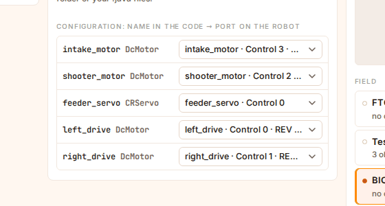
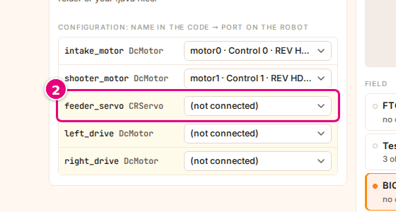
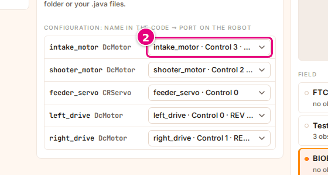

# Connect the devices to ports

On this page you will connect the device names in the program to the motors and servos on the
robot. On a real robot, the robot configuration on the Driver Station does this job; in Sim, the
**Configuration** table does it.

<!-- CAPTURE: url=https://probotstudio.com/sim/?dil=en | hazirla=Starter Bot + Starter Bot Autonomous (CRServo), all rows connected | hedef=.ks-tablo | isaret=yok | bekle=text="Configuration: name in the code" -->
<!-- SAY: In the end every device in the code is connected to a motor or a servo on the robot. -->

A device that is not connected does not work. Even if the program gives power to the `left_drive`
motor, the wheel does not turn when there is nothing for it on the robot. This is the most common
problem.

## Before you start

- The robot and the program are selected: [Select the robot](robotu-sec.md), [Select the program](programi-sec.md).
- The code must be converted. If the table area says "The device list appears here once the code is
  converted." and the checklist shows "Converting the code…", wait. If the checklist says "Could
  not convert the code: …", waiting does not help; look at the reason: [Could not convert the code](sorunlar.md#kod-cevrilemedi).

<!-- SAY: First we select the robot and the program and wait for the code to be converted. -->

## Read the table

The **Configuration: name in the code → port on the robot** table is at the bottom of the **Code**
section. Each row is a device in the program.

| Column | What it shows |
|---|---|
| Left | The name and type in the code, for example `left_drive DcMotor`, `feeder_servo CRServo`. |
| Right | The robot hardware it is connected to: "<name> · Control <port>" ("Expansion <port>" for hardware connected to the Expansion Hub). Motors also show " · <motor model>" at the end; servos show no model. A motor that turns a drive wheel shows "wheel" at the very end. |

- Light yellow (cream) row: the device is not connected; **(not connected)** is selected in the list on the right.
- The IMU row is always connected to "Control Hub IMU"; it cannot be changed.
- If the program uses no devices, the table area says "This OpMode uses no devices." instead.

Sim sets up the connections by itself first. If the robot has hardware with the same name as in the
code, it connects the device to it. It connects a motor whose name contains `left` or `sol` to the
motor of the wheel on the left side, and one that contains `right` or `sag` to the one on the right side.

<!-- SAY: The configuration table shows which port on the robot each device in the code is connected to. -->

## Connect a device that has no match {#eslesmeyen-cihazi-bagla}

If a device has no match, a yellow warning appears in the checklist on the home page: "Devices with
no match on the robot: <names>. Connect them to a port in the configuration, or they will not
work." The warning lists at most three names; for more, it adds "and <number> more".

!!! tip "Tip"
    If the robot has no free servo or motor, the row stays yellow. Select a robot that fits the program: the Starter Bot for Starter Bot programs.

1. Press the yellow warning in the checklist; the page scrolls to the **Code** section. If you are
   in the workspace, select the **Code** panel's tab instead. The rows that are not connected are light yellow in the **Configuration** table.
2. Open the list on the right of a light yellow row.
   <!-- CAPTURE: url=https://probotstudio.com/sim/?dil=en | hazirla=Omni chassis + Starter Bot Autonomous (CRServo) | hedef=.ks-tablo__satir--eksik (first) | isaret=2 | bekle=text="Configuration: name in the code" -->
   
3. Select the correct motor or servo on the robot. For drive motors, select the ones that end in "wheel".

Result: The yellow color of the row goes away, and the list shows the hardware you selected. When
all the rows are connected, the yellow warning in the checklist disappears.

<!-- SAY: When we select the correct motor of the robot from the list in the yellow row, the device gets connected. -->

The list shows only hardware of the matching type: motors in a motor row, servos in a servo row. If
the robot has no servo, a servo row cannot be connected; that device does not work in Sim. In the
example in the image (Omni chassis with Starter Bot Autonomous (CRServo)), the robot has no servo,
so the `feeder_servo` row stays yellow and the warning does not go away.

If a motor row is yellow, the robot has no free motor left. The motor you select is taken from
another device, and that row turns yellow. In this case, select a robot that fits the program or
add a motor to the robot in Builder.

## Fix a wrong connection {#yanlis-baglantiyi-duzelt}

The connection Sim sets up by itself is not always right. If the robot moves the wrong way or in an
unexpected way, check the connections.

1. On the home page, scroll to the **Code** section. If you are in the workspace, press the **Code**
   panel's tab. The right column of the **Configuration** table shows the hardware each device is connected to.
2. Open the list of the row that is connected wrong.
   <!-- CAPTURE: url=https://probotstudio.com/sim/?dil=en | hazirla=Starter Bot + Starter Bot Autonomous (CRServo) | hedef=.ks-tablo__satir (first) >> select | isaret=2 | bekle=text="Configuration: name in the code" -->
   
3. Select the right hardware.

Result: The row's list shows the hardware you selected. If you are in the workspace, the autonomous
program runs again by itself with the new connection.

The connections are kept in this browser.

!!! note "Note"
    The list also has **(not connected)**, but Sim does not keep this choice and connects the device again to a free hardware item of the matching type.
    A device stays not connected only when no free hardware of the matching type is left on the robot.

<!-- SAY: We fix a device that is connected wrong from the list, and the autonomous runs again by itself. -->

## Having trouble?

- **"The robot has no "<name>" motor; it runs as a virtual motor that spins freely." warning in the Driver Station:**
  That device is not connected. Connect it with the steps in [Connect a device that has no match](#eslesmeyen-cihazi-bagla).
  In TeleOp this warning does not appear while you drive; it appears when you press **Stop** or when the 120 seconds are up.
  See [The robot does not move](sorunlar.md#robot-kipirdamiyor).
- **"The robot has no "<name>" servo; its commands are ignored." warning in the Driver Station:** The servo is not connected,
  and the commands the program gives it are not carried out. If the robot has a servo, connect it with the steps in
  [Connect a device that has no match](#eslesmeyen-cihazi-bagla); if not, select a robot with a servo.
- **The wheel is connected but the robot turns the wrong way:** The left and right motors may be swapped:
  [Fix a wrong connection](#yanlis-baglantiyi-duzelt). Or see [Set the drive front](robotu-sec.md#surus-onunu-ayarla).

<!-- SAY: If the robot turns the wrong way, we check the places of the motors or the drive front. -->

## Next step

[Select the field and the starting position](sahayi-ayarla.md)

<!-- SAY: After the devices are connected, we move on to selecting the field. -->
