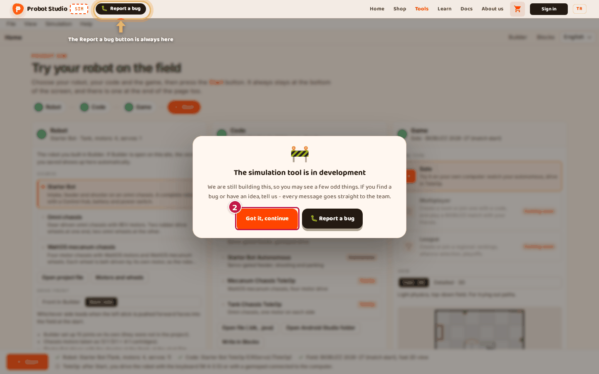
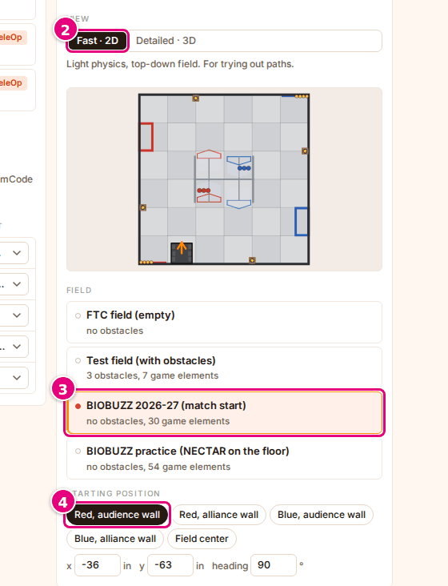
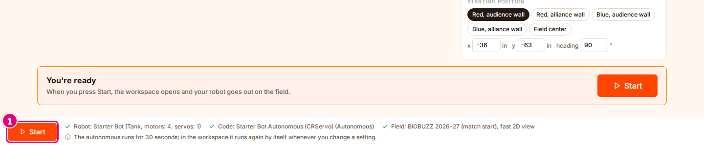
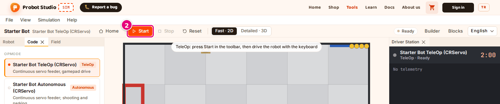

# First 10 minutes

On this page you will watch your first autonomous run with a ready-made robot, then drive the same
robot with the keyboard. You do not need an account, an installation or your own robot. Each
section ends with a "Check:" line.

<!-- CAPTURE: url=https://probotstudio.com/sim/?dil=en#calis | hazirla=Starter Bot + Starter Bot Autonomous (CRServo), BIOBUZZ 2026-27 (match start), Red audience wall, Fast · 2D; autonomous finished, clock at 12 s | hedef=body | isaret=yok | bekle=text="OpMode ran for 30.0 s" -->
<!-- SAY: On this page we run the Starter Bot on the field, first in the autonomous phase and then with the keyboard. -->

These steps are for a computer window wider than 900 pixels.

## Open Sim

!!! note "Note"
    If the window is 900 pixels wide or narrower, or if you opened Sim on a tablet, the card's title
    is "The simulation tool is made for a computer". Wait 3 seconds, then press **Continue anyway**.

1. In your browser, go to [probotstudio.com/sim](https://probotstudio.com/sim/?dil=en).
2. On the "The simulation tool is in development" card, press **Got it, continue**.
   While the card is open, **Report a bug** in the site header is shown with a ring and an arrow. The marker goes away when the card closes.
   <!-- CAPTURE: url=https://probotstudio.com/sim/?dil=en | hazirla=clean browser, cookie banner closed | hedef=role=button[name="Got it, continue"] | isaret=2 | bekle=text="The simulation tool is in development" -->
   
3. If the cookie banner appears, press **Accept** or **Only necessary**.

<!-- SAY: We open Sim in the browser and close the intro card. -->

Check: The screen shows the "Probot Sim" label, the "Try your robot on the field" title and the
**Robot**, **Code** and **Game** sections.

## Select the robot and the program

The program calls the robot's motors and servos by their names in the code. The configuration says
which port on the robot each name is connected to ([Glossary](index.md#glossary)). A device that is
not connected to a port does not work.

!!! tip "Tip"
    Select the robot first, then the program. If an example program is selected and you press a ready-made
    robot, even the robot that is already selected, the program goes back to that robot's
    example. For the Starter Bot, it becomes **Starter Bot TeleOp (CRServo)**.

1. In the **Robot** section, select **Starter Bot** from the **Source** list.
2. In the **Code** section, select **Starter Bot Autonomous (CRServo)** from the **OpMode** list.
   <!-- CAPTURE: url=https://probotstudio.com/sim/?dil=en | hazirla=Starter Bot selected | hedef=role=button[name=/^Starter Bot Autonomous \(CRServo\)/] | isaret=2 | bekle=text="OpMode" -->
   
3. In the "Configuration: name in the code → port on the robot" table of the **Code** section,
   check that no row says "(not connected)".

<!-- SAY: We select the Starter Bot from the ready-made robots and its autonomous program from the programs. -->

Check: In the checklist in the bottom strip, "Robot: Starter Bot (Tank, motors: 4, servos: 1)" and
"Code: Starter Bot Autonomous (CRServo) (Autonomous)" have green checks. There is no yellow warning.

## Select the field

1. In the **Game** section, select **Solo** from the **Game type** cards.
2. Under **View**, select **Fast · 2D**.
3. From the **Field** list, select **BIOBUZZ 2026-27 (match start)**.
4. Under **Starting position**, select **Red, audience wall**.
   <!-- CAPTURE: url=https://probotstudio.com/sim/?dil=en | hazirla=Starter Bot + Starter Bot Autonomous (CRServo) | hedef=role=radio[name="Fast · 2D"]; role=button[name=/^BIOBUZZ 2026-27/]; role=button[name="Red, audience wall"] | isaret=2,3,4 | bekle=text="Starting position" -->
   

<!-- SAY: We select the field and the place where the robot starts. -->

Check: In the **Starting position preview**, the robot stands at the wall on the audience side of the field, in
the red alliance's half.

## Start the autonomous phase and watch it

!!! note "Note"
    If **Start** is gray and cannot be pressed, the **Code** row of the checklist says "Converting the
    code…" or "Could not convert the code: …". Fix: [Start or Run cannot be pressed](sorunlar.md#baslat-basilmiyor).

1. In the bottom strip, press **Start**.
   The workspace opens. The toolbar first shows "Computing…", then the robot moves on the field.
   <!-- CAPTURE: url=https://probotstudio.com/sim/?dil=en | hazirla=Starter Bot + Starter Bot Autonomous (CRServo), BIOBUZZ 2026-27 (match start) | hedef=.ana__baslat | isaret=1 | bekle=text="The autonomous runs for 30 seconds" -->
   
2. When the counter shows "30.00 / 30.00 s", press ▶ on the timeline. The recording plays from the start.
3. From the **Playback speed** list, select **2×**. The recording plays twice as fast.

<!-- SAY: When we press Start the robot goes out on the field and runs its autonomous program. -->

Check: The status badge in the toolbar says "Done", and under the timeline it says "OpMode ran for
30.0 s". The **Driver Station** panel shows the program's telemetry lines. The example programs write
these lines in Turkish.

**Start** is also in the step strip under the title and at the end of the page. Whichever one you
press, the result is the same: [Step strip and the Start button at the end of the page](arayuz.md#adim-seridi).

Details: [Run the autonomous phase and review the recording](otonomu-calistir.md).

## Drive the robot with the keyboard

!!! tip "Tip"
    If the keys do not drive the robot, click an empty spot on the scene. While a text box is
    selected, the keys type into that box.

1. In the left panels, on the **Code** tab, select **Starter Bot TeleOp (CRServo)**.
   In a narrow window the panels become tabs under the scene, and the **Code** tab is there. See
   [Work on a narrow screen](panelleri-duzenle.md#dar-ekranda-calis).
2. In the toolbar, press **Start**.
   <!-- CAPTURE: url=https://probotstudio.com/sim/?dil=en#calis | hazirla=Starter Bot + Starter Bot TeleOp (CRServo), no run | hedef=role=toolbar[name="Tools"] >> role=button[name="Start"] | isaret=2 | bekle=text="TeleOp ready: press Start" -->
   
3. Hold down <kbd>W</kbd>: the robot goes forward. <kbd>A</kbd> and <kbd>D</kbd> turn the robot.
4. To finish, press **Stop** in the toolbar.

<!-- SAY: We select the TeleOp program, press Start and drive the robot with the W A S D keys. -->

Check: While you drive, the status badge says "Live · keyboard". After **Stop**, it says "Done".

Details: [Drive in TeleOp with the keyboard or a gamepad](teleopu-sur.md).

## Next step

- Bring your own robot: [Select the robot](robotu-sec.md).
- Bring your own program: [Select the program](programi-sec.md).
- Get to know the screen: [Interface tour](arayuz.md).

<!-- SAY: Next we bring our own robot and our own program. -->
