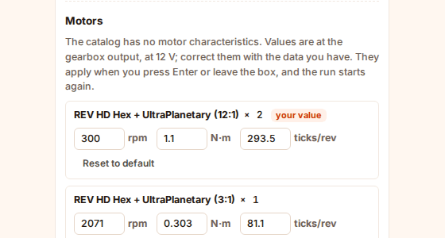
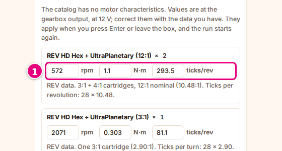
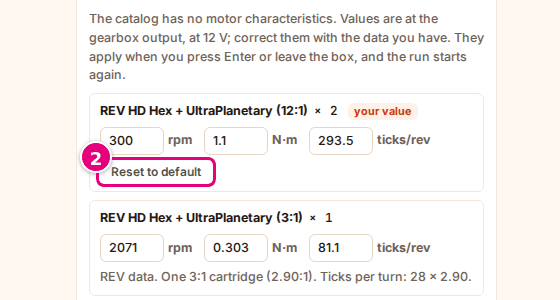
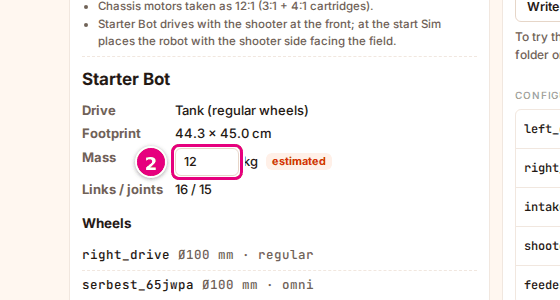

# Set the motor values and the mass

On this page you correct the robot's motor values with your own data and, if needed, enter the robot's mass.

<!-- CAPTURE: url=https://probotstudio.com/sim/?dil=en | hazirla=Starter Bot, Motors and wheels open, the first motor's rpm value set to 300 | hedef=.motor-ayar (first) | isaret=yok | bekle=text="your value" -->
<!-- SAY: In the end Sim runs the motor with the values we entered ourselves. -->

Sim's motor values are approximate. If the robot is not as fast in Sim as in reality, or the encoder counts do not
match, correct the values using the motor's data sheet.

## Before you start

- A robot is selected. To start with a ready-made robot, select **Starter Bot**: [Select a ready-made robot](robotu-sec.md#hazir-robot-sec).
- In the **Robot** section (on the home page or in the **Robot** panel of the workspace), you pressed **Motors and wheels**.
  The robot details open. To close them, press **Hide motors**.
- You have your motor's data sheet at hand: free speed (rpm), stall torque (N·m), encoder ticks per revolution.

<!-- SAY: We keep the motor's data sheet at hand. -->

## Read the robot details

The robot's name and summary are at the top of the robot details:

| Row | What it shows |
|---|---|
| **Drive** | The chassis type: **Mecanum**, **Tank (regular wheels)**, **Omni**, **Mixed** or **No drive wheels**. |
| **Footprint** | The robot's length and width on the floor, in cm. |
| **Mass** | "from part data" if the part data is complete. If it is incomplete, a kg box and the "estimated" tag. |
| **Links / joints** | The number of part groups (links) and joints in the Builder model, for example "16 / 15". |
| **Wheels** | Each wheel: its name, its diameter (mm) and its type (regular, mecanum, omni). |

<!-- SAY: The robot details show the chassis type, the footprint and the wheels. -->

## Change a motor value {#motor-degerini-degistir}

Under the **Motors** heading, each motor model on the robot is listed once, with how many there are next to it ("× 2").
Each motor has three boxes. The values are at the gearbox output, at 12 V.

| Box | Unit | Valid range |
|---|---|---|
| Free speed | rpm | Between 1 and 10000 |
| Stall torque | N·m | Between 0.01 and 100 |
| Encoder | ticks/rev | Between 1 and 100000 |

!!! tip "Tip"
    A value outside the range, or one that is not a number, is not applied, and the box goes back to the old value. When you
    hover over the box with the mouse, the valid range appears.

1. Select the box of the motor you want to change, for example the **rpm** box.
   <!-- CAPTURE: url=https://probotstudio.com/sim/?dil=en | hazirla=Starter Bot + Starter Bot Autonomous (CRServo), Motors and wheels open | hedef=.motor-ayar (first) | isaret=1 | bekle=text="Motors" -->
   
2. Delete the value in the box.
3. Type the new value. You can use a period or a comma for decimals.
4. Press <kbd>Enter</kbd> or leave the box.

Result: The "your value" tag appears next to the motor. If you are in the workspace, the autonomous program runs again by itself with the new value.

To cancel while you type, press <kbd>Esc</kbd> before <kbd>Enter</kbd>. The old value comes back into the box.

Under the boxes of a motor you have not changed, the source of the values is shown, for example "goBILDA 5203-2402-0019
manufacturer data.". The "not verified" tag tells you that Sim has not verified that motor's values against a data sheet.
The reason is shown under the boxes. It also appears when you hover over the tag with the mouse.

<!-- SAY: We correct the motor's speed, torque and encoder values with our own data, and the autonomous phase runs again. -->

## Reset to the default {#varsayilana-don}

1. Scroll the robot details down to the **Motors** heading.
2. Under the motor with the "your value" tag, press **Reset to default**.
   <!-- CAPTURE: url=https://probotstudio.com/sim/?dil=en | hazirla=Starter Bot, the first motor's rpm value set to 300, Motors and wheels open | hedef=role=button[name="Reset to default"] | isaret=2 | bekle=text="your value" -->
   
3. Repeat step 2 for any other motors you entered values for.

Result: Sim's values come back into the boxes, the "your value" tag goes away and the source of the values is shown
under the boxes again.

<!-- SAY: With Reset to default we take the motor values back to Sim's values. -->

## Enter the mass {#kutleyi-gir}

Some robots have incomplete part data. On these robots, the **Mass** row shows a box and the "estimated" tag.
At first the box shows 12 kg.

1. Weigh your robot.
2. In the **Mass** box, type the total mass in kg. The valid range is 0.2 to 60 kg.
   <!-- CAPTURE: url=https://probotstudio.com/sim/?dil=en | hazirla=a robot with incomplete part data, Motors and wheels open | hedef=role=textbox[name="Total weighed mass of the robot, kg"] | isaret=2 | bekle=text="estimated" -->
   
3. Press <kbd>Enter</kbd> or leave the box.

Result: The box shows the new mass. If you are in the workspace, the autonomous program runs again with the new mass.

If the **Mass** row says "from part data", the mass is computed from the Builder parts and cannot be changed.

<!-- SAY: On robots with incomplete part data we enter the mass we weighed by hand. -->

!!! note "Note"
    The motor values and the mass are kept in this browser. A motor's value applies to every robot that uses that motor model.

## Having trouble?

- **The value I typed went back:** The value is outside the range or is not a number. See [Change a motor value](#motor-degerini-degistir).
- **The Mass row has no box:** The robot's part data is complete, and the mass is computed from the Builder parts.
- **The robot is still too slow or too fast:** When you change the **View**, the physics changes too. See [Change the view and the camera](gorunumu-degistir.md).

<!-- SAY: If the value we typed goes back, the value is outside the allowed range. -->

## Next step

[Arrange the panels](panelleri-duzenle.md)

<!-- SAY: Next we arrange the panels. -->
