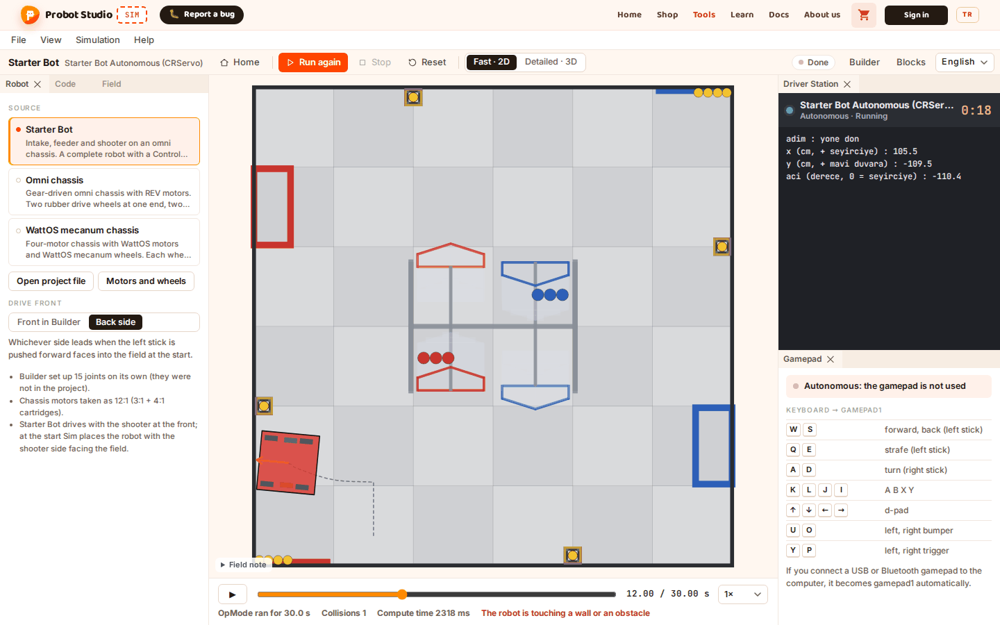
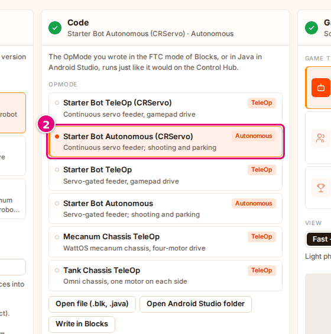
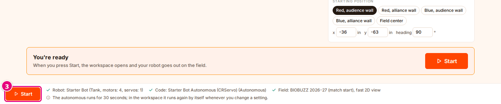
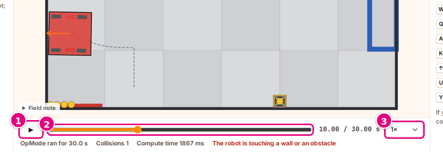
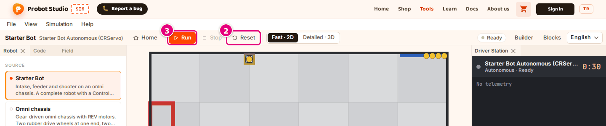

# Run the autonomous phase and review the recording

On this page you run the autonomous program on the field, then move the recording back and forth to review it.

<!-- CAPTURE: url=https://probotstudio.com/sim/?dil=en#calis | hazirla=Starter Bot + Starter Bot Autonomous (CRServo), BIOBUZZ 2026-27 (match start), Red, audience wall, Fast · 2D; autonomous finished, clock at 12 s | hedef=body | isaret=yok | bekle=text="OpMode ran for 30.0 s" -->
<!-- SAY: By the end of this page we pause the autonomous recording at any moment we like and review it. -->

The autonomous program runs for 30 seconds. Sim first computes the movement and starts playing the recording while it computes.
When the run ends, the recording stops. You can watch it again as many times as you like.

## Before you start

- Sim's home page is open: the "Try your robot on the field" heading is visible. If you are opening Sim for the first time,
  start with the [First 10 minutes](ilk-10-dakika.md) page.
- You do not need your own robot or program. The steps use the ready-made **Starter Bot** example.

<!-- SAY: We start from Sim's home page and the ready-made Starter Bot example. -->

## Start the autonomous phase

!!! tip "Tip"
    Select the robot first, then the program. If an example program is selected and you then press a ready-made robot or a Builder
    robot, the program goes back to that robot's TeleOp example. On the Starter Bot, it becomes **Starter Bot TeleOp (CRServo)**.

1. In the **Robot** section, in the **Source** list, select **Starter Bot**.
2. In the **Code** section, in the **OpMode** list, select **Starter Bot Autonomous (CRServo)**. If you are working
   with your own program, select a program with the "Autonomous" badge. In the checklist, the **Code** row gets a green check mark.
   <!-- CAPTURE: url=https://probotstudio.com/sim/?dil=en | hazirla=Starter Bot selected | hedef=role=button[name=/^Starter Bot Autonomous \(CRServo\)/] | isaret=2 | bekle=text="OpMode" -->
   
   <!-- SAY: First we select the Starter Bot robot, then the program with the autonomous badge. -->
3. In the bottom strip, press **Start**. The same button is also in the step strip under the heading and at the end of the page: [Step strip and the Start button at the end of the page](arayuz.md#adim-seridi).
   The workspace opens. The toolbar shows "Computing…" and the robot starts moving on the field.
   <!-- CAPTURE: url=https://probotstudio.com/sim/?dil=en | hazirla=Starter Bot + Starter Bot Autonomous (CRServo), BIOBUZZ 2026-27 (match start) | hedef=.ana__baslat | isaret=3 | bekle=text="The autonomous runs for 30 seconds" -->
   

Result: The status badge changes from "Computing" to "Done". Under the timeline you see "OpMode ran for 30.0 s",
"Collisions …" and "Compute time … ms". The button in the toolbar becomes **Run again**.

<!-- SAY: When we press Start, Sim computes the autonomous program and plays the robot on the field. -->

In the workspace you can also run the autonomous phase from the beginning by selecting **Simulation** > **Run again**.

The autonomous phase runs again by itself when your choices change: the program, the field, the starting position, the view,
the motor values or the configuration. It also runs when the workspace opens without **Start**: when you select
**Simulation** > **Game type** > **Solo**, with the browser's forward button, or with a link that ends in
`#calis`. In these cases you do not need to press **Start** or **Run**.

## Review the recording {#kaydi-incele}

1. In the timeline, press ▶. If the recording is at its end, ▶ plays it from the beginning. If you paused it, it continues from where it stopped.
   While the recording plays, the button shows ❚❚ (Pause). To watch from the beginning, press ❚❚ and drag the **Time**
   slider all the way to the left.
2. To go to a moment, drag the **Time** slider. Playback stops.
3. In the **Playback speed** list, select a speed: **0.25×**, **0.5×**, **1×**, **2×** or **4×**.
   <!-- CAPTURE: url=https://probotstudio.com/sim/?dil=en#calis | hazirla=Starter Bot Autonomous (CRServo) finished, clock at 10 s, paused | hedef=role=button[name="Play"]; role=slider[name="Time"]; role=combobox[name="Playback speed"] | isaret=1,2,3 | bekle=text="OpMode ran for 30.0 s" -->
   
4. In the **Driver Station** panel, read the telemetry lines at that moment.

Result: The scene, the counter and the Driver Station show the moment of the recording you selected. The countdown shows the time left at that moment.

<!-- SAY: We can slow the recording down, stop it at any moment and read the telemetry at that moment. -->

The playback speed is only the speed at which you watch the recording. It does not change how the robot moves.
The ❚❚ (Pause) button in the timeline is not **Stop** in the toolbar. It only pauses the playback.

## Read the info line

When the run ends, the following appears under the timeline:

| Text | Meaning |
|---|---|
| "OpMode ran for 30.0 s" | How many seconds the program ran. If the program ends early, it is shorter. |
| "Collisions …" | How many separate times the robot hit a wall, an obstacle or a structure. |
| "Compute time … ms" | How long Sim took to compute the movement. |
| "Red HIVE tip-overs …", "Blue HIVE tip-overs …" | Only in the **Detailed · 3D** view, on the BIOBUZZ fields: how many times that HIVE tipped over. |
| "The robot is touching a wall or an obstacle" | At that moment the robot is touching something. On the 2D scene the robot turns red. |

After the robot has touched nothing for at least 0.25 seconds, the first contact counts as a collision. Leaning against a wall
and staying there counts once. Starting right next to a wall does not count as a collision.

<!-- SAY: The info line shows how long the program ran, the number of collisions and the compute time. -->

## Stop, reset, start again {#durdur-sifirla-yeniden-baslat}

Follow this order to cut a run short or to make a clean start.

1. If computing or playback is still going on, press **Stop** in the toolbar. If the run has ended or you paused
   playback, **Stop** is faded. Skip this step and go to step 2.
2. In the toolbar, press **Reset**. The recording is deleted, the clock goes to 0 and the robot goes back to its starting position.
   <!-- CAPTURE: url=https://probotstudio.com/sim/?dil=en#calis | hazirla=Starter Bot Autonomous (CRServo) finished, Reset pressed | hedef=role=toolbar[name="Tools"] >> role=button[name="Reset"]; role=button[name="Run"] | isaret=2,3 | bekle=text="Ready" -->
   
3. In the toolbar, press **Run**.

Result: The status badge changes from "Ready" to "Computing" and the autonomous phase runs from the beginning.

If you go back to **Home**, the run stops. To start it again, press **Start** in the bottom strip.

!!! note "Note"
    If you press **Stop** while Sim is computing, only part of the recording is left: the badge shows "Done", and the info line shows values
    that are not real, such as "OpMode ran for Infinity s", "Collisions 0" and "Compute time 0 ms". When you press **Reset**,
    this recording is deleted.

<!-- SAY: With Stop, Reset and Run in this order we start the autonomous phase again cleanly. -->

## Having trouble?

- **Red text in the Driver Station:** Read the text. If the program threw an error, the text appears in the telemetry area and the badge shows "Done". If Sim itself stops or computing takes longer than 60 seconds, the badge shows "Error". See [The program showed an error](sorunlar.md#program-hatasi).
- **Start is gray and cannot be pressed:** Read the **Code** row of the checklist. See [Start or Run cannot be pressed](sorunlar.md#baslat-basilmiyor).
- **The program switched back to TeleOp and the autonomous phase does not run:** You pressed a robot after selecting the program. TeleOp does not run
  by itself. Select the autonomous program again in the **Code** section.
- **The robot does not move:** See [The robot does not move](sorunlar.md#robot-kipirdamiyor).
- **Very slow in 3D:** In **View**, select **Fast · 2D**. See [Change the view and the camera](gorunumu-degistir.md).

<!-- SAY: If an error appears, we read the red text in the Driver Station. -->

## Next step

[Drive in TeleOp with the keyboard or a gamepad](teleopu-sur.md)

<!-- SAY: After the autonomous phase we drive the robot ourselves in TeleOp. -->
