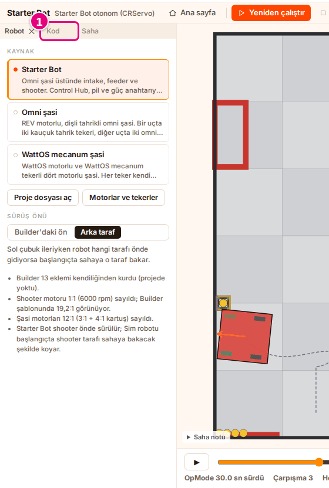
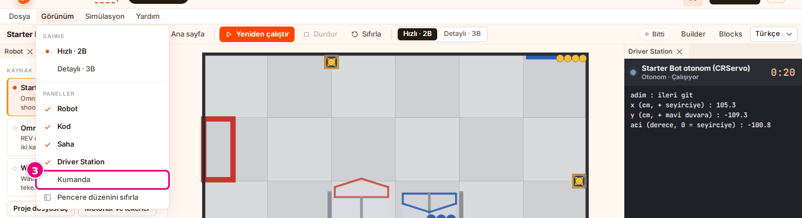
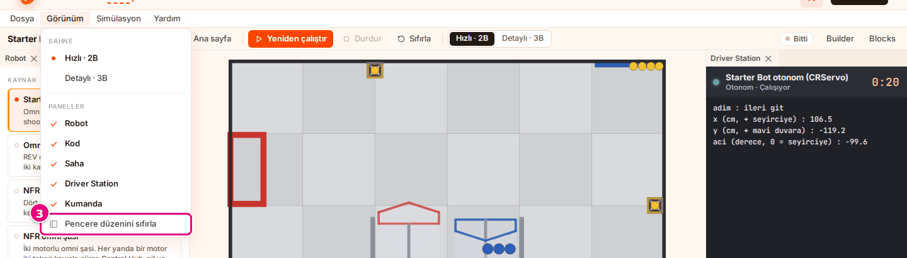
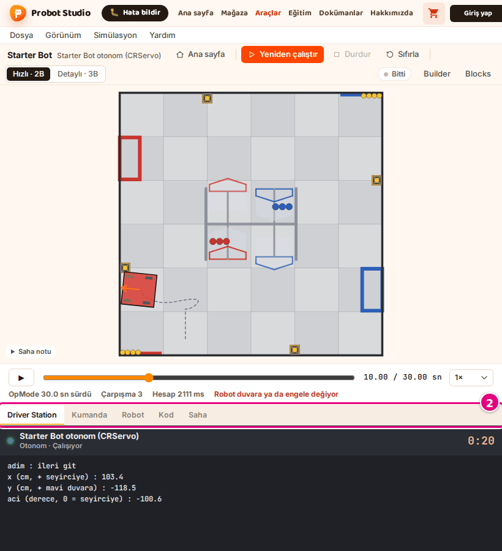

# Arrange the panels

On this page you will move the panels in the workspace, close and open them, and reset the layout.

<!-- CAPTURE: url=https://probotstudio.com/sim/?dil=en#calis | hazirla=Starter Bot + Starter Bot Autonomous (CRServo), BIOBUZZ 2026-27 (match start), Red, audience wall, Fast · 2D; autonomous run finished, clock at 12 s | hedef=body | isaret=yok | bekle=text="OpMode ran for 30.0 s" -->
<!-- SAY: In the workspace the scene stands in the middle and the panels line up on both sides of it. -->

In the workspace, the scene is in the middle. On the left are the **Robot**, **Code** and **Field** tabs, on the right
is **Driver Station** with **Gamepad** below it. The scene is fixed; it does not move and does not close.

## Before you start

- The workspace is open. A ready-made example: the **Starter Bot** robot and the **Starter Bot Autonomous (CRServo)**
  program ([First 10 minutes](ilk-10-dakika.md)).
- On the home page, the panel names in the **View** menu are dimmed and show "in the workspace" next to them.
  When you press **Start** on the home page, the workspace opens.

<!-- SAY: To arrange the panels, we first open the workspace. -->

## Move and resize a panel

1. Hold the panel's tab (its title).
   <!-- CAPTURE: url=https://probotstudio.com/sim/?dil=en#calis | hazirla=default layout | hedef=.dv-tab:has-text("Code") | isaret=1 | bekle=.dv-tab -->
   
2. Drag the tab onto the tab row of another group or onto the edge of a group, and let go.
3. To change the width of a panel, drag the line between two panels.

Result: The panel stays in its new place.

When you press a tab, that panel comes to the front of its group. The **Robot** and **Driver Station** panels and
the panels you open again from the **View** menu do not get narrower than 240 pixels. While these panels are in front,
you cannot make the group any narrower.

<!-- SAY: We hold the panels by their tabs and drag them to arrange the workspace the way we want. -->

## Close a panel and open it again

1. On the panel's tab, press **×**.
2. To open it again, open the **View** menu in the menu bar.
3. Under the **Panels** heading, select the panel name.
   <!-- CAPTURE: url=https://probotstudio.com/sim/?dil=en#calis | hazirla=Gamepad panel closed, View menu open | hedef=role=menuitemcheckbox[name="Gamepad"] | isaret=3 | bekle=role=menu -->
   

Result: The panel opens again. In the menu, a check mark is shown next to the open panels.

If you select a checked panel in the menu, that panel closes. **Help** > **Gamepad controls** also opens
the **Gamepad** panel.

<!-- SAY: We open the panel we closed again from the View menu. -->

## Reset the layout {#duzeni-sifirla}

1. If you are on the home page, press **Start** in the bottom strip. On the home page, **Reset window layout** is dimmed.
2. In the menu bar, open the **View** menu.
3. Select **Reset window layout**.
   <!-- CAPTURE: url=https://probotstudio.com/sim/?dil=en#calis | hazirla=View menu open | hedef=role=menuitem[name="Reset window layout"] | isaret=3 | bekle=role=menu -->
   

Result: All panels go back to their first places, and closed panels open. In the left group, the **Robot** tab is in front.

The layout is kept in this browser. When you open Sim again, the last layout comes back.

<!-- SAY: With Reset window layout we put the panels back the way they were at the start. -->

## Work on a narrow screen {#dar-ekranda-calis}

If the window is 900 pixels wide or narrower, the panels cannot be moved. The scene is at the top, and the panels are tabs below it.
When Sim first opens, the **Driver Station** tab is selected.

!!! note "Note"
    When you open Sim at this width, the welcome card shows "The simulation tool is made for a computer".
    **Continue anyway** becomes active after a 3-second countdown; press it.

1. Make the browser window 900 pixels wide or narrower. On a tablet, open Sim holding it upright; if the width
   is more than 900 pixels (a tablet held sideways, a large iPad), the movable layout opens.
2. In the tab row under the scene, press the **Gamepad** tab. The **Gamepad** panel opens under the scene.
   <!-- CAPTURE: url=https://probotstudio.com/sim/?dil=en#calis | hazirla=window 820×900 | hedef=.dar-duzen__sekmeler | isaret=2 | bekle=.dar-duzen__sekmeler -->
   
3. To go back to the movable layout, make the window wider than 900 pixels.

Result: The tab row under the scene disappears, and the movable layout comes back.

The tab row shows **Driver Station**, **Gamepad**, **Robot**, **Code** and **Field**, in this order. On a narrow screen,
**View** > **Panels**, **Reset window layout** and **Help** > **Gamepad controls** do not change
anything. To see the gamepad controls, press the **Gamepad** tab under the scene.

<!-- SAY: On a narrow screen the panels become tabs under the scene. -->

## Having trouble?

- **The panel names in the View menu are dimmed and show "in the workspace" next to them:** You are on the home page.
  Press **Start**, and when the workspace opens, open the menu again.
- **The panels are scattered or a panel has disappeared:** [Reset the layout](#duzeni-sifirla).

<!-- SAY: If the panels get scattered, we reset the layout and start over. -->

## Next step

- [Shortcuts](kisayollar.md)
- [Troubleshooting](sorunlar.md)

<!-- SAY: The shortcuts and troubleshooting pages are always close at hand. -->
