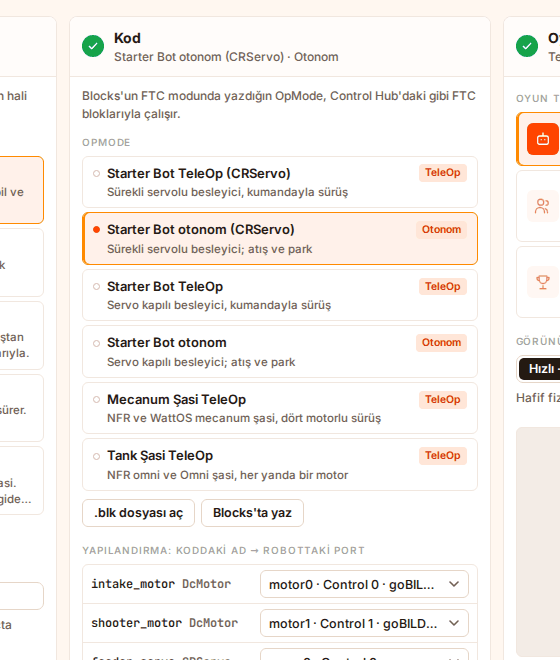
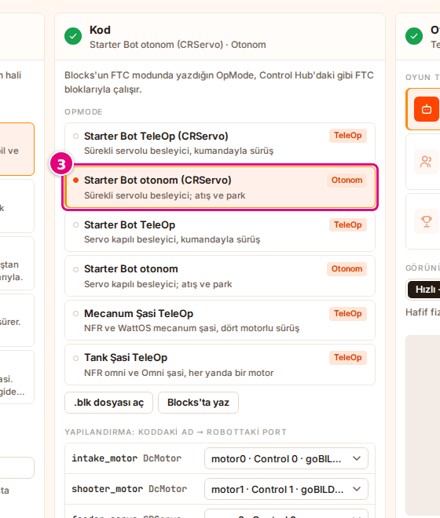
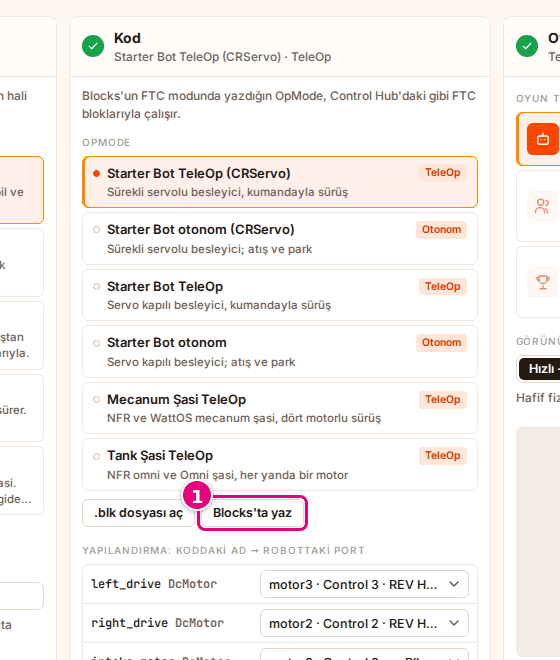
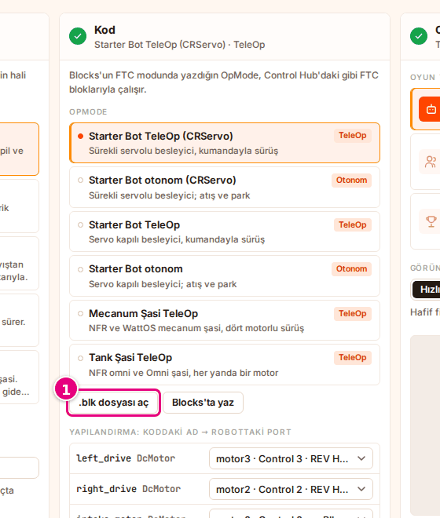
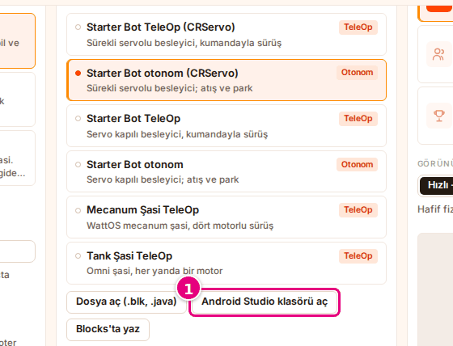
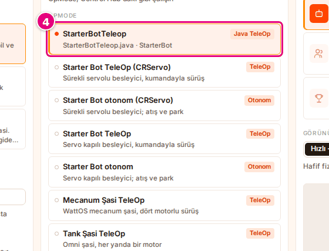
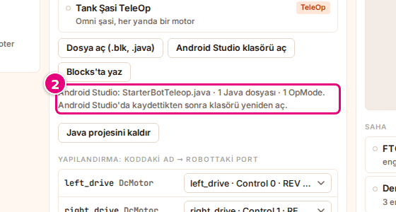

# Select the program

On this page you will select the FTC program (OpMode) that the robot runs: one of Sim's example
programs, the program open in Blocks, a `.blk` file or the Java OpModes in your Android Studio project.

<!-- CAPTURE: url=https://probotstudio.com/sim/?dil=en | hazirla=Starter Bot + Starter Bot Autonomous (CRServo) | hedef=#ana-kod | isaret=yok | bekle=text="Starter Bot Autonomous (CRServo) · Autonomous" -->
<!-- SAY: In the end the program that the robot runs is selected in the Code section. -->

Selecting the program works the same in the **Code** section of the home page and in the **Code**
panel of the workspace. The program you select in one is selected in the other too.

Sim runs FTC Blocks programs and OpModes written in Java in Android Studio. The program runs the way
it does on the Control Hub. The `.ino` and `.probot.json` files of Probot Blocks do not open in Sim.

## Before you start

- Sim is open: [probotstudio.com/sim](https://probotstudio.com/sim/?dil=en).
- If you bring your own program, it must be written in the **FTC Blocks** mode of Blocks
  ([Write a new FTC program](../blocks/ftc-program-yaz.md)) or in Java in Android Studio.

<!-- SAY: If we bring our own program we write it in the FTC mode of Blocks or in Android Studio. -->

## Select an example program {#ornek-programi-sec}

| Example | Type | For which robot |
|---|---|---|
| **Starter Bot TeleOp (CRServo)** | TeleOp | Starter Bot, feeder with a continuous servo |
| **Starter Bot Autonomous (CRServo)** | Autonomous | Starter Bot, shooting and parking |
| **Starter Bot TeleOp** | TeleOp | Starter Bot with a servo-gated feeder |
| **Starter Bot Autonomous** | Autonomous | Starter Bot with a servo-gated feeder, shooting and parking |
| **Mecanum Chassis TeleOp** | TeleOp | WattOS mecanum chassis |
| **Tank Chassis TeleOp** | TeleOp | Omni chassis (tank drive, one motor on each side) |

In the **OpMode** list, each row has an "Autonomous" or "TeleOp" badge on its right.

1. On the home page, in the **Robot** section's **Source** list, select a robot that suits the
   example, for example **Starter Bot**. In the workspace, the same list is in the **Robot** panel.
2. Scroll down to the **Code** section. If you are in the workspace, select the **Code** panel's tab instead.
3. In the **OpMode** list, select a program, for example **Starter Bot Autonomous (CRServo)**.
   <!-- CAPTURE: url=https://probotstudio.com/sim/?dil=en | hazirla=Starter Bot selected | hedef=role=button[name=/^Starter Bot Autonomous \(CRServo\)/] | isaret=3 | bekle=text="OpMode" -->
   

Result: The summary under the section title reads "Starter Bot Autonomous (CRServo) · Autonomous". In
the checklist of the home page, the "Code: Starter Bot Autonomous (CRServo) (Autonomous)" item has a
green check mark.

<!-- SAY: We select one of the example programs, and the badge tells us whether the program is autonomous or TeleOp. -->

!!! tip "Tip"
    If the selected program is an example, then when you select a ready-made robot, Sim switches by itself to the example for that robot (if there is one). If the program from Blocks or from a file is selected, the program does not change. See [Select a ready-made robot](robotu-sec.md#hazir-robot-sec).

## Select the program in Blocks {#blocks-programini-sec}

If Blocks and Sim are open in the same browser, Sim finds the FTC program open in Blocks by itself.

!!! tip "Tip"
    The program in Blocks appears in the list only if it contains a **runOpMode** block.

1. In the **Code** section, press **Write in Blocks** (or select **File** > **Open Blocks**). Blocks opens in a new tab.
   <!-- CAPTURE: url=https://probotstudio.com/sim/?dil=en | hazirla=intro card and cookie banner closed | hedef=role=link[name="Write in Blocks"] | isaret=1 | bekle=text="OpMode" -->
   
2. In Blocks, on the **FTC Blocks** tab, write or open your program.
3. Go back to the Sim tab.
4. At the top of the **OpMode** list, select the row described as "FTC project open in Blocks".

Result: The row's name is the OpMode name in Blocks. Whenever you change the program in Blocks, Sim reads the program in the list again.

<!-- SAY: The FTC program we write in Blocks comes by itself to the list of Sim in the same browser. -->

## Open a .blk file {#blk-dosyasini-ac}

!!! warning "Warning"
    The list holds only one program from a file at a time. When you open a new `.blk` file or reload the page, the previous program from a file leaves the list.

1. In the **Code** section, press **Open file (.blk, .java)** (or select **File** > **Open code file (.blk, .java)…**).
   <!-- CAPTURE: url=https://probotstudio.com/sim/?dil=en | hazirla=intro card and cookie banner closed | hedef=role=button[name="Open file (.blk, .java)"] | isaret=1 | bekle=text="OpMode" -->
   
2. In the window that opens, select the `.blk` file. You can also select a `.java` file in the same window: [Open an Android Studio project](#android-studio-projesini-ac).
3. Press **Open**.

Result: The program is added to the end of the list with the description "From file: <file name>" and
is selected. The row's name is the file name without the `.blk` extension.

If the file has no **runOpMode** block, the program is still added to the list, but the **Code**
section shows "The program has no runOpMode block" in a red box.

You download the `.blk` file from Blocks: [Save the program, open it and get the Java code](../blocks/ftc-programi-kaydet.md).

<!-- SAY: We can open in Sim the blk file that we downloaded from Blocks. -->

## Open an Android Studio project {#android-studio-projesini-ac}

In Sim you can also run the Java OpModes you wrote in Android Studio. Sim reads the `TeamCode`
folder of your project and adds every class marked with `@TeleOp` or `@Autonomous` to the **OpMode** list.
Java support is experimental: a class or method that Sim does not know gives an error with a line number.

1. In the **Code** section, press **Open Android Studio folder** (or select **File** > **Open Android Studio folder…**).
   To open files one by one, press **Open file (.blk, .java)**; you can select more than one `.java` file.
   <!-- CAPTURE: url=https://probotstudio.com/sim/?dil=en | hazirla=intro card and cookie banner closed, Starter Bot + Starter Bot Autonomous (CRServo) | hedef=role=button[name="Open Android Studio folder"] | isaret=1 | bekle=text="OpMode" -->
   
2. In the window that opens, select the `TeamCode` folder in your Android Studio project.
3. If the browser asks for permission to read the folder, allow it.
4. In the **OpMode** list, select a row with a "Java TeleOp" or "Java Autonomous" badge.
   <!-- CAPTURE: url=https://probotstudio.com/sim/?dil=en | hazirla=Starter Bot selected, StarterBotTeleop.java (FTC example) opened with Open file | hedef=role=button[name=/^StarterBotTeleop/] | isaret=4 | bekle=text="Java TeleOp" -->
   

Result: The **Code** section reads "Android Studio: <folder> · Java files: <number> · OpModes: <number>.".
The Java OpModes appear at the top of the list; the description shows the file name and the OpMode group.
The first OpMode is selected by itself. The project is kept in this browser and stays in the list when
you reload the page.

<!-- SAY: When we open the TeamCode folder of the Android Studio project the Java OpModes come to the list. -->

The device names in the code are connected to ports the same way as in a Blocks program: [Connect the devices to ports](cihazlari-porta-bagla.md).
Sim reads the names from the code; write the name directly as text, as in `hardwareMap.get(DcMotor.class, "left_drive")`, or as a constant.

## Bring the change into Sim {#java-yeniden-oku}

1. In Android Studio, save the file.
2. In Sim, scroll down to the **Code** section. The "Android Studio: …" line tells you how to read the project again.
   <!-- CAPTURE: url=https://probotstudio.com/sim/?dil=en | hazirla=Starter Bot selected, StarterBotTeleop.java (FTC example) opened with Open file | hedef=text=/^Android Studio: / | isaret=2 | bekle=text="Remove Java project" -->
   
3. Press **Read again** (or select **File** > **Reload Java project**).
   **Read again** appears only in Chrome and Edge, and only if you opened the folder with **Open Android Studio folder**.
   When you reload the page, the project stays in the list, but **Read again** goes away.
   In the other cases, the line says "open the folder again"; open the folder or the files again.
4. If TeleOp is selected in the workspace, press **Start** in the toolbar. If Autonomous is selected, the run starts again by itself with the new code.

Result: The selected OpMode stays selected and runs with the new code. To take the project out of the list, press **Remove Java project**;
if the selected program is Java, Sim goes back to the robot's example program.

<!-- SAY: After we save in Android Studio we bring the change into Sim with Read again. -->

## What works in Java {#java-calisanlar}

- `LinearOpMode` and `OpMode`, `hardwareMap`, motors, servos, continuous servos, the IMU, `gamepad1`, `telemetry`, `ElapsedTime`, `Range`.
- The goBILDA Pinpoint and SparkFun OTOS position is read from the position of the robot in Sim.
- Projects that use the Pedro Pathing 2.x library are converted and run.
- The camera (AprilTag and color processors with `VisionPortal`) and the Limelight 3A give results. No image is processed; the results are computed
  from the positions of the AprilTags and the game elements on the field. The camera is at the front of the robot, 8 inches high, looking forward.
  For AprilTag, select **FTC field (empty)** or **Test field (with obstacles)**: [Select the field and the starting position](sahayi-ayarla.md).
- Distance, color and touch sensors read a fixed value; a yellow warning appears on the Driver Station.
- `System.out` output is not shown; use `telemetry`. `Thread`s that run at the same time are not supported.
- Folders such as `build`, `.gradle`, `libs` and `res` are not read. If the project is too big, select only the `TeamCode` folder.

<!-- SAY: In Java Sim runs the motors, the IMU, Pedro Pathing and the camera, but it does not process a real image. -->

## Which blocks of the program work {#calisan-bloklar}

- Motor (DcMotor), servo (Servo), continuous servo (CRServo) and Control Hub IMU blocks work.
- The motor encoder is read; the ticks per revolution value comes from the motor settings: [Set the motor values and the mass](motorlari-ayarla.md).
- Distance, color and touch sensor blocks are not in Sim; they are not in the FTC mode of Blocks either. If you open a `.blk` file that contains these blocks (for example from a real Control Hub), the code is not converted and the program does not run. The red box in the **Code** section shows an error that contains "Unknown block type", and the checklist shows "Could not convert the code: …".
- At a block that Sim cannot run, the program stops and the Driver Station shows the error "Sim does not run this block yet: <block>".
- In gamepad blocks, a command that Sim does not support (for example rumble) does not stop the program; the command is skipped. The yellow box on the Driver Station shows the warning "gamepad1.<command> is ignored in Sim".
- Custom blocks that call Java (myBlocks) do not work.

Every device name in the program must be connected to a port on the robot: [Connect the devices to ports](cihazlari-porta-bagla.md).

<!-- SAY: Sim runs motor, servo and IMU blocks, but distance, color and touch sensor blocks are not in Sim. -->

## Having trouble?

- **"Could not convert the code: …" error:** See [Could not convert the code](sorunlar.md#kod-cevrilemedi).
- **"The program has no runOpMode block" appears:** The `.blk` file has no **runOpMode** block. In Blocks, start the program from an FTC example. See [Could not convert the code](sorunlar.md#kod-cevrilemedi).
- **"This file is not FTC Blocks (.blk) or Java (.java)." appears:** See [A file does not open](sorunlar.md#robot-dosyasi-acilmiyor).
- **"Sim does not run this block yet: <block>" appears:** See [The program showed an error](sorunlar.md#program-hatasi).
- **The Java project does not open, or the OpMode is not in the list:** See [A Java project does not open](sorunlar.md#java-acilmiyor).
- **The program in Blocks is not in the list:** The program must have a **runOpMode** block, and Blocks and Sim must be open in the same browser. See [Select the program in Blocks](#blocks-programini-sec).

<!-- SAY: If the code cannot be converted we check whether the program has a runOpMode block. -->

## Next step

[Connect the devices to ports](cihazlari-porta-bagla.md)

<!-- SAY: After we select the program we connect the devices to ports. -->
