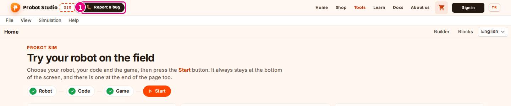
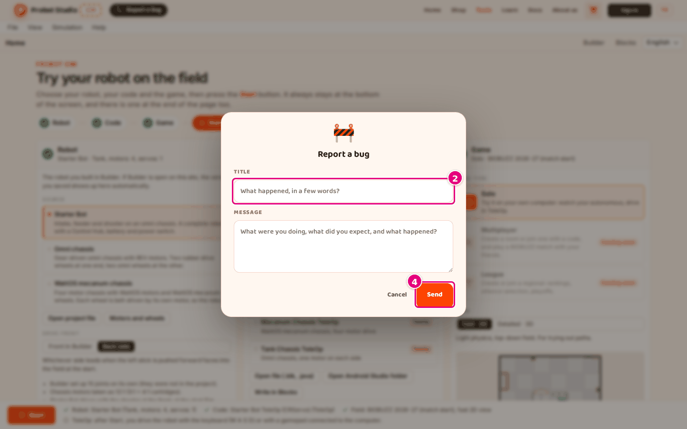

# Troubleshooting

The problems you run into most often in Sim. First look at the status indicators, then find the
heading for your symptom. If text appeared on the screen, the heading starts with that text; the
cause and the fix are below it.

## Check the status indicators first {#durum-gostergeleri}

In the workspace, the status badge in the toolbar shows the state of the run. On the home page, the
numbered circle of each section and the checklist in the bottom strip show whether your choices are
missing something.

| Indicator | Meaning | What to do |
|---|---|---|
| Status badge "Ready" | The run has not started. | In the toolbar, press **Run** or **Start**. |
| Status badge "Computing" | The autonomous phase is being computed. | Wait until the computation ends. If it does not end in 60 seconds, the badge becomes "Error": [The program showed an error](#program-hatasi). |
| Status badge "Done" | The run is over, and you can watch the recording. The badge becomes "Done" even if the program showed an error. | If there is red text in the **Driver Station**, see [The program showed an error](#program-hatasi). |
| Status badge "Live · keyboard" | You are driving TeleOp with the keyboard. | If the keys do not reach the robot, click the scene once: [The robot does not move](#robot-kipirdamiyor). |
| Status badge "Live · gamepad" | You are driving TeleOp with a gamepad connected to the computer. | Button mapping: [Gamepad](kisayollar.md#kumanda). |
| Status badge "Error" | The program did not finish in time, or the simulation could not start. | For the red text in the **Driver Station**, see [The program showed an error](#program-hatasi). |
| Section circle yellow | There is a warning in that section. | Press the yellow item in the checklist. The page scrolls to that section. |
| Section circle red | The robot or the code could not be read. | See the [Could not convert the code](#kod-cevrilemedi) or [A file does not open](#robot-dosyasi-acilmiyor) section. |
| Section circle gray | The code is being converted. **Start** is disabled. | Wait until the code is converted: [Start or Run cannot be pressed](#baslat-basilmiyor). |
| Section circle with a green check mark | Nothing is missing in that section. | If all three circles are green, press **Start**. |

<!-- SAY: When there is a problem, we first look at the status badge and the checklist. -->

## The robot does not move {#robot-kipirdamiyor}

| Cause | Fix |
|---|---|
| A device name in the program is not connected to a port on the robot. The checklist shows "Devices with no match on the robot: …". | [Connect the devices to ports](cihazlari-porta-bagla.md). |
| A motor name in the program is not connected to a port on the robot. The Driver Station shows "The robot has no "<name>" motor; it runs as a virtual motor that spins freely.". In TeleOp this warning does not appear while you drive; it appears when you press **Stop** or when the 120 seconds run out. | [Connect the devices to ports](cihazlari-porta-bagla.md). |
| A servo does not move: the servo name in the program is not connected to a port on the robot. The Driver Station shows "The robot has no "<name>" servo; its commands are ignored.". This warning also appears when the run ends. | [Connect the devices to ports](cihazlari-porta-bagla.md). |
| The robot has no drive wheel connected to a motor. The checklist shows "No drive wheel connected to a motor was found on the robot; it will not move.". | In Builder, connect the wheels to a motor, or select a ready-made robot: [Select the robot](robotu-sec.md). |
| TeleOp is selected, but driving has not started. The badge shows "Ready" or "Done". | In the toolbar, press **Start**: [Drive in TeleOp with the keyboard or a gamepad](teleopu-sur.md). |
| The focus is in a number box or a list. The keys do not reach the robot. | Click the scene once, then press the key. |
| You use a Turkish F keyboard. | Sim looks at where the keys are: [Driving keys](kisayollar.md#surus-tuslari). |
| The program waits for a sensor (for example, for a touch sensor to be pressed). Sim does not simulate sensors. | Try the program in a version without sensors. |

<!-- SAY: If the robot does not move, we first look at the checklist and the Driver Station warnings. -->

## The program showed an error {#program-hatasi}

Red text appears in the **Driver Station** panel. The status badge becomes "Error" only if the program does not finish in time or the simulation cannot start.
For other errors the badge shows "Done"; you read the error from the red text in the Driver Station.

!!! note "Note"
    Yellow warnings in the Driver Station do not stop the program. If it shows "<object>.<method> is ignored in Sim", Sim skips that command (for example, gamepad rumble) and the program goes on.

<!-- SAY: If the program shows an error, we read the reason from the red text in the Driver Station. -->

### "Sim does not run this block yet: …" {#blok-calismiyor}

Cause: The program uses a block that Sim does not support. The name of the block is at the end of the text.

Fix: Remove that block, or try the program on a real robot.

See [Which blocks of the program work](programi-sec.md#calisan-bloklar).

### "Sim does not run custom blocks that call Java (myBlocks) yet" {#myblocks}

Cause: The program has myBlocks.

Fix: Remove the myBlocks blocks.

See [Which blocks of the program work](programi-sec.md#calisan-bloklar).

### "The program loops without letting time pass: …" {#zaman-ilerlemiyor}

Full text: "The program loops without letting time pass: put opModeIsActive or sleep in the loop."

Cause: The loop has neither an **opModeIsActive** condition nor a **sleep** block. Time does not pass in Sim.

Fix: Add **opModeIsActive** to the loop condition, or put a **sleep** block inside the loop.

### "The program did not finish in 60 seconds; it was stopped." {#sure-asildi}

In TeleOp the text is "The program did not finish in 150 seconds; it was stopped.". The badge becomes "Error".

Cause: The computation went past the time limit: 60 seconds for the autonomous phase, 150 seconds for TeleOp.

Fix: Check that the loop has an **opModeIsActive** condition. Try it in **Fast · 2D**.

See [Change the view and the camera](gorunumu-degistir.md).

### "Program error: …" {#program-hatasi-mesaj}

Sometimes the text is only "Program error".

Cause: An unexpected error happened while the program was running. The message after the colon says what the error is.

Fix: In Blocks, fix the block that the message points to. If the problem goes on, see [Report a bug](#hata-bildir).

### "The simulation worker could not start" {#isci-acilamadi}

Cause: The browser could not start the simulation. The badge becomes "Error".

Fix: Reload the page. If that does not help, use the latest version of Chrome, Edge or Firefox.

## Start or Run cannot be pressed {#baslat-basilmiyor}

The button looks gray, and nothing happens when you press it.

| Cause | Fix |
|---|---|
| In the checklist, the **Code** line shows "Converting the code…". **Start** on the home page and **Run** in the toolbar are disabled until the code is converted. | Wait until the code is converted. When the line shows "Code: <name> (…)", you can press the button. |
| The checklist shows "Could not convert the code: …". | See the [Could not convert the code](#kod-cevrilemedi) section. |
| The toolbar shows "Computing…". The autonomous phase is still being computed. | Wait for the computation to end. When the status badge shows "Done", you can press **Run again**. |

<!-- SAY: If Start is gray, we first look at the Code line in the checklist. -->

## Could not convert the code {#kod-cevrilemedi}

The checklist shows "Could not convert the code: …", and the summary of the **Code** section becomes "Could not convert the code".

<!-- SAY: If the code cannot be converted, the checklist gives the reason. -->

### "Could not convert the code: The program has no runOpMode block" {#runopmode-yok}

Cause: The program has no **runOpMode** block.

Fix: In Blocks, start the program from an FTC example.

See [Write a new FTC program](../blocks/ftc-program-yaz.md).

### "Could not convert the code: This is not an FTC Blocks (.blk) file" {#blk-degil-kod}

Cause: The content of the file is not FTC Blocks.

Fix: Open the `.blk` file that you downloaded from the **FTC Blocks** mode of Blocks.

See [Open a .blk file](programi-sec.md#blk-dosyasini-ac).

### "Could not convert the code: Could not load the FTC Blocks file: …" {#blocks-yuklenemedi}

Cause: The connection was lost.

Fix: Reload the page.

## A file does not open {#robot-dosyasi-acilmiyor}

If you opened it with the **Open project file** or **Open file (.blk, .java)** button in a section, the error appears in a red box in that section.
If you opened it from the **File** menu, a notification appears at the bottom of the screen for a few seconds; if the file opened, it shows "<file name> opened".

<!-- SAY: If a file does not open, the red box or the notification at the bottom tells us the reason. -->

### "This file is not a Builder project." {#builder-projesi-degil}

Cause: The `.json` file is not from Builder.

Fix: In Builder, save the project from the **File** menu and open that file.

See [Open a Builder project file](robotu-sec.md#builder-proje-dosyasini-ac).

### "Could not read the Builder project file (not JSON)." {#json-degil}

Cause: The file is damaged or is not `.json`.

Fix: Save the file again from Builder.

### "This file is not FTC Blocks (.blk) or Java (.java)." {#blk-degil}

Cause: The file you opened is not `.java`, and its content is not FTC Blocks.

Fix: Open the `.blk` file that you downloaded from the **FTC Blocks** mode of Blocks, or the `.java` file in your Android Studio project.

See [Open a .blk file](programi-sec.md#blk-dosyasini-ac), [Open an Android Studio project](programi-sec.md#android-studio-projesini-ac).

### "Could not read the robot: …" {#robot-okunamadi}

The checklist shows "Could not read the robot (…); using the Starter Bot instead.".

Cause: The selected robot could not be drawn.

Fix: Select another robot, or save the file again from Builder.

See [Select the robot](robotu-sec.md).

## A Java project does not open {#java-acilmiyor}

Errors that come up while you open an Android Studio project appear in a red box in the **Code**
section or in the notification at the bottom of the screen. Java files that could not be converted
are listed in the **Code** section as "<file>, line <n>: <message>". To open the project, see
[Open an Android Studio project](programi-sec.md#android-studio-projesini-ac).

<!-- SAY: If a Java project does not open, the red box in the Code section gives the reason with the line number. -->

| Text on the screen | Cause | Fix |
|---|---|---|
| "There are no .java files in your selection. Pick the TeamCode folder of your Android Studio project." | The folder you selected has no `.java` files. | Select the `TeamCode` folder. |
| "No OpMode found: no class is marked with @TeleOp or @Autonomous." | The files have no OpMode class. | Add `@TeleOp` or `@Autonomous` to the OpMode class, save in Android Studio and open the folder again. |
| "No OpMode found; could not read <file> (line <n>): …" | The file has a line that Sim cannot read. | Fix the line named in the text, or open the folder again without that file selected. |
| "The project is too big; pick only the TeamCode folder." | The whole project folder was selected. | Select only the `TeamCode` folder. |
| "The project is open but could not be saved in the browser (no space left); pick it again after you reload the page." | The space the browser sets aside for this site is full. | After you reload the page, open the folder again. |
| "Could not read the folder: …" | The browser could not read the folder, or permission was not given. | Open the folder again, and give permission if the browser asks. |

Java errors that come up while the program runs appear as red text in the **Driver Station**:

| Text on the screen | Cause | Fix |
|---|---|---|
| "Sim does not run this Java class yet: …" | The code uses a class that Sim does not know. | Remove that part from the OpMode, or try it on the robot. [Report a bug](#hata-bildir). |
| ""<name>" (<type>) not found. Sim reads device names from the code: …" | The device name could not be read from the code, or it has no match on the robot. | Write the name as text, like `hardwareMap.get(DcMotor.class, "left_drive")`, then see [Connect the devices to ports](cihazlari-porta-bagla.md). |
| "Sim does not support Threads that run at the same time; move the work into the OpMode loop." | The code starts a separate `Thread`. | Move the work into the OpMode loop. |

## "Live driving could not start in this browser window" appears {#canli-surus-acilmadi}

When you press **Start**, "Live driving could not start in this browser window (the page is not cross-origin isolated). Reload the page and try again." appears.

| Cause | Fix |
|---|---|
| The page is open inside another site or in an old tab. | Reload the page. If that does not help, open [probotstudio.com/sim](https://probotstudio.com/sim/?dil=en) in a new tab. |
| The browser is old. | Use the latest version of Chrome, Edge or Firefox. |

<!-- SAY: If live driving does not start, we reload the page. -->

## The 3D scene is slow {#3b-yavas}

| Cause | Fix |
|---|---|
| **Detailed · 3D** uses full physics and works the graphics card hard. | In the toolbar or in the **View** menu, select **Fast · 2D**: [Change the view and the camera](gorunumu-degistir.md). |
| There are many game elements on the field. | Select the **FTC field (empty)** or **BIOBUZZ 2026-27 (match start)** field. |

<!-- SAY: If the 3D scene is slow, we switch to the fast 2D view. -->

## My choices are gone {#secimler-kayboldu}

| Cause | Fix |
|---|---|
| Sim keeps your choices only in this browser. The browser data was cleared, or you are using a private window or another computer. | Select the robot and the program again. For a lasting copy, save the robot in Builder and the program in Blocks as files. |
| The panels are scattered. | **View** > **Reset window layout**: [Reset the layout](panelleri-duzenle.md#duzeni-sifirla). |

<!-- SAY: Sim keeps our choices only in this browser, so we also save the robot and the program as files. -->

## Report a bug {#hata-bildir}

Here you tell the team about a problem that has no fix in these docs.

1. In the site header, press **Report a bug** next to the "SIM" badge.
   If the window is narrower than 560 pixels, the button shows only the 🐛 icon.
   <!-- CAPTURE: url=https://probotstudio.com/sim/?dil=en | hazirla=intro card and cookie banner closed | hedef=probot-header >> .hatabtn | isaret=1 | bekle=text="Report a bug" -->
   
2. In **Title**, type a short summary of the problem.
   <!-- CAPTURE: url=https://probotstudio.com/sim/?dil=en | hazirla=intro card and cookie banner closed, Report a bug form open | hedef=placeholder="What happened, in a few words?"; text="Send" | isaret=2,4 | bekle=text="Title" -->
   
3. In **Message**, type these things:
    - The open robot and program, for example "Starter Bot + Starter Bot TeleOp (CRServo)".
    - The last button or key you pressed.
    - The text on the screen, word for word, in quotes.
    - Your browser, for example Chrome.
4. Press **Send**.

Result: The form shows "Received, thank you! 🎉".

To cancel without sending, press **Cancel**. The title can have at most 120 characters and the
message at most 4000; neither can be left empty. If "Could not send it." appears, try again after a
while or write to us from the contact page.

<!-- SAY: With the Report a bug form we send the problem to the team with a title and a message. -->
