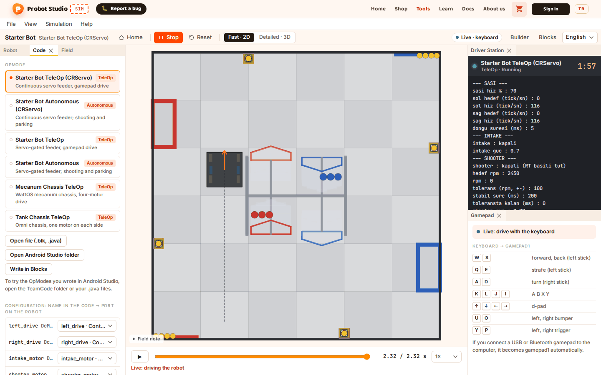
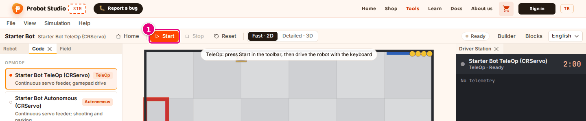
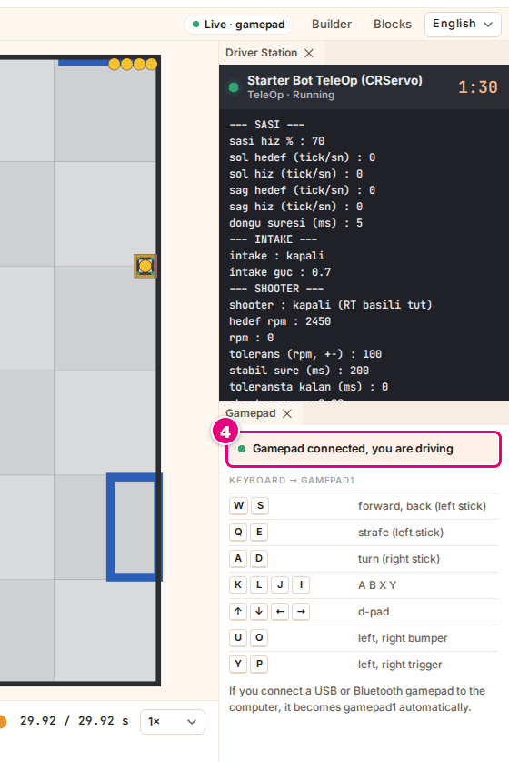
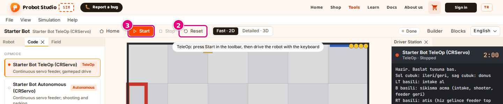

# Drive in TeleOp with the keyboard or a gamepad

On this page you start the TeleOp program and drive the robot with the keyboard or with a gamepad connected to the computer.

<!-- CAPTURE: url=https://probotstudio.com/sim/?dil=en#calis | hazirla=Starter Bot + Starter Bot TeleOp (CRServo), Start pressed, driven a little forward with W | hedef=body | isaret=yok | bekle=text="Live · keyboard" -->
<!-- SAY: In the end we drive the robot on the field with the keyboard or a gamepad. -->

TeleOp runs for 120 seconds and starts only when you press **Start**. The keyboard and the gamepad go to the program as
**gamepad1**. There is no second gamepad (**gamepad2**).

## Before you start

- In the **Code** section, a program with the "TeleOp" badge is selected. Ready-made example: the **Starter Bot** robot with
  the **Starter Bot TeleOp (CRServo)** program.
- The workspace is open. Above the scene it says "TeleOp: press Start in the toolbar, then drive the robot with the keyboard".

If you press **Start** in the bottom strip on the home page, the workspace opens and driving starts directly. In that case,
skip step 1 below.

<!-- SAY: First we select a program with the TeleOp badge. -->

## Drive with the keyboard

!!! tip "Tip"
    While you type in a number box or a list, the keys do not go to the robot. If the robot does not move, click the scene once, then press a key.

1. In the toolbar, press **Start**.
   <!-- CAPTURE: url=https://probotstudio.com/sim/?dil=en#calis | hazirla=Starter Bot + Starter Bot TeleOp (CRServo), workspace | hedef=role=toolbar[name="Tools"] >> role=button[name="Start"] | isaret=1 | bekle=text="TeleOp ready: press Start" -->
   
2. To move the robot forward, hold <kbd>W</kbd>. To move it back, hold <kbd>S</kbd>.
3. To turn, hold <kbd>A</kbd> or <kbd>D</kbd>.
4. To finish, press **Stop** in the toolbar.

Result: While you drive, the status badge shows "Live · keyboard", the **Gamepad** panel shows "Live: drive with the keyboard"
and the timeline shows "Live: driving the robot". After **Stop**, the badge shows "Done".

When you switch to another window, the keys you hold are released.

<!-- SAY: We press Start and drive the robot on the field with the W A S D keys. -->

## Learn the keys

The table in the **Gamepad** panel lists the keys. If the panel is closed, select **Help** > **Gamepad controls**.
On a narrow screen this command does nothing. Instead, select the **Gamepad** tab under the scene.

| Key | On gamepad1 |
|---|---|
| <kbd>W</kbd> / <kbd>S</kbd> | **Left stick** forward / back |
| <kbd>A</kbd> / <kbd>D</kbd> | **Right stick** left / right (turn) |
| <kbd>Q</kbd> / <kbd>E</kbd> | **Left stick** left / right (strafe) |
| <kbd>K</kbd> <kbd>L</kbd> <kbd>J</kbd> <kbd>I</kbd> | **A**, **B**, **X**, **Y** buttons |
| <kbd>↑</kbd> <kbd>↓</kbd> <kbd>←</kbd> <kbd>→</kbd> | **D-pad** |
| <kbd>U</kbd> / <kbd>O</kbd> | **Left bumper** / **right bumper** |
| <kbd>Y</kbd> / <kbd>P</kbd> | **Left trigger** / **right trigger** |

A key does something only if the program reads that button. For example, Starter Bot TeleOp uses buttons for shooting and feeding.
Sim looks at where a key is on the keyboard. On a Turkish F keyboard, press the keys in the same places: [Driving keys](kisayollar.md#surus-tuslari).

<!-- SAY: The table in the Gamepad panel shows which key goes to which button of the gamepad. -->

## Drive with a gamepad

1. Connect the gamepad to the computer with USB or Bluetooth.
2. Press any button on the gamepad once. The browser sees the gamepad only after a button is pressed.
3. In the toolbar, press **Start**.
4. Drive with the gamepad's sticks.
   <!-- CAPTURE: url=https://probotstudio.com/sim/?dil=en#calis | hazirla=Starter Bot TeleOp (CRServo), virtual gamepad connected, live driving | hedef=.kumanda-durum | isaret=4 | bekle=text="Gamepad connected, you are driving" -->
   

Result: The status badge shows "Live · gamepad" and the **Gamepad** panel shows "Gamepad connected, you are driving".

Sim reads only the first gamepad that connects. Small movements of the sticks are ignored.

While a gamepad is connected, the keyboard works too. For the button mapping, see [Gamepad](kisayollar.md#kumanda).

<!-- SAY: The gamepad we connect to the computer becomes gamepad1 by itself. -->

## Restart driving

1. In the toolbar, press **Stop**.
2. In the toolbar, press **Reset**. The robot goes back to its starting position.
   <!-- CAPTURE: url=https://probotstudio.com/sim/?dil=en#calis | hazirla=Starter Bot TeleOp (CRServo), driving stopped | hedef=role=toolbar[name="Tools"] >> role=button[name="Reset"]; role=toolbar[name="Tools"] >> role=button[name="Start"] | isaret=2,3 | bekle=text="Done" -->
   
3. In the toolbar, press **Start**.

Result: The counter in the Driver Station starts counting down from 2:00, and the badge shows "Live · keyboard" again.

After **Stop**, you can watch the run you drove again in the timeline: [Review the recording](otonomu-calistir.md#kaydi-incele).

<!-- SAY: With Stop, Reset and Start we restart driving from the beginning. -->

!!! note "Note"
    If you change the robot, the program, the field or a setting while you drive, driving stops and is reset.
    To drive again, press **Start**.

## Having trouble?

- **"Live driving could not start in this browser window (the page is not cross-origin isolated)…":** Reload the page. See ["Live driving could not start in this browser window" appears](sorunlar.md#canli-surus-acilmadi).
- **I press a key and the robot does not move:** Click the scene once. In TeleOp, the motor name warning appears in the **Driver Station** after **Stop**. See [The robot does not move](sorunlar.md#robot-kipirdamiyor).
- **The gamepad is connected but the panel says "Live: drive with the keyboard":** Press a button on the gamepad. The badge changes to "Live · gamepad". If it does not, drive with the keyboard.

<!-- SAY: If the robot does not respond to the keys, we click the scene once. -->

## Next step

[Change the view and the camera](gorunumu-degistir.md)

<!-- SAY: After driving we look at changing the view and the camera. -->
