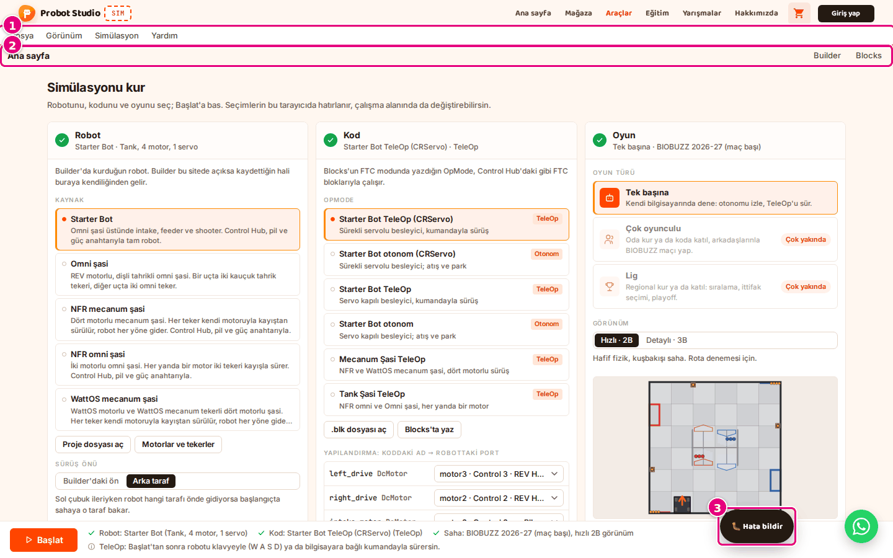
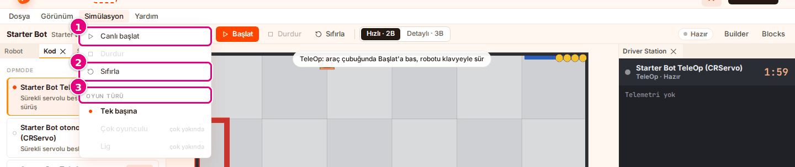
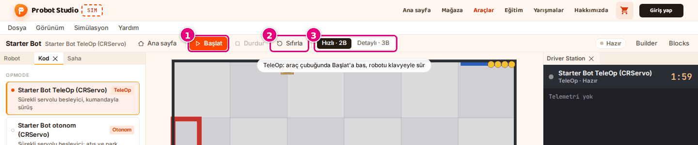
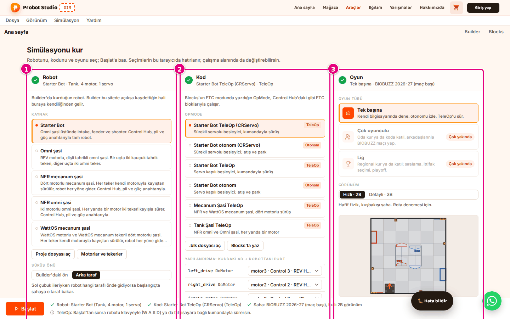
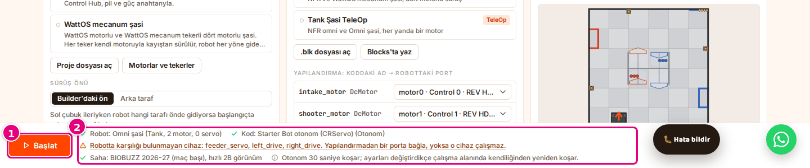
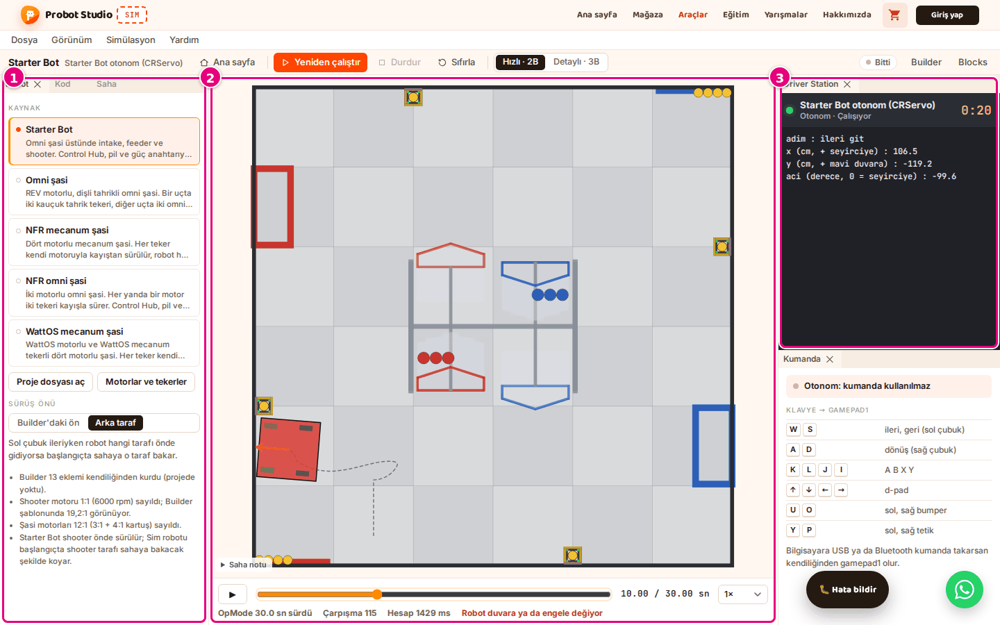
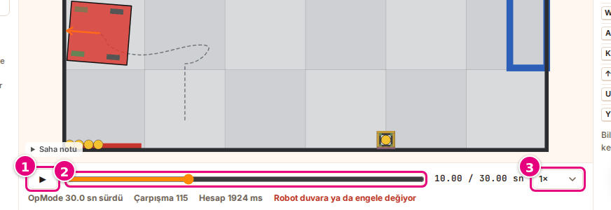
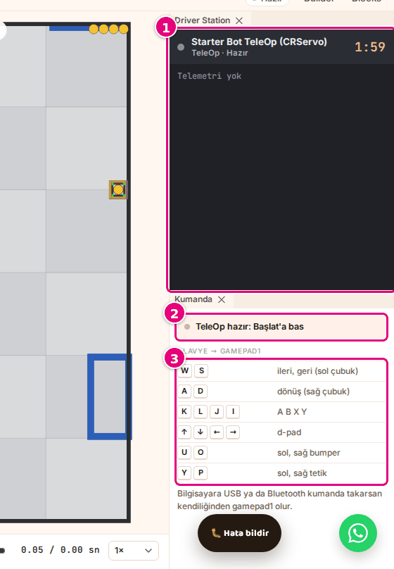

# Arayüz turu

Bu sayfa Sim ekranındaki her bölgeyi ve her düğmeyi tanıtır. Görev sayfalarında geçen bölge adları
burada tanımlanır.

Sim iki ekrandan oluşur. **Ana sayfa**'da robotu, programı ve sahayı seçersin. **Başlat**'a basınca
**çalışma alanı** açılır; robot orada sahaya çıkar. İki ekranın üstünde aynı menü çubuğu ve araç
çubuğu durur.

## Her ekranda olanlar

<!-- CAPTURE: url=https://probotstudio.com/sim/ | hazirla=giriş kartı ve çerez bandı kapalı, varsayılan seçimler | hedef=role=menubar; role=toolbar[name="Araçlar"]; text="Hata bildir" | isaret=1,2,3 | bekle=text="Simülasyonu kur" -->
<!-- SAY: Sim ekranında üstte menü çubuğu, onun altında araç çubuğu bulunuyor. -->

| # | Ad | Ne yapar | Kısayol | İlgili görev |
|---|---|---|---|---|
| | Site başlığı | Probot Studio logosu, "SIM" rozeti ve site menüsü (**Ana sayfa**, **Mağaza**, **Araçlar**, **Eğitim**, **Yarışmalar**, **Hakkımızda**). **Giriş yap** site geneline aittir; Sim giriş istemez. | | |
| 1 | Menü çubuğu | **Dosya**, **Görünüm**, **Simülasyon**, **Yardım** menüleri (aşağıda). | <kbd>Esc</kbd> açık menüyü kapatır | |
| 2 | Araç çubuğu | Solda ekranın adı. Çalışma alanında robotun adı ve altında programın adı yazar. Düğmeler aşağıda. | | |
| 3 | **Hata bildir** | Ekibe hata ya da öneri gönderme formunu açar. Ekranın köşesinde hep durur. | | [Sorun giderme](sorunlar.md#hata-bildir) |
| | WhatsApp düğmesi (yeşil, yuvarlak) | Probot Studio ile WhatsApp yazışmasını açar. Site geneline aittir. | | |
| | Giriş kartı | Sayfa her açıldığında çıkan "Simülasyon aracı geliştirme aşamasında" kartı. **Anladım, devam et** kartı kapatır; **Hata bildir** formu açar. Pencere 900 pikselden darsa ya da 1100 pikselden dar bir dokunmatik ekrandaysan (ör. tablet), kartta "Simülasyon aracı bilgisayarda kullanım için tasarlandı" yazar. Düğme **Yine de devam et** olur ve 3 saniye geri sayımdan sonra açılır. | | [İlk 10 dakika](ilk-10-dakika.md) |
| | Çerez bandı | İlk ziyarette çıkar. **Kabul et** ayrıntılı ölçüme izin verir; **Sadece zorunlu** çerezsiz sayımla sınırlar. | | |
| | Bildirim kutusu | Menüden dosya açınca sonucu gösterir ("<dosya> açıldı" ya da hata metni). 6 saniye sonra kaybolur. | | [Robotu seç](robotu-sec.md) |

### Menü çubuğu

Bir menüye bas, sonra öğeyi seç. Bir menü açıkken fareyi yandaki menünün üstüne getirirsen o menü
açılır. Menüyü kapatmak için <kbd>Esc</kbd>'ye bas ya da menünün dışına tıkla.

Menü öğelerinin klavye kısayolu yoktur.

<!-- CAPTURE: url=https://probotstudio.com/sim/#calis | hazirla=Starter Bot + Starter Bot TeleOp (CRServo), çalışma alanı, koşu yok | hedef=role=menuitem[name="Simülasyon"]; text="Canlı başlat"; text="Sıfırla"; text="Oyun türü" | isaret=1,2,3 | bekle=role=menu -->
<!-- SAY: Simülasyon menüsünde başlatma, durdurma ve sıfırlama komutları duruyor. -->

| Menü | Öğe | Ne yapar | Ne zaman pasif | İlgili görev |
|---|---|---|---|---|
| **Dosya** | **Ana sayfa** | Ana sayfaya döner. | | |
| | **Robot proje dosyası aç…** | Builder'dan indirdiğin `.json` proje dosyasını seçtirir. | | [Robotu seç](robotu-sec.md#builder-proje-dosyasini-ac) |
| | **Kod dosyası (.blk) aç…** | FTC Blocks `.blk` dosyasını seçtirir. | | [Programı seç](programi-sec.md#blk-dosyasini-ac) |
| | **Builder'ı aç** | Builder'ı yeni sekmede açar. | | [Robotu seç](robotu-sec.md) |
| | **Blocks'u aç** | Blocks'u yeni sekmede açar. | | [Programı seç](programi-sec.md) |
| **Görünüm** | Sahne > **Hızlı · 2B** | Kuşbakışı 2B sahne ve hafif fizik. | | [Görünümü değiştir](gorunumu-degistir.md) |
| | Sahne > **Detaylı · 3B** | 3B sahne ve sağlam fizik. | | [Görünümü değiştir](gorunumu-degistir.md) |
| | Paneller > **Robot**, **Kod**, **Saha**, **Driver Station**, **Kumanda** | Paneli açar ya da kapatır. Açık panelin yanında onay işareti durur. | Ana sayfada ("çalışma alanında" notu) | [Panelleri düzenle](panelleri-duzenle.md) |
| | **Pencere düzenini sıfırla** | Panelleri ilk yerlerine koyar, kayıtlı düzeni siler. | Ana sayfada | [Panelleri düzenle](panelleri-duzenle.md#duzeni-sifirla) |
| **Simülasyon** | **Canlı başlat** (TeleOp seçiliyken) ya da **Yeniden çalıştır** (Otonom seçiliyken) | Koşuyu başlatır. | Ana sayfada, kod çevrilirken, kod çevrilemediyse ya da otonom hesaplanırken | [Otonomu çalıştır](otonomu-calistir.md), [TeleOp'u sür](teleopu-sur.md) |
| | **Durdur** | Koşuyu ya da oynatmayı durdurur. | Ana sayfada ve koşu ya da oynatma yokken | [Otonomu çalıştır](otonomu-calistir.md#durdur-sifirla-yeniden-baslat) |
| | **Sıfırla** | Kaydı siler, robotu başlangıç yerine koyar. | Ana sayfada | [Otonomu çalıştır](otonomu-calistir.md#durdur-sifirla-yeniden-baslat) |
| | Oyun türü > **Tek başına** | Çalışma alanına geçer. Otonom seçiliyse koşu kendiliğinden başlar, **Başlat**'a basman gerekmez. | | [Otonomu çalıştır](otonomu-calistir.md#otonomu-baslat) |
| | Oyun türü > **Çok oyunculu**, **Lig** | Henüz açık değil ("çok yakında" notu). | Hep | |
| **Yardım** | **Kumanda tuşları** | **Kumanda** panelini açar ya da öne getirir. Dar ekranda bir şey yapmaz; sahnenin altındaki **Kumanda** sekmesine bas. | Ana sayfada | [TeleOp'u sür](teleopu-sur.md) |
| | **Kurulum ipuçları (ana sayfa)** | Ana sayfaya döner. | | |

### Araç çubuğu

<!-- CAPTURE: url=https://probotstudio.com/sim/#calis | hazirla=Starter Bot + Starter Bot TeleOp (CRServo), koşu yok | hedef=role=toolbar[name="Araçlar"] >> role=button[name="Başlat"]; role=button[name="Sıfırla"]; role=radiogroup[name="Görünüm"] | isaret=1,2,3 | bekle=text="Hazır" -->
<!-- SAY: Araç çubuğunda başlatma düğmesi, sıfırlama ve görünüm seçici yan yana duruyor. -->

| # | Ad | Ne yapar | Ne zaman görünür | İlgili görev |
|---|---|---|---|---|
| | **Ana sayfa** | Ana sayfaya döner. Koşu varsa durur. | Çalışma alanında | |
| 1 | **Çalıştır** / **Yeniden çalıştır** / **Başlat** / "Hesaplanıyor…" | Otonom seçiliyken **Çalıştır** (kayıt varsa **Yeniden çalıştır**) otonomu baştan koşar. TeleOp seçiliyken **Başlat** canlı sürüşü açar. Hesap sürerken "Hesaplanıyor…" yazar ve pasiftir. | Çalışma alanında | [Otonomu çalıştır](otonomu-calistir.md), [TeleOp'u sür](teleopu-sur.md) |
| | **Durdur** | Otonomun hesabını ya da kaydın oynatmasını keser. Canlı TeleOp'ta turuncu olur ve sürüşü bitirir. Durduracak bir şey yoksa pasiftir. | Çalışma alanında | [Otonomu çalıştır](otonomu-calistir.md#durdur-sifirla-yeniden-baslat) |
| 2 | **Sıfırla** | Koşuyu iptal eder, kaydı siler, saati 0'a alır. Robot başlangıç yerine döner. | Çalışma alanında | [Otonomu çalıştır](otonomu-calistir.md#durdur-sifirla-yeniden-baslat) |
| 3 | **Görünüm**: **Hızlı · 2B** / **Detaylı · 3B** | Sahneyi ve fizik türünü seçer. | Çalışma alanında | [Görünümü değiştir](gorunumu-degistir.md) |
| | Durum rozeti | Koşunun durumu: "Hazır", "Hesaplanıyor", "Bitti", "Canlı · klavye", "Canlı · kumanda", "Hata". | Çalışma alanında | [Sorun giderme](sorunlar.md) |
| | **Builder** | Builder'ı yeni sekmede açar. | Hep | [Robotu seç](robotu-sec.md) |
| | **Blocks** | Blocks'u yeni sekmede açar. | Hep | [Programı seç](programi-sec.md) |

## Ana sayfa

Ana sayfa üç bölümden ve bir alt şeritten oluşur. Bölümün başındaki numaralı daire o bölümün durumunu
renkle gösterir: sarı uyarı, kırmızı hata, gri kodun çevrilmesini bekliyor demektir. Daire yeşil onay
işaretine dönünce o bölümde eksik yok demektir.

<!-- CAPTURE: url=https://probotstudio.com/sim/ | hazirla=giriş kartı ve çerez bandı kapalı, varsayılan seçimler | hedef=#ana-robot; #ana-kod; #ana-oyun | isaret=1,2,3 | bekle=text="Simülasyonu kur" -->
<!-- SAY: Ana sayfada robot, kod ve oyun seçimi üç bölümde yan yana duruyor. -->

| # | Bölge | Ne var | İlgili görev |
|---|---|---|---|
| 1 | **Robot** bölümü | Başlık altında seçili robotun özeti ("Starter Bot · Tank, 4 motor, 1 servo"). **Kaynak** listesi, **Proje dosyası aç**, **Motorlar ve tekerler**, **Sürüş önü** ve robot notları. | [Robotu seç](robotu-sec.md) |
| 2 | **Kod** bölümü | Seçili programın özeti. **OpMode** listesi, **.blk dosyası aç**, **Blocks'ta yaz** ve **Yapılandırma** tablosu. | [Programı seç](programi-sec.md), [Cihazları porta bağla](cihazlari-porta-bagla.md) |
| 3 | **Oyun** bölümü | **Oyun türü** kartları, **Görünüm** seçici ve açıklaması, başlangıç önizlemesi (2B saha), **Saha** listesi ve **Başlangıç yeri**. | [Sahayı ve başlangıç yerini seç](sahayi-ayarla.md) |

### Oyun türü kartları

| Ad | Ne yapar |
|---|---|
| **Tek başına** | Kendi bilgisayarında dener: otonomu izlersin, TeleOp'u sürersin. Varsayılan ve tek açık seçenek. |
| **Çok oyunculu** | "Çok yakında" rozetli, seçilemez. |
| **Lig** | "Çok yakında" rozetli, seçilemez. |

### Alt şerit

<!-- CAPTURE: url=https://probotstudio.com/sim/ | hazirla=Omni şasi + Starter Bot otonom (CRServo): eşleşmeyen cihaz uyarısı görünsün | hedef=.ana__baslat; role=list[name="Hazırlık"] | isaret=1,2 | bekle=text="Robotta karşılığı bulunmayan cihaz" -->
<!-- SAY: Alt şeritte Başlat düğmesi ve seçimlerin hazırlık listesi duruyor. -->

Alt şerit sayfayı kaydırsan da ekranın altında kalır.

| # | Ad | Ne yapar | İlgili görev |
|---|---|---|---|
| 1 | **Başlat** | Çalışma alanını açar ve koşuyu başlatır. TeleOp seçiliyse canlı sürüş de başlar. Kod çevrilemediyse ya da çevriliyorsa pasiftir. | [İlk 10 dakika](ilk-10-dakika.md) |
| 2 | Hazırlık listesi | Seçimlerin özeti ve uyarılar. Yeşil onay = tamam, sarı = uyarı, kırmızı = hata, gri yuvarlak ok = kod çevriliyor, gri "i" = bilgi. Uyarı, hata ya da "Kod çevriliyor" maddesine basınca sayfa ilgili bölüme kayar; bilgi maddeleri yalnızca ipucudur, basılmaz. | [Sorun giderme](sorunlar.md) |

## Çalışma alanı

Çalışma alanı ana sayfada **Başlat**'a basınca açılır. Adres `probotstudio.com/sim/#calis` olur.
Tarayıcının geri tuşu ana sayfaya döner.

Otonom seçiliyse koşu, çalışma alanı açılınca kendiliğinden başlar. Bu, çalışma alanını **Simülasyon** >
Oyun türü > **Tek başına**, tarayıcının ileri tuşu ya da `#calis` bağlantısıyla açtığında da olur. Bu
yollarla açtığında TeleOp seçiliyse sürüş, araç çubuğunda **Başlat**'a basana kadar başlamaz.

<!-- CAPTURE: url=https://probotstudio.com/sim/#calis | hazirla=Starter Bot + Starter Bot otonom (CRServo), BIOBUZZ 2026-27 (maç başı), Hızlı · 2B, otonom bitmiş, saat 10 sn | hedef=.dv-groupview (Robot); .sahne; .dv-groupview (Driver Station) | isaret=1,2,3 | bekle=text="Bitti" -->
<!-- SAY: Çalışma alanında ortada sahne, iki yanında paneller bulunuyor. -->

| # | Bölge | Ne var | İlgili görev |
|---|---|---|---|
| 1 | Sol paneller | **Robot**, **Kod** ve **Saha** panelleri, sekme olarak üst üste. Ana sayfadaki seçimlerin aynısıdır; burada değiştirdiğin seçim ana sayfada da değişir. **Saha** panelinin başında **Görünüm** seçici de vardır. | [Robotu seç](robotu-sec.md), [Programı seç](programi-sec.md), [Sahayı seç](sahayi-ayarla.md) |
| 2 | Sahne | 2B ya da 3B saha, robot ve oyun elemanları. Altında zaman çizelgesi. | [Otonomu çalıştır](otonomu-calistir.md) |
| 3 | Sağ paneller | Üstte **Driver Station**, altta **Kumanda** paneli. | [TeleOp'u sür](teleopu-sur.md) |

### Sahne

| Ad | Ne yapar | İlgili görev |
|---|---|---|
| 2B sahne | Kuşbakışı saha. Robotun geçtiği yol kesikli çizgiyle, ön tarafı turuncu okla çizilir. Her teker gücüne göre renklenir: ileri dönerken yeşil, geri dönerken kırmızı, dururken gri; güç arttıkça renk koyulaşır. Robot duvara ya da engele değince kırmızı olur. Fare sahanın üstündeyken köşede imlecin yeri inç olarak yazar ("x … · y … inç"). | [Görünümü değiştir](gorunumu-degistir.md) |
| 3B sahne | Saha, robot ve oyun elemanları 3B çizilir. Fareyle döndürülür ve yakınlaştırılır. | [Görünümü değiştir](gorunumu-degistir.md#3b-kamerayi-kullan) |
| Yükleme yazıları | Çalışma alanı açılırken "Çalışma alanı yükleniyor…", 3B sahne açılırken "3B sahne yükleniyor…" yazar. | [Görünümü değiştir](gorunumu-degistir.md) |
| **Saha**, **Sürücü gözü**, **Robotu takip et** | 3B kamera açıları. Yalnız **Detaylı · 3B** görünümde görünür. | [Görünümü değiştir](gorunumu-degistir.md#3b-kamerayi-kullan) |
| **Saha notu** | Açılır kutu. Sahanın ölçülerinin nereden geldiğini ve neyin yaklaşık olduğunu yazar. Yalnız BIOBUZZ sahalarında görünür. | [Sahayı seç](sahayi-ayarla.md) |
| Sahne ipucu | TeleOp seçiliyken ve sürüş başlamamışken "TeleOp: araç çubuğunda Başlat'a bas, robotu klavyeyle sür" yazar. | [TeleOp'u sür](teleopu-sur.md) |

### Zaman çizelgesi

<!-- CAPTURE: url=https://probotstudio.com/sim/#calis | hazirla=Starter Bot otonom (CRServo) bitmiş, saat 10 sn, duraklatılmış | hedef=role=button[name="Oynat"]; role=slider[name="Zaman"]; role=combobox[name="Oynatma hızı"] | isaret=1,2,3 | bekle=text="OpMode 30.0 sn sürdü" -->
<!-- SAY: Zaman çizelgesiyle kaydı oynatıyor, istediğimiz ana gidiyoruz. -->

| # | Ad | Ne yapar | İlgili görev |
|---|---|---|---|
| 1 | Oynat / Duraklat (▶ / ❚❚) | Kaydı oynatır ya da duraklatır. Kayıt sonundayken basarsan baştan oynatır, duraklattıysan kaldığı yerden sürer. Araç çubuğundaki **Durdur** değildir. Kayıt yoksa pasiftir. | [Kaydı incele](otonomu-calistir.md#kaydi-incele) |
| 2 | Zaman kaydırıcısı | Kayıtta istediğin ana gider ve oynatmayı durdurur. | [Kaydı incele](otonomu-calistir.md#kaydi-incele) |
| | Sayaç | "geçen / toplam sn". | |
| 3 | Oynatma hızı | **0.25×**, **0.5×**, **1×**, **2×**, **4×**. Yalnız kaydın oynatma hızını değiştirir. | [Kaydı incele](otonomu-calistir.md#kaydi-incele) |
| | Bilgi satırı | Koşu bitince "OpMode … sn sürdü", "Çarpışma …", "Hesap … ms". BIOBUZZ sahalarında ve yalnız **Detaylı · 3B** görünümde yapıların devrilme sayısı da yazar ("Kırmızı HIVE devrilme …"). | [Kaydı incele](otonomu-calistir.md#kaydi-incele) |
| | Uyarı | "Robot duvara ya da engele değiyor" ya da canlı sürüşte "Canlı: robot sürülüyor". | |

### Driver Station ve Kumanda panelleri

<!-- CAPTURE: url=https://probotstudio.com/sim/#calis | hazirla=Starter Bot + Starter Bot TeleOp (CRServo), koşu yok | hedef=role=region[name="Driver Station"]; .kumanda-durum; .tus-tablosu | isaret=1,2,3 | bekle=text="TeleOp hazır: Başlat'a bas" -->
<!-- SAY: Sağda Driver Station ve kumanda tuşlarının listesi duruyor. -->

| # | Ad | Ne yapar | İlgili görev |
|---|---|---|---|
| 1 | **Driver Station** | Başlıkta durum ışığı, OpMode adı ("OpMode yok"), tür ve durum ("Otonom · Hazır", "TeleOp · Çalışıyor", "Durdu", "Hesaplanıyor"). Sağda geri sayım: TeleOp 2:00, Otonom 0:30. Altında programın o anki telemetri satırları ya da "Telemetri yok". Program hatası kırmızı yazılır, uyarılar sarı kutuda (en çok 4). | [Otonomu çalıştır](otonomu-calistir.md), [Sorun giderme](sorunlar.md) |
| 2 | **Kumanda** durum ışığı | "TeleOp hazır: Başlat'a bas", "Canlı: klavyeyle sür", "Kumanda bağlı, sürüyorsun" ya da "Otonom: kumanda kullanılmaz". | [TeleOp'u sür](teleopu-sur.md) |
| 3 | Tuş tablosu "Klavye → gamepad1" | Sürüş tuşlarının listesi. Altında kumanda notu: "Bilgisayara USB ya da Bluetooth kumanda takarsan kendiliğinden gamepad1 olur." | [Kısayollar](kisayollar.md) |

!!! note "Not"
    <kbd>Q</kbd> ve <kbd>E</kbd> tuşları (sol çubukla yana kayma) çalışır ama tuş tablosunda yazmaz.

### Paneller

| Ad | Ne yapar | İlgili görev |
|---|---|---|
| Panel sekmesi | Panelin adı. Sürükleyip başka yere ya da başka panelin yanına bırakırsın. | [Panelleri düzenle](panelleri-duzenle.md) |
| Sekmedeki **×** | Paneli kapatır. **Görünüm** > Paneller'den yeniden açarsın. | [Panelleri düzenle](panelleri-duzenle.md) |
| Panel kenarı | Sürükleyince paneli genişletir ya da daraltır. En dar 240 piksel. | [Panelleri düzenle](panelleri-duzenle.md) |
| Dar ekran sekmeleri | Pencere 900 pikselden darsa paneller sahnenin altında sekme olur: **Driver Station**, **Kumanda**, **Robot**, **Kod**, **Saha**. | [Panelleri düzenle](panelleri-duzenle.md#dar-ekranda-calis) |

Sahne panelinin sekmesi yoktur; taşınmaz ve kapanmaz. Panel düzeni bu tarayıcıda saklanır.

## Robot ayrıntısı

**Robot** bölümünde **Motorlar ve tekerler**'e basınca açılır. Kapatmak için **Motorları gizle**'ye
basarsın.

Sayı kutusuna yazdığın değer <kbd>Enter</kbd>'a basınca ya da kutudan çıkınca işlenir. Aralığın
dışındaki değer işlenmez, kutu eski değere döner. Ondalık ayırıcı olarak virgül ya da nokta yazabilirsin.

| Ad | Ne yapar | Kısayol | İlgili görev |
|---|---|---|---|
| Sürüş, Ayak izi, Link / eklem | Sürüş türü ("Tank (normal teker)", "Mecanum", "Omni", "Karışık", "Sürüş tekeri yok"), robotun cm cinsinden taban ölçüsü, birlikte hareket eden parça gruplarının (link) ve eklemlerin sayısı. Değiştirilmez. | | [Motorları ayarla](motorlari-ayarla.md) |
| **Kütle** kutusu ("tahmini" etiketli) | Robotun tartılmış toplam kütlesi, 0,2 ile 60 kg arası. Yalnız parça verisi eksik robotta görünür; diğerlerinde "parça verisinden" yazar. | <kbd>Enter</kbd> işler, <kbd>Esc</kbd> eski değere döner | [Motorları ayarla](motorlari-ayarla.md#kutleyi-gir) |
| **Tekerler** listesi | Her teker için adı, mm cinsinden çapı ("Ø… mm") ve türü: "normal", "mecanum" ya da "omni". | | |
| **rpm** kutusu | Motorun serbest devri, 1 ile 10000 arası. | <kbd>Enter</kbd> işler, <kbd>Esc</kbd> eski değere döner | [Motorları ayarla](motorlari-ayarla.md) |
| **N·m** kutusu | Durma torku, 0,01 ile 100 arası. | <kbd>Enter</kbd> işler, <kbd>Esc</kbd> eski değere döner | [Motorları ayarla](motorlari-ayarla.md) |
| **tik/tur** kutusu | Enkoderin bir turdaki tik sayısı, 1 ile 100000 arası. | <kbd>Enter</kbd> işler, <kbd>Esc</kbd> eski değere döner | [Motorları ayarla](motorlari-ayarla.md) |
| "senin değerin" / "doğrulanmadı" etiketi | Değeri sen girdiysen "senin değerin", katalog verisi doğrulanmamışsa "doğrulanmadı" yazar. | | |
| **Varsayılana dön** | Senin girdiğin motor değerlerini siler. Yalnız değer girdiğin motorda görünür. | | [Motorları ayarla](motorlari-ayarla.md#varsayilana-don) |

<!-- SAY: Robot ayrıntısında motor değerlerini ve gerekirse kütleyi kendi verimizle düzeltebiliyoruz. -->
