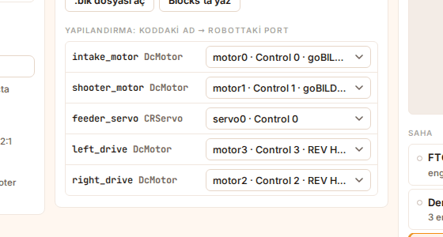
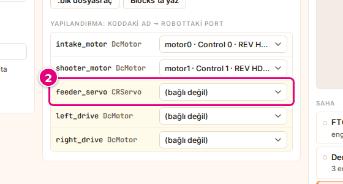
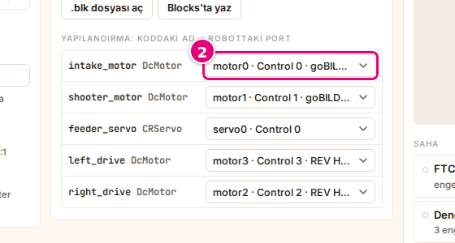

# Cihazları porta bağla

Bu sayfada programdaki cihaz adlarını robottaki motor ve servolara bağlayacaksın. Gerçek robotta bu
işi Driver Station'daki robot yapılandırması yapar; Sim'de **Yapılandırma** tablosu yapar.

<!-- CAPTURE: url=https://probotstudio.com/sim/ | hazirla=Starter Bot + Starter Bot otonom (CRServo), tüm satırlar bağlı | hedef=.ks-tablo | isaret=yok | bekle=text="Yapılandırma: koddaki ad" -->
<!-- SAY: Sonunda koddaki her cihaz robottaki bir motora ya da servoya bağlı oluyor. -->

Bağlı olmayan cihaz çalışmaz. Programın `left_drive` motoruna güç verse de robotta karşılığı yoksa
teker dönmez. En sık karşılaşılan sorun budur.

## Başlamadan önce

- Robot ve program seçili: [Robotu seç](robotu-sec.md), [Programı seç](programi-sec.md).
- Kod çevrilmiş olmalı. Tablo yerine "Kod çevrilince cihaz listesi burada çıkar." yazıyorsa ve hazırlık
  listesinde "Kod çevriliyor…" görünüyorsa bekle. Hazırlık listesinde "Kod çevrilemedi: …" yazıyorsa
  beklemek işe yaramaz; nedenine bak: [Kod çevrilemedi](sorunlar.md#kod-cevrilemedi).

<!-- SAY: Önce robotu ve programı seçiyoruz, kodun çevrilmesini bekliyoruz. -->

## Tabloyu oku

**Yapılandırma: koddaki ad → robottaki port** tablosu **Kod** bölümünün altındadır. Her satır
programdaki bir cihazdır.

| Sütun | Ne yazar |
|---|---|
| Sol | Koddaki ad ve tür, örneğin `left_drive DcMotor`, `feeder_servo CRServo`. |
| Sağ | Bağlı olduğu robot donanımı: "<ad> · Control <port>" (Expansion Hub'a bağlı donanımda "Expansion <port>"). Motorlarda sonda " · <motor modeli>" de yazar; servolarda model yazmaz. Sürüş tekerini çeviren motorda en sonda "teker" yazar. |

- Açık sarı (krem) satır: cihaz bağlı değil; sağdaki listede **(bağlı değil)** seçili.
- IMU satırı her zaman "Control Hub IMU"ya bağlıdır; değiştirilmez.
- Program cihaz kullanmıyorsa tablo yerine "Bu OpMode cihaz kullanmıyor." yazar.

Sim bağlantıları önce kendisi kurar. Robotta koddakiyle aynı adlı donanım varsa cihazı ona bağlar. Adında
`left` ya da `sol` geçen motoru sol yandaki tekerin motoruna, `right` ya da `sag` geçeni sağ yandakine bağlar.

<!-- SAY: Yapılandırma tablosu koddaki her cihazın robottaki hangi porta bağlı olduğunu gösteriyor. -->

## Eşleşmeyen cihazı bağla {#eslesmeyen-cihazi-bagla}

Eşleşmeyen cihaz varsa ana sayfanın hazırlık listesinde sarı uyarı çıkar: "Robotta karşılığı
bulunmayan cihaz: <adlar>. Yapılandırmadan bir porta bağla, yoksa o cihaz çalışmaz." Uyarı en çok üç
ad yazar; fazlası için "ve <sayı> cihaz daha" ekler.

!!! tip "İpucu"
    Robotta boş servo ya da motor yoksa satır sarı kalır. Programa uygun robotu seç: Starter Bot programları için Starter Bot.

1. Hazırlık listesindeki sarı uyarıya bas; sayfa **Kod** bölümüne kayar. Çalışma alanındaysan bunun
   yerine **Kod** panelinin sekmesine bas. Bağlı olmayan satırlar **Yapılandırma** tablosunda açık sarıdır.
2. Açık sarı satırın sağındaki listeyi aç.
   <!-- CAPTURE: url=https://probotstudio.com/sim/ | hazirla=Omni şasi + Starter Bot otonom (CRServo) | hedef=.ks-tablo__satir--eksik (ilk) | isaret=2 | bekle=text="Yapılandırma: koddaki ad" -->
   
3. Robottaki doğru motoru ya da servoyu seç. Sürüş motorları için sonunda "teker" yazanları seç.

Sonuç: Seçtiğin satırın sarı rengi kalkar ve listede seçtiğin donanım yazar. Tüm satırlar bağlanınca hazırlık
listesindeki sarı uyarı kaybolur.

<!-- SAY: Sarı satırdaki listeden robotun doğru motorunu seçince cihaz bağlanıyor. -->

Liste yalnız uygun türdeki donanımı gösterir: motor satırında motorlar, servo satırında servolar.
Robotta servo yoksa servo satırı bağlanamaz; o cihaz Sim'de çalışmaz. Görseldeki örnekte (Omni şasi ile
Starter Bot otonom (CRServo)) robotta servo olmadığı için `feeder_servo` satırı sarı kalır ve uyarı kaybolmaz.

Motor satırı sarıysa robotta boş motor kalmamıştır. Seçtiğin motor başka bir cihazdan alınır ve o satır
sarı olur. Bu durumda programa uygun robotu seç ya da Builder'da robota motor ekle.

## Yanlış bağlantıyı düzelt {#yanlis-baglantiyi-duzelt}

Sim'in kendi kurduğu bağlantı her zaman doğru olmaz. Robot ters ya da beklenmedik hareket ediyorsa
bağlantıları kontrol et.

1. Ana sayfada **Kod** bölümüne kaydır. Çalışma alanındaysan **Kod** panelinin sekmesine bas.
   **Yapılandırma** tablosunun sağ sütununda her cihazın bağlı olduğu donanım yazar.
2. Yanlış bağlı satırın listesini aç.
   <!-- CAPTURE: url=https://probotstudio.com/sim/ | hazirla=Starter Bot + Starter Bot otonom (CRServo) | hedef=.ks-tablo__satir (ilk) >> select | isaret=2 | bekle=text="Yapılandırma: koddaki ad" -->
   
3. Doğru donanımı seç.

Sonuç: Satırın listesinde seçtiğin donanım yazar. Çalışma alanındaysan otonom program yeni bağlantıyla
kendiliğinden yeniden koşar.

Bağlantılar bu tarayıcıda saklanır.

!!! note "Not"
    Listede **(bağlı değil)** de var, ama Sim bu seçimi tutmaz ve cihazı boştaki uygun bir donanıma yeniden bağlar.
    Bir cihaz yalnız robotta uygun boş donanım kalmadıysa bağlı değil olarak kalır.

<!-- SAY: Yanlış bağlanmış bir cihazı listeden düzeltiyoruz, otonom kendiliğinden yeniden koşuyor. -->

## Sorun mu var?

- **Driver Station'da ""<ad>" motoru robotta yok; boşta dönen sanal motor olarak çalışıyor." uyarısı:**
  O cihaz bağlı değil. [Eşleşmeyen cihazı bağla](#eslesmeyen-cihazi-bagla) adımlarıyla bağla.
  TeleOp'ta bu uyarı sürüş sırasında değil, **Durdur**'a basınca ya da 120 saniye dolunca çıkar.
  Bkz. [Robot kıpırdamıyor](sorunlar.md#robot-kipirdamiyor).
- **Driver Station'da ""<ad>" servosu robotta yok; komutları yok sayılıyor." uyarısı:** Servo bağlı değil,
  programın ona verdiği komutlar işlenmez. Robotta servo varsa [Eşleşmeyen cihazı bağla](#eslesmeyen-cihazi-bagla)
  adımlarıyla bağla; yoksa servolu bir robot seç.
- **Teker bağlı ama robot ters dönüyor:** Sol ve sağ motorlar yer değiştirmiş olabilir:
  [Yanlış bağlantıyı düzelt](#yanlis-baglantiyi-duzelt). Ya da [sürüş önünü](robotu-sec.md#surus-onunu-ayarla) değiştir.

<!-- SAY: Robot ters dönüyorsa motorların yerini ya da sürüş önünü kontrol ediyoruz. -->

## Sonraki adım

[Sahayı ve başlangıç yerini seç](sahayi-ayarla.md)

<!-- SAY: Cihazlar bağlandıktan sonra sahayı seçmeye geçiyoruz. -->
