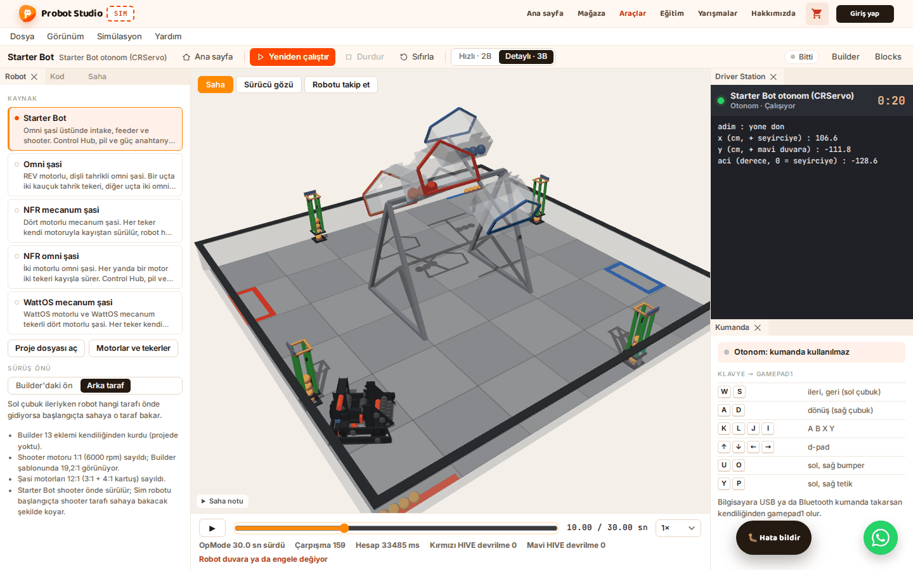
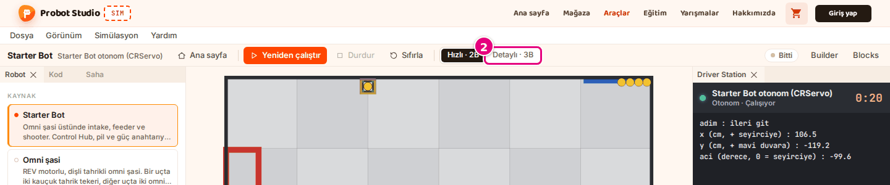
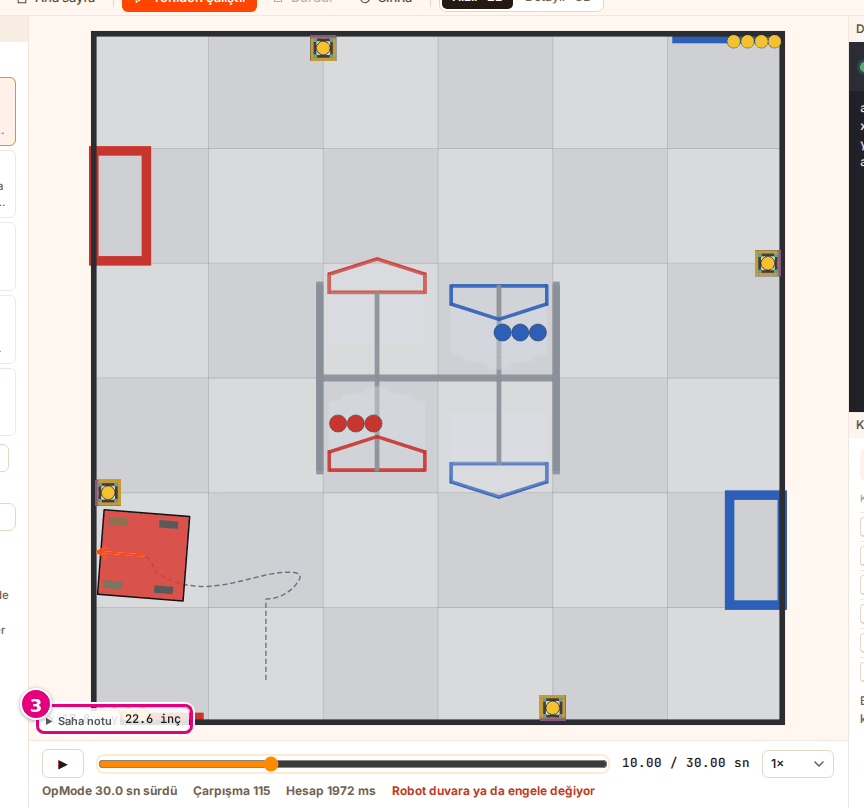
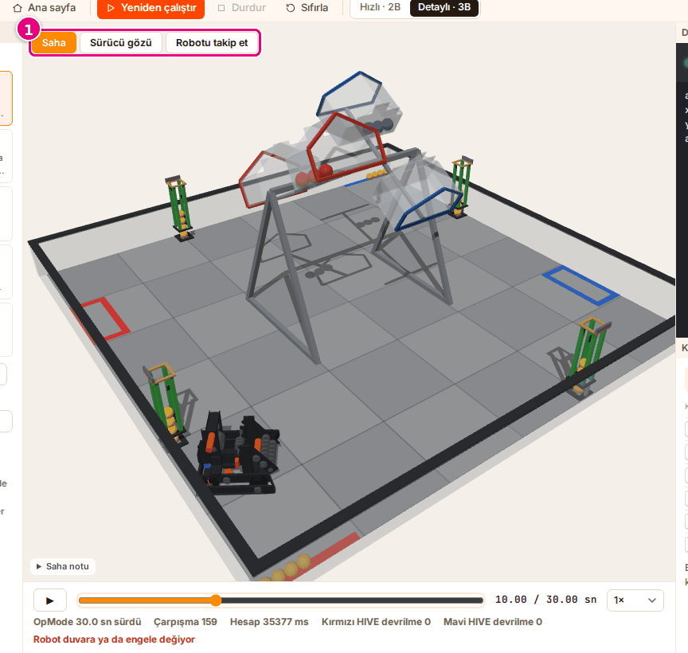

# Görünümü ve kamerayı değiştir

Bu sayfada sahneyi 2B ile 3B arasında değiştirecek, 3B sahnede kamerayı döndürüp yaklaştıracaksın.

<!-- CAPTURE: url=https://probotstudio.com/sim/#calis | hazirla=Starter Bot + Starter Bot otonom (CRServo), BIOBUZZ 2026-27 (maç başı), Detaylı · 3B, otonom bitmiş | hedef=body | isaret=yok | bekle=role=button[name="Sürücü gözü"] -->
<!-- SAY: Sayfanın sonunda sahneyi üç boyutlu görüp kamerayı istediğimiz açıya çeviriyoruz. -->

Görünüm yalnız çizimi değiştirmez, fiziği de değiştirir. Aynı program iki görünümde biraz farklı sonuç verebilir.

| Görünüm | Fizik | Ne zaman |
|---|---|---|
| **Hızlı · 2B** | Hafif fizik, kuşbakışı saha. | Rota denemesi, yavaş bilgisayar. Varsayılan görünüm. |
| **Detaylı · 3B** | Sağlam fizik, 3B saha. | Çarpışma, oyun elemanını itme, HIVE'ın devrilmesi. |

## Başlamadan önce

- Çalışma alanı açık, bir robot ve bir otonom program seçili. Hazır örnek: **Starter Bot** robotu ve
  **Starter Bot otonom (CRServo)** programı ([Robotu seç](robotu-sec.md), [Programı seç](programi-sec.md)).
- Araç çubuğunda **Hızlı · 2B** seçili.

<!-- SAY: Starter Bot ve otonom programıyla çalışma alanını açık tutuyoruz. -->

## Görünümü seç

!!! tip "İpucu"
    Bilgisayarın yavaşsa ya da 3B sahne takılıyorsa **Hızlı · 2B**'de kal. Rotanı 2B'de hazırla,
    çarpışmayı en son 3B'de kontrol et.

1. Zaman çizelgesinin altında "OpMode … sn sürdü" yazınca "Çarpışma …" sayısını not al.
2. Araç çubuğunda **Detaylı · 3B**'yi seç. Sahne yeniden çizilir, otonom sağlam fizikle baştan koşar.
   <!-- CAPTURE: url=https://probotstudio.com/sim/#calis | hazirla=Starter Bot + Starter Bot otonom (CRServo), Hızlı · 2B | hedef=role=radiogroup[name="Görünüm"] >> text="Detaylı · 3B" | isaret=2 | bekle=.sahne -->
   
3. Koşu bitince yeni "Çarpışma …" sayısını ilk sayıyla karşılaştır.

Sonuç: Sahne 3B olur, köşesinde **Saha**, **Sürücü gözü** ve **Robotu takip et** düğmeleri çıkar.
"Çarpışma …" sayısı 2B'dekinden farklı olabilir.

Çalışma alanı açılırken "Çalışma alanı yükleniyor…", 3B sahne ilk çizilirken "3B sahne yükleniyor…" yazar.
3B'de hesap uzun sürerse sahnede "Fizik hesaplanıyor…" yazar.

Aynı seçim menü çubuğunda **Görünüm** > **Sahne** altında ve **Saha** panelindeki **Görünüm**'de de var.
Ana sayfada **Oyun** bölümündeki **Görünüm**'dedir. Sim seçtiğin görünümü bu tarayıcıda hatırlar.

TeleOp programı seçiliyse görünümü değiştirmek sürüşü sıfırlar. Yeniden sürmek için araç çubuğunda **Başlat**'a bas.

<!-- SAY: Görünümü 3B yapınca Sim sahneyi üç boyutlu çiziyor ve sağlam fizikle yeniden hesaplıyor. -->

## 2B sahneyi oku

1. Araç çubuğunda **Hızlı · 2B**'yi seç. Otonom hafif fizikle yeniden koşar.
2. Zaman çizelgesinde **Zaman** kaydırıcısını sürükle. Robot o andaki yerine gelir.
3. Fareyi sahanın üstünde gezdir.
   <!-- CAPTURE: url=https://probotstudio.com/sim/#calis | hazirla=Hızlı · 2B, fare sahnenin ortasının sağ üstünde | hedef=.saha2d__imlec | isaret=3 | bekle=.saha2d__imlec -->
   

Sonuç: Sahanın köşesinde imlecin yeri "x … · y … inç" olarak yazar. Robotun o ana kadar gittiği yol
koyu kesik çizgiyle çizilir.

| 2B sahnede | Anlamı |
|---|---|
| Kırmızı robot gövdesi | Robot duvara ya da engele değiyor. Zaman çizelgesinin altında da "Robot duvara ya da engele değiyor" yazar. |
| Turuncu ok | Robotun önü. |
| Yeşil teker | Teker ileri dönüyor. Güç arttıkça renk belirginleşir. |
| Kırmızı teker | Teker geri dönüyor. Güç arttıkça renk belirginleşir. |
| Gri teker | Teker duruyor. |
| Koyu kesik çizgi | Robotun zaman çizelgesinde seçili ana kadar gittiği yol. |

2B sahnede kırmızı ittifak duvarı solda, mavi ittifak duvarı sağda, seyirci duvarı alttadır.
**FTC sahası (boş)** ve **Deneme sahası (engel bulunan)** sahalarında alt kenarda kırmızı, üst kenarda mavi bir çizgi görürsün.
Bu çizgiler ittifak duvarı değildir.

BIOBUZZ sahalarında bu çizgiler yoktur; oradaki kırmızı ve mavi şekiller oyun alanlarıdır.

<!-- SAY: 2B sahnede fareyle gezince imlecin sahadaki yeri inç cinsinden yazıyor. -->

## 3B kamerayı kullan {#3b-kamerayi-kullan}

| Fare | Ne yapar |
|---|---|
| Sol tuşla sürükle | Kamerayı sahanın çevresinde döndürür. |
| Sağ tuşla sürükle | Kamerayı kaydırır. |
| Tekerlek | Yaklaştırır, uzaklaştırır. |

Döndürürken kamera zeminin altına inmez. Sağ tuşla kaydırırken sahne kaybolursa kamera düğmelerinden **Saha**'yı seç.
Kamera ilk açısına döner.

1. Sahnedeki kamera düğmelerinden **Saha**'yı seç.
   <!-- CAPTURE: url=https://probotstudio.com/sim/#calis | hazirla=Detaylı · 3B, otonom bitmiş | hedef=role=group[name="Kamera"] | isaret=1 | bekle=role=button[name="Sürücü gözü"] -->
   
2. Sahnede sol tuşla sürükleyip açıyı değiştir.
3. Tekerlekle yaklaş.

Sonuç: **Saha** turuncu olur (üstünde beyaz yazı). Kamera sahanın çevresinde döner, tekerlekle sahaya yaklaşır.

| Düğme | Ne gösterir |
|---|---|
| **Saha** | Bütün sahayı seyirci tarafının çaprazından gösterir. |
| **Sürücü gözü** | Robotun bulunduğu yarıdaki ittifak duvarının arkasından, sürücü boyundan robota bakar. Bu kamerada fare çalışmaz. |
| **Robotu takip et** | Robotun yakınından bakar ve robotla birlikte kayar. Fareyle açıyı değiştirebilirsin. |

<!-- SAY: Kamerayı sahaya, sürücünün gözüne ya da robotu takip etmeye alabiliyoruz. -->

## Sorun mu var?

- **3B sahne boş ya da çok yavaş:** **Hızlı · 2B**'ye dön. Bkz. [Sorun giderme](sorunlar.md#3b-yavas).
- **Sürücü gözünde fare çalışmıyor:** Bu kamerada beklenen davranış. Döndürmek için kamera düğmelerinden **Saha**'yı seç.
- **Görünümü değiştirince TeleOp sürüşü durdu:** Beklenen davranış. Araç çubuğunda **Başlat**'a yeniden bas.

<!-- SAY: Sahne yavaşsa hızlı 2B görünüme dönüyoruz. -->

## Sonraki adım

[Motor değerlerini ve kütleyi ayarla](motorlari-ayarla.md)

<!-- SAY: Görünümden sonra motor değerlerine bakıyoruz. -->
