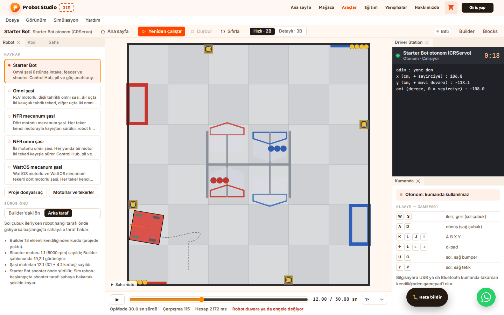
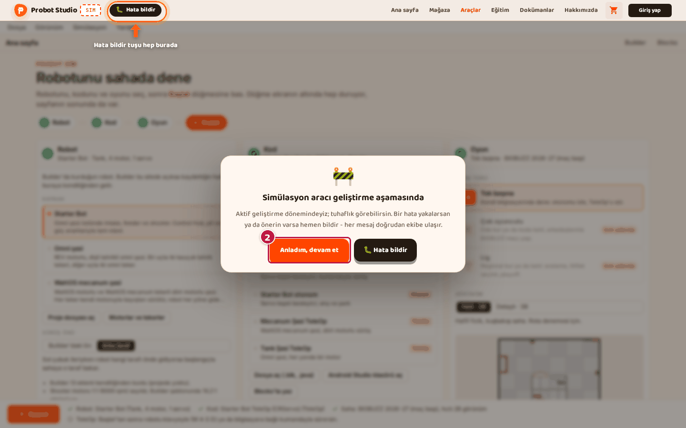
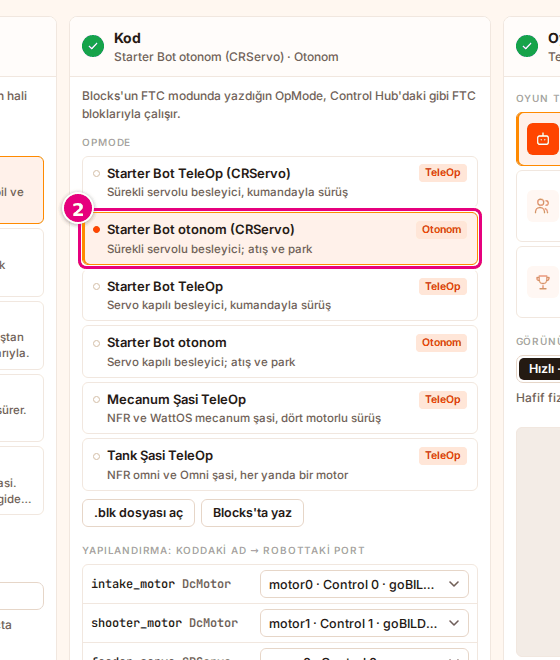
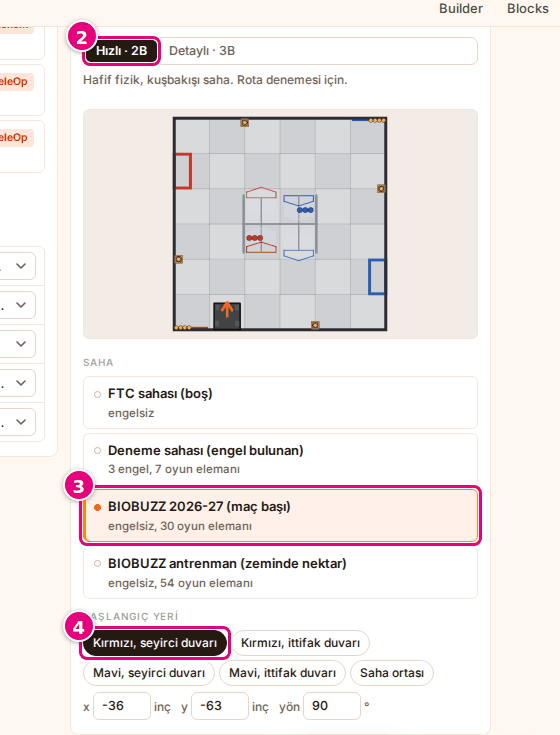
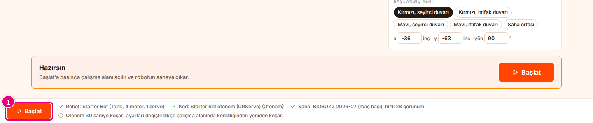
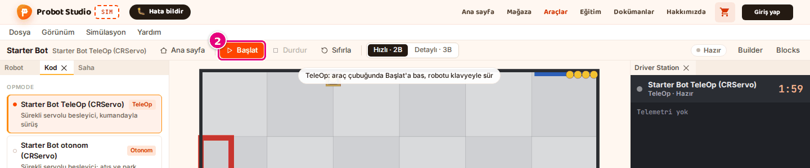

# İlk 10 dakika

Bu sayfada hazır bir robotla ilk otonomu izleyecek, sonra aynı robotu klavyeyle süreceksin. Hesap,
kurulum ya da kendi robotun gerekmez. Her bölüm "Kontrol et:" satırıyla biter.

<!-- CAPTURE: url=https://probotstudio.com/sim/#calis | hazirla=Starter Bot + Starter Bot otonom (CRServo), BIOBUZZ 2026-27 (maç başı), Kırmızı seyirci duvarı, Hızlı · 2B; otonom bitmiş, saat 12 sn | hedef=body | isaret=yok | bekle=text="OpMode 30.0 sn sürdü" -->
<!-- SAY: Bu sayfada Starter Bot'u sahada önce otonomla sonra klavyeyle çalıştırıyoruz. -->

Bu adımlar 900 pikselden geniş bir bilgisayar penceresi içindir.

## Sim'i aç

!!! note "Not"
    Pencere en çok 900 piksel genişse ya da Sim'i tablette açtıysan kartın başlığı "Simülasyon aracı
    bilgisayarda kullanım için tasarlandı" olur. 3 saniye bekle, sonra **Yine de devam et**'e bas.

1. Tarayıcıda [probotstudio.com/sim](https://probotstudio.com/sim/) adresini aç.
2. "Simülasyon aracı geliştirme aşamasında" kartında **Anladım, devam et**'e bas.
   Kart açıkken site başlığındaki **Hata bildir** bir halka ve okla gösterilir. Kart kapanınca işaret kalkar.
   <!-- CAPTURE: url=https://probotstudio.com/sim/ | hazirla=temiz tarayıcı, çerez bandı kapalı | hedef=role=button[name="Anladım, devam et"] | isaret=2 | bekle=text="Simülasyon aracı geliştirme aşamasında" -->
   
3. Çerez bandı çıkarsa **Kabul et**'e ya da **Sadece zorunlu**'ya bas.

<!-- SAY: Sim'i tarayıcıda açıyoruz, giriş kartını kapatıyoruz. -->

Kontrol et: Ekranda "Probot Sim" etiketi, "Robotunu sahada dene" başlığı ve **Robot**, **Kod**, **Oyun**
bölümleri görünür.

## Robotu ve programı seç

Program robotun motorlarına ve servolarına koddaki adlarıyla seslenir. Yapılandırma, her adın robotta
hangi porta bağlı olduğunu söyler ([Sözlük](index.md#sozluk)). Porta bağlı olmayan cihaz çalışmaz.

!!! tip "İpucu"
    Önce robotu, sonra programı seç. Örnek program seçiliyken bir hazır robota basarsan (seçili olana
    bile) program o robotun örneğine döner, Starter Bot'ta **Starter Bot TeleOp (CRServo)** olur.

1. **Robot** bölümünde **Kaynak** listesinden **Starter Bot**'u seç.
2. **Kod** bölümünde **OpMode** listesinden **Starter Bot otonom (CRServo)**'yu seç.
   <!-- CAPTURE: url=https://probotstudio.com/sim/ | hazirla=Starter Bot seçili | hedef=role=button[name=/^Starter Bot otonom \(CRServo\)/] | isaret=2 | bekle=text="OpMode" -->
   
3. **Kod** bölümündeki "Yapılandırma: koddaki ad → robottaki port" tablosunda hiçbir satırda
   "(bağlı değil)" yazmadığını kontrol et.

<!-- SAY: Hazır robotlardan Starter Bot'u, programlardan da onun otonomunu seçiyoruz. -->

Kontrol et: Alt şeritteki hazırlık listesinde "Robot: Starter Bot (Tank, 4 motor, 1 servo)" ve
"Kod: Starter Bot otonom (CRServo) (Otonom)" yeşil onaylıdır. Sarı uyarı yoktur.

## Sahayı seç

1. **Oyun** bölümünde **Oyun türü** kartlarından **Tek başına**'yı seç.
2. **Görünüm**'de **Hızlı · 2B**'yi seç.
3. **Saha** listesinden **BIOBUZZ 2026-27 (maç başı)**'nı seç.
4. **Başlangıç yeri**'nde **Kırmızı, seyirci duvarı**'nı seç.
   <!-- CAPTURE: url=https://probotstudio.com/sim/ | hazirla=Starter Bot + Starter Bot otonom (CRServo) | hedef=role=radio[name="Hızlı · 2B"]; role=button[name=/^BIOBUZZ 2026-27/]; role=button[name="Kırmızı, seyirci duvarı"] | isaret=2,3,4 | bekle=text="Başlangıç yeri" -->
   

<!-- SAY: Sahayı ve robotun başlayacağı yeri seçiyoruz. -->

Kontrol et: Başlangıç önizlemesinde robot, sahanın seyirci tarafındaki duvarda, kırmızı ittifak
yarısında durur.

## Otonomu başlat ve izle

!!! note "Not"
    **Başlat** gri ve basılamıyorsa hazırlık listesindeki **Kod** satırında "Kod çevriliyor…" ya da
    "Kod çevrilemedi: …" yazar. Çözüm: [Başlat ya da Çalıştır basılmıyor](sorunlar.md#baslat-basilmiyor).

1. Alt şeritte **Başlat**'a bas.
   Çalışma alanı açılır. Araç çubuğunda önce "Hesaplanıyor…" yazar, robot sahada hareket eder.
   <!-- CAPTURE: url=https://probotstudio.com/sim/ | hazirla=Starter Bot + Starter Bot otonom (CRServo), BIOBUZZ 2026-27 (maç başı) | hedef=.ana__baslat | isaret=1 | bekle=text="Otonom 30 saniye koşar" -->
   
2. Sayaç "30.00 / 30.00 sn" olunca zaman çizelgesinde ▶'ye bas. Kayıt baştan oynar.
3. **Oynatma hızı** listesinden **2×**'i seç. Kayıt iki kat hızlı oynar.

<!-- SAY: Başlat'a basınca robot sahaya çıkıyor ve otonom programını koşuyor. -->

Kontrol et: Araç çubuğundaki durum rozetinde "Bitti", zaman çizelgesinin altında "OpMode 30.0 sn
sürdü" yazar. **Driver Station** panelinde programın telemetri satırları görünür.

**Başlat** başlığın altındaki adım şeridinde ve sayfanın sonunda da durur. Hangisine basarsan bas sonuç
aynıdır: [Adım şeridi ve sayfa sonundaki Başlat](arayuz.md#adim-seridi).

Ayrıntı: [Otonomu çalıştır ve kaydı incele](otonomu-calistir.md).

## Robotu klavyeyle sür

!!! tip "İpucu"
    Tuşlar sürüşe gitmiyorsa sahnenin boş bir yerine tıkla. Bir yazı kutusu seçiliyken tuşlar o
    kutuya yazılır.

1. Sol panellerdeki **Kod** sekmesinde **Starter Bot TeleOp (CRServo)**'yu seç.
   Dar pencerede paneller sahnenin altında sekme olur, **Kod** sekmesi orada durur. Bkz.
   [Dar ekranda çalış](panelleri-duzenle.md#dar-ekranda-calis).
2. Araç çubuğunda **Başlat**'a bas.
   <!-- CAPTURE: url=https://probotstudio.com/sim/#calis | hazirla=Starter Bot + Starter Bot TeleOp (CRServo), koşu yok | hedef=role=toolbar[name="Araçlar"] >> role=button[name="Başlat"] | isaret=2 | bekle=text="TeleOp hazır: Başlat'a bas" -->
   
3. <kbd>W</kbd>'yi basılı tut: robot ileri gider. <kbd>A</kbd> ve <kbd>D</kbd> robotu döndürür.
4. Bitirmek için araç çubuğunda **Durdur**'a bas.

<!-- SAY: TeleOp programını seçip Başlat'a basıyoruz, robotu W A S D tuşlarıyla sürüyoruz. -->

Kontrol et: Sürerken durum rozetinde "Canlı · klavye" yazar. **Durdur**'dan sonra "Bitti" yazar.

Ayrıntı: [TeleOp'u klavyeyle ya da kumandayla sür](teleopu-sur.md).

## Sonraki adım

- Kendi robotunu getir: [Robotu seç](robotu-sec.md).
- Kendi programını getir: [Programı seç](programi-sec.md).
- Ekranı tanı: [Arayüz turu](arayuz.md).

<!-- SAY: Sırada kendi robotumuzu ve kendi programımızı getirmek var. -->
