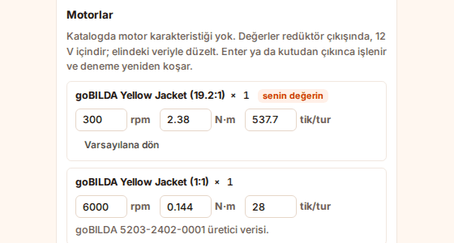
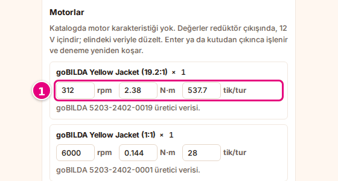
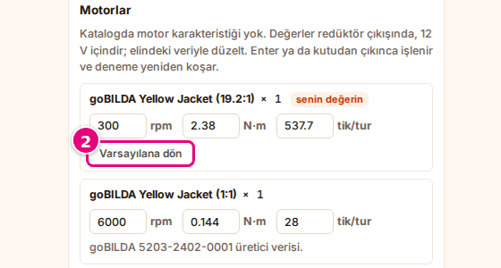
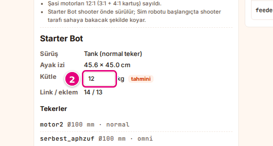

# Motor değerlerini ve kütleyi ayarla

Bu sayfada robotun motor değerlerini kendi verinle düzeltecek, gerekirse robotun kütlesini gireceksin.

<!-- CAPTURE: url=https://probotstudio.com/sim/ | hazirla=Starter Bot, Motorlar ve tekerler açık, ilk motorun rpm değeri 300 yapılmış | hedef=.motor-ayar (ilk) | isaret=yok | bekle=text="senin değerin" -->
<!-- SAY: Sonunda Sim motoru kendi girdiğimiz değerlerle çalıştırıyor. -->

Sim'in motor değerleri yaklaşıktır. Robot Sim'de gerçekteki kadar hızlı gitmiyorsa ya da enkoder
sayıları tutmuyorsa değerleri motorun veri sayfasına göre düzelt.

## Başlamadan önce

- Bir robot seçili. Hazır robotla başlamak için **Starter Bot**'u seç: [Hazır robot seç](robotu-sec.md#hazir-robot-sec).
- **Robot** bölümünde (ana sayfada ya da çalışma alanındaki **Robot** panelinde) **Motorlar ve tekerler**'e bastın.
  Robot ayrıntısı açılır; kapatmak için **Motorları gizle**'ye bas.
- Motorunun veri sayfası elinde: serbest devir (rpm), durma torku (N·m), enkoder tik/tur.

<!-- SAY: Motorun veri sayfasını elimizin altında tutuyoruz. -->

## Robot ayrıntısını oku

Robot ayrıntısının üstünde robotun adı ve özeti durur:

| Satır | Ne yazar |
|---|---|
| **Sürüş** | Şasi türü: **Mecanum**, **Tank (normal teker)**, **Omni**, **Karışık** ya da **Sürüş tekeri yok**. |
| **Ayak izi** | Robotun zemindeki boyu ve eni, cm. |
| **Kütle** | Parça verisi tamsa "parça verisinden". Eksikse kg kutusu ve "tahmini" etiketi. |
| **Link / eklem** | Builder modelindeki parça grubu (link) ve eklem sayısı, örneğin "14 / 13". |
| **Tekerler** | Her teker: adı, çapı (mm) ve türü (normal, mecanum, omni). |

<!-- SAY: Robot ayrıntısı şasi türünü, ayak izini ve tekerleri gösteriyor. -->

## Motor değerini değiştir {#motor-degerini-degistir}

**Motorlar** başlığı altında robottaki her motor modeli bir kez yazar, yanında kaç tane olduğu durur ("× 2").
Her motorun üç kutusu vardır. Değerler redüktör çıkışında ve 12 V içindir.

| Kutu | Birim | Geçerli aralık |
|---|---|---|
| Serbest devir | rpm | 1 ile 10000 arası |
| Durma torku | N·m | 0,01 ile 100 arası |
| Enkoder | tik/tur | 1 ile 100000 arası |

!!! tip "İpucu"
    Aralık dışındaki ya da sayı olmayan bir değer işlenmez, kutu eski değere döner. Fareyle kutunun
    üstünde durunca geçerli aralık yazar.

1. Değiştireceğin motorun kutusunu seç, örneğin **rpm** kutusu.
   <!-- CAPTURE: url=https://probotstudio.com/sim/ | hazirla=Starter Bot + Starter Bot otonom (CRServo), Motorlar ve tekerler açık | hedef=.motor-ayar (ilk) | isaret=1 | bekle=text="Motorlar" -->
   
2. Kutudaki değeri sil.
3. Yeni değeri yaz. Ondalık için nokta ya da virgül kullanabilirsin.
4. <kbd>Enter</kbd>'a bas ya da kutudan çık.

Sonuç: Motorun yanında "senin değerin" etiketi çıkar. Çalışma alanındaysan otonom program yeni değerle kendiliğinden yeniden koşar.

Yazarken vazgeçmek için <kbd>Enter</kbd>'dan önce <kbd>Esc</kbd>'ye bas. Kutuya eski değer geri gelir.

Değiştirmediğin motorun kutularının altında değerlerin kaynağı yazar, örneğin "goBILDA 5203-2402-0019
üretici verisi.". "doğrulanmadı" etiketi, Sim'in o motorun değerini veri sayfasından doğrulamadığını
söyler. Nedeni kutuların altında yazar; fareyle etiketin üstünde durunca da çıkar.

<!-- SAY: Motorun devir tork ve enkoder değerlerini kendi verimizle düzeltiyoruz, otonom yeniden koşuyor. -->

## Varsayılana dön {#varsayilana-don}

1. Robot ayrıntısını **Motorlar** başlığına kadar kaydır.
2. "senin değerin" etiketli motorun altındaki **Varsayılana dön**'e bas.
   <!-- CAPTURE: url=https://probotstudio.com/sim/ | hazirla=Starter Bot, ilk motorun rpm değeri 300 yapılmış, Motorlar ve tekerler açık | hedef=role=button[name="Varsayılana dön"] | isaret=2 | bekle=text="senin değerin" -->
   
3. Değer girdiğin başka motorlar için 2. adımı tekrarla.

Sonuç: Kutulara Sim'in değerleri geri gelir, "senin değerin" etiketi kalkar ve kutuların altında
yine değerlerin kaynağı yazar.

<!-- SAY: Varsayılana dön ile motor değerlerini Sim'in değerlerine geri alıyoruz. -->

## Kütleyi gir {#kutleyi-gir}

Bazı robotların parça verisi eksiktir. Bu robotlarda **Kütle** satırında bir kutu ve "tahmini" etiketi
çıkar. Kutuya önce 12 kg yazar.

1. Robotunu tart.
2. **Kütle** kutusuna toplam kütleyi kg cinsinden yaz. Geçerli aralık 0,2 ile 60 kg arası.
   <!-- CAPTURE: url=https://probotstudio.com/sim/ | hazirla=parça verisi eksik bir robot, Motorlar ve tekerler açık | hedef=role=textbox[name="Robotun tartılmış toplam kütlesi, kg"] | isaret=2 | bekle=text="tahmini" -->
   
3. <kbd>Enter</kbd>'a bas ya da kutudan çık.

Sonuç: Kutuda yeni kütle durur. Çalışma alanındaysan otonom program yeni kütleyle yeniden koşar.

**Kütle** satırında "parça verisinden" yazıyorsa kütle Builder parçalarından hesaplanır; değiştirilmez.

<!-- SAY: Parça verisi eksik robotlarda tarttığımız kütleyi elle giriyoruz. -->

!!! note "Not"
    Motor değerleri ve kütle bu tarayıcıda saklanır. Bir motorun değeri, o motor modelini kullanan her robotta geçerlidir.

## Sorun mu var?

- **Yazdığım değer geri döndü:** Değer aralık dışında ya da sayı değil. Bkz. [Motor değerini değiştir](#motor-degerini-degistir).
- **Kütle satırında kutu yok:** Robotun parça verisi tam, kütle Builder parçalarından hesaplanır.
- **Robot hâlâ çok yavaş ya da çok hızlı:** **Görünüm**'ü değiştirince fizik de değişir. Bkz. [Görünümü değiştir](gorunumu-degistir.md).

<!-- SAY: Yazdığımız değer geri dönüyorsa değer izin verilen aralığın dışında kalıyor. -->

## Sonraki adım

[Panelleri düzenle](panelleri-duzenle.md)

<!-- SAY: Sırada panelleri düzenlemek var. -->
