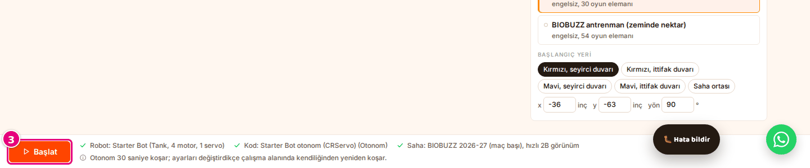
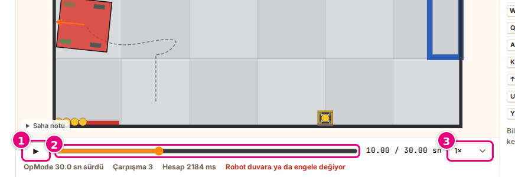
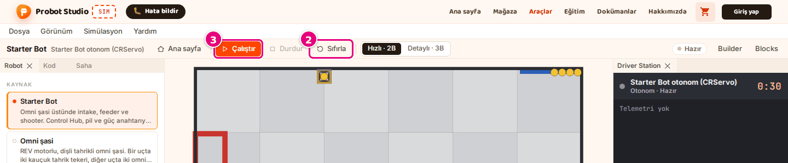

# Otonomu çalıştır ve kaydı incele

Bu sayfada otonom programı sahada koşturacak, sonra kaydı ileri geri sarıp inceleyeceksin.

<!-- CAPTURE: url=https://probotstudio.com/sim/#calis | hazirla=Starter Bot + Starter Bot otonom (CRServo), BIOBUZZ 2026-27 (maç başı), Kırmızı seyirci duvarı, Hızlı · 2B; otonom bitmiş, saat 12 sn | hedef=body | isaret=yok | bekle=text="OpMode 30.0 sn sürdü" -->
<!-- SAY: Bu sayfanın sonunda otonom kaydını istediğimiz anda durdurup inceliyoruz. -->

Otonom program 30 saniye koşar. Sim önce hareketi hesaplar, hesap sürerken kaydı oynatmaya başlar.
Koşu bitince kayıt durur; istediğin kadar yeniden izlersin.

## Başlamadan önce

- Sim'in ana sayfası açık: "Robotunu sahada dene" başlığı görünür. Sim'i ilk kez açıyorsan
  [İlk 10 dakika](ilk-10-dakika.md) sayfasından başla.
- Kendi robotun ya da programın gerekmez. Adımlar hazır **Starter Bot** örneğiyle gider.

<!-- SAY: Sim'in ana sayfasından ve hazır Starter Bot örneğinden başlıyoruz. -->

## Otonomu başlat

!!! tip "İpucu"
    Önce robotu, sonra programı seç. Örnek bir program seçiliyken hazır bir robota ya da Builder
    robotuna basarsan program o robotun TeleOp örneğine döner, Starter Bot'ta **Starter Bot TeleOp (CRServo)** olur.

1. **Robot** bölümünde **Kaynak** listesinden **Starter Bot**'u seç.
2. **Kod** bölümünde **OpMode** listesinden **Starter Bot otonom (CRServo)**'yu seç. Kendi programınla
   çalışıyorsan "Otonom" rozetli programı seç. Hazırlık listesinde **Kod** satırı yeşil onaylı olur.
   <!-- CAPTURE: url=https://probotstudio.com/sim/ | hazirla=Starter Bot seçili | hedef=role=button[name=/^Starter Bot otonom \(CRServo\)/] | isaret=2 | bekle=text="OpMode" -->
   
   <!-- SAY: Önce Starter Bot robotunu, sonra otonom rozetli programı seçiyoruz. -->
3. Alt şeritte **Başlat**'a bas. Aynı düğme başlığın altındaki [adım şeridinde](arayuz.md#adim-seridi) ve sayfanın sonunda da durur.
   Çalışma alanı açılır. Araç çubuğunda "Hesaplanıyor…" yazar, robot sahada hareket etmeye başlar.
   <!-- CAPTURE: url=https://probotstudio.com/sim/ | hazirla=Starter Bot + Starter Bot otonom (CRServo), BIOBUZZ 2026-27 (maç başı) | hedef=.ana__baslat | isaret=3 | bekle=text="Otonom 30 saniye koşar" -->
   

Sonuç: Durum rozeti "Hesaplanıyor"dan "Bitti"ye döner. Zaman çizelgesinin altında "OpMode 30.0 sn
sürdü", "Çarpışma …" ve "Hesap … ms" yazar. Araç çubuğundaki düğme **Yeniden çalıştır** olur.

<!-- SAY: Başlat'a basınca Sim otonom programı hesaplıyor ve robotu sahada oynatıyor. -->

Çalışma alanındayken **Simülasyon** > **Yeniden çalıştır**'ı seçerek de otonomu baştan koşarsın.

Otonom, seçimlerin değişince kendiliğinden yeniden koşar: program, saha, başlangıç yeri, görünüm,
motor değerleri ya da yapılandırma. Çalışma alanı **Başlat** olmadan açıldığında da koşar:
**Simülasyon** > **Oyun türü** > **Tek başına** seçilince, tarayıcının ileri düğmesiyle ya da
`#calis` ile biten bir bağlantıyla. Bu durumlarda **Başlat**'a ya da **Çalıştır**'a basman gerekmez.

## Kaydı incele {#kaydi-incele}

1. Zaman çizelgesinde ▶'ye bas. Kayıt sonundaysa ▶ baştan oynatır; duraklattıysan kaldığı yerden sürer.
   Kayıt oynarken düğmede ❚❚ (Duraklat) görünür. Baştan izlemek için ❚❚'ye basıp **Zaman**
   kaydırıcısını en sola çek.
2. Bir ana gitmek için **Zaman** kaydırıcısını sürükle. Oynatma durur.
3. **Oynatma hızı** listesinden bir hız seç: **0.25×**, **0.5×**, **1×**, **2×** ya da **4×**.
   <!-- CAPTURE: url=https://probotstudio.com/sim/#calis | hazirla=Starter Bot otonom (CRServo) bitmiş, saat 10 sn, duraklatılmış | hedef=role=button[name="Oynat"]; role=slider[name="Zaman"]; role=combobox[name="Oynatma hızı"] | isaret=1,2,3 | bekle=text="OpMode 30.0 sn sürdü" -->
   
4. **Driver Station** panelinde o andaki telemetri satırlarını oku.

Sonuç: Sahne, sayaç ve Driver Station kaydın seçtiğin anını gösterir. Geri sayım o ana göre kalan süreyi yazar.

<!-- SAY: Kaydı yavaşlatıp istediğimiz anda durdurabiliyor, o anki telemetriyi okuyabiliyoruz. -->

Oynatma hızı yalnız kaydı izleme hızıdır. Robotun hareketini değiştirmez.
Zaman çizelgesindeki ❚❚ (Duraklat) araç çubuğundaki **Durdur** değildir; yalnız oynatmayı bekletir.

## Bilgi satırını oku

Koşu bitince zaman çizelgesinin altında şunlar yazar:

| Yazı | Anlamı |
|---|---|
| "OpMode 30.0 sn sürdü" | Program kaç saniye koştu. Program erken biterse daha kısa olur. |
| "Çarpışma …" | Robotun duvara, engele ya da yapıya kaç ayrı kez çarptığı. |
| "Hesap … ms" | Sim'in hareketi hesaplama süresi. |
| "Kırmızı HIVE devrilme …", "Mavi HIVE devrilme …" | Yalnız **Detaylı · 3B** görünümde, BIOBUZZ sahalarında: o HIVE'ın kaç kez devrildiği. |
| "Robot duvara ya da engele değiyor" | O anda robot bir şeye değiyor. 2B sahnede robot kırmızı olur. |

Robot en az 0,25 saniye hiçbir şeye değmeden kaldıktan sonraki ilk temas bir çarpışma sayılır. Duvara
yaslanıp kalmak bir kez sayılır, duvara bitişik başlangıç sayılmaz.

<!-- SAY: Bilgi satırı programın süresini, çarpışma sayısını ve hesap süresini gösteriyor. -->

## Durdur, sıfırla, yeniden başlat {#durdur-sifirla-yeniden-baslat}

Koşuyu yarıda kesmek ya da temiz bir başlangıç yapmak için bu sırayı izle.

1. Hesap ya da oynatma sürüyorsa araç çubuğunda **Durdur**'a bas. Koşu bittiyse ya da oynatmayı
   duraklattıysan **Durdur** soluktur, bu adımı atla ve 2. adıma geç.
2. Araç çubuğunda **Sıfırla**'ya bas. Kayıt silinir, saat 0 olur, robot başlangıç yerine döner.
   <!-- CAPTURE: url=https://probotstudio.com/sim/#calis | hazirla=Starter Bot otonom (CRServo) bitmiş, Sıfırla'ya basılmış | hedef=role=toolbar[name="Araçlar"] >> role=button[name="Sıfırla"]; role=button[name="Çalıştır"] | isaret=2,3 | bekle=text="Hazır" -->
   
3. Araç çubuğunda **Çalıştır**'a bas.

Sonuç: Durum rozeti "Hazır"dan "Hesaplanıyor"a geçer ve otonom baştan koşar.

**Ana sayfa**'ya döndüysen koşu durur. Yeniden başlatmak için alt şeritteki **Başlat**'a bas.

!!! note "Not"
    Hesap sürerken **Durdur**'a basarsan yarım kayıt kalır: rozet "Bitti" olur, bilgi satırı "OpMode
    Infinity sn sürdü", "Çarpışma 0" ve "Hesap 0 ms" gibi gerçek olmayan değerler yazar. **Sıfırla**'ya
    basınca bu kayıt silinir.

<!-- SAY: Durdur, Sıfırla ve Çalıştır sırasıyla otonomu temiz bir şekilde baştan başlatıyoruz. -->

## Sorun mu var?

- **Driver Station'da kırmızı yazı:** Yazıyı oku. Program hata verdiyse yazı telemetri alanında çıkar ve rozet "Bitti" olur. Sim'in kendisi durursa ya da hesap 60 saniyeyi aşarsa rozet "Hata" olur. Bkz. [Sorun giderme](sorunlar.md#program-hatasi).
- **Başlat gri, basılmıyor:** Hazırlık listesinin **Kod** satırını oku. Bkz. [Sorun giderme](sorunlar.md#baslat-basilmiyor).
- **Program TeleOp'a döndü, otonom koşmuyor:** Program seçtikten sonra bir robota bastın. TeleOp kendiliğinden
  koşmaz. **Kod** bölümünden otonom programı yeniden seç.
- **Robot kıpırdamıyor:** Bkz. [Sorun giderme](sorunlar.md#robot-kipirdamiyor).
- **3B'de çok yavaş:** **Görünüm**'de **Hızlı · 2B**'yi seç. Bkz. [Görünümü değiştir](gorunumu-degistir.md).

<!-- SAY: Hata çıkarsa Driver Station'daki kırmızı yazıyı okuyoruz. -->

## Sonraki adım

[TeleOp'u klavyeyle ya da kumandayla sür](teleopu-sur.md)

<!-- SAY: Otonomdan sonra TeleOp ile robotu kendimiz sürüyoruz. -->
