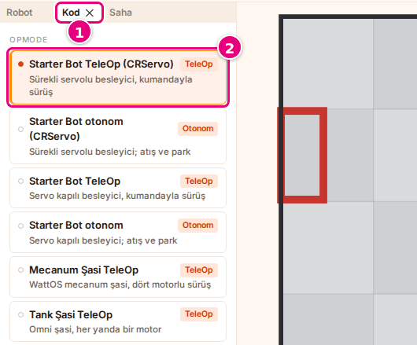

# Hoca hazırlığı

## Bu derste

Bu bir ders değil, Sim kullanım dokümanından üretilmiş araç tanıtımı. Sunum videoya dökülür, seslendirilen metin sayfa notlarındaki Söyle satırlarıdır. İzleyen kişi sonunda Sim'i açar, Starter Bot ile otonomu izler ve robotu klavyeyle sürer.

## Dersten önce

- Canlı anlatılacaksa probotstudio.com/sim açık ve giriş kartı kapatılmış olsun.
- Ekran görüntüleri prod'dan alınmış örnek görsellerdir, aynı adla yenilenir.

## Zaman planı

Her sayfa yaklaşık yarım dakika, toplam 7 dakika. Ödev yok.

# Sayfalar

## Sim ile ilk 10 dakika {kapak sure=0.5}

::: hoca
**Söyle:** "Bu sunumda Sim'i ilk kez açıyoruz. Hazır Starter Bot robotuyla bir otonom programı izliyor, sonra aynı robotu klavyeyle sürüyoruz. Bunun için hesap, kurulum ya da kendi robotunuz gerekmiyor."
:::

## Sim ne işe yarar {gorsel-sol sure=0.5}

- Builder'da kurulan robot sahaya çıkar
- Blocks'ta (`.blk`) ya da Android Studio'da (`.java`) yazılan FTC programı çalışır
- Otonom 30 saniye, TeleOp 120 saniye koşar
- Tarayıcıda çalışır, hesap ve kurulum istemez

::: hoca
**Söyle:** "Sim ile robotumuzu ve programımızı sanal bir FTC sahasında çalıştırıyoruz. Robotu Builder'da kuruyor, FTC programını Blocks'ta ya da Android Studio'da yazıyor, ikisini robota yüklemeden Sim'de deniyoruz."
:::

## Sim neyi yapmaz {gorsel-sol sure=0.5}

- Robot kurmaz, kaydetmez, paylaşmaz
- Probot Blocks (`.ino`) programını çalıştırmaz
- Mesafe, renk ve dokunma sensörü yok
- İkinci kumanda (**gamepad2**) yok

::: hoca
**Söyle:** "Sim motorları, servoları ve IMU'yu canlandırıyor ama mesafe, renk ve dokunma sensörlerini canlandırmıyor. Robotu ve programı da kaydetmiyor, bunları Builder'da ve Blocks'ta kaydediyoruz. Seçimlerimiz yalnız bu tarayıcıda saklanıyor, dosyadan açtığımız robot ve program ise sayfa yenilenince gidiyor."
:::

## Sim'i açıyoruz {gorsel-sol sure=0.5}

- Adres probotstudio.com/sim
- Giriş kartında **Anladım, devam et**
- Başlıktaki **Hata bildir** halka ve okla gösterilir
- Dar pencerede 3 saniye sonra **Yine de devam et**

::: hoca
**Söyle:** "Tarayıcıda Probot Studio sitesinin Sim sayfasını açıyoruz. Simülasyon aracı geliştirme aşamasında yazan kartta Anladım, devam et düğmesine basıyoruz. Kart açıkken site başlığındaki Hata bildir düğmesi bir halka ve okla gösteriliyor. Ekranda Robotunu sahada dene başlığı ve Robot, Kod, Oyun bölümleri beliriyor."
:::

## Önce robotu seçiyoruz {gorsel-sol sure=0.5}

- **Robot** bölümünde **Kaynak** listesi
- **Starter Bot** seçilir
- Önce robot, sonra program

::: hoca
**Söyle:** "Robot bölümündeki Kaynak listesinden Starter Bot'u seçiyoruz. Önce robotu seçiyoruz, çünkü programı seçtikten sonra bir hazır robota basarsak program o robotun örneğine dönüyor."
:::

## Sonra programı seçiyoruz {sure=0.5}

- **Kod** bölümünde **OpMode** listesi
- **Starter Bot otonom (CRServo)**
- Sağdaki rozet Otonom ya da TeleOp

::: hoca
**Söyle:** "Kod bölümündeki OpMode listesinden Starter Bot otonom programını seçiyoruz. OpMode, FTC'de robotun çalıştırdığı tek bir program demek. Satırın sağındaki rozet programın otonom mu TeleOp mu olduğunu söylüyor."
:::

## Yapılandırma tablosuna bakıyoruz {sure=0.5}

- Koddaki ad ve robottaki port yan yana
- Hiçbir satırda **(bağlı değil)** yok
- Porta bağlı olmayan cihaz çalışmaz

::: hoca
**Söyle:** "Program motorlara ve servolara koddaki adlarıyla sesleniyor. Kod bölümünün altındaki Yapılandırma tablosu her adın robotta hangi porta bağlı olduğunu gösteriyor. Hiçbir satırda bağlı değil yazmıyorsa ve alt şeritteki hazırlık listesi yeşilse devam ediyoruz."
:::

## Sahayı seçiyoruz {sure=0.5}

- **Oyun türü** **Tek başına**
- **Görünüm** **Hızlı · 2B**
- **Saha** **BIOBUZZ 2026-27 (maç başı)**
- **Başlangıç yeri** **Kırmızı, seyirci duvarı**

::: hoca
**Söyle:** "Oyun bölümünde Tek başına oyun türünü ve Hızlı 2B görünümü seçiyoruz. Saha olarak BIOBUZZ maç başı sahasını, başlangıç yeri olarak kırmızı ittifakın seyirci duvarını seçiyoruz. Önizlemede robot sahanın seyirci tarafında, kırmızı yarıda duruyor."
:::

## Başlat ile otonom koşuyor {gorsel-alt sure=0.5}

- Alt şeritte **Başlat**
- Çalışma alanı açılır, önce "Hesaplanıyor…" yazar
- **Başlat** griyse kod çevriliyor

::: hoca
**Söyle:** "Alt şeritteki Başlat düğmesine basıyoruz. Çalışma alanı açılıyor, araç çubuğunda önce Hesaplanıyor yazıyor ve robot sahada otonom programını koşmaya başlıyor. Başlat gri kalıyorsa kod henüz çevriliyor ya da çevrilemedi, hazırlık listesindeki Kod satırı nedenini yazıyor."
:::

## Otonom bitti {gorsel-sol sure=0.5}

- Durum rozetinde "Bitti"
- Zaman çizelgesinin altında "OpMode 30.0 sn sürdü"
- **Driver Station**'da telemetri satırları

::: hoca
**Söyle:** "Otonom otuz saniye koşuyor. Bitince araç çubuğundaki durum rozetinde Bitti, zaman çizelgesinin altında programın otuz saniye sürdüğü yazıyor. Sağdaki Driver Station panelinde programın yazdığı telemetri satırlarını görüyoruz."
:::

## Kaydı yeniden izliyoruz {sure=0.5}

- ▶ kaydı baştan oynatır
- **Oynatma hızı** listesinde **2×**
- Kayıt iki kat hızlı oynar

::: hoca
**Söyle:** "Sayaç otuz saniyeye gelince zaman çizelgesindeki oynat düğmesine basıyoruz ve kayıt baştan oynuyor. Oynatma hızı listesinden iki katı seçince kayıt iki kat hızlı oynuyor."
:::

## TeleOp programını seçiyoruz {sure=0.5}

- Sol panellerde **Kod** sekmesi
- **Starter Bot TeleOp (CRServo)**
- Dar pencerede sekmeler sahnenin altında

::: hoca
**Söyle:** "Şimdi robotu kendimiz sürmek için sol panellerdeki Kod sekmesine geçiyor ve Starter Bot TeleOp programını seçiyoruz. TeleOp, sürücünün kumandayla yönettiği program ve Sim'de yüz yirmi saniye koşuyor."
:::

## Başlat'a basıp sürüyoruz {gorsel-alt sure=0.5}

- Araç çubuğunda **Başlat**
- <kbd>W</kbd> ileri, <kbd>A</kbd> ve <kbd>D</kbd> döndürür
- Rozette "Canlı · klavye", bitirmek için **Durdur**

::: hoca
**Söyle:** "Araç çubuğunda Başlat düğmesine basıyoruz. W tuşunu basılı tutunca robot ileri gidiyor, A ve D tuşları robotu döndürüyor. Tuşlar robota gitmiyorsa sahnenin boş bir yerine bir kez tıklıyoruz, bitirmek için Durdur düğmesine basıyoruz."
:::

## Özet ve sıradaki sunum {gorsel-sol sure=0.5}

- Sim'i açtık, robotu ve programı seçtik
- Otonomu izledik, kaydı yeniden oynattık
- TeleOp ile robotu klavyeyle sürdük

::: hoca
**Söyle:** "Bu sunumda Sim'i açtık, Starter Bot ile otonomu izledik ve robotu klavyeyle sürdük. Sıradaki sunumda Sim ekranını bölge bölge tanıyor, her düğmenin ne yaptığını görüyoruz."
:::
