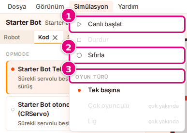
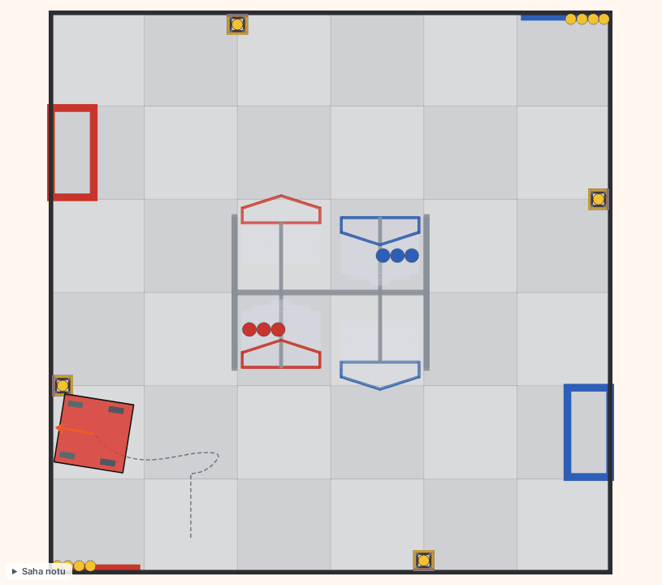
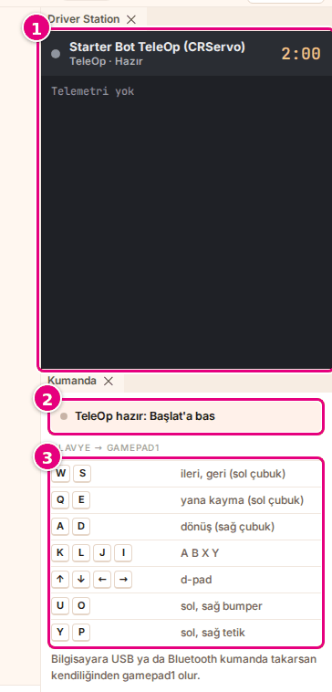
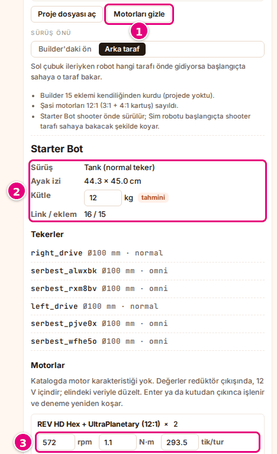

# Hoca hazırlığı

## Bu derste

Bu bir ders değil, Sim kullanım dokümanının arayüz turundan üretilmiş araç tanıtımı. Sunum videoya dökülür, seslendirilen metin sayfa notlarındaki Söyle satırlarıdır. İzleyen kişi sonunda Sim ekranındaki her bölgenin adını ve ne işe yaradığını bilir.

## Dersten önce

- Canlı anlatılacaksa Sim'de Starter Bot ile bir otonom koşmuş olsun, çalışma alanı açık dursun.
- Ekran görüntüleri prod'dan alınmış örnek görsellerdir, aynı adla yenilenir.

## Zaman planı

Her sayfa yaklaşık yarım dakika, toplam 8 dakika. Ödev yok.

# Sayfalar

## Sim arayüz turu {kapak sure=0.5}

::: hoca
**Söyle:** "Bu sunumda Sim ekranını bölge bölge tanıyoruz. Menü çubuğunu, araç çubuğunu, ana sayfayı, çalışma alanını, zaman çizelgesini ve panelleri sırayla görüyoruz."
:::

## İki ekran, ortak üst kısım {gorsel-alt sure=0.5}

- **Ana sayfa**'da robot, program ve saha seçilir
- **Başlat** ile çalışma alanı açılır
- Üstte menü çubuğu ve araç çubuğu
- Site başlığında **Hata bildir**

::: hoca
**Söyle:** "Sim iki ekrandan oluşuyor. Ana sayfada robotu, programı ve sahayı seçiyoruz, Başlat'a basınca robotun sahaya çıktığı çalışma alanı açılıyor. İki ekranın üstünde de aynı menü çubuğu ve araç çubuğu duruyor, site başlığında SIM rozetinin yanında da Hata bildir düğmesi bulunuyor."
:::

## Menü çubuğu {sure=0.5}

- **Canlı başlat** koşuyu başlatır
- **Sıfırla** kaydı siler, robotu başa koyar
- **Oyun türü** > **Tek başına** çalışma alanını açar
- **Dosya** dosya açar, **Görünüm** sahne ve panel seçer

::: hoca
**Söyle:** "Menü çubuğunda Dosya, Görünüm, Simülasyon ve Yardım menüleri var. Açık olan Simülasyon menüsünde Canlı başlat koşuyu başlatıyor, Sıfırla robotu başa koyuyor, Tek başına çalışma alanını açıyor. Dosya robot ve kod dosyası açıyor, Görünüm sahneyi ve panelleri seçiyor. Açık menüyü Esc tuşuyla kapatıyoruz."
:::

## Araç çubuğu {gorsel-alt sure=0.5}

- **Çalıştır** ya da **Başlat** koşuyu başlatır
- **Durdur**, **Sıfırla**, **Hızlı · 2B** / **Detaylı · 3B**
- **Builder** ve **Blocks** yeni sekmede açılır
- En sağda dil seçici, **Türkçe** ya da **English**

::: hoca
**Söyle:** "Araç çubuğunda otonom seçiliyken Çalıştır, TeleOp seçiliyken Başlat düğmesi duruyor. Yanında Durdur, Sıfırla ve görünüm seçici var. Builder ve Blocks bağlantıları bu araçları yeni sekmede açıyor, en sağdaki dil seçiciyle arayüzü Türkçe ya da İngilizce yapıyoruz."
:::

## Durum rozeti {gorsel-sol sure=0.5}

- "Hazır", "Hesaplanıyor", "Bitti"
- "Canlı · klavye", "Canlı · kumanda"
- "Hata"

::: hoca
**Söyle:** "Araç çubuğundaki durum rozeti koşunun durumunu söylüyor. Hazır koşunun başlamadığını, Hesaplanıyor otonomun hesaplandığını, Bitti kaydın izlenebileceğini gösteriyor. TeleOp sürerken Canlı yazıyor, program süresinde bitmezse ya da simülasyon açılamazsa Hata yazıyor."
:::

## Ana sayfanın üç bölümü {gorsel-sol sure=0.5}

- **Robot**, **Kod**, **Oyun** bölümleri
- Sarı daire uyarı, kırmızı daire hata
- Gri daire kod çevriliyor demek
- Yeşil onay, o bölümde eksik yok

::: hoca
**Söyle:** "Ana sayfada Robot, Kod ve Oyun bölümleri yan yana duruyor. Her bölümün başındaki daire sarıysa uyarı, kırmızıysa hata var, griyse kod çevriliyor. Daire yeşil onaya dönünce o bölümde eksik kalmıyor."
:::

## Alt şerit ve hazırlık listesi {gorsel-alt sure=0.5}

- **Başlat** çalışma alanını açar
- Hazırlık listesi seçimlerin özeti
- Sarı maddeye basınca sayfa o bölüme kayar
- **Başlat** adım şeridinde ve sayfa sonunda da var

::: hoca
**Söyle:** "Alt şerit sayfayı kaydırsak da ekranın altında kalıyor. Solda Başlat düğmesi, yanında seçimlerimizin hazırlık listesi var. Bir uyarıya basınca sayfa ilgili bölüme kayıyor, kod çevrilirken ya da çevrilemediyse Başlat basılmıyor. Aynı Başlat düğmesi başlığın altındaki adım şeridinde ve sayfanın sonunda da duruyor."
:::

## Çalışma alanı {gorsel-sol sure=0.5}

- Solda **Robot**, **Kod**, **Saha** panelleri
- Ortada sahne ve zaman çizelgesi
- Sağda **Driver Station** ve **Kumanda**
- Tarayıcının geri tuşu ana sayfaya döner

::: hoca
**Söyle:** "Başlat'a basınca çalışma alanı açılıyor. Ortada sahne, solda Robot, Kod ve Saha panelleri, sağda Driver Station ve Kumanda panelleri duruyor. Sol panellerde yaptığımız seçim ana sayfada da değişiyor."
:::

## 2B sahne {sure=0.5}

- Robotun yolu kesik çizgi, önü turuncu ok
- Teker yeşilse ileri, kırmızıysa geri, griyse duruyor
- Gövde kırmızıysa robot bir şeye değiyor

::: hoca
**Söyle:** "Hızlı 2B görünümde saha kuşbakışı çiziliyor. Robotun geçtiği yol kesik çizgiyle, önü turuncu okla gösteriliyor. Tekerler ileri dönerken yeşil, geri dönerken kırmızı, dururken gri oluyor ve robot duvara ya da engele değince gövdesi kırmızıya dönüyor."
:::

## 3B sahne {gorsel-sol sure=0.5}

- Fareyle döndürülür ve yakınlaştırılır
- Kamera düğmeleri **Saha**, **Sürücü gözü**, **Robotu takip et**
- BIOBUZZ sahalarında **Saha notu**

::: hoca
**Söyle:** "Detaylı 3B görünümde saha, robot ve oyun elemanları üç boyutlu çiziliyor. Sahneyi fareyle döndürüp yakınlaştırıyor, köşedeki kamera düğmeleriyle hazır açılara geçiyoruz. BIOBUZZ sahalarında köşede bir de Saha notu kutusu duruyor."
:::

## Zaman çizelgesi {sure=0.5}

- Oynat ve Duraklat (▶ / ❚❚)
- **Zaman** kaydırıcısı
- **Oynatma hızı** 0.25× ile 4× arası
- Altında bilgi satırı

::: hoca
**Söyle:** "Sahnenin altındaki zaman çizelgesiyle kaydı oynatıyor ya da duraklatıyoruz. Kaydırıcıyla kaydın istediğimiz anına gidiyor, oynatma hızını çeyrekten dört kata kadar değiştiriyoruz. Koşu bitince altında programın süresi, çarpışma sayısı ve hesap süresi yazıyor."
:::

## Driver Station ve Kumanda {sure=0.5}

- OpMode adı, türü ve durumu
- Geri sayım, TeleOp 2:00, Otonom 0:30
- Telemetri satırları, hata kırmızı yazılır
- **Kumanda** panelinde tuş tablosu

::: hoca
**Söyle:** "Sağdaki Driver Station paneli programın adını, türünü ve durumunu gösteriyor. Yanında geri sayım, altında programın telemetri satırları var ve program hatası kırmızı yazıyla çıkıyor. Altındaki Kumanda paneli de hangi tuşun kumandanın hangi düğmesine gittiğini listeliyor."
:::

## Paneller {sure=0.5}

- Solda **Robot**, **Kod**, **Saha** sekmeleri
- Sekmesinden tutup sürükle, panel taşınır
- **Robot** sekmesindeki **×** paneli kapatır
- Sahnenin sekmesi yok, sahne taşınmaz

::: hoca
**Söyle:** "Her panelin bir sekmesi var, solda Robot, Kod ve Saha sekmelerini görüyoruz. Sekmeyi tutup sürükleyerek paneli başka yere taşıyor, Robot sekmesindeki çarpıyla kapatıyoruz. Ortadaki sahnenin sekmesi yok, sahne taşınmıyor ve kapanmıyor."
:::

## Robot ayrıntısı {sure=0.5}

- **Motorlar ve tekerler** ile açılır
- Sürüş türü, ayak izi, kütle, tekerler
- Her motor için rpm, N·m, tik/tur
- **Motorları gizle** ile kapanır

::: hoca
**Söyle:** "Robot bölümünde Motorlar ve tekerler düğmesine basınca robot ayrıntısı açılıyor. Burada sürüş türünü, ayak izini, kütleyi ve tekerleri görüyor, her motorun devir, tork ve enkoder değerini değiştirebiliyoruz. Kapatmak için Motorları gizle düğmesine basıyoruz."
:::

## Özet ve sıradaki sunum {gorsel-sol sure=0.5}

- İki ekran, menü çubuğu, araç çubuğu
- Ana sayfanın bölümleri ve hazırlık listesi
- Sahne, zaman çizelgesi ve paneller

::: hoca
**Söyle:** "Bu sunumda Sim'in iki ekranını, menü ve araç çubuğunu, sahneyi, zaman çizelgesini ve panelleri tanıdık. Sıradaki sunumda sürüş tuşlarını, kumandayı ve bir sorun çıktığında nereye bakacağımızı görüyoruz."
:::
