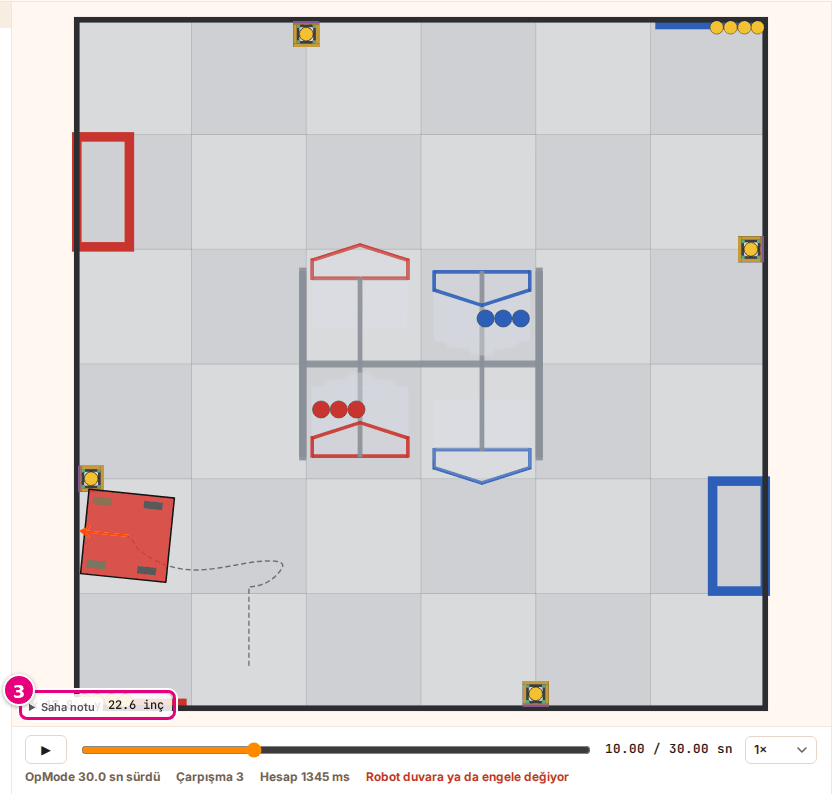
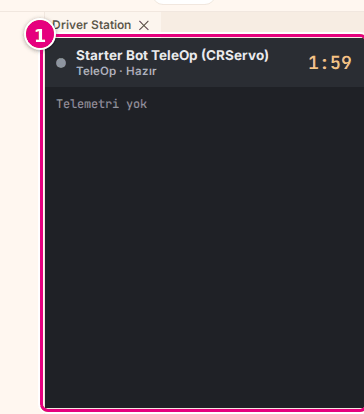

# Hoca hazırlığı

## Bu derste

Bu bir ders değil, Sim kullanım dokümanının kısayollar ve sorun giderme sayfalarından üretilmiş araç tanıtımı. Sunum videoya dökülür, seslendirilen metin sayfa notlarındaki Söyle satırlarıdır. İzleyen kişi sonunda sürüş tuşlarını bilir ve bir sorunda önce hangi göstergeye bakacağını bilir.

## Dersten önce

- Canlı anlatılacaksa Sim'de Starter Bot TeleOp (CRServo) seçili olsun.
- Ekran görüntüleri prod'dan alınmış örnek görsellerdir, aynı adla yenilenir.

## Zaman planı

Her sayfa yaklaşık yarım dakika, toplam 7 dakika. Ödev yok.

# Sayfalar

## Kısayollar ve sorun giderme {kapak sure=0.5}

::: hoca
**Söyle:** "Bu sunumda Sim'in klavye tuşlarını, bilgisayara bağlı kumandayı ve fare hareketlerini görüyoruz. Sonra bir sorun çıktığında hangi göstergeye bakacağımızı ve hatayı ekibe nasıl bildireceğimizi öğreniyoruz."
:::

## Sürüş tuşları {sure=0.5}

- <kbd>W</kbd> / <kbd>S</kbd> sol çubuk ileri, geri
- <kbd>A</kbd> / <kbd>D</kbd> sağ çubuk, dönüş
- <kbd>Q</kbd> / <kbd>E</kbd> sol çubuk, yana kayma
- Tuşlar programa **gamepad1** olarak gider

::: hoca
**Söyle:** "TeleOp sürerken klavye tuşları programa birinci kumanda olarak, yani gamepad1 olarak gidiyor. W ve S sol çubuğu ileri ve geri, A ve D sağ çubuğu sola ve sağa itiyor. Q ve E sol çubuğu yana itiyor. Bütün bu tuşlar Kumanda panelindeki tabloda yazıyor."
:::

## Düğme tuşları {gorsel-sol sure=0.5}

- <kbd>K</kbd> <kbd>L</kbd> <kbd>J</kbd> <kbd>I</kbd> **A**, **B**, **X**, **Y**
- Ok tuşları **D-pad**
- <kbd>U</kbd> / <kbd>O</kbd> sol ve sağ bumper
- <kbd>Y</kbd> / <kbd>P</kbd> sol ve sağ tetik

::: hoca
**Söyle:** "K, L, J ve I tuşları kumandanın A, B, X ve Y düğmeleri oluyor. Ok tuşları D-pad'e, U ve O bumper'lara, Y ve P de tetiklere gidiyor. Tuş basılıyken değer tam oluyor, yarım çubuk ya da yarım tetik klavyeyle verilemiyor."
:::

## Tuşlar robota gitmiyorsa {sure=0.5}

- Odak bir kutudaysa tuşlar oraya gider
- Sahneye bir kez tıklanır
- Sim tuşun harfine değil yerine bakar
- Türkçe F klavyede aynı yerdeki tuş

::: hoca
**Söyle:** "Bir sayı kutusu, liste ya da zaman kaydırıcısı seçiliyken tuşlar robota gitmiyor. Böyle olursa sahneye bir kez tıklıyor, sonra tuşa yeniden basıyoruz. Sim tuşun harfine değil klavyedeki yerine baktığı için Türkçe F klavyede Q klavyedeki W'nin yerindeki tuşa basıyoruz."
:::

## Bilgisayara bağlı kumanda {sure=0.5}

- USB ya da Bluetooth ile bağlanır
- Bir düğmeye bir kez basılır
- İlk bağlanan kumanda **gamepad1** olur
- Klavye de çalışmaya devam eder

::: hoca
**Söyle:** "Kumandayı bilgisayara USB ya da Bluetooth ile bağlıyor ve bir düğmesine bir kez basıyoruz, çünkü tarayıcı kumandayı ancak bir düğmeye basınca görüyor. Sim ilk bağlanan kumandayı gamepad1 yapıyor ve panelde Kumanda bağlı, sürüyorsun yazıyor."
:::

## Fare {sure=0.5}

- Sol tuşla sürükle, kamera döner
- Sağ tuşla sürükle, kamera kayar
- Tekerlek yaklaştırır, uzaklaştırır
- **Sürücü gözü** kamerasında fare çalışmaz

::: hoca
**Söyle:** "3B sahnede sol tuşla sürükleyince kamera dönüyor, sağ tuşla sürükleyince kayıyor, tekerlekle yaklaşıp uzaklaşıyoruz. Sürücü gözü kamerasında fare çalışmıyor. 2B sahnede fareyi gezdirince köşede imlecin yeri inç olarak yazıyor."
:::

## Diğer tuşlar {sure=0.5}

- <kbd>Esc</kbd> açık menüyü kapatır
- Sayı kutusunda <kbd>Enter</kbd> değeri işler
- Sayı kutusunda <kbd>Esc</kbd> eski değere döner
- Kaydet ya da geri al kısayolu yok

::: hoca
**Söyle:** "Açık bir menüyü Esc tuşuyla kapatıyoruz. Motor ve kütle kutularında Enter yazdığımız değeri işliyor, Esc ise kutuyu eski değere döndürüyor. Sim'de kaydet ya da geri al kısayolu bulunmuyor."
:::

## Sorun olursa önce göstergeler {gorsel-alt sure=0.5}

- Çalışma alanında durum rozeti
- Ana sayfada bölüm daireleri
- Hazırlık listesindeki sarı maddeye basılır

::: hoca
**Söyle:** "Bir sorun olduğunda önce göstergelere bakıyoruz. Çalışma alanında durum rozeti, ana sayfada bölüm daireleri ve hazırlık listesi neyin eksik olduğunu söylüyor. Sarı bir maddeye basınca sayfa sorunun olduğu bölüme kayıyor."
:::

## Robot kıpırdamıyor {sure=0.5}

- Bir cihaz porta bağlı değil
- Robotta motora bağlı sürüş tekeri yok
- TeleOp'ta **Başlat**'a basılmadı
- Odak bir sayı kutusunda

::: hoca
**Söyle:** "Robot kıpırdamıyorsa çoğu zaman programdaki bir cihaz robotta bir porta bağlanmamış oluyor. Hazırlık listesindeki uyarıya ve Yapılandırma tablosundaki açık sarı satırlara bakıyoruz. TeleOp'ta Başlat'a basmadıysak ya da odak bir kutudaysa da robot kıpırdamıyor."
:::

## Başlat basılmıyor {gorsel-alt sure=0.5}

- Hazırlık listesinde **Kod** satırına bakılır
- "Kod çevriliyor…" yazıyorsa beklenir
- "Kod çevrilemedi" nedenini yazar
- "Hesaplanıyor…" bitince **Yeniden çalıştır**

::: hoca
**Söyle:** "Başlat gri görünüyor ve basılmıyorsa hazırlık listesindeki Kod satırına bakıyoruz. Kod çevriliyorsa bekliyoruz, kod çevrilemediyse satır nedenini yazıyor. Programda runOpMode bloğu yoksa da kod çevrilmiyor. Otonom hesaplanırken de düğme basılmıyor, hesap bitince Yeniden çalıştır'a basabiliyoruz."
:::

## Program hata verdi {sure=0.5}

- Hata **Driver Station** panelinde kırmızı yazılır
- Rozet çoğu hatada "Bitti" kalır
- Sarı uyarılar programı durdurmaz
- Döngüde **opModeIsActive** ya da **sleep**

::: hoca
**Söyle:** "Hatanın yeri Driver Station paneli. Program hata verirse burada kırmızı bir yazı çıkıyor ve rozet çoğu zaman Bitti gösteriyor. Sarı uyarılar programı durdurmuyor. Program zaman ilerletmeden dönüyor yazıyorsa döngüye opModeIsActive koşulu ya da bir sleep bloğu ekliyoruz."
:::

## Seçimler, 3B ve canlı sürüş {gorsel-alt sure=0.5}

- Seçimler yalnız bu tarayıcıda saklanır
- Kalıcı kopya Builder'da ve Blocks'ta dosya
- 3B yavaşsa **Hızlı · 2B**
- Canlı sürüş açılmazsa sayfa yenilenir

::: hoca
**Söyle:** "Sim seçimleri yalnız bu tarayıcıda saklıyor, bu yüzden robotu Builder'da, programı Blocks'ta dosya olarak da kaydediyoruz. 3B sahne yavaşsa Hızlı 2B görünüme geçiyoruz. Canlı sürüş açılamadı yazıyorsa sayfayı yeniliyoruz."
:::

## Hata bildir {gorsel-sol sure=0.5}

- Site başlığındaki **Hata bildir**
- **Başlık** ve **Mesaj** doldurulur
- Robot ve program, son tuş, ekrandaki yazı, tarayıcı
- **Gönder**

::: hoca
**Söyle:** "Belgede çözümü olmayan bir sorunu site başlığındaki Hata bildir düğmesiyle ekibe gönderiyoruz. Başlığa sorunu kısaca, mesaja açık robotu ve programı, son bastığımız tuşu, ekrandaki yazıyı birebir ve tarayıcımızı yazıyoruz. Gönder'e basınca formda Alındı, teşekkürler yazıyor."
:::

## Özet ve sıradaki sunum {gorsel-sol sure=0.5}

- Sürüş tuşları, kumanda ve fare
- Sorunda önce göstergeler
- Çözüm yoksa **Hata bildir**

::: hoca
**Söyle:** "Bu sunumda sürüş tuşlarını, kumandayı ve fareyi gördük, bir sorun çıktığında göstergelerden başlamayı öğrendik. Sıradaki sunumda kendi robotumuzu ve kendi programımızı Sim'e getiriyor, cihazları porta bağlıyoruz."
:::
