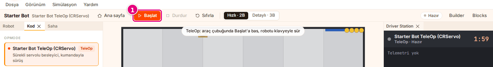
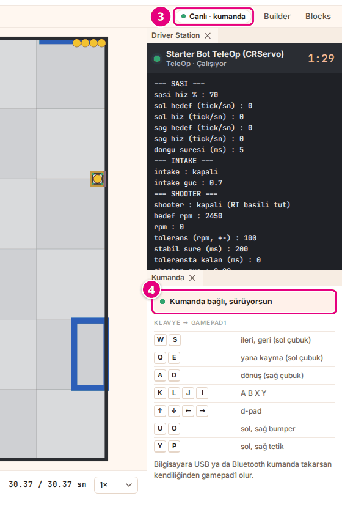
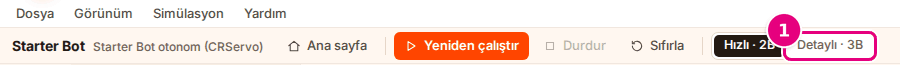
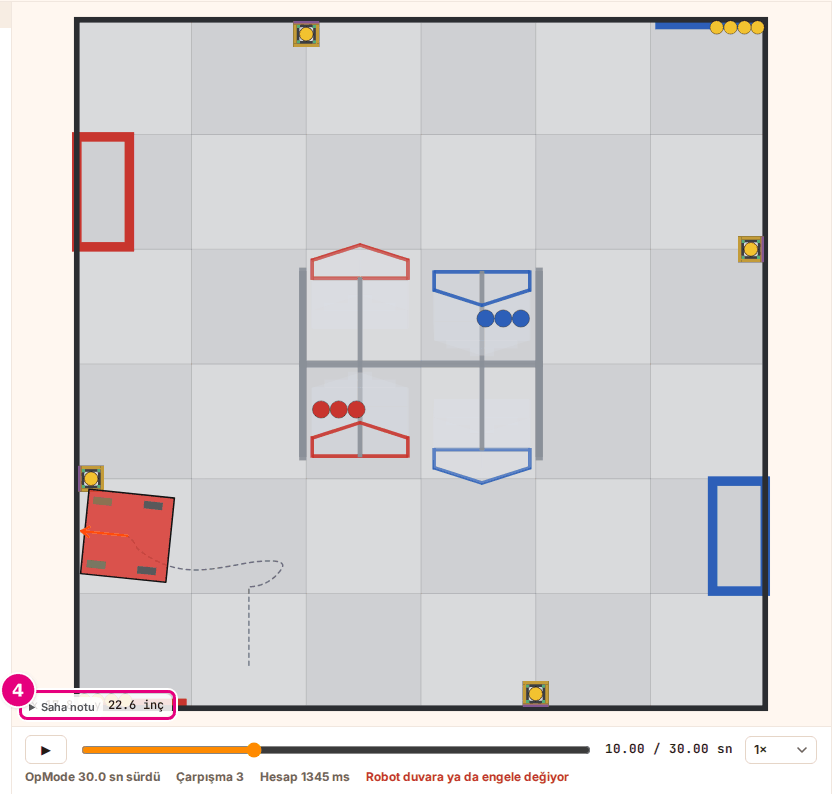

# Hoca hazırlığı

## Bu derste

Bu bir ders değil, Sim kullanım dokümanının TeleOp'u sür ve Görünümü değiştir sayfalarından üretilmiş araç tanıtımı. Sunum videoya dökülür, seslendirilen metin sayfa notlarındaki Söyle satırlarıdır. İzleyen kişi sonunda robotu klavyeyle ya da kumandayla sürer, görünümü değiştirir ve 3B kamerayı kullanır.

## Dersten önce

- Canlı anlatılacaksa Sim'de Starter Bot ve Starter Bot TeleOp (CRServo) seçili olsun, kumanda varsa bağlı dursun.
- Ekran görüntüleri prod'dan alınmış örnek görsellerdir, aynı adla yenilenir.

## Zaman planı

Her sayfa yaklaşık yarım dakika, toplam 6 dakika. Ödev yok.

# Sayfalar

## TeleOp'u sür, görünümü değiştir {kapak sure=0.5}

::: hoca
**Söyle:** "Bu sunumda TeleOp programıyla robotu klavyeyle ve bilgisayara bağlı kumandayla sürüyoruz. Sonra sahneyi 2B ile 3B arasında değiştiriyor, 3B sahnede kamerayı döndürüp yaklaştırıyoruz."
:::

## TeleOp'u başlatıyoruz {gorsel-alt sure=0.5}

- "TeleOp" rozetli program
- Araç çubuğunda **Başlat**
- TeleOp 120 saniye koşar
- Ana sayfadaki **Başlat** sürüşü de başlatır

::: hoca
**Söyle:** "TeleOp rozetli bir program seçip araç çubuğundaki Başlat düğmesine basıyoruz. TeleOp yüz yirmi saniye koşuyor ve biz Başlat'a basmadan başlamıyor. Ana sayfadaki Başlat'a basarsak çalışma alanı açılıyor ve sürüş doğrudan başlıyor."
:::

## Klavyeyle sürüyoruz {gorsel-sol sure=0.5}

- <kbd>W</kbd> ileri, <kbd>S</kbd> geri
- <kbd>A</kbd> ve <kbd>D</kbd> döndürür
- Rozette "Canlı · klavye"
- Bitirmek için **Durdur**

::: hoca
**Söyle:** "W tuşunu basılı tutunca robot ileri, S ile geri gidiyor, A ve D robotu döndürüyor. Sürerken durum rozetinde Canlı klavye, zaman çizelgesinde Canlı robot sürülüyor yazıyor. Durdur'a basınca sürüş bitiyor ve rozet Bitti oluyor."
:::

## Kumandayla sürüyoruz {sure=0.5}

- USB ya da Bluetooth ile bağlanır
- Bir düğmeye bir kez basılır
- Rozette "Canlı · kumanda"
- **Kumanda** panelinde "Kumanda bağlı, sürüyorsun"

::: hoca
**Söyle:** "Bilgisayara bağladığımız kumandanın bir düğmesine bir kez basıyor, sonra Başlat ile sürüşü açıyoruz. Rozette Canlı kumanda, Kumanda panelinde Kumanda bağlı, sürüyorsun yazıyor. Robotu kumandanın çubuklarıyla sürüyoruz. Kumanda bağlıyken klavye de çalışmaya devam ediyor."
:::

## Sürüşü yeniden başlatıyoruz {gorsel-alt sure=0.5}

- **Durdur**, **Sıfırla**, **Başlat**
- Sayaç 2:00'dan geri sayar
- Ayar değişirse sürüş durur ve sıfırlanır

::: hoca
**Söyle:** "Sürüşü baştan almak için Durdur, Sıfırla ve Başlat düğmelerine sırayla basıyoruz. Robot başlangıç yerine dönüyor ve Driver Station'daki sayaç iki dakikadan geri saymaya başlıyor. Sürüş sırasında robotu, programı, sahayı ya da bir ayarı değiştirirsek sürüş duruyor ve yeniden Başlat'a basıyoruz."
:::

## İki görünüm {gorsel-sol sure=0.5}

- **Hızlı · 2B** hafif fizik, kuşbakışı saha
- **Detaylı · 3B** sağlam fizik, 3B saha
- Aynı program iki görünümde biraz farklı sonuç verebilir

::: hoca
**Söyle:** "Görünüm yalnız çizimi değil fiziği de değiştiriyor. Hızlı 2B hafif fizikle kuşbakışı bir saha gösteriyor, onu rota denemesinde ve yavaş bilgisayarda seçiyoruz. Detaylı 3B sağlam fizik kullanıyor, çarpışmayı, oyun elemanını itmeyi ve HIVE'ın devrilmesini gösteriyor."
:::

## 3B'ye geçiyoruz {gorsel-alt sure=0.5}

- Araç çubuğunda **Detaylı · 3B**
- Otonom sağlam fizikle baştan koşar
- "Çarpışma …" sayısı değişebilir
- 3B yavaşsa **Hızlı · 2B**'ye dönülür

::: hoca
**Söyle:** "Araç çubuğunda Detaylı 3B seçeneğini seçiyoruz. Sahne yeniden çiziliyor ve otonom sağlam fizikle baştan koşuyor, bu yüzden çarpışma sayısı 2B'dekinden farklı çıkabiliyor. Bilgisayar yavaşsa rotayı 2B'de hazırlayıp çarpışmayı en son 3B'de kontrol ediyoruz."
:::

## 2B sahneyi okuyoruz {sure=0.5}

- Kaydırıcıyla robot o andaki yere gelir
- Gittiği yol koyu kesik çizgi
- Kırmızı ittifak solda, mavi sağda, seyirci altta
- Köşede imlecin yeri inç olarak

::: hoca
**Söyle:** "Hızlı 2B görünümde zaman kaydırıcısını sürükleyince robot o andaki yerine geliyor ve o ana kadar gittiği yol kesik çizgiyle çiziliyor. Kırmızı ittifak duvarı solda, mavi ittifak duvarı sağda, seyirci duvarı altta duruyor. Fareyi sahada gezdirince köşede imlecin yeri inç olarak yazıyor."
:::

## 3B kamerayı kullanıyoruz {sure=0.5}

- Sol tuşla sürükle, döndür
- Sağ tuşla sürükle, kaydır
- Tekerlekle yaklaş
- Sahne kaybolursa **Saha**

::: hoca
**Söyle:** "3B sahnede sol tuşla sürükleyince kamera sahanın çevresinde dönüyor, sağ tuşla kayıyor, tekerlekle yaklaşıyor. Kamera zeminin altına inmiyor. Sahne gözden kaybolursa kamera düğmelerinden Saha'yı seçince kamera ilk açısına dönüyor."
:::

## Kamera açıları {gorsel-sol sure=0.5}

- **Saha** bütün sahayı çaprazdan gösterir
- **Sürücü gözü** ittifak duvarının arkasından bakar
- **Robotu takip et** robotla birlikte kayar

::: hoca
**Söyle:** "Saha düğmesi bütün sahayı seyirci tarafının çaprazından gösteriyor. Sürücü gözü robotun bulunduğu yarıdaki ittifak duvarının arkasından, sürücü boyundan bakıyor ve bu kamerada fare çalışmıyor. Robotu takip et kamerası robotun yakınından bakıyor ve robotla birlikte kayıyor."
:::

## Özet ve sıradaki sunum {gorsel-sol sure=0.5}

- TeleOp klavyeyle ve kumandayla sürüldü
- Görünüm 2B ve 3B arasında değişti
- 3B kamera döndürüldü, açılar seçildi

::: hoca
**Söyle:** "Bu sunumda TeleOp'u klavyeyle ve kumandayla sürdük, görünümü değiştirdik ve 3B kamerayı kullandık. Son sunumda motor değerlerini ve kütleyi ayarlıyor, çalışma alanındaki panelleri düzenliyoruz."
:::
