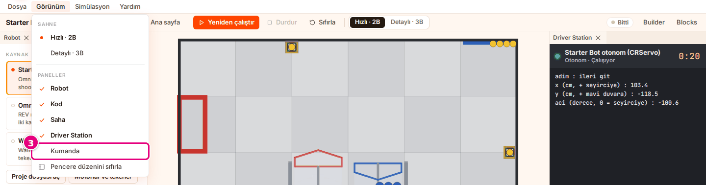
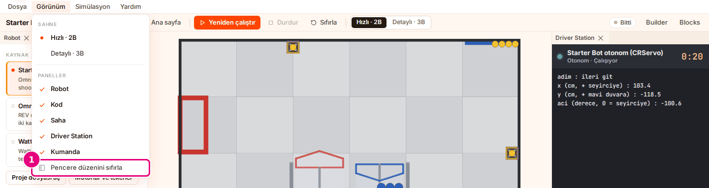

# Hoca hazırlığı

## Bu derste

Bu bir ders değil, Sim kullanım dokümanının Motor değerlerini ve kütleyi ayarla ile Panelleri düzenle sayfalarından üretilmiş araç tanıtımı. Sunum videoya dökülür, seslendirilen metin sayfa notlarındaki Söyle satırlarıdır. İzleyen kişi sonunda motor değerlerini ve kütleyi kendi verisiyle girer ve çalışma alanını düzenler.

## Dersten önce

- Canlı anlatılacaksa Sim'de Starter Bot seçili, **Motorlar ve tekerler** açık olsun.
- Ekran görüntüleri prod'dan alınmış örnek görsellerdir, aynı adla yenilenir.

## Zaman planı

Her sayfa yaklaşık yarım dakika, toplam 6 dakika. Ödev yok.

# Sayfalar

## Motorları ayarla, panelleri düzenle {kapak sure=0.5}

::: hoca
**Söyle:** "Bu sunumda robotun motor değerlerini kendi verimizle düzeltiyor, gerekirse robotun kütlesini giriyoruz. Sonra çalışma alanındaki panelleri taşıyor, kapatıp açıyor ve düzeni sıfırlıyoruz."
:::

## Robot ayrıntısını açıyoruz {sure=0.5}

- **Robot** bölümünde **Motorlar ve tekerler**
- **Sürüş**, **Ayak izi**, **Kütle**, **Link / eklem**
- Tekerlerin çapı ve türü
- **Motorları gizle** ile kapanır

::: hoca
**Söyle:** "Sim motorlarda yaklaşık değerler kullanıyor. Robot Sim'de gerçekteki kadar hızlı gitmiyorsa ya da enkoder sayıları tutmuyorsa Robot bölümünde Motorlar ve tekerler düğmesine basıp robot ayrıntısını açıyoruz. Üstte sürüş türü, ayak izi, kütle ve tekerler yazıyor."
:::

## Üç motor değeri {sure=0.5}

- Serbest devir, rpm, 1 ile 10000 arası
- Durma torku, N·m, 0,01 ile 100 arası
- Enkoder, tik/tur, 1 ile 100000 arası
- Redüktör çıkışında, 12 V için

::: hoca
**Söyle:** "Robottaki her motor modelinin üç kutusu var, serbest devir, durma torku ve enkoderin bir turdaki tik sayısı bulunuyor. Değerler redüktör çıkışında ve on iki volt için geçerli oluyor. Aralığın dışındaki ya da sayı olmayan bir değer işlenmiyor, kutu eski değere dönüyor."
:::

## Değeri değiştiriyoruz {sure=0.5}

- Kutuya yeni değer yazılır
- <kbd>Enter</kbd> ya da kutudan çıkış işler
- Yanında "senin değerin" etiketi
- <kbd>Esc</kbd> vazgeçer

::: hoca
**Söyle:** "Kutudaki değeri silip motorun veri sayfasındaki değeri yazıyor ve Enter'a basıyoruz. Motorun yanında senin değerin etiketi çıkıyor, çalışma alanındaysak otonom yeni değerle yeniden koşuyor. Bir motorun değeri o motor modelini kullanan her robotta geçerli oluyor."
:::

## Varsayılana dönüyoruz {sure=0.5}

- "senin değerin" etiketli motor
- **Varsayılana dön**
- Sim'in değerleri geri gelir

::: hoca
**Söyle:** "Kendi girdiğimiz değerlerden vazgeçmek için motorun altındaki Varsayılana dön düğmesine basıyoruz. Kutulara Sim'in değerleri geri geliyor ve senin değerin etiketi kalkıyor. Değer girdiğimiz her motor için bunu ayrı ayrı yapıyoruz."
:::

## Kütleyi giriyoruz {sure=0.5}

- Parça verisi eksik robotta kutu çıkar
- "tahmini" etiketi, başta 12 kg
- 0,2 ile 60 kg arası
- Parça verisi tamsa kütle değiştirilmez

::: hoca
**Söyle:** "Bazı robotların parça verisi eksik, bu robotlarda Kütle satırında tahmini etiketli bir kutu çıkıyor ve içinde on iki kilogram yazıyor. Robotu tartıp toplam kütleyi kilogram olarak yazıyor ve Enter'a basıyoruz. Parça verisi tam olan robotta kütle Builder parçalarından hesaplanıyor."
:::

## Paneli taşıyoruz {sure=0.5}

- Panel sekmesinden tutulur, örneğin **Kod**
- Başka grubun sekme satırına ya da kenarına sürüklenir
- Aradaki çizgi genişliği değiştirir
- Sahne taşınmaz, kapanmaz

::: hoca
**Söyle:** "Çalışma alanında bir panelin sekmesini tutup başka bir grubun sekme satırına ya da kenarına sürüklüyoruz. İki panel arasındaki çizgiyi sürükleyince genişlik değişiyor. Ortadaki sahne sabit, taşınmıyor ve kapanmıyor."
:::

## Paneli kapatıp açıyoruz {gorsel-alt sure=0.5}

- Sekmedeki **×** kapatır
- **Görünüm** menüsünde **Paneller**
- Kapalı panelin adı seçilir, açıklarda onay işareti
- Ana sayfada panel adları soluk

::: hoca
**Söyle:** "Sekmedeki çarpıya basınca panel kapanıyor. Yeniden açmak için Görünüm menüsünde Paneller başlığının altındaki adı seçiyoruz, açık panellerin yanında onay işareti duruyor. Ana sayfada bu adlar soluk, paneller çalışma alanında açılıyor."
:::

## Düzeni sıfırlıyoruz {gorsel-alt sure=0.5}

- **Görünüm** > **Pencere düzenini sıfırla**
- Paneller ilk yerlerine döner
- Kapalı paneller açılır
- Düzen bu tarayıcıda saklanır

::: hoca
**Söyle:** "Paneller dağılırsa Görünüm menüsünden Pencere düzenini sıfırla komutunu seçiyoruz. Bütün paneller ilk yerlerine dönüyor ve kapalı paneller açılıyor. Düzen bu tarayıcıda saklandığı için Sim'i yeniden açınca en son düzen geliyor."
:::

## Dar ekranda çalışıyoruz {sure=0.5}

- 900 piksel ya da daha dar pencere
- Sahne üstte, paneller altta sekme
- İlk açılışta **Driver Station** seçili
- Paneller taşınmaz

::: hoca
**Söyle:** "Pencere dokuz yüz piksel ya da daha darsa paneller sahnenin altında sekme oluyor ve taşınmıyor. Sekme satırında Driver Station, Kumanda, Robot, Kod ve Saha duruyor. Pencereyi genişletince taşınabilir düzen geri geliyor."
:::

## Özet {gorsel-sol sure=0.5}

- Motor değerleri ve kütle kendi verimizle
- Paneller taşındı, kapatılıp açıldı
- Düzen sıfırlandı, dar ekran görüldü

::: hoca
**Söyle:** "Bu sunumda motor değerlerini ve kütleyi kendi verimizle ayarladık, panelleri taşıdık, kapatıp açtık ve düzeni sıfırladık. Böylece Sim sunumlarının sonuna geldik, takıldığımız bir yerde kısayollar ve sorun giderme sunumuna dönebiliyoruz."
:::
